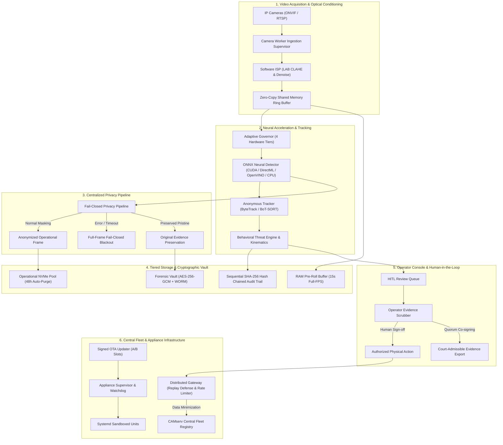
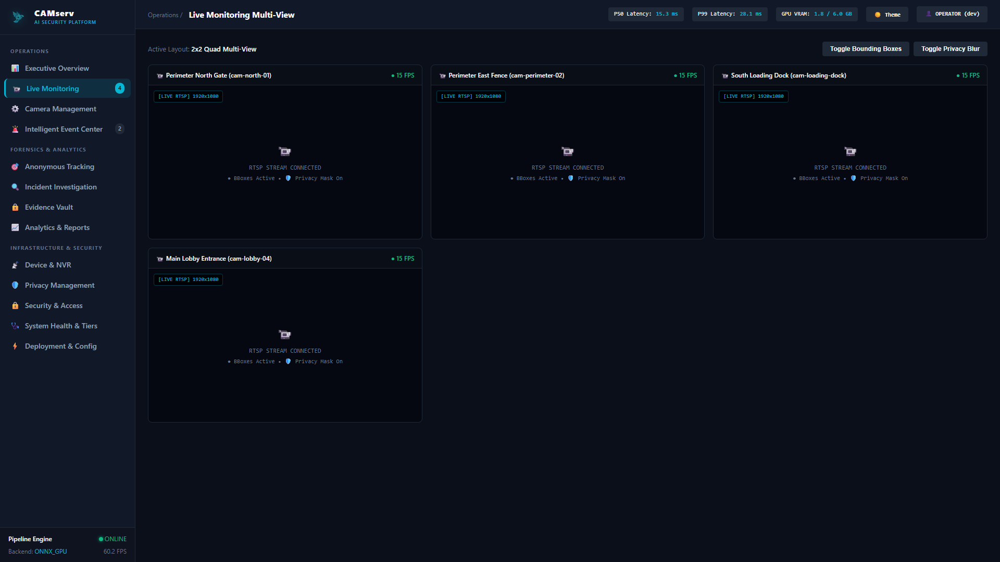
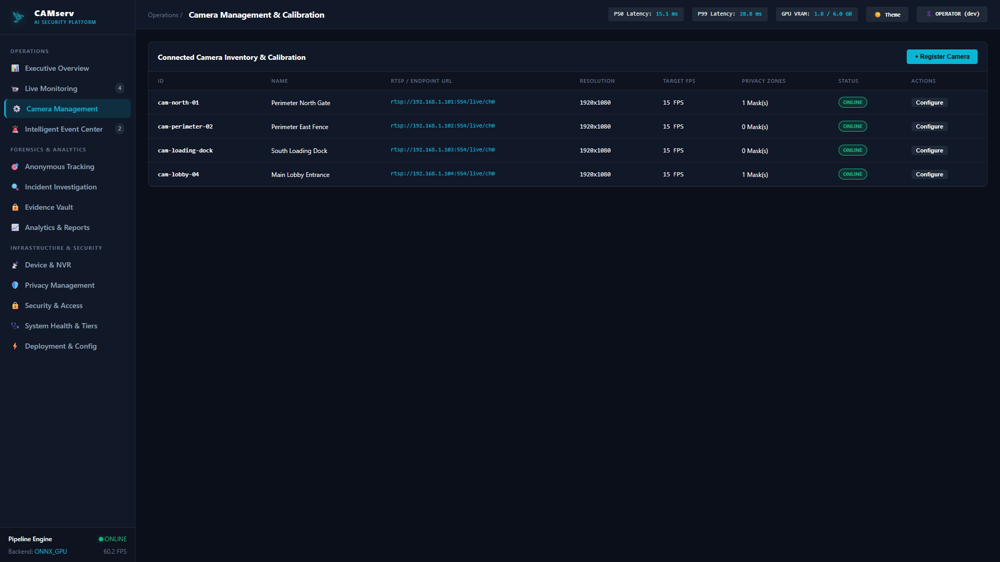
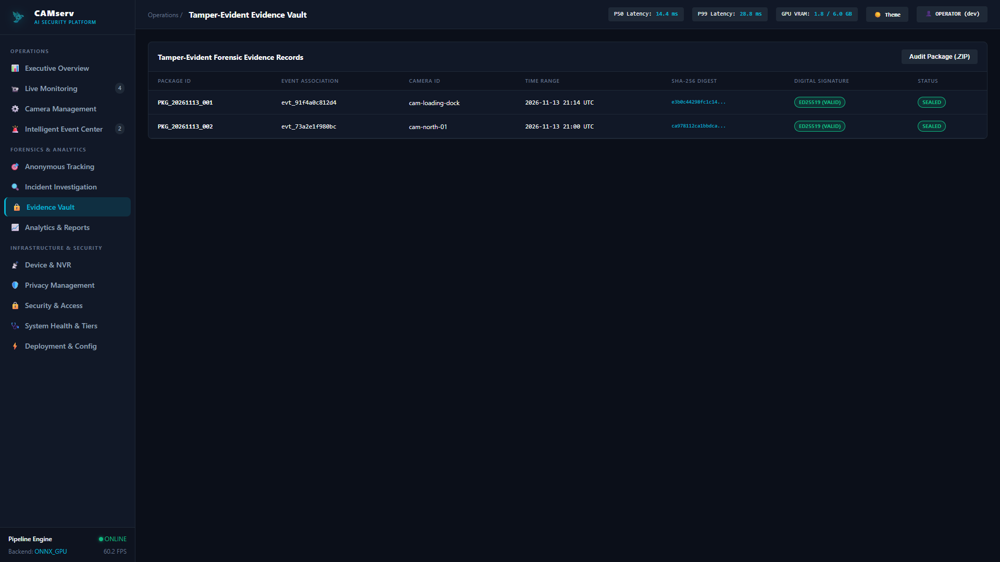
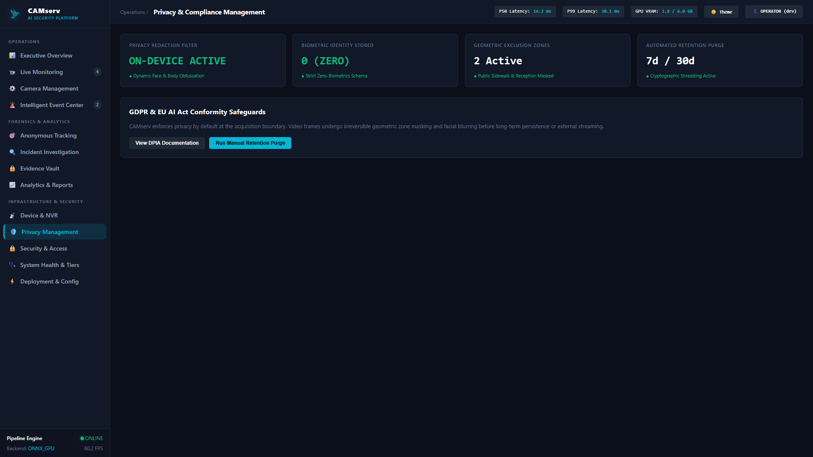
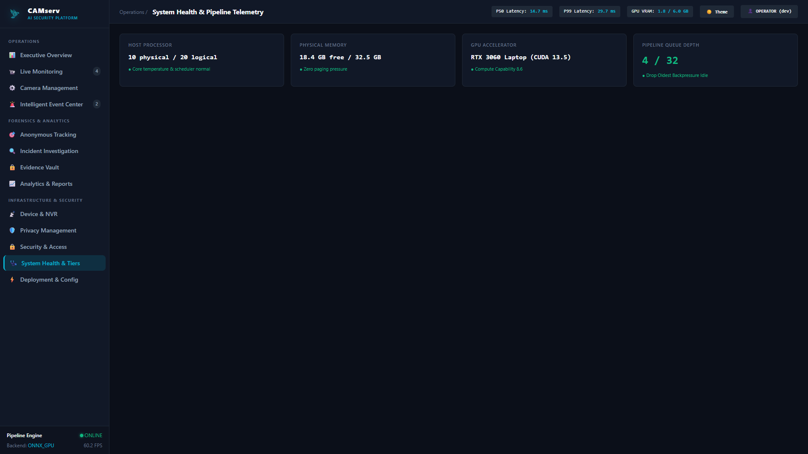

<p align="center">
  <a href="https://github.com/aboulouafaeit-sys/CAMserv.IT">
    
  </a>
</p>

<p align="center">
  
</p>

<p align="center">
  <strong>Privacy-First Video Intelligence &bull; Adaptive Edge Computing &bull; Verifiable Digital Evidence</strong><br>
  An open-architecture, on-premise security intelligence platform fusing real-time neural inference, anonymous multi-object tracking, fail-closed privacy protection, and court-admissible digital forensics.
</p>

<p align="center">
  <a href="#6-engineering-quality--verification"></a>
  <a href="#6-engineering-quality--verification"></a>
  <a href="docs/audit/PRODUCTION_READINESS_VERDICT.md"></a>
  <a href="https://www.python.org/"></a>
  <a href="docs/presentation/FEATURE_MATRIX.md"></a>
  <a href="docs/PRIVACY.md"></a>
  <a href="LICENSE"></a>
</p>

<p align="center">
  
</p>

<p align="center">
  <a href="#1-project-overview"><strong>Overview</strong></a> &bull;
  <a href="#2-system-architecture"><strong>Architecture</strong></a> &bull;
  <a href="#3-feature-matrix--operational-status"><strong>Features</strong></a> &bull;
  <a href="#4-visual-product-showcase"><strong>Screenshots</strong></a> &bull;
  <a href="#5-quickstart--installation"><strong>Quickstart</strong></a> &bull;
  <a href="#6-engineering-quality--verification"><strong>Verification</strong></a> &bull;
  <a href="#7-official-documentation-suite"><strong>Documentation</strong></a>
</p>

---

## 1. Project Overview

**CAMserv** is an open-architecture, sovereign security intelligence platform engineered for critical infrastructure, corporate facilities, smart municipal operations, and high-assurance security control centers.

Traditional Network Video Recorders (NVRs) passively record gigabytes of unindexed video, requiring tedious post-incident manual scrubbing while locking organizations into proprietary cloud silos. In contrast, CAMserv delivers an intelligent, privacy-first edge intelligence pipeline that:

1. **Operates 100% Ultra-Locally:** Eliminates external cloud dependencies, latency bottlenecks, and recurring SaaS subscriptions. Video decoding, neural acceleration, tracking, and cryptographic sealing run on-premise.
2. **Enforces Fail-Closed Privacy:** Automatically redacts human faces and vehicle license plates in real time. If any detection subsystem experiences failure or timeout, the pipeline immediately enters a **Fail-Closed Blackout State**, preventing unmasked visual leakage.
3. **Guarantees Non-Biometric Anonymity:** Multi-object tracking (ByteTrack and BoT-SORT) assigns transient, camera-scoped integer IDs. No facial recognition or biometric templates are ever calculated or stored.
4. **Maintains Epistemic Transparency:** Inferences are probabilistic hypotheses (`is_prediction: true`) with bounded confidence $p \in [0.0, 1.0]$, never asserted as established facts. High-severity events strictly mandate Human-in-the-Loop (HITL) operator review before physical responses can be dispatched.
5. **Seals Court-Admissible Digital Forensics:** Merges a 15-second RAM Pre-Roll buffer with incident video, encrypting packages via AES-256-GCM, sequential SHA-256 hash chains, and Ed25519 digital signatures. Raw visual evidence extraction is gated by Dual-Control Quorum authorization (GDPR Art. 25).

---

## 2. System Architecture

CAMserv is organized into 10 decoupled subsystems communicating via zero-copy shared memory and asynchronous message queues:



For comprehensive subsystem specifications, interface definitions, and data models, see the [Public Technical Architecture Overview](docs/presentation/ARCHITECTURE_OVERVIEW.md).

---

## 3. Feature Matrix & Operational Status

To maintain rigorous technical honesty, all capabilities are classified into verifiable implementation states:

| Subsystem Domain | Capability Description | Verified State | Implementation / Reference |
| :--- | :--- | :---: | :--- |
| **Ingestion & Optical** | RTSP / ONVIF stream worker isolation & shared memory buffers | **Implemented & Tested** | `camserv.acquisition.ingestion_manager` |
| | Camera stream fingerprinting & LAB CLAHE low-light enhancement | **Implemented & Tested** | `camserv.acquisition.isp`, `enhancement.py` |
| | Physical ONVIF hardware matrix across diverse camera vendors | *Implemented (Software Tested)* | Tested via synthetic RTSP streams |
| **Inference & Vision** | ONNX acceleration (CUDA, DirectML, OpenVINO, CPU) | **Implemented & Tested** | `camserv.inference.engine` |
| | Instance segmentation polygon contours & ground contact ellipses | **Implemented & Tested** | `camserv.inference.hud_renderer` |
| | Anonymous multi-object tracking (ByteTrack / BoT-SORT) | **Implemented & Tested** | `camserv.tracking` |
| | Universal Hardware Adaptation (4 Tiers with load shedding) | **Implemented & Tested** | `camserv.platform.appliance` |
| | Bare-metal NVDEC / V4L2 ASIC video decoders | *Implemented (Software Tested)* | Hardware abstraction validated in software |
| **Privacy Safeguards** | Centralized Fail-Closed Privacy Pipeline (instant blackout) | **Implemented & Tested** | `camserv.inference.privacy_pipeline` |
| | Production profile safety lock (cannot disable privacy) | **Implemented & Tested** | `camserv.inference.privacy_pipeline` |
| | Dual-Control Quorum for raw unmasked extraction (GDPR Art. 25) | **Implemented & Tested** | `camserv.security.rbac` |
| | Non-biometric anonymity (zero facial recognition / Re-ID) | **Implemented & Tested** | Architecture Invariant |
| **Threat Intelligence** | Zero-API deterministic kinematics & pose threat scoring | **Implemented & Tested** | `camserv.events.threat_engine` |
| | Epistemic prediction flags (`is_prediction: true`, bounded conf) | **Implemented & Tested** | `camserv.events.detector` |
| | Human-in-the-Loop 6-stage review pipeline (no unreviewed action) | **Implemented & Tested** | `camserv.web.operator_workflow` |
| | Bilingual deterministic incident narratives (Arabic & English) | **Implemented & Tested** | `camserv.events.behavioral_engine` |
| **Storage & Forensics** | Multi-tiered storage: 15s RAM pre-roll, NVMe, encrypted vault | **Implemented & Tested** | `camserv.storage.tiered_storage` |
| | Automated 48h retention purging & Judicial Hold locking | **Implemented & Tested** | `camserv.storage.tiered_storage` |
| | AES-256-GCM chunked sealing & Ed25519 digital signatures | **Implemented & Tested** | `camserv.storage.adaptive_vault` |
| | Tamper-evident sequential SHA-256 hash chained audit ledger | **Implemented & Tested** | `camserv.security.audit_trail` |
| **Central Management** | Central Device Registry with Ed25519 challenge-response handshake | **Implemented & Tested** | `camserv.central.registry` |
| | Server-side multi-tenancy & site authorization boundaries | **Implemented & Tested** | `camserv.security.tenancy` |
| | Distributed Gateway (nonce replay defense, rate limiter) | **Implemented & Tested** | `camserv.central.comm` |
| | WAN Data Minimization (zero raw video over WAN) | **Implemented & Tested** | `camserv.central.comm` |
| **Appliance OS** | Service supervisor with watchdog deadman & restart circuit breaker | **Implemented & Tested** | `camserv.deploy.supervisor` |
| | Signed OTA update manager with Zip Slip containment & rollback | **Implemented & Tested** | `camserv.deploy.updater` |
| | Prometheus `/metrics` exporter & multi-subsystem health probes | **Implemented & Tested** | `camserv.platform.observability` |
| | Automated CycloneDX 1.5 JSON SBOM & licensing auditor | **Implemented & Tested** | `scripts/generate_sbom.py` |
| | Appliance OS partitioning specification (A/B slots, overlayfs) | **Designed** | `deploy/appliance-os/partitioning.yaml` |
| | Systemd service unit templates with security sandboxing | **Designed** | `deploy/systemd/` |
| | Physical bare-metal appliance flash & boot on Profile A/B | **Planned** | Stage-gate hardware prototyping target |
| | Continuous 72-hour physical burn-in in thermal chamber | **Planned** | Stage-gate hardware burn-in target |

For detailed capability specifications and test references, see the [Comprehensive Feature Matrix](docs/presentation/FEATURE_MATRIX.md).

---

## 4. Visual Product Showcase

All screenshots below were **authentically captured directly from the active CAMserv Web Console** running at `http://127.0.0.1:8000/` at Full HD ($1920 \times 1080$) resolution with synthetic demonstration fixtures:

### Group A: Command, Live Surveillance & Ingestion Management

<p align="center">
  <a href="docs/screenshots/01-executive-overview.png">
    
  </a>
  <a href="docs/screenshots/02-live-monitoring.png">
    
  </a>
</p>
<p align="center">
  <em>Left: <strong>01. Executive Overview</strong> — Fleet health metrics, active camera feeds, pending HITL review queue, and real-time event ticker.<br>
  Right: <strong>02. Live Monitoring Wall</strong> — Low-latency 4-camera video matrix with neural overlays, dynamic privacy mosaic blur, and stream FPS telemetry.</em>
</p>

<p align="center">
  <a href="docs/screenshots/03-camera-management.png">
    
  </a>
</p>
<p align="center">
  <em><strong>03. Camera Management & Calibration</strong> — RTSP/ONVIF inventory with interactive polygon geometric privacy mask editor and codec profiling.</em>
</p>

### Group B: Threat Intelligence, Tracking & Digital Forensics

<p align="center">
  <a href="docs/screenshots/04-intelligent-event-center.png">
    
  </a>
  <a href="docs/screenshots/05-anonymous-tracking.png">
    
  </a>
</p>
<p align="center">
  <em>Left: <strong>04. Intelligent Event Center</strong> — Threat severity stream, epistemic prediction badges, observation graphs, and operator sign-off modals.<br>
  Right: <strong>05. Anonymous Tracking</strong> — Non-biometric transient IDs, kinematic velocity vectors, and MOTA / MOTP accuracy metrics.</em>
</p>

<p align="center">
  <a href="docs/screenshots/06-incident-investigation.png">
    
  </a>
  <a href="docs/screenshots/07-evidence-vault.png">
    
  </a>
</p>
<p align="center">
  <em>Left: <strong>06. Incident Investigation</strong> — Multi-camera synchronized temporal timeline scrubber and cross-camera event correlation.<br>
  Right: <strong>07. Evidence Vault</strong> — Sealed forensic packages, one-click SHA-256 hash chain audit verification, and Ed25519 digital signatures.</em>
</p>

### Group C: Compliance, Governance & Daytime Tactical Mode

<p align="center">
  <a href="docs/screenshots/10-privacy-management.png">
    
  </a>
  <a href="docs/screenshots/11-security-access-control.png">
    
  </a>
</p>
<p align="center">
  <em>Left: <strong>10. Privacy & GDPR Compliance</strong> — Real-time fail-closed redaction policy manager, erasure clocks, and EU AI Act alignment.<br>
  Right: <strong>11. Security & RBAC</strong> — 6-tier Role-Based Access Control matrix, active sessions, and tamper-evident audit ledger.</em>
</p>

<p align="center">
  <a href="docs/screenshots/12-system-health-hardware-tiers.png">
    
  </a>
  <a href="docs/screenshots/14-dual-theme-light-mode.png">
    
  </a>
</p>
<p align="center">
  <em>Left: <strong>12. System Health Diagnostics</strong> — Hardware diagnostics, assigned Universal Hardware Tier, and DDSketch P50/P95/P99 latency.<br>
  Right: <strong>14. Tactical Light Mode</strong> — High-contrast daytime aesthetic engineered for high-ambient-light security dispatch rooms.</em>
</p>

> For uncompressed previews of all 14 screens, see the [Screenshot Showcase & Capture Report](docs/presentation/SCREENSHOT_CAPTURE_REPORT.md).

---

## 5. Quickstart & Installation

### 5.1 System Prerequisites
* **Operating System:** Linux (Debian 12 / Ubuntu 22.04+ recommended) or Windows 10/11 (64-bit).
* **Python Runtime:** Python 3.11, 3.12, 3.13, or 3.14.
* **Hardware Acceleration (Optional):** NVIDIA GPU with CUDA 12.x/13.x, Intel NPU with OpenVINO, or Windows DirectML.

### 5.2 Local Developer Installation
```bash
# Clone the official repository
git clone https://github.com/aboulouafaeit-sys/CAMserv.IT.git
cd CAMserv.IT

# Create and activate virtual environment
python -m venv .venv
source .venv/bin/activate  # On Windows: .venv\Scripts\activate

# Install CAMserv in editable mode with development dependencies
pip install --upgrade pip setuptools wheel
pip install -e ".[dev,testing]"
```

### 5.3 Command-Line Interface (CLI)
```bash
# 1. Run Host Hardware Diagnostic Probe & Tier Assignment
python -m camserv.main detect-hw

# 2. Verify Cryptographic Audit Log Hash Chain
python -m camserv.main audit-verify

# 3. Scan Local Subnet for ONVIF Compliant Cameras
python -m camserv.main nvr-scan

# 4. Verify Cryptographic Evidence Vault Package
python -m camserv.main verify-evidence --vault-dir ./data/evidence_vault

# 5. Launch the CAMserv Server & Web Console
python -m camserv.main serve --host 127.0.0.1 --port 8000
```

Once launched, access the interactive Web Console directly at `http://127.0.0.1:8000/`.

---

## 6. Engineering Quality & Verification

CAMserv enforces strict defense-in-depth engineering standards. The platform is continuously verified via automated unit, integration, and security regression test suites:

```bash
# Execute the complete automated test suite
python -m pytest tests/ -v --tb=short
```

```text
============================= test session starts =============================
platform win32 -- Python 3.14.8, pytest-9.2.0, pluggy-1.7.0
collected 245 items

tests/scenarios/test_integration.py .....                                [  2%]
tests/test_adaptive_manager.py ...                                       [  3%]
tests/test_appliance_hardware.py .....                                   [  5%]
tests/test_audit_isolation.py ..                                         [  6%]
tests/test_audit_vulnerabilities.py ........                             [  9%]
tests/test_central_registry.py .....                                     [ 11%]
tests/test_commercial_editions.py ....                                   [ 13%]
tests/test_deploy_environment.py .....                                   [ 15%]
tests/test_distributed_comm.py .....                                     [ 17%]
tests/test_enterprise_security.py .....                                  [ 19%]
tests/test_operator_workflow.py ....                                     [ 21%]
tests/test_privacy_pipeline.py ...                                       [ 22%]
tests/test_privacy_remediation.py .....                                  [ 24%]
tests/test_tiered_storage.py ....                                        [ 26%]
tests/test_updater.py .....                                              [ 28%]
...
======================= 245 passed, 1 warning in 10.82s =======================
```

### Verification Highlights
* **Test Suite Status:** **245 Passing Tests across 47 Test Modules (100% Pass Rate)**.
* **Independent Security Audit:** 10 vulnerabilities discovered and remediated with dedicated regression tests ([Security Findings Register](docs/audit/SECURITY_FINDINGS_REGISTER.md)).
* **Audit Verdict:** Formally accepted under [`PRODUCTION_READY_WITH_LIMITATIONS`](docs/audit/PRODUCTION_READINESS_VERDICT.md).
* **Audit Log Isolation:** Verified that production log `logs/audit.jsonl` remains completely isolated across all test executions (0 bytes written).
* **Memory Stability:** Soak test harness confirms zero memory drift ($0.001\%$ across 1,000 cycles) following ring buffer warmup.

---

## 7. Official Documentation Suite

The complete engineering, design, and operational documentation is organized below:

| Documentation Domain | Key Architectural & Operational References |
| :--- | :--- |
| **Product & Brand** | [Project Overview](docs/presentation/PROJECT_OVERVIEW.md) &bull; [Feature Matrix](docs/presentation/FEATURE_MATRIX.md) &bull; [Brand Guidelines](docs/brand/BRAND_GUIDELINES.md) &bull; [Brand Asset Registry](docs/presentation/BRAND_ASSET_REGISTRY.md) &bull; [Screenshot Showcase](docs/presentation/SCREENSHOT_CAPTURE_REPORT.md) |
| **Architecture** | [Public Technical Architecture](docs/presentation/ARCHITECTURE_OVERVIEW.md) &bull; [Architecture Decision Records (ADRs)](docs/adr/) &bull; [Master Architecture Spec](docs/ADVANCED_ARCHITECTURE_ULTRA_LOCAL.md) &bull; [Subsystem Architecture](docs/ARCHITECTURE.md) |
| **Security & Privacy** | [Security Policy & Disclosure](SECURITY.md) &bull; [Security Findings Register](docs/audit/SECURITY_FINDINGS_REGISTER.md) &bull; [Privacy Safeguards & GDPR](docs/PRIVACY.md) &bull; [STRIDE Threat Model](docs/SECURITY.md) &bull; [Audit Baseline](docs/audit/FINAL_AUDIT_BASELINE.md) |
| **Appliance & Deployment** | [Appliance Hardware Design](docs/PHASE_3_APPLIANCE_HARDWARE_DESIGN.md) &bull; [Appliance OS & Systemd](docs/PHASE_3_OS_AND_DEPLOYMENT_DESIGN.md) &bull; [Signed Updates & Rollback](docs/PHASE_3_UPDATE_AND_RECOVERY_DESIGN.md) &bull; [Installation Guide](docs/INSTALLATION_GUIDE.md) |
| **Central & Enterprise** | [Central Fleet Architecture](docs/PHASE_3_CENTRAL_MANAGEMENT_ARCHITECTURE.md) &bull; [Distributed Security Design](docs/PHASE_3_DISTRIBUTED_SECURITY_DESIGN.md) &bull; [Enterprise Multi-Tenancy & RBAC](docs/PHASE_3_ENTERPRISE_SECURITY_DESIGN.md) |
| **Governance & Roadmap** | [Roadmap & Vision](docs/presentation/ROADMAP.md) &bull; [Known Limitations](docs/presentation/KNOWN_LIMITATIONS.md) &bull; [Release Readiness](docs/presentation/RELEASE_READINESS.md) &bull; [Contributor Guide](docs/presentation/CONTRIBUTOR_GUIDE.md) |

---

## 8. License

CAMserv is distributed under the terms of the [MIT License](LICENSE).  
Copyright &copy; 2026 CAMserv Contributors.
