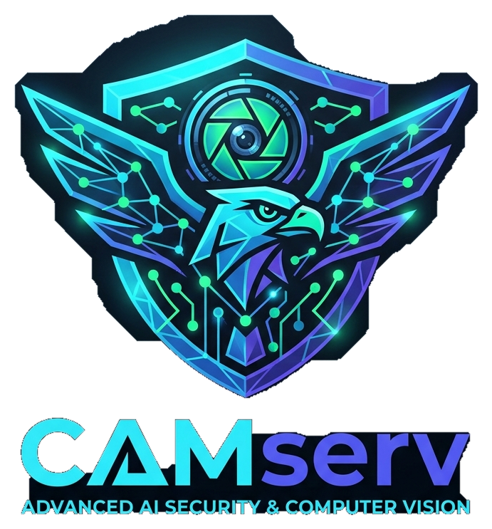
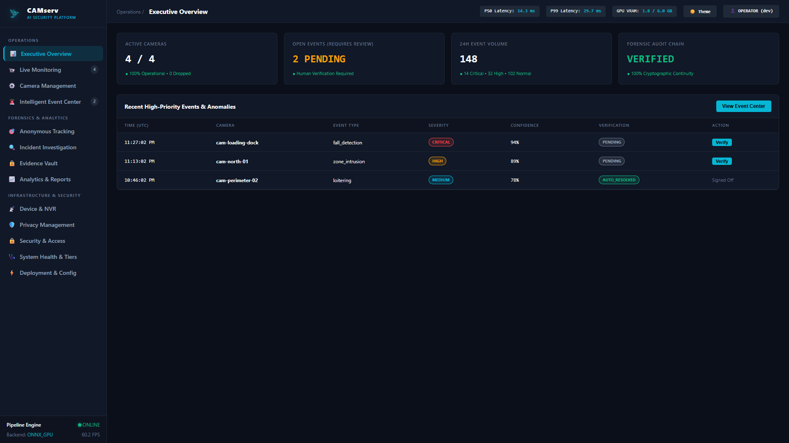
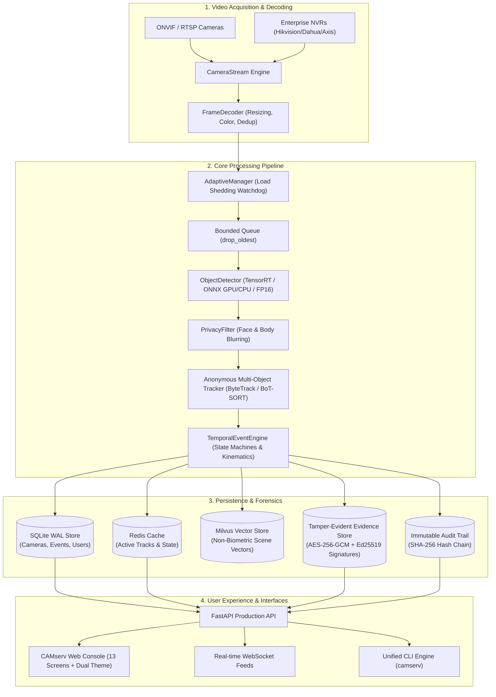

<p align="center">
  
</p>

<p align="center">
  
</p>

<p align="center">
  <strong>Advanced, Modular, Privacy-Preserving Security Intelligence Platform</strong><br>
  Real-time video analytics, anonymous multi-object tracking, on-device AI inference, and tamper-evident digital forensics.
</p>

<p align="center">
  <a href="#test-results"></a>
  <a href="https://www.python.org/"></a>
  <a href="docs/ADVANCED_ARCHITECTURE_ULTRA_LOCAL.md"></a>
  <a href="docs/HARDWARE_COMPATIBILITY.md"></a>
  <a href="docs/PRIVACY.md"></a>
  <a href="LICENSE"></a>
</p>

---

## 1. Executive Summary

**CAMserv** is an industrial-grade security intelligence platform engineered for critical infrastructure, corporate facilities, smart municipal monitoring, and high-assurance operations. It delivers a privacy-first video surveillance architecture that fuses high-throughput RTSP/ONVIF ingestion, on-device neural acceleration, anonymous multi-object tracking, and explainable temporal reasoning into a coherent, production-ready product.

### Core Architectural Pillars
* **100% Ultra-Local Sovereignty:** Zero-API architecture eliminating external cloud fees and latency bottlenecks; all decoding, inference, tracking, narrative generation, and vault sealing run on-premise.
* **Cinematic Visual HUD & Contouring:** Rigid bounding boxes are replaced with precise instance segmentation polygon contours (`YOLOv8/v11-seg`), 3D Ground Elliptical Rings, 17-keypoint skeletal pose stick figures, and floating glassmorphic telemetry cards.
* **Camera-Adaptive Software ISP:** Autonomous 5-second camera stream fingerprinting into 3 operational tiers, with real-time LAB CLAHE low-light luminance equalization and ROI-based bilateral filtering.
* **Zero-API Threat Intelligence (Arabic & English):** Multi-factor kinematic and joint pose scoring with instantaneous deterministic security narrative reporting without LLM compute overhead.
* **Smart Adaptive Retention Vault:** 15-second continuous RAM Pre-Roll buffer combined with high-bitrate incident triggers, structured numerical metadata indexing, AES-256-GCM chunked encryption, SHA-256 Merkle hash chaining, and software WORM retention.
* **Epistemic Transparency:** Every algorithmic detection is explicitly marked (`is_prediction: bool = True`) with bounded confidence $p \in [0.0, 1.0]$. Inferences are never treated as facts.
* **Strict Non-Biometric Anonymity:** Multi-object tracking (ByteTrack and BoT-SORT) enforces transient anonymous integer IDs. No facial recognition or biometric templates are ever constructed or stored.
* **Mandatory Human-in-the-Loop (HITL):** High-severity events (`severity >= HIGH`) automatically require authorized operator review and sign-off before consequential physical or automated actions are dispatched.
* **Universal Hardware Adaptation:** Automatic boot-time hardware inspection assigning the system into one of 4 operational tiers (from low-end edge CPUs up to enterprise multi-GPU clusters) with real-time pressure shedding.

---

## 2. Interactive Enterprise Web Console

CAMserv includes an embedded, high-performance web console served directly at `http://localhost:8000/`.

> **Note:** For full-resolution uncompressed previews of all 14 screens, see the [docs/SCREENSHOT_CATALOG.md](docs/SCREENSHOT_CATALOG.md).

### Visual Showcase (Captured from Active Web Application)

#### 01. Executive Overview

*Fleet health metrics, active camera feeds, pending human review queue, incident velocity, and real-time event feed.*

#### 02. Live Monitoring Multi-View

*Low-latency multi-stream video matrix with neural bounding boxes, dynamic privacy mosaic blur, and stream FPS telemetry.*

#### 04. Intelligent Event Center

*Event severity stream, epistemic prediction badges, multi-frame observation graphs, and operator sign-off workflow.*

#### 07. Tamper-Evident Evidence Vault

*Cryptographically sealed evidentiary archive with one-click SHA-256 hash chain verification and Ed25519 audit proof.*

#### 12. System Health & Hardware Tiers

*Hardware resource monitors, assigned Universal Hardware Tier, and DDSketch P50/P95/P99 latency distribution.*

#### 14. Dual Theme (Light Mode)

*High-contrast daytime aesthetic engineered for high-ambient-light security dispatch rooms and executive briefing.*

---

### The 13 Operational Product Screens

| Screen # | Operational View | Purpose & Technical Scope |
| :---: | :--- | :--- |
| **01** | **Executive Overview** | Real-time KPI summaries, active camera statuses, pending review queue, and 24h event volume. |
| **02** | **Live Monitoring** | Quad/multi-view video wall with real-time bounding box and dynamic privacy-mask overlays. |
| **03** | **Camera Management** | RTSP/ONVIF camera inventory with interactive polygon geometric privacy mask editor. |
| **04** | **Intelligent Event Center** | Filterable security event stream with multi-frame observation graphs and operator sign-off workflow. |
| **05** | **Anonymous Tracking** | Real-time spatial tracking visualization, kinematic velocities, MOTA/MOTP accuracy metrics. |
| **06** | **Incident Investigation** | Multi-camera synchronized temporal timeline reconstruction and cross-camera correlation. |
| **07** | **Evidence Vault** | Tamper-evident evidence storage with one-click cryptographic hash chain auditing. |
| **08** | **Analytics & Reports** | Crowd density trend analysis, vehicle classification breakdowns, and automated GDPR purge logs. |
| **09** | **Device & NVR Integration** | Subnet ONVIF WS-Discovery scanner and NVR stream stability benchmark utility. |
| **10** | **Privacy Management** | Privacy zone configuration, automatic redaction policies, and GDPR data retention schedules. |
| **11** | **Security & Access Control** | User RBAC management (`ADMIN`, `OPERATOR`, `VIEWER`, `AUDITOR`) and immutable audit log viewer. |
| **12** | **System Health** | Host CPU/RAM/GPU diagnostics, DDSketch P50/P95/P99 latency histograms, queue fill ratios. |
| **13** | **Deployment & Config** | Live platform configuration tuning with schema validation and automated backup triggers. |

---

## 3. High-Level System Architecture



---

## 4. Quickstart & Installation

Detailed instructions are available in [docs/INSTALLATION_GUIDE.md](docs/INSTALLATION_GUIDE.md).

### 4.1 Prerequisites
* Python 3.11, 3.12, 3.13, or 3.14
* (Recommended) NVIDIA GPU with CUDA 12.x or 13.x

### 4.2 Installation
```bash
# Clone the repository
git clone git@github.com:aboulouafaeit-sys/CAMserv.IT.git
cd CAMserv.IT

# Install in editable mode
pip install -e .
```

### 4.3 Command-Line Interface (CLI)
```bash
# 1. Run Host Hardware Diagnostic Probe & Tier Assignment
python -m camserv.main detect-hw

# 2. Verify Cryptographic Audit Log Hash Chain
python -m camserv.main audit-verify

# 3. Scan Local Subnet for ONVIF Compliant Cameras
python -m camserv.main nvr-scan

# 4. Verify Cryptographic Evidence Vault Package
python -m camserv.main verify-evidence --vault-dir ./evidence

# 5. Launch the CAMserv Server & Web Console
python -m camserv.main serve --host 127.0.0.1 --port 8000
```

Access the interactive web console at `http://127.0.0.1:8000/`.

---

## 5. Verification & Test Suite

The platform includes 136 comprehensive automated test cases across 18 test modules:

```bash
python -m pytest tests/ -v
```

```text
tests/scenarios/test_integration.py .....                                [  3%]
tests/test_adaptive_manager.py ...                                       [  5%]
tests/test_adaptive_vault.py ....                                        [  8%]
tests/test_adversarial.py .............                                  [ 18%]
tests/test_api.py .........                                              [ 25%]
tests/test_camera_isp.py ....                                            [ 27%]
tests/test_config.py ......                                              [ 32%]
tests/test_events.py ...........                                         [ 40%]
tests/test_forensics.py ....                                             [ 43%]
tests/test_hud_segmentation.py ......                                    [ 47%]
tests/test_inference.py ..........                                       [ 55%]
tests/test_main_cli.py ....                                              [ 58%]
tests/test_onvif.py ..                                                   [ 59%]
tests/test_pipeline.py ........                                          [ 65%]
tests/test_platform_hardware.py ..                                       [ 66%]
tests/test_security.py .............                                     [ 76%]
tests/test_sqlite_store.py ...                                           [ 78%]
tests/test_storage.py ........                                           [ 84%]
tests/test_temporal_events.py ..                                         [ 86%]
tests/test_threat_engine.py ....                                         [ 88%]
tests/test_tracking.py ............                                      [ 97%]
tests/test_web_console.py ...                                            [100%]
======================= 136 passed in 8.29s =======================
```

---

## 6. Official Documentation Suite

* [ADVANCED_ARCHITECTURE_ULTRA_LOCAL.md](docs/ADVANCED_ARCHITECTURE_ULTRA_LOCAL.md) — Master Ultra-Local Edition specification: Cinematic HUD, Camera ISP, Zero-API Threat Engine, & Cryptographic Vault.
* [USER_GUIDE.md](docs/USER_GUIDE.md) — Comprehensive operator handbook, screen guide, and shortcuts.
* [INSTALLATION_GUIDE.md](docs/INSTALLATION_GUIDE.md) — Production setup, systemd service, and environment configuration.
* [HARDWARE_COMPATIBILITY.md](docs/HARDWARE_COMPATIBILITY.md) — The 4 Universal Hardware Adaptation Tiers and load shedding mechanics.
* [SCREENSHOT_CATALOG.md](docs/SCREENSHOT_CATALOG.md) — Authentic $1920 \times 1080$ screenshots of all 14 screens.
* [BRAND_ASSET_MIGRATION_REPORT.md](docs/BRAND_ASSET_MIGRATION_REPORT.md) — Generative model audit, asset catalog, and migration history.
* [BRAND_GUIDELINES.md](docs/BRAND_GUIDELINES.md) — Brand tokens, typography, clear space, and asset inventory.
* [ARCHITECTURE.md](docs/ARCHITECTURE.md) — Subsystem interfaces, performance budgets, and queue mechanics.
* [SECURITY.md](docs/SECURITY.md) — STRIDE threat modeling, key management, and cryptographic protocols.
* [PRIVACY.md](docs/PRIVACY.md) — GDPR compliance, EU AI Act conformity assessment, and DPIA templates.
* [NVR_COMPATIBILITY_MATRIX.md](docs/NVR_COMPATIBILITY_MATRIX.md) — ONVIF/RTSP enterprise NVR topology validation.
* [API.md](docs/API.md) — Complete REST and WebSocket API specification.
* [DEPLOYMENT.md](docs/DEPLOYMENT.md) — Production Docker Compose, Nginx TLS 1.3, and clustering guide.
* [Architecture Decision Records (ADRs)](docs/adr/) — Formal record of architectural decisions.

---

## 7. License

CAMserv is distributed under the [MIT License](LICENSE).
