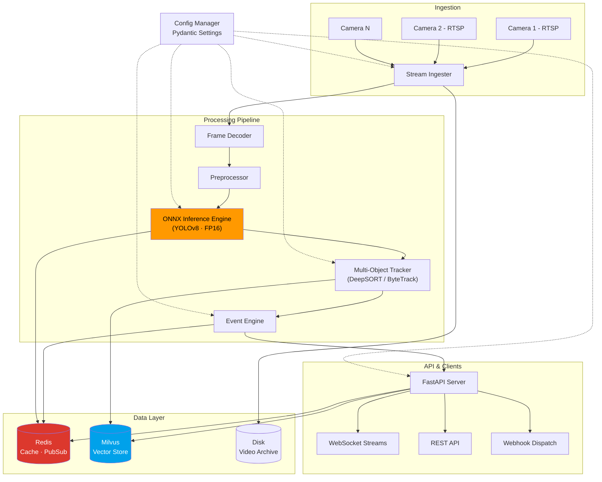

# CAMserv — Advanced Security Intelligence Platform

[](LICENSE)
[](https://www.python.org/)

> Real-time, privacy-preserving video analytics with GPU-accelerated AI inference, multi-object tracking, and intelligent event detection.

---

## Overview

**CAMserv** is a modular security intelligence platform that transforms standard IP camera feeds into actionable security insights. It combines state-of-the-art object detection (YOLOv8 via ONNX Runtime), multi-object tracking (DeepSORT / ByteTrack), and a rule-based event engine — all running on-premise with full control over your data.

### Key Principles

- **Privacy by Design** — GDPR & EU AI Act compliant. Face blurring, privacy zones, automatic data purging, and right-to-erasure built in.
- **Human-in-the-Loop** — All AI predictions carry confidence scores and are clearly labeled as predictions. Consequential decisions (identity matches, high-severity alerts) are queued for human review before action.
- **On-Premise First** — Your video never leaves your network. All inference runs locally on your GPU.
- **Epistemic Humility** — Deep neural network outputs are probabilistic inferences, never treated as absolute ground truth.

---

## Architecture



---

## Features

### 🎥 Camera Management
- Multi-camera RTSP/HTTP stream ingestion with auto-reconnect
- Configurable FPS, resolution, and codec per camera
- Ring-buffer frame management with back-pressure control

### 🧠 AI Inference
- YOLOv8 object detection via ONNX Runtime GPU (FP16)
- Batched inference for multi-camera efficiency
- Configurable confidence and NMS thresholds
- **All detections are predictions with associated confidence scores**

### 🔍 Multi-Object Tracking
- DeepSORT, ByteTrack, and BoTSORT algorithms
- Kalman filter state estimation with configurable noise
- Re-identification via vector similarity search (Milvus)
- Anonymous integer track identifiers only — zero PII linkage

### ⚡ Event Engine
- Rule-based event detection: intrusion, loitering, crowd density, tripwire
- Configurable severity levels and cooldown periods
- Webhook notifications and WebSocket real-time streaming
- **Human-in-the-loop review for consequential events**

### 🔒 Privacy & Compliance
- GDPR: data subject access/erasure, retention policies, audit logging
- EU AI Act: risk classification, transparency, human oversight
- Real-time face blurring and configurable privacy zones
- Automatic data purging with configurable retention

### 🛡️ Security
- JWT authentication (HS256/RS256) with refresh tokens
- Role-based access control (admin, operator, viewer, auditor)
- TLS 1.3, tamper-evident audit logs (HMAC chain)
- Rate limiting and CORS policy

### 📊 Analytics & API
- RESTful API with OpenAPI documentation
- WebSocket streams for live video and events
- Zone-based analytics and occupancy tracking
- Prometheus metrics endpoint

---

## Quick Start

### Prerequisites

- Python 3.11+
- NVIDIA GPU with CUDA 12.x / 13.x (recommended: RTX 3060 or better)
- Redis 7+
- Milvus 2.3+
- Docker & Docker Compose (for containerized deployment)

### Installation

```bash
# Clone the repository
git clone https://github.com/camserv/camserv.git
cd camserv

# Create virtual environment
python -m venv .venv
.venv\Scripts\activate  # Windows
# source .venv/bin/activate  # Linux/macOS

# Install with all extras
pip install -e ".[all,dev]"

# Set required environment variable
set CAMSERV_SECURITY__JWT__SECRET_KEY=your-secret-key-at-least-32-characters-long

# Run the platform
camserv
```

### Docker Compose (Recommended)

```bash
# Start all services (API, Redis, Milvus, Nginx)
docker compose up -d

# View logs
docker compose logs -f camserv-api
```

See [docs/DEPLOYMENT.md](docs/DEPLOYMENT.md) for full deployment instructions.

### Configuration

CAMserv uses environment variables with the `CAMSERV_` prefix:

```bash
# Core
CAMSERV_ENVIRONMENT=production
CAMSERV_LOG_LEVEL=INFO
CAMSERV_HOST=0.0.0.0
CAMSERV_PORT=8000

# Inference
CAMSERV_INFERENCE__DEVICE=cuda
CAMSERV_INFERENCE__MODEL_PATH=models/yolov8n.onnx
CAMSERV_INFERENCE__CONFIDENCE_THRESHOLD=0.45

# Security
CAMSERV_SECURITY__JWT__SECRET_KEY=<your-secret>
CAMSERV_SECURITY__TLS_ENABLED=true

# Storage
CAMSERV_STORAGE__REDIS__HOST=redis
CAMSERV_STORAGE__MILVUS__HOST=milvus
```

See [src/camserv/config/settings.py](src/camserv/config/settings.py) for the full schema.

---

## Verification & Testing

CAMserv comes with a rigorous test suite covering unit, integration, and adversarial conditions:

```bash
# Run all tests with coverage report
pytest --cov=camserv --cov-report=term-missing

# Run adversarial robustness test suite
pytest -m adversarial

# Run integration pipeline scenarios
pytest tests/scenarios/
```

### Performance Benchmarking

To benchmark the inference and tracking pipeline against your local GPU:

```bash
python -m camserv.inference.benchmarks --streams 4 --batch-size 4 --iterations 500
```

---

## Documentation

| Document | Description |
|----------|-------------|
| [Architecture](docs/ARCHITECTURE.md) | System design, data flow, component interfaces, performance budgets |
| [Security](docs/SECURITY.md) | Threat model, encryption, authentication, RBAC, audit logging |
| [Privacy](docs/PRIVACY.md) | GDPR, EU AI Act, data minimization, anonymization pipeline |
| [API Reference](docs/API.md) | REST endpoints, WebSocket streams, schemas, authentication |
| [Deployment](docs/DEPLOYMENT.md) | Docker Compose, hardware requirements, TLS, monitoring, backups |

---

## Project Structure

```
CAMserv/
├── src/
│   └── camserv/
│       ├── __init__.py           # Package init, version
│       ├── main.py               # Application entry point
│       ├── config/
│       │   ├── __init__.py
│       │   └── settings.py       # Pydantic configuration
│       ├── acquisition/          # Camera RTSP capture & decoders
│       ├── inference/            # ONNX detection & scene analytics
│       ├── tracking/             # ByteTrack & Kalman filtering
│       ├── events/               # Event engine & alerting
│       ├── privacy/              # Anonymization & masking
│       ├── api/                  # FastAPI routes & WebSocket
│       ├── storage/              # Redis & Milvus adapters
│       └── security/             # Auth, RBAC, audit
├── models/                       # ONNX model files
├── tests/                        # Test suite
├── docs/                         # Documentation
├── docker-compose.yml
├── Dockerfile
├── pyproject.toml
└── README.md
```

---

## Deployment Overview

CAMserv is designed for on-premise deployment with Docker Compose:

| Service | Role | Port |
|---------|------|------|
| `camserv-api` | FastAPI application server (GPU) | 8000 |
| `camserv-worker` | Background pipeline workers (GPU) | — |
| `redis` | Cache, pub/sub, session store | 6379 |
| `milvus` | Vector similarity search | 19530 |
| `nginx` | TLS termination, reverse proxy | 443 |

**Hardware Recommendations:**

| Scale | Cameras | GPU | RAM | Storage |
|-------|---------|-----|-----|---------|
| Small | 1–4 | RTX 3060 (6GB) | 16 GB | 500 GB |
| Medium | 5–8 | RTX 3070 (8GB) | 32 GB | 1 TB |
| Large | 9–16 | RTX 4080 (16GB) | 64 GB | 2 TB+ |

---

## License

This project is licensed under the MIT License — see the [LICENSE](LICENSE) file for details.

---

## Disclaimer

> **Important:** CAMserv is an analytical tool that produces **predictions**, not facts. All detections, classifications, and event determinations are probabilistic outputs of machine learning models and carry associated confidence scores. No automated action with real-world consequences should be taken without **human review and confirmation**. Users are responsible for ensuring deployment complies with local laws and regulations governing video surveillance and data processing.
