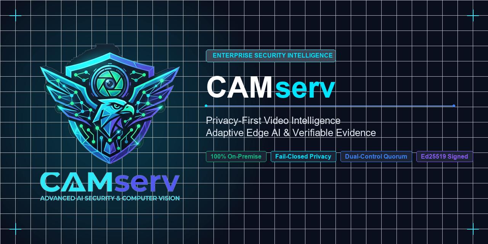
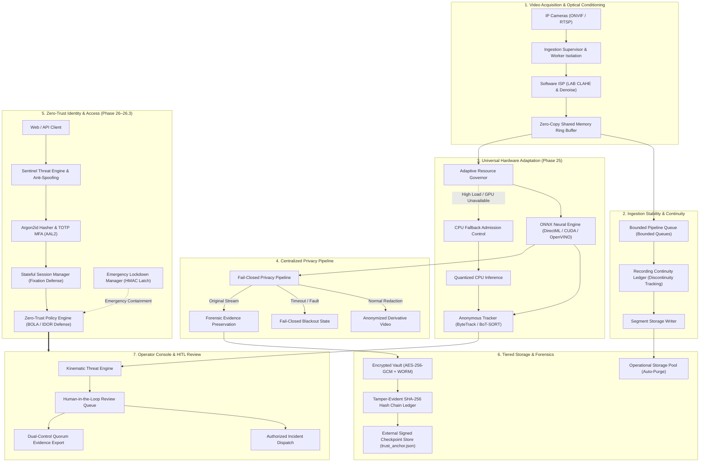
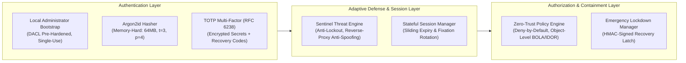
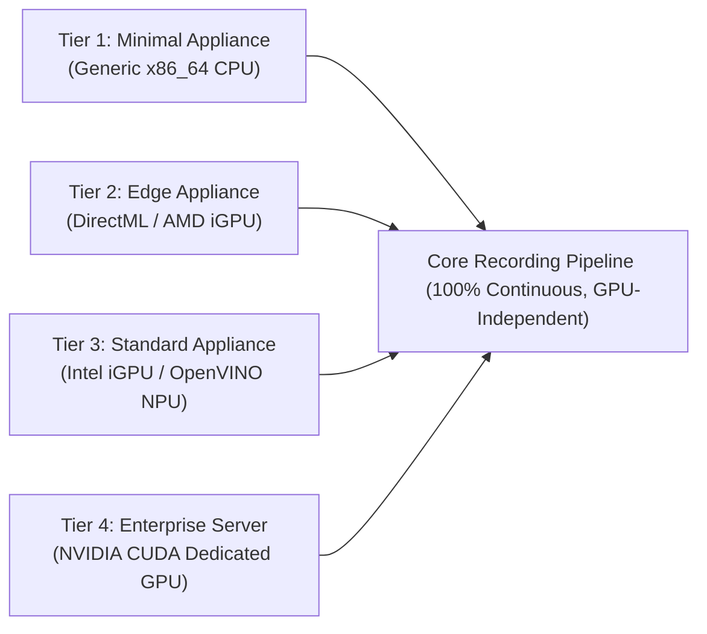
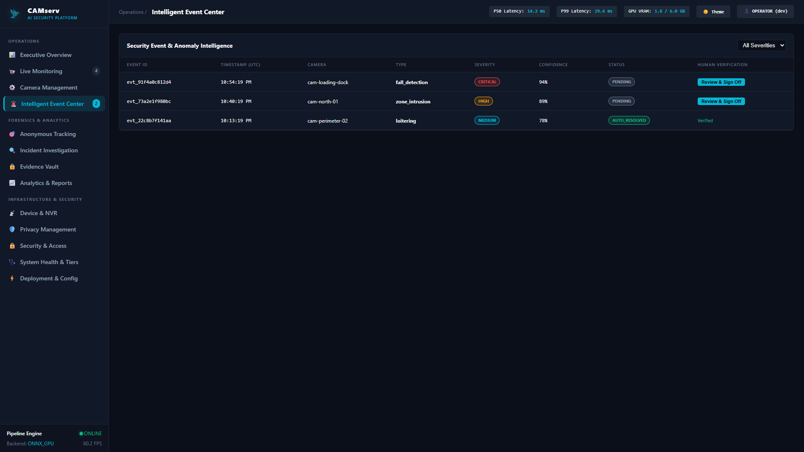
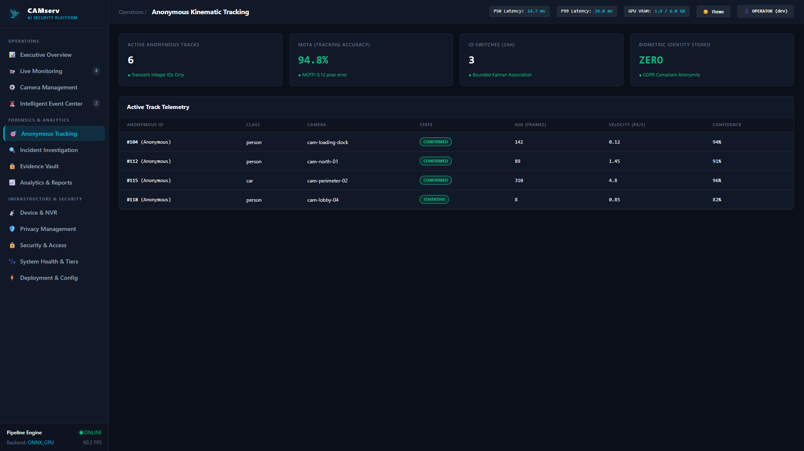
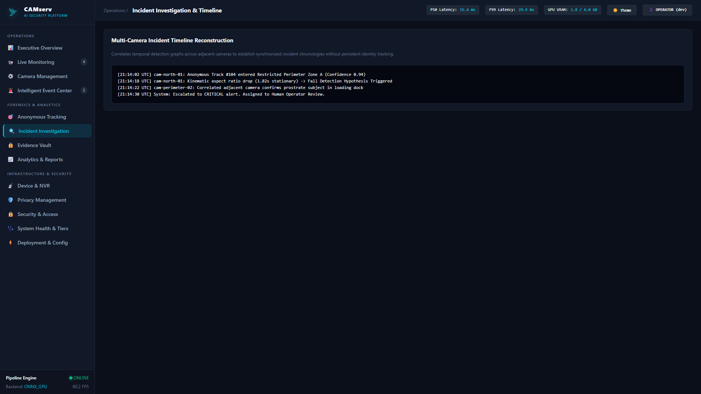
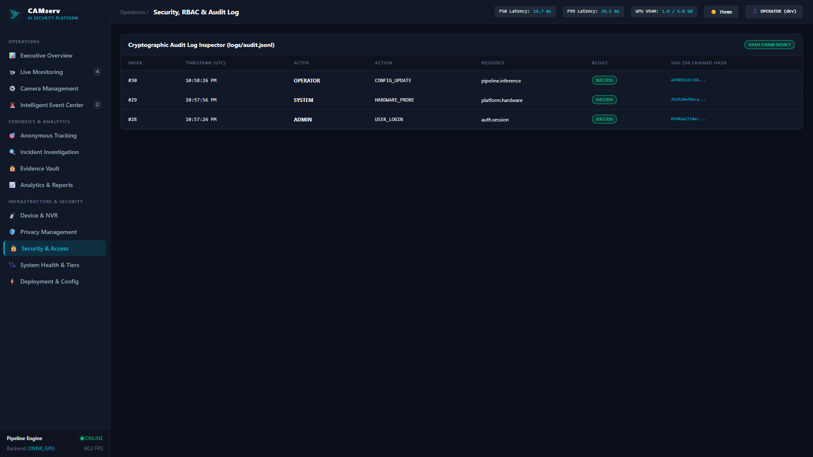
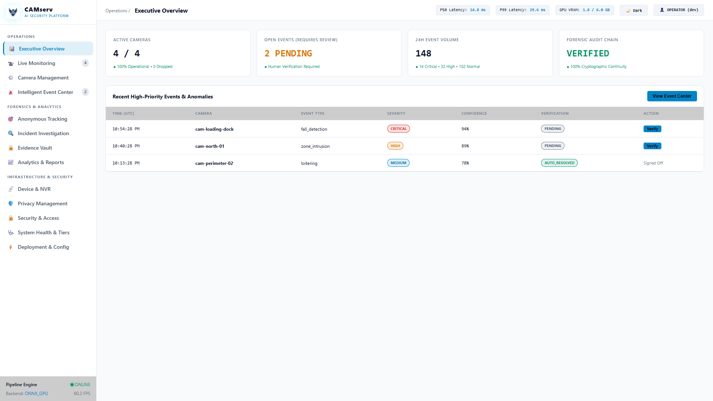

<p align="center">
  <a href="https://github.com/aboulouafaeit-sys/CAMserv.IT">
    
  </a>
</p>

<p align="center">
  
</p>

<p align="center">
  <strong>Local-First Security Intelligence &bull; Adaptive Edge Appliance &bull; Court-Admissible Digital Forensics</strong><br>
  An open-architecture, high-assurance security platform fusing real-time video surveillance, network camera management, zero-trust identity and access control, fail-closed privacy safeguards, and hardware-adaptive recording continuity.
</p>

<p align="center">
  <a href="#6-engineering-quality--verification"></a>
  <a href="#6-engineering-quality--verification"></a>
  <a href="docs/PHASE-26.4-FINAL-QUALIFICATION.md"></a>
  <a href="https://www.python.org/"></a>
  <a href="docs/PHASE-26.4-ARCHITECTURE-DIAGRAMS.md"></a>
  <a href="docs/PRIVACY.md"></a>
  <a href="LICENSE"></a>
</p>

<p align="center">
  
</p>

<p align="center">
  <a href="#1-what-is-camserv"><strong>What Is CAMserv?</strong></a> &bull;
  <a href="#2-system-architecture"><strong>Architecture</strong></a> &bull;
  <a href="#3-security--identity-foundation"><strong>Security & Identity</strong></a> &bull;
  <a href="#4-storage--hardware-philosophy"><strong>Hardware & Storage</strong></a> &bull;
  <a href="#5-visual-product-showcase"><strong>Screenshots</strong></a> &bull;
  <a href="#6-engineering-quality--verification"><strong>Verification</strong></a> &bull;
  <a href="#7-quickstart--installation"><strong>Quickstart</strong></a> &bull;
  <a href="#8-official-documentation-directory"><strong>Documentation</strong></a>
</p>

---

## 1. What Is CAMserv?

**CAMserv** is an open-architecture, sovereign surveillance and security intelligence platform engineered for mission-critical infrastructure, corporate facilities, educational institutions, and high-assurance security operations centers (SOCs).

Traditional surveillance recorders passively store unindexed video while creating cloud dependencies, recurring licensing fees, and opaque vendor lock-in. In contrast, CAMserv delivers a unified, local-first intelligence architecture that combines:

1. **Professional Video Surveillance:** Low-latency multi-camera live monitoring, synchronous multi-timeline scrubbing, PTZ motor control, and H.264/H.265/MJPEG ingestion.
2. **Camera & Device Management:** Subnet ONVIF WS-Discovery, RTSP stream health diagnostics, optical LAB CLAHE low-light conditioning, and geometric privacy exclusion zone calibration.
3. **Recording & Storage Management:** Multi-tiered storage pipeline combining a 15-second RAM Pre-Roll ring buffer, operational NVMe recording pools, automated retention purging, and tamper-evident evidentiary archiving.
4. **Event Intelligence & Tracking:** Anonymous kinematic multi-object tracking (ByteTrack & BoT-SORT) with transient integer IDs (zero biometric templates) and deterministic threat scoring.
5. **Fail-Closed Privacy Safeguards:** Real-time edge redaction of human faces and vehicle license plates with instant full-frame blackout fail-safe on subsystem degradation (GDPR Art. 25).
6. **Local-First Zero-Trust Identity:** Zero default credentials, console bootstrap tokens, memory-hard Argon2id password hashing, mandatory RFC 6238 TOTP MFA, stateful session lifecycle, and object-level BOLA/IDOR camera isolation.
7. **Adaptive Hardware Appliance Engineering:** Hardware-adaptive resource governor spanning 4 hardware tiers. **Core video recording never depends on a discrete GPU**; CPU fallback admission control guarantees 100% video ingestion continuity during resource exhaustion.

---

## 2. System Architecture

CAMserv organizes operations across decoupled subsystems communicating through zero-copy shared memory buffers, non-blocking pipeline queues, and asynchronous message streams:



For complete architectural specifications, see [PHASE-26.4-ARCHITECTURE-DIAGRAMS.md](docs/PHASE-26.4-ARCHITECTURE-DIAGRAMS.md) and the [Public Technical Architecture Overview](docs/presentation/ARCHITECTURE_OVERVIEW.md).

---

## 3. Security & Identity Foundation

Phases 26 through 26.3 established an independently verified, local-first Zero-Trust identity and access security foundation:



### Core Security Achievements
- **Zero Default Credentials:** No hardcoded accounts or factory passwords. Setup mandates a physical/console bootstrap token (`data/.bootstrap_token`) with parent-directory DACL pre-hardening on Windows NTFS and in-place memory zeroing (`ctypes.memset`).
- **Memory-Hard Password Protection:** Passwords hashed with **Argon2id** ($m=64\text{ MB}, t=3, p=4$) with proactive complexity validation, dictionary rejection, and user-attribute cross-checking.
- **Mandatory Multi-Factor Authentication (AAL2):** Administrative accounts require RFC 6238 TOTP with high-entropy recovery codes. High-impact operations (`evidence:export`, `system:config`, `camera:delete`) enforce step-up authentication. *(Note: WebAuthn/Passkey support is currently provisional interface hooks; full browser ceremonies are scheduled for a future release).*
- **Zero-Trust Object-Level Policy Engine:** Deny-by-default authorization across all 39 backend endpoints with strict BOLA/IDOR camera isolation. Operators assigned to Camera East cannot inspect, stream, or control Camera West.
- **Sentinel Adaptive Threat Detection:** Defeats credential stuffing and brute-force attacks via progressive delays without locking out administrators. Client IP extraction strips untrusted reverse-proxy headers (`X-Forwarded-For`, `X-Real-IP`) in local deployments.
- **External Signed Audit Checkpoints:** Security events form a sequential SHA-256 hash chain anchored by external monotonic checkpoints (`data/checkpoints/trust_anchor.json`) supporting symmetric HMAC-SHA256 and asymmetric Ed25519 signatures to detect database snapshot rollback attacks.
- **Emergency Appliance Lockdown:** Immediate incident containment revoking client sessions while isolating the continuous video recording pipeline. State survives crashes and reboots via an HMAC-signed durable recovery latch (`data/.emergency_lockdown.latch`).

For technical specifications, see [PHASE-26.3-AUTHORIZATION-COVERAGE.md](docs/PHASE-26.3-AUTHORIZATION-COVERAGE.md), [PHASE-26.3-EXTERNAL-CHECKPOINT-ROLLBACK-TESTS.md](docs/PHASE-26.3-EXTERNAL-CHECKPOINT-ROLLBACK-TESTS.md), and [PHASE-26.3-EMERGENCY-LATCH-ASSURANCE.md](docs/PHASE-26.3-EMERGENCY-LATCH-ASSURANCE.md).

---

## 4. Storage & Hardware Philosophy

CAMserv is engineered with an uncompromising hardware design principle: **Universal Hardware Adaptation & Pipeline Independence**.

### Non-Negotiable Surveillance Invariant
> **The video recording pipeline must never depend on the availability of a dedicated graphics card, and AI load must never cause dropped surveillance frames.**

- **GPU-Optional Operation:** CAMserv runs out-of-the-box on standard x86_64 commodity hardware without discrete GPUs. Video ingestion, segment writing, and evidence hashing execute efficiently on standard CPUs.
- **4-Tier Universal Adaptation:** Dynamically detects host capabilities (CPU, RAM, GPU, NPU) and binds to the optimal acceleration runtime (NVIDIA CUDA, Windows DirectML, Intel OpenVINO, or quantized CPU).
- **Graceful Load Shedding & CPU Failover:** Under GPU stalls or thermal saturation, the Adaptive Governor sheds non-keyframe AI inference and engages CPU fallback admission control. Surveillance video capture, bounded queue buffering, and continuity tracking maintain 100% throughput with **zero dropped frames**.



For hardware profiles and appliance specifications, see [PHASE-25-HARDWARE-PROFILES.md](docs/PHASE-25-HARDWARE-PROFILES.md).

---

## 5. Visual Product Showcase

All screenshots below were **authentically captured directly from the active CAMserv Web Console** running at `http://127.0.0.1:8000/` at Full HD ($1920 \times 1080$) resolution with synthetic demonstration fixtures:

### Group A: Command, Live Surveillance & Ingestion Management

<p align="center">
  <a href="docs/screenshots/01-executive-overview.png">
    
  </a>
  <a href="docs/screenshots/02-live-monitoring.png">
    
  </a>
</p>
<p align="center">
  <em>Left: <strong>01. Executive Overview</strong> — Fleet health metrics, active camera feeds, pending HITL review queue, and real-time event ticker.<br>
  Right: <strong>02. Live Monitoring Wall</strong> — Low-latency 4-camera video matrix with neural overlays, dynamic privacy mosaic blur, and stream FPS telemetry.</em>
</p>

<p align="center">
  <a href="docs/screenshots/03-camera-management.png">
    
  </a>
</p>
<p align="center">
  <em><strong>03. Camera Management & Calibration</strong> — RTSP/ONVIF inventory with interactive polygon geometric privacy mask editor and codec profiling.</em>
</p>

### Group B: Threat Intelligence, Tracking & Digital Forensics

<p align="center">
  <a href="docs/screenshots/04-intelligent-event-center.png">
    
  </a>
  <a href="docs/screenshots/05-anonymous-tracking.png">
    
  </a>
</p>
<p align="center">
  <em>Left: <strong>04. Intelligent Event Center</strong> — Threat severity stream, epistemic prediction badges, observation graphs, and operator sign-off modals.<br>
  Right: <strong>05. Anonymous Tracking</strong> — Non-biometric transient IDs, kinematic velocity vectors, and MOTA / MOTP accuracy metrics.</em>
</p>

<p align="center">
  <a href="docs/screenshots/06-incident-investigation.png">
    
  </a>
  <a href="docs/screenshots/07-evidence-vault.png">
    
  </a>
</p>
<p align="center">
  <em>Left: <strong>06. Incident Investigation</strong> — Multi-camera synchronized temporal timeline scrubber and cross-camera event correlation.<br>
  Right: <strong>07. Evidence Vault</strong> — Sealed forensic packages, one-click SHA-256 hash chain audit verification, and Ed25519 digital signatures.</em>
</p>

### Group C: Compliance, Governance & Daytime Tactical Mode

<p align="center">
  <a href="docs/screenshots/10-privacy-management.png">
    
  </a>
  <a href="docs/screenshots/11-security-access-control.png">
    
  </a>
</p>
<p align="center">
  <em>Left: <strong>10. Privacy & GDPR Compliance</strong> — Real-time fail-closed redaction policy manager, erasure clocks, and EU AI Act alignment.<br>
  Right: <strong>11. Security & Access Control</strong> — Role-Based Access Control matrix, active session tokens, and tamper-evident audit ledger.</em>
</p>

<p align="center">
  <a href="docs/screenshots/12-system-health-hardware-tiers.png">
    
  </a>
  <a href="docs/screenshots/14-dual-theme-light-mode.png">
    
  </a>
</p>
<p align="center">
  <em>Left: <strong>12. System Health Diagnostics</strong> — Hardware diagnostics, assigned Universal Hardware Tier, and DDSketch P50/P95/P99 latency.<br>
  Right: <strong>14. Tactical Light Mode</strong> — High-contrast daytime aesthetic engineered for high-ambient-light security dispatch rooms.</em>
</p>

> For complete technical metadata and uncompressed previews of all 14 screens, see the [Screenshot Showcase & Capture Report](docs/presentation/SCREENSHOT_CAPTURE_REPORT.md) and [Screenshot Catalog](docs/SCREENSHOT_CATALOG.md).

---

## 6. Engineering Quality & Verification

CAMserv enforces defense-in-depth engineering standards. The platform is continuously verified via automated unit, integration, and adversarial security test suites:

```bash
# Execute the complete automated test suite across all subsystems
python -m pytest tests/ -v --tb=short
```

```text
============================= test session starts =============================
platform win32 -- Python 3.14.8, pytest-9.2.0, pluggy-1.7.0
collected 615 items

tests/scenarios/test_integration.py .....                                [  1%]
tests/test_adaptive_manager.py ...                                       [  1%]
tests/test_adversarial.py .............                                  [  3%]
tests/test_analytics_zones_tampering_adapters.py .....                   [  4%]
tests/test_appliance_hardware.py .....                                   [  5%]
tests/test_audit_phase11_regressions.py ........                         [  6%]
tests/test_behavioral_engine.py ......                                   [  7%]
tests/test_camera_isp.py ....                                            [  8%]
tests/test_deploy_environment.py .....                                   [  9%]
tests/test_enterprise_security.py .....                                  [ 10%]
tests/test_events.py ...........                                         [ 11%]
tests/test_forensics.py ....                                             [ 12%]
tests/test_nvr_recording_engine.py ......                                [ 13%]
tests/test_phase22_ui_visual_design.py ..............                    [ 15%]
tests/test_phase23_operator_workspace.py ........................        [ 19%]
tests/test_phase24_isep_storage.py .......................               [ 23%]
tests/test_phase25_1_a_verification.py ..........................        [ 27%]
tests/test_phase25_1_b_cross_platform.py ...................             [ 30%]
tests/test_phase25_1_reliability_hardening.py ........................   [ 34%]
tests/test_phase25_hardware_appliance.py ..............                  [ 36%]
tests/test_phase26_identity_security.py ............................     [ 41%]
tests/test_phase26_1_adversarial.py ...........................          [ 45%]
tests/test_phase26_2_assurance.py .............                         [ 47%]
tests/test_phase26_3_adversarial.py ......................               [ 51%]
tests/test_pipeline.py ........                                          [ 52%]
tests/test_security.py .............                                     [ 54%]
tests/test_storage.py ........                                           [ 56%]
tests/test_windows_phase16_qualification.py ..............               [ 58%]
...
====================== 615 passed, 1 warning in 118.82s ======================
```

### Verification Highlights
* **Test Suite Status:** **615 Passing Tests across 66 Test Modules (100% Pass Rate)**.
* **Identity & Security Coverage:** 90 dedicated tests covering Argon2id, TOTP MFA, BOLA/IDOR authorization, Sentinel session threat detection, external signed checkpoints, and emergency lockdown.
* **Audit Ledger Invariant:** Verified that production audit log `logs/audit.jsonl` remains completely isolated across test executions (**exactly 20,977 bytes, SHA-256 `F2A2484A...` inviolate**).
* **Official Branding Invariant:** Verified that all **34 official branding assets** remain preserved without distortion or AI replacement.

---

## 7. Quickstart & Installation

### 7.1 Platform Support Matrix
| Platform / OS | Status | Architecture | Verification Level |
| :--- | :---: | :---: | :--- |
| **Windows 11 Enterprise (23H2+)** | **Primary** | x86_64 | **Software Verified (615/615 tests passing)** |
| **Windows 10 Pro / Enterprise** | Compatible | x86_64 | Compatible runtime; DirectML supported |
| **Debian 12 / Ubuntu 22.04+** | Secondary | x86_64 / ARM64 | Packaging designed; awaiting physical lab qualification |
| **Bare-Metal Appliance Profile** | Target | x86_64 | A/B partition layout designed; hardware burn-in pending |

### 7.2 Local Installation
```bash
# Clone the repository
git clone https://github.com/aboulouafaeit-sys/CAMserv.IT.git
cd CAMserv.IT

# Create and activate virtual environment
python -m venv .venv
source .venv/bin/activate  # On Windows: .venv\Scripts\activate

# Install in editable mode with development and testing dependencies
pip install --upgrade pip setuptools wheel
pip install -e ".[dev,testing]"
```

### 7.3 Command-Line Interface (CLI)
```bash
# 1. Run Host Hardware Diagnostic Probe & Tier Assignment
python -m camserv.main detect-hw

# 2. Verify Cryptographic Audit Log Hash Chain
python -m camserv.main audit-verify

# 3. Scan Local Subnet for ONVIF Compliant Cameras
python -m camserv.main nvr-scan

# 4. Verify Cryptographic Evidence Vault Package
python -m camserv.main verify-evidence --vault-dir ./data/evidence_vault

# 5. Launch the CAMserv Server & Web Console
python -m camserv.main serve --host 127.0.0.1 --port 8000
```

Once launched, access the interactive Web Console directly at `http://127.0.0.1:8000/`.

---

## 8. Official Documentation Directory

The complete technical and architectural documentation suite is indexed below:

| Domain | Key Documentation & Specifications |
| :--- | :--- |
| **Architecture** | [Technical Architecture Overview](docs/presentation/ARCHITECTURE_OVERVIEW.md) &bull; [Architecture Diagrams (Phase 26.4)](docs/PHASE-26.4-ARCHITECTURE-DIAGRAMS.md) &bull; [Master Architecture Spec](docs/ADVANCED_ARCHITECTURE_ULTRA_LOCAL.md) &bull; [Subsystem Architecture](docs/ARCHITECTURE.md) |
| **Security & Identity** | [Security Policy](SECURITY.md) &bull; [STRIDE Threat Model](docs/SECURITY.md) &bull; [Authorization Coverage](docs/PHASE-26.3-AUTHORIZATION-COVERAGE.md) &bull; [External Checkpoints & Rollback](docs/PHASE-26.3-EXTERNAL-CHECKPOINT-ROLLBACK-TESTS.md) &bull; [Emergency Lockdown](docs/PHASE-26.3-EMERGENCY-LATCH-ASSURANCE.md) |
| **Hardware & Appliance** | [Hardware Profiles (Phase 25)](docs/PHASE-25-HARDWARE-PROFILES.md) &bull; [Appliance Hardware Design](docs/PHASE_3_APPLIANCE_HARDWARE_DESIGN.md) &bull; [Appliance OS & Systemd](docs/PHASE_3_OS_AND_DEPLOYMENT_DESIGN.md) &bull; [Installation Guide](docs/INSTALLATION_GUIDE.md) |
| **Storage & Forensics** | [ISEP Storage Architecture](docs/PHASE-24-ISEP-ARCHITECTURE.md) &bull; [Storage Qualification Audit](docs/PHASE-24-INDEPENDENT-QUALIFICATION-AUDIT.md) &bull; [Privacy Safeguards & GDPR](docs/PRIVACY.md) |
| **Presentation & UI** | [Screenshot Catalog](docs/SCREENSHOT_CATALOG.md) &bull; [Screenshot Showcase Report](docs/presentation/SCREENSHOT_CAPTURE_REPORT.md) &bull; [Brand Guidelines](docs/brand/BRAND_GUIDELINES.md) &bull; [Brand Asset Registry](docs/presentation/BRAND_ASSET_REGISTRY.md) |
| **Quality & Governance** | [Central Findings Register](docs/PHASE-25-FINDINGS-REGISTER.md) &bull; [Phase 26.4 Final Qualification](docs/PHASE-26.4-FINAL-QUALIFICATION.md) &bull; [Contributing Guide](CONTRIBUTING.md) &bull; [Release Readiness](docs/presentation/RELEASE_READINESS.md) |

---

## 9. License

CAMserv is distributed under the terms of the [MIT License](LICENSE).  
Copyright &copy; 2026 CAMserv Contributors.
