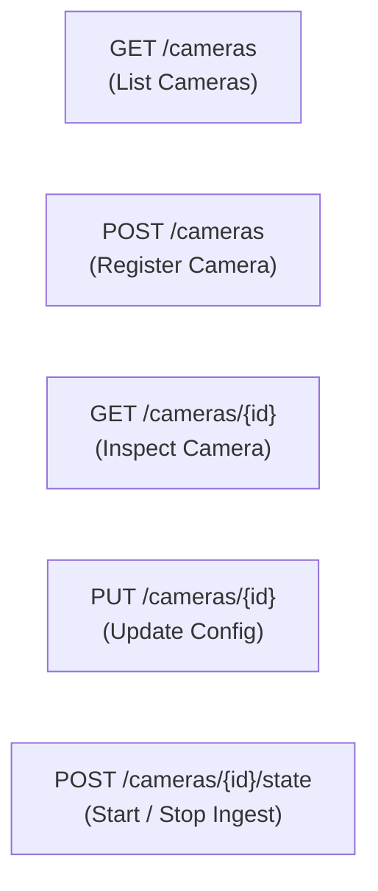
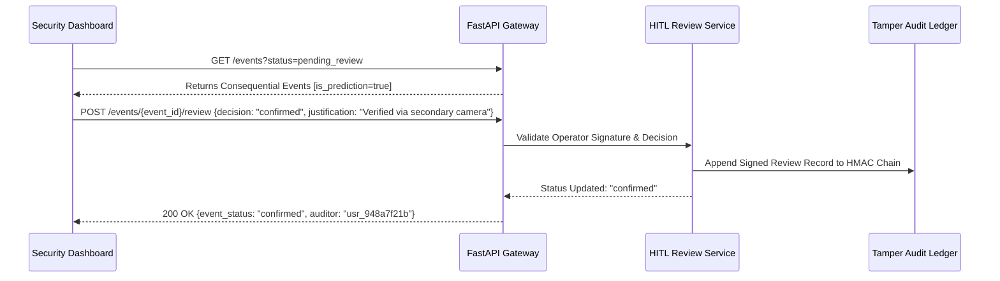

# CAMserv — REST API & WebSocket Streaming Specification

> **API Version:** v1 (`/api/v1`)  
> **OpenAPI Version:** 3.1.0  
> **Protocol:** HTTPS / WSS (TLS 1.3 Recommended)  
> **Authentication:** Bearer JWT (RS256/HS256)  
> **Epistemic Standards:** All detection outputs are strictly probabilistic predictions carrying `is_prediction: true` and confidence scores $p \in [0.0, 1.0]$. High-severity events enforce Human-in-the-Loop review.

---

## 1. Global API Conventions

### 1.1 Base URL & Content Negotiation
- **Base URL:** `https://<camserv-host>:8000/api/v1`
- **Default Headers:**
  - `Content-Type: application/json`
  - `Accept: application/json`
  - `Authorization: Bearer <access_token>`

### 1.2 Rate Limiting
All HTTP endpoints enforce rate limits. Standard clients receive 300 requests per minute by default. Rate limit status is transmitted in standard HTTP response headers:
```http
X-RateLimit-Limit: 300
X-RateLimit-Remaining: 284
X-RateLimit-Reset: 1731540600
```
When exhausted, the server returns HTTP `429 Too Many Requests`.

### 1.3 Cursor-Based Pagination
List endpoints support deterministic cursor-based pagination:
- `limit`: Integer (1 to 100, default 20)
- `cursor`: Base64 opaque cursor token
- `sort_order`: `asc` or `desc` (default `desc`)

**Response Envelope Format:**
```json
{
  "items": [],
  "pagination": {
    "has_more": true,
    "next_cursor": "eyJpZCI6ICJldnRfZGVjMTAyIiwgInRzIjogMTczMTUzOTgwMH0=",
    "total_count": 1420
  }
}
```

### 1.4 Standardized Error Schema
```json
{
  "error": {
    "code": "INVALID_PREDICTION_FILTER",
    "message": "Confidence threshold must be a float between 0.0 and 1.0",
    "request_id": "req_8471b69f-0c4a-4a21-8263-d238b7049ac1",
    "timestamp": "2026-11-13T20:30:00.124Z",
    "details": [
      {
        "field": "min_confidence",
        "issue": "Value 1.45 exceeds permissible upper bound 1.0"
      }
    ]
  }
}
```

---

## 2. Authentication & Session Endpoints (`/auth`)

### `POST /auth/login`
Authenticates a user and issues an asymmetric RS256 JWT access token and refresh token.

- **Permissions:** Public
- **Request Body:**
  ```json
  {
    "username": "security_operator_01",
    "password": "CorrectHorseBatteryStaple99!"
  }
  ```
- **Response (200 OK):**
  ```json
  {
    "access_token": "eyJhbGciOiJSUzI1NiIsInR5cCI6IkpXVCJ9...",
    "refresh_token": "rt_8f10b271d44c9b91...",
    "token_type": "Bearer",
    "expires_in": 1800,
    "user": {
      "id": "usr_948a7f21b",
      "username": "security_operator_01",
      "role": "operator",
      "permissions": ["cameras:read", "events:read", "events:write"]
    }
  }
  ```

### `POST /auth/refresh`
Rotates an existing refresh token and issues a fresh 30-minute access token.

- **Permissions:** Public
- **Request Body:**
  ```json
  {
    "refresh_token": "rt_8f10b271d44c9b91..."
  }
  ```
- **Response (200 OK):**
  ```json
  {
    "access_token": "eyJhbGciOiJSUzI1NiIs...",
    "refresh_token": "rt_9011a91e55b10c22...",
    "token_type": "Bearer",
    "expires_in": 1800
  }
  ```

### `POST /auth/revoke`
Explicitly invalidates an active session token, adding its JTI to the Redis revocation blacklist.

- **Permissions:** Authenticated User
- **Response (204 No Content)**

---

## 3. Camera Management Endpoints (`/cameras`)



### `GET /cameras`
Returns a paginated list of registered camera sources and current ingestion status.

- **Permissions:** `cameras:read`
- **Response (200 OK):**
  ```json
  {
    "items": [
      {
        "id": "cam_north_gate",
        "name": "North Gate Entrance",
        "url": "rtsp://192.168.1.100:554/h264Preview_01_main",
        "enabled": true,
        "fps": 15,
        "resolution": [1920, 1080],
        "status": "STREAMING",
        "current_fps": 14.9,
        "dropped_frames": 0,
        "active_tracks_count": 3
      }
    ]
  }
  ```

### `POST /cameras`
Registers a new RTSP camera source.

- **Permissions:** `cameras:write`
- **Request Body:**
  ```json
  {
    "id": "cam_dock_west",
    "name": "Loading Dock West",
    "url": "rtsp://192.168.1.105:554/live",
    "enabled": true,
    "fps": 15,
    "resolution": [1920, 1080],
    "codec": "h264",
    "retry_interval_s": 5.0,
    "max_retries": 10
  }
  ```
- **Response (201 Created)**

### `POST /cameras/{camera_id}/state`
Controls camera ingestion state (`start`, `stop`, `restart`).

- **Permissions:** `cameras:write`
- **Request Body:** `{"action": "restart"}`
- **Response (200 OK):** `{"camera_id": "cam_dock_west", "status": "RECONNECTING"}`

---

## 4. Detection & Inference Endpoints (`/detections`)

> **Epistemic Notice:** All items returned from detection endpoints represent statistical predictions produced by deep learning models. They are not physical facts.

### `GET /detections`
Queries detection bounding boxes across cameras with spatio-temporal and confidence filtering.

- **Permissions:** `detections:read`
- **Query Parameters:**
  - `camera_id`: string (optional)
  - `min_confidence`: float (0.0 to 1.0, default 0.45)
  - `class_name`: string (e.g. `person`, `car`)
  - `start_time`: ISO8601 string
  - `end_time`: ISO8601 string
- **Response (200 OK):**
  ```json
  {
    "items": [
      {
        "detection_id": "det_20261113_001921",
        "camera_id": "cam_north_gate",
        "timestamp": "2026-11-13T20:25:31.102Z",
        "class_id": 0,
        "class_name": "person",
        "confidence_score": 0.892,
        "is_prediction": true,
        "bbox_normalized": [0.32, 0.41, 0.48, 0.85],
        "associated_track_id": 104
      }
    ]
  }
  ```

### `GET /detections/heatmap`
Returns normalized 2D spatial occupancy density matrices for a specific camera and timeframe.

- **Permissions:** `analytics:read`
- **Query Parameters:** `camera_id=cam_north_gate&interval_hours=24`
- **Response (200 OK):**
  ```json
  {
    "camera_id": "cam_north_gate",
    "grid_dimensions": [64, 64],
    "density_matrix": [[0.0, 0.05, 0.12], [0.0, 0.45, 0.98]]
  }
  ```

---

## 5. Multi-Object Tracking & Re-ID (`/tracks`)

### `GET /tracks/active`
Retrieves currently tracked objects across all active camera streams.

- **Permissions:** `tracks:read`
- **Response (200 OK):**
  ```json
  {
    "active_tracks": [
      {
        "track_id": 104,
        "camera_id": "cam_north_gate",
        "class_name": "person",
        "detection_confidence": 0.89,
        "is_prediction": true,
        "current_bbox": [0.32, 0.41, 0.48, 0.85],
        "velocity_px_s": [12.4, -2.1],
        "age_frames": 142,
        "confirmed": true
      }
    ]
  }
  ```

### `POST /tracks/reid-search`
Performs an approximate nearest neighbor (ANN) vector search in Milvus using scene-level appearance embeddings.

- **Permissions:** `tracks:read`
- **Request Body:**
  ```json
  {
    "track_id": 104,
    "camera_id": "cam_north_gate",
    "top_k": 5,
    "similarity_threshold": 0.70
  }
  ```
- **Response (200 OK):**
  ```json
  {
    "matches": [
      {
        "matched_track_id": 98,
        "camera_id": "cam_east_perimeter",
        "similarity_score": 0.842,
        "is_prediction": true,
        "timestamp": "2026-11-13T20:20:15.000Z"
      }
    ]
  }
  ```

---

## 6. Events, Alarms & Human-in-the-Loop Gateway (`/events`, `/alerts`)



### `GET /events`
Queries security incident events.

- **Permissions:** `events:read`
- **Query Parameters:** `severity=critical&human_review_status=pending`
- **Response (200 OK):**
  ```json
  {
    "items": [
      {
        "event_id": "evt_20261113_0981",
        "rule_id": "rule_restricted_perimeter",
        "rule_name": "Perimeter Line Crossing",
        "camera_id": "cam_east_perimeter",
        "timestamp": "2026-11-13T20:27:10.841Z",
        "severity": "critical",
        "confidence_score": 0.91,
        "is_prediction": true,
        "requires_human_review": true,
        "human_review_status": "pending",
        "target_track_ids": [104],
        "snapshot_url": "/api/v1/events/evt_20261113_0981/snapshot"
      }
    ]
  }
  ```

### `POST /events/{event_id}/review`
**Human-in-the-Loop Decision Submission Endpoint.** Authenticated operators record formal human verification or dismissal of machine predictions.

- **Permissions:** `events:write`
- **Request Body:**
  ```json
  {
    "decision": "approved",
    "justification": "Operator visually confirmed individual crossing fenced line."
  }
  ```
- **Response (200 OK):**
  ```json
  {
    "event_id": "evt_20261113_0981",
    "human_review_status": "approved",
    "reviewed_by": "usr_948a7f21b",
    "reviewed_at": "2026-11-13T20:28:02.115Z",
    "audit_record_hash": "e9c18d04f21ab81023d8c0147e45b820a0b12c85e24b"
  }
  ```

---

## 7. Privacy Zones & Masking (`/privacy`)

### `GET /privacy/zones`
Lists all geometric privacy blackout zones.

- **Permissions:** `privacy:manage`
- **Response (200 OK):**
  ```json
  {
    "zones": [
      {
        "id": "pz_neighbor_window_01",
        "camera_id": "cam_east_perimeter",
        "x": 0.65,
        "y": 0.10,
        "width": 0.20,
        "height": 0.25,
        "label": "Neighboring Residence Window (GDPR)"
      }
    ]
  }
  ```

### `POST /privacy/zones`
Defines a new privacy masking rectangle. Frames from this region are blacked out on ingress.

- **Permissions:** `privacy:manage`
- **Request Body:**
  ```json
  {
    "id": "pz_sidewalk_mask",
    "camera_id": "cam_north_gate",
    "x": 0.0,
    "y": 0.85,
    "width": 1.0,
    "height": 0.15,
    "label": "Public Sidewalk Mask"
  }
  ```
- **Response (201 Created)**

---

## 8. System Diagnostics & Metrics (`/system`)

### `GET /system/health`
High-level system health for container orchestrators and load balancers.

- **Permissions:** Public
- **Response (200 OK):**
  ```json
  {
    "status": "healthy",
    "uptime_seconds": 84120,
    "version": "0.1.0",
    "gpu": {
      "name": "NVIDIA GeForce RTX 3060 Laptop GPU",
      "cuda_version": "13.5",
      "vram_allocated_mb": 3410,
      "vram_total_mb": 6144,
      "gpu_utilization_percent": 68
    },
    "subsystems": {
      "redis": "connected",
      "milvus": "connected",
      "ingestion": "streaming_all"
    }
  }
  ```

### `GET /system/metrics`
Prometheus format telemetry endpoint for latency profiling, drop rates, and throughput.

---

## 9. Real-Time WebSocket Streaming

### 9.1 Live Video & Track Overlay Stream
**Endpoint:** `GET /ws/stream/{camera_id}?token=<jwt_token>`

Streams real-time JPEG/WebP frames with synchronized prediction metadata.

**Client Subscription Message:**
```json
{
  "action": "subscribe",
  "fps": 15,
  "include_metadata": true,
  "anonymize_faces": true
}
```

**Server Binary/Text Frame Protocol:**
- Binary WebSocket packets transmit compressed video frames.
- Text WebSocket packets transmit spatial annotations:
```json
{
  "type": "frame_metadata",
  "camera_id": "cam_north_gate",
  "frame_id": 94812,
  "timestamp_ns": 1731539700000000000,
  "predictions": [
    {
      "track_id": 104,
      "class": "person",
      "confidence": 0.892,
      "is_prediction": true,
      "bbox": [0.32, 0.41, 0.48, 0.85]
    }
  ]
}
```

### 9.2 Global Incident Events Stream
**Endpoint:** `GET /ws/events?token=<jwt_token>`

Broadcasts instantaneous security notifications and HITL review requests to connected operator stations.

**Broadcast Payload:**
```json
{
  "type": "event_alert",
  "event_id": "evt_20261113_0981",
  "severity": "critical",
  "rule_name": "Perimeter Line Crossing",
  "is_prediction": true,
  "confidence": 0.91,
  "requires_human_review": true,
  "camera_id": "cam_east_perimeter"
}
```
