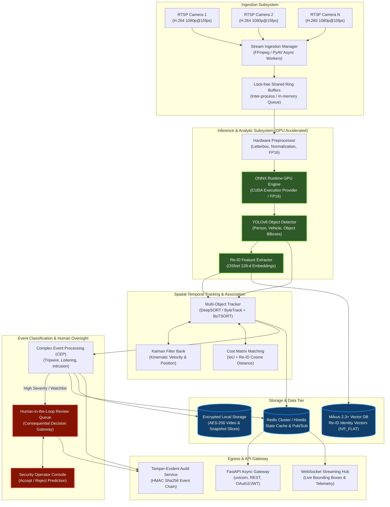
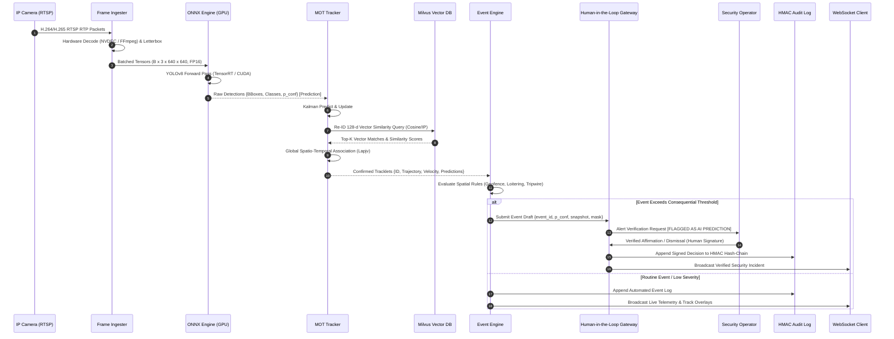
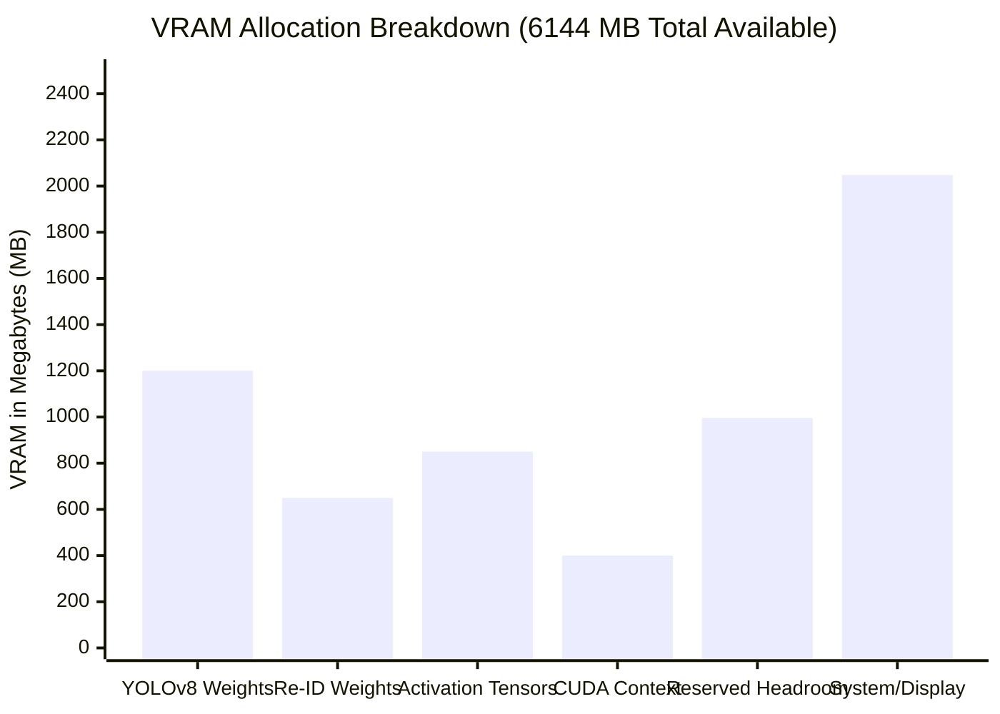
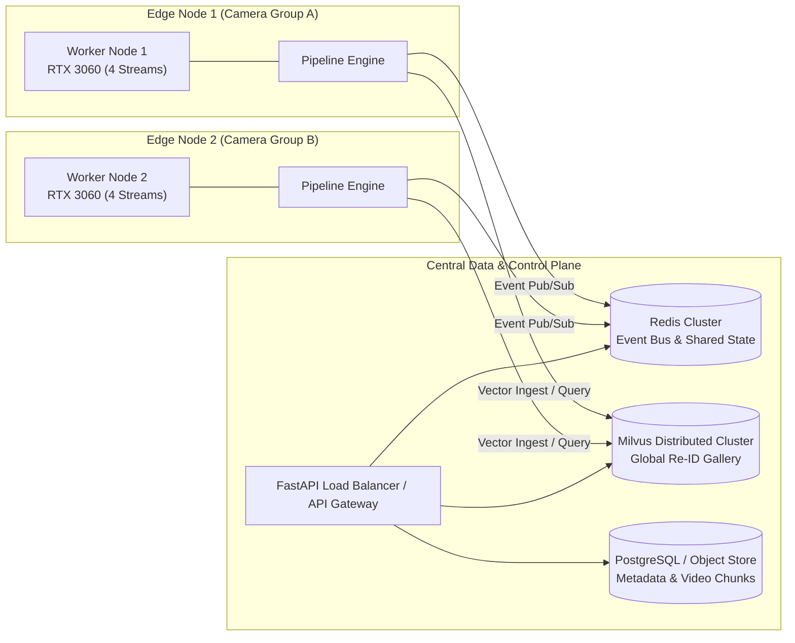

# CAMserv — Platform Architecture Specification

> **Document Version:** 1.0.0  
> **Status:** Approved / Active Baseline  
> **System Class:** Real-Time Video Surveillance Intelligence & Analytics Platform  
> **Target Environment:** Windows 11 / Linux (Ubuntu 22.04 LTS), Python 3.14, NVIDIA RTX 3060 Laptop GPU (6GB VRAM, Compute Capability 8.6), CUDA 13.5

---

## 1. Executive Summary & Architectural Philosophy

CAMserv is a high-throughput, low-latency modular security intelligence platform engineered for edge and on-premise compute nodes. The system continuously ingests high-definition video streams across distributed IP cameras via RTSP/H.264/H.265 protocols, decodes frames asynchronously, executes accelerated deep neural network inference on discrete NVIDIA GPUs, establishes multi-object spatio-temporal tracking across video frames, correlates identity re-identification embeddings via vector search, and evaluates real-time situational rules.

### Core Architectural Axioms

1. **Epistemic Humility & Probabilistic Governance:**
   All machine-learning model outputs are treated strictly as **probabilistic predictions**, never objective ground truth. Every detection bounding box, class categorization, Re-ID affinity match, and behavioral inference carries an explicit numerical confidence metric ($p \in [0.0, 1.0]$) and metadata tag `is_prediction: true`. 
2. **Mandatory Human-in-the-Loop (HITL) for Consequential Actions:**
   Autonomous automated physical actions or high-stakes interventions (such as dispatching perimeter security, triggering physical access lockouts, or flagging individuals on watchlist alerts) are architecturally prohibited from execution without verified human operator confirmation. The platform implements asynchronous human review queues for all critical and high-severity event decisions.
3. **Data Protection by Structural Design:**
   Adhering to GDPR Article 25 and the EU AI Act (High-Risk AI Systems under Annex III), privacy safeguards are integrated directly into the processing pipeline rather than bolted on as an afterthought. Video frames undergo zero-knowledge zone masking and dynamic facial anonymization before storage or egress to monitoring consoles.
4. **Deterministic Budgeting of Compute & Memory:**
   With strict GPU hardware constraints (NVIDIA RTX 3060 Laptop GPU with 6GB GDDR6 VRAM), memory allocation across TensorRT / ONNX Runtime execution providers, PyTorch inference contexts, and frame buffer rings is strictly bounded and guarded by backpressure regulators.

---

## 2. High-Level System Architecture

The following component diagram illustrates the major subsystem layers, process boundaries, IPC channels, and persistent datastores comprising CAMserv.



---

## 3. End-to-End Execution Data Flow

The lifecycle of every frame from camera lens capture to operator alerting follows a deterministic, non-blocking pipeline. Every prediction is attributed to a source frame timestamp and assigned confidence bounds.



---

## 4. Subsystem Component Interfaces & Class Contracts

The architecture is strictly decoupled using abstract base classes and typed protocols. Below are the definitive contracts for the primary components.

### 4.1 Ingestion Interface: `IFrameSource`

```python
from abc import ABC, abstractmethod
from dataclasses import dataclass
from typing import AsyncGenerator
import numpy as np

@dataclass(frozen=True)
class RawVideoFrame:
    camera_id: str
    frame_index: int
    pts_timestamp_ns: int
    monotonic_timestamp_ns: int
    data: np.ndarray  # Shape: (H, W, C), dtype: uint8
    height: int
    width: int
    fps: float

class IFrameSource(ABC):
    @abstractmethod
    async def connect(self) -> None:
        """Establish RTSP/TCP connection with retry semantics."""
        ...

    @abstractmethod
    async def disconnect(self) -> None:
        """Gracefully release demuxers and decode contexts."""
        ...

    @abstractmethod
    async def stream_frames(self) -> AsyncGenerator[RawVideoFrame, None]:
        """Yield uncorrupted decoded video frames from circular ring buffer."""
        ...

    @abstractmethod
    def get_health_metrics(self) -> dict[str, float | int | bool]:
        """Return drop rates, jitter, instantaneous FPS, and connection state."""
        ...
```

### 4.2 Inference Interface: `IInferenceEngine`

```python
from abc import ABC, abstractmethod
from dataclasses import dataclass
from typing import Sequence
import numpy as np

@dataclass(frozen=True)
class ModelPrediction:
    """Represents a strictly probabilistic model output."""
    class_id: int
    class_name: str
    confidence_score: float  # Guaranteed in range [0.0, 1.0]
    bbox_xyxy: tuple[float, float, float, float]  # Normalized [0, 1]
    is_prediction: bool = True  # Strict architectural tag
    reid_embedding: np.ndarray | None = None  # 128-d feature vector

class IInferenceEngine(ABC):
    @abstractmethod
    def load_model(self, model_path: str, half_precision: bool = True) -> None:
        """Load ONNX runtime model onto CUDA Execution Provider with tensor allocations."""
        ...

    @abstractmethod
    async def infer_batch(
        self, frames: Sequence[np.ndarray]
    ) -> list[list[ModelPrediction]]:
        """
        Execute batched forward pass.
        Returns list of predictions per frame in the batch.
        Guaranteed execution within inference budget.
        """
        ...

    @abstractmethod
    def get_vram_allocation_bytes(self) -> int:
        """Query actual GPU memory footprint allocated on discrete device."""
        ...
```

### 4.3 Tracking Interface: `IMultiObjectTracker`

```python
from abc import ABC, abstractmethod
from dataclasses import dataclass
from typing import Sequence
import numpy as np

@dataclass
class TrackedTarget:
    track_id: int
    camera_id: str
    class_name: str
    detection_confidence: float
    confirmed: bool
    age_frames: int
    hits: int
    current_bbox_xyxy: tuple[float, float, float, float]
    velocity_vector_px_per_s: tuple[float, float]
    trajectory_history: list[tuple[float, float]]  # Centroids over time
    last_known_embedding: np.ndarray | None

class IMultiObjectTracker(ABC):
    @abstractmethod
    def update(
        self,
        camera_id: str,
        predictions: Sequence[ModelPrediction],
        timestamp_ns: int
    ) -> list[TrackedTarget]:
        """
        Associate new detections with existing tracks using Kalman prediction,
        IoU cost matrix, and Re-ID vector cosine distance matching.
        """
        ...

    @abstractmethod
    def purge_stale_tracks(self, max_idle_seconds: float) -> int:
        """Remove dead tracklets from active tracking tables."""
        ...
```

### 4.4 Event Classification & HITL: `IEventProcessor`

```python
from abc import ABC, abstractmethod
from dataclasses import dataclass
from enum import Enum
from typing import Any

class EventSeverity(str, Enum):
    LOW = "low"
    MEDIUM = "medium"
    HIGH = "high"
    CRITICAL = "critical"

@dataclass(frozen=True)
class SecurityEvent:
    event_id: str
    rule_id: str
    rule_name: str
    camera_id: str
    timestamp_ns: int
    severity: EventSeverity
    target_track_ids: list[int]
    confidence_score: float
    is_prediction: bool
    requires_human_review: bool
    human_review_status: str  # "pending", "approved", "rejected", "exempt"
    payload: dict[str, Any]

class IEventProcessor(ABC):
    @abstractmethod
    async def process_tracks(
        self, targets: Sequence[TrackedTarget], frame_metadata: dict[str, Any]
    ) -> list[SecurityEvent]:
        """Evaluate spatial, temporal, and kinematic triggers against active rules."""
        ...

    @abstractmethod
    async def submit_human_decision(
        self, event_id: str, reviewer_id: str, decision: str, justification: str
    ) -> SecurityEvent:
        """Record human-in-the-loop verification or rejection with cryptographic audit trail."""
        ...
```

---

## 5. Performance Budgets & Hardware Concurrency

### 5.1 Hardware Envelope
- **Host GPU:** NVIDIA GeForce RTX 3060 Laptop GPU
- **VRAM Total:** 6,144 MB GDDR6
- **Compute Capability:** 8.6 (Ampere Architecture, 3840 CUDA cores, 120 Tensor Cores)
- **CUDA Runtime:** 13.5
- **Driver:** NVIDIA Display Driver 550+ / 560+ with NVENC/NVDEC support

### 5.2 Latency and Memory Budgets

| Subsystem Stage | Latency Budget (Target) | Latency Budget (SLA Max) | Resource Footprint |
| :--- | :--- | :--- | :--- |
| **RTSP Ingestion & HW Decode** | 8 ms / frame | 15 ms / frame | ~35 MB RAM / stream ring buffer |
| **Tensor Preprocessing (Letterbox/FP16)** | 3 ms / frame | 6 ms / frame | CPU Host pinned memory (~20 MB) |
| **YOLOv8 Detection (Batch=4, FP16)** | 18 ms / batch | 35 ms / batch | ~1,650 MB VRAM static weights + activations |
| **Re-ID Feature Extraction (Batch=8)** | 12 ms / batch | 22 ms / batch | ~850 MB VRAM static weights + activations |
| **Kalman & Hungarian Tracking** | 4 ms / camera | 10 ms / camera | ~25 MB Host RAM |
| **Milvus Vector ANN Search (nprobe=16)** | 5 ms / query | 12 ms / query | Milvus Server Host RAM & Index Cache |
| **Event Rule Evaluation (CEP)** | 2 ms / frame | 5 ms / frame | In-memory spatial index (R-Tree / NumPy) |
| **WebSocket / API Dispatch** | 5 ms / message | 15 ms / message | Async event loop task queue |
| **TOTAL End-to-End Pipeline Latency** | **45 - 60 ms** | **≤ 100 ms** | **VRAM Total: ~3.8 GB (≤ 4.0 GB target)** |

### 5.3 Concurrency Scaling Model
For 4 concurrent RTSP cameras @ 15 FPS:
- **Total Inflow:** 60 FPS aggregated.
- **Batching Strategy:** Dynamic batching across cameras with maximum batch window of 25 ms ($N_{batch} = 4$).
- **VRAM Ceiling:** Hard limit of 4,096 MB VRAM allocated to ONNX Runtime CUDA provider to preserve 2,048 MB for system display and CUDA runtime overhead.



---

## 6. Horizontal & Vertical Scalability Strategy



1. **Camera-Group Sharding (Horizontal):**
   Individual worker nodes host dedicated discrete GPUs processing local camera partitions (4 streams per RTX 3060 tier). Sharded nodes communicate upstream solely via Redis pub/sub and Milvus vector ingest endpoints.
2. **GPU Batching & Dynamic Frame Skipping (Vertical):**
   Under high transient scene complexity (e.g. > 50 detections per frame), pipeline automatically throttles Re-ID embedding inference from 1:1 down to keyframe cadence (1 embedding per tracklet per 10 frames), preventing pipeline buffer starvation.

---

## 7. Epistemic Transparency and Human-in-the-Loop Safeguards

1. **Probability Bounding:**
   No classification is binary. Raw soft-max logits and sigmoid confidence scores are transmitted across all internal interfaces. 
2. **Rejection of Uncalibrated Classifiers:**
   Temperature scaling and Platt scaling are applied to deep network outputs to ensure predicted probabilities match empirical observation frequencies.
3. **Escalation Boundaries:**
   - Classification confidence $p < 0.45$: Automatically discarded as detector noise.
   - Classification confidence $0.45 \le p < 0.75$: Displayed on operator UI with amber disclaimer tag `PREDICTION (MODERATE CONFIDENCE)`.
   - Classification confidence $p \ge 0.75$ on restricted zones: Queued to Human-in-the-Loop review portal with affirmative dual-operator confirmation before external dispatch.
4. **Audit Cryptographic Hash Chaining:**
   Every human interaction (acceptance, override, or rejection of a prediction) creates an immutable record hashed via HMAC-SHA256, chained directly to the previous entry index.
