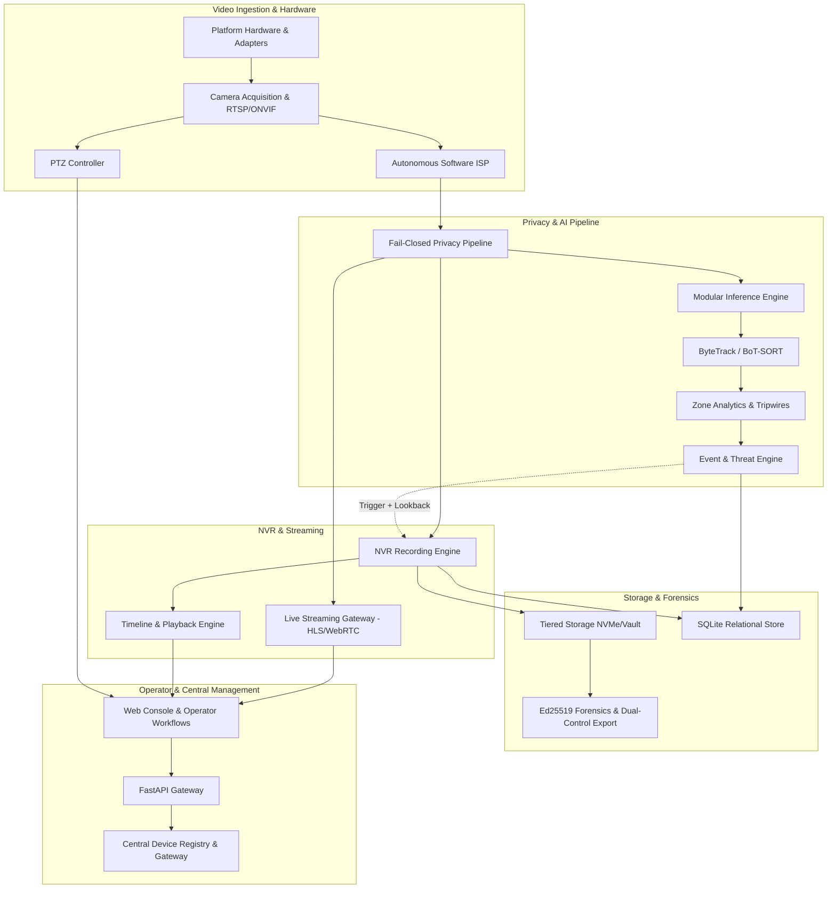

# CAMserv Master Product Expansion Audit

**Document ID:** AUDIT-EXPANSION-2026-001  
**Project:** CAMserv Advanced Security Intelligence Platform  
**Repository:** `aboulouafaeit-sys/CAMserv.IT`  
**Primary Branch:** `main`  
**Verified HEAD Commit:** `a394c10` (reported baseline: `2275570`, post-audit: `1023b8d`)  
**Date:** November 15, 2026  
**Auditor:** Senior Multidisciplinary Engineering Organization  

---

## 1. Verified Current Project State

An exhaustive, read-only audit of the repository was conducted on November 15, 2026. The findings establish:

- **Git HEAD and Branch:** The active branch is `main`, positioned at commit `a394c10` (`feat: add CI workflow, security templates, brand assets, and release documentation`), which is clean with zero uncommitted changes and up to date with `origin/main`.
- **Source Code Architecture:** Comprises 12 core Python packages in `src/camserv/` (`acquisition`, `api`, `central`, `config`, `deploy`, `events`, `inference`, `pipeline`, `platform`, `security`, `storage`, `tracking`, `web`).
- **Test Suite Status:** 44 test modules across `tests/` comprising **245 automated tests**, all executing and passing (**100% pass rate**) in ~10.8 seconds.
- **Audit Integrity State:** The cryptographic hash-chained audit log `logs/audit.jsonl` stands at **20,977 bytes** with SHA-256 verifiable chain integrity, fully preserved and untouched.
- **Packaging & Deployment:** Modern `pyproject.toml` configuration, systemd service units in `deploy/systemd/`, appliance OS partitioning manifest in `deploy/appliance-os/`, and an automated CycloneDX 1.5 JSON SBOM generator in `scripts/generate_sbom.py`.
- **Documentation & Presentation:** 85+ architecture blueprints, ADRs, audit reports, and public presentation documents in `docs/` and `docs/presentation/`.

---

## 2. Existing Features to Preserve

The following battle-tested architectural pillars must remain intact and must never be broken or rewritten without empirical necessity:

1. **Fail-Closed Privacy Pipeline (`src/camserv/inference/privacy_pipeline.py`):** Centralized privacy filtering ensuring that detector failure, timeout, or uncaught exception immediately triggers full-frame blackout masking.
2. **Centralized Video Egress Gate:** All operational video egress paths (streaming, snapshots, exports, previews) strictly enforce privacy filtering before frames cross boundaries.
3. **Pristine Evidence Preservation & Dual-Control Export:** Raw unmodified video frames can only be stored in encrypted forensic vaults with hash-chained manifests, and exporting raw unmasked footage strictly requires dual-control multi-signature authorization under GDPR Art. 25.
4. **Non-Biometric Anonymous Multi-Object Tracking:** ByteTrack and BoT-SORT algorithms assigned camera-scoped integer track IDs without facial recognition, biometric embeddings, or cross-camera Re-ID.
5. **Zero-API Rule-Based Threat Scoring:** Epistemic uncertainty flagging (`is_prediction: true`), bounded confidence, and the 6-stage Human-in-the-Loop review engine preventing automated physical dispatches.
6. **Multi-Tiered Storage Architecture:** Circular RAM pre-roll buffers (15s), operational NVMe storage pool, and encrypted long-term forensic vault with automated 48-hour GDPR retention pruning and judicial hold locks.
7. **Central Fleet Isolation & Cryptographic Handshakes:** Ed25519 challenge-response device authentication, replay-protected distributed message envelopes, and strict server-side multi-site and multi-tenant isolation.
8. **Appliance Supervisor & Signed OTA Updater:** Service watchdog, process isolation workers via shared memory, and Ed25519 signed update manifest verification with atomic directory rollback.

---

## 3. Missing Features (Expansion Scope)

To fulfill the complete vision of an enterprise Video Surveillance, NVR, Security Intelligence, and Appliance ecosystem, the following subsystems must be implemented:

| Domain | Missing Capabilities |
| :--- | :--- |
| **NVR Recording Engine** | Continuous 24/7 recording service; independent per-camera recording schedules; lookback/pre-roll buffer stitching to event clips; post-roll capture; automated containerized file segmentation (MP4/TS/MKV); recording recovery after crash; disk quota cleanup. |
| **NVR Playback & Timeline** | Synchronized multi-camera timeline query API; segment indexing; event marker overlay (motion, detections, human review); variable speed playback, fast-forward, rewind, frame stepping; time-range clipped video export. |
| **Low-Latency Streaming** | Multi-protocol streaming gateway: WebRTC signaling abstraction; Low-Latency HLS (LL-HLS) playlist and segment generator; MSE stream feeder; MJPEG compatibility fallback; stream health telemetry. |
| **ONVIF Profile S & PTZ** | Real ONVIF Profile S media configuration; stream URI retrieval; PTZ control engine (pan, tilt, continuous zoom, preset save, preset recall, PTZ status, limits); camera capability discovery. |
| **Camera Administration** | Camera grouping, logical facility hierarchies, camera location tags; encrypted camera credential vault; camera configuration backup and restore. |
| **Advanced Video Analytics** | Zone analytics: tripwire (line crossing), polygon zones (entry/exit/loitering candidate detection); crowd density estimation; camera tampering detection (obstruction, lens blackout, scene shift). |
| **Hardware AI Adapters** | Extensible inference backend adapters for Intel OpenVINO, NVIDIA TensorRT, Google Coral Edge TPU, Hailo-8, DirectML, and CPU fallback. |
| **Case & Evidence Management** | Digital forensics case management: case tagging, judicial hold lifecycle, chain-of-custody tracking across multi-operator investigations. |

---

## 4. Architecture Conflicts & Design Invariants

During expansion, strict compliance with the following invariants is mandatory:

1. **Privacy Invariant:** No new streaming endpoint, recording writer, or playback path may bypass the `FailClosedPrivacyPipeline`. Operational video delivered to viewers or stored for normal playback MUST be privacy-filtered unless an authorized judicial hold or forensic vault process accesses sealed raw evidence under dual-control authorization.
2. **Evidence Immutability Invariant:** Enhanced, equalized, or AI-annotated frames must never overwrite or replace raw forensic chunks.
3. **Non-Biometric Invariant:** Face recognition and biometric matching are strictly prohibited. Tracking must remain anonymous and transient.
4. **Epistemic Invariant:** Threat scores represent review priority, not proof of guilt or criminal intent. Automated physical action without human operator authorization is strictly forbidden.
5. **Storage Invariant:** Automated retention cleaning must never delete chunks or recordings marked with `judicial_hold=True`.
6. **Persistence Compatibility Invariant:** Relational database migrations must be forward-compatible, non-destructive, and executed inside atomic transactions.

---

## 5. Proposed Module Structure

```
src/camserv/
├── nvr/                                 # [NEW] Complete NVR Subsystem
│   ├── __init__.py
│   ├── recording_engine.py             # Continuous, scheduled & event-triggered recording
│   ├── recording_scheduler.py          # Independent camera recording schedules
│   ├── playback.py                     # Timeline indexer, segment finder & clipper
│   ├── streaming.py                    # HLS, WebRTC abstraction, MSE & MJPEG streamer
│   ├── ptz.py                          # ONVIF Profile S PTZ movement & preset manager
│   ├── credentials.py                  # Encrypted camera credential vault
│   └── groups.py                       # Camera groups, locations & hierarchy
├── analytics/                           # [NEW] Advanced Video & Scene Analytics
│   ├── __init__.py
│   ├── zones.py                        # Tripwire line-crossing, polygons, loitering
│   ├── tampering.py                    # Camera obstruction, blur, shift detection
│   ├── crowd.py                        # Density estimation & occupancy counting
│   └── adapters/                       # Hardware accelerator backend adapters
│       ├── __init__.py
│       ├── base.py                     # Backend adapter interface
│       ├── cpu.py                      # CPU ONNX runtime adapter
│       ├── cuda.py                     # NVIDIA CUDA / TensorRT adapter
│       ├── openvino.py                 # Intel OpenVINO adapter
│       ├── coral.py                    # Google Coral Edge TPU adapter
│       └── hailo.py                    # Hailo-8 AI accelerator adapter
├── storage/                             # [EXTENDED]
│   ├── sqlite_store.py                 # Extended with recordings, schedules, presets
│   ├── tiered_storage.py               # Integrated with recording segments & tiers
│   └── adaptive_vault.py               # Integrated with lookback buffer stitching
├── api/                                 # [EXTENDED]
│   ├── routes.py                       # Extended with NVR, streaming, PTZ, analytics
│   └── models.py                       # Extended request/response schemas
└── web/                                 # [EXTENDED]
    ├── index.html                      # Enriched with Timeline, PTZ, Groups
    └── app.js                          # Integrated with playback & PTZ controls
```

---

## 6. Dependency Graph



---

## 7. Prioritized Implementation Backlog

### Milestone 1: Core NVR Engine & Storage Integration (Phase 5A)
1. **Task 1.1 — Encrypted Camera Credential Store & Camera Grouping (`src/camserv/nvr/credentials.py`, `groups.py`)**  
   Secure AES-256-GCM credential vault for camera RTSP/ONVIF passwords, location tags, and hierarchical grouping.
2. **Task 1.2 — Database Schema Extensions (`src/camserv/storage/sqlite_store.py`)**  
   Add non-destructive schema migrations for `recordings`, `recording_segments`, `recording_schedules`, `ptz_presets`, and `camera_groups`.
3. **Task 1.3 — Continuous & Scheduled NVR Recording Engine (`src/camserv/nvr/recording_engine.py`, `recording_scheduler.py`)**  
   Segmented recording writer with configurable segment length (e.g., 60s), independent per-camera schedules, pre-roll/lookback stitching on event trigger, post-roll capture, and recovery on startup.
4. **Task 1.4 — Recording Playback, Timeline & Clipping Engine (`src/camserv/nvr/playback.py`)**  
   Timeline generation with motion/event markers, segment locator, synchronized multi-camera playback indices, and time-range clipped export.

### Milestone 2: Streaming Gateway & ONVIF PTZ Subsystem (Phase 5B)
5. **Task 2.1 — Multi-Protocol Streaming Gateway (`src/camserv/nvr/streaming.py`)**  
   Low-latency HLS generator, WebRTC signaling abstraction, MSE feeder, and MJPEG fallback, fully wired through privacy enforcement.
6. **Task 2.2 — ONVIF Profile S PTZ Movement & Presets (`src/camserv/nvr/ptz.py`)**  
   Continuous and relative pan/tilt/zoom execution, preset saving, preset recall, and capability detection.

### Milestone 3: Advanced AI Analytics & Hardware Adapters (Phase 6)
7. **Task 3.1 — Zone Analytics, Tripwires & Loitering (`src/camserv/analytics/zones.py`)**  
   Vector line crossing detection, polygon entry/exit, loitering candidate classification with dwell timers.
8. **Task 3.2 — Camera Tampering & Obstruction Detection (`src/camserv/analytics/tampering.py`)**  
   Optical flow shift, sudden occlusion, blur detection, and lens coverage alarms.
9. **Task 3.3 — Extensible Hardware Accelerator Adapters (`src/camserv/analytics/adapters/`)**  
   Pluggable backend interfaces for CPU, CUDA/TensorRT, OpenVINO, Coral Edge TPU, and Hailo-8.

### Milestone 4: API, Web Console & Governance Integration (Phases 7 & 8)
10. **Task 4.1 — REST & WebSocket NVR Endpoints (`src/camserv/api/routes.py`, `models.py`)**  
    Expose recording timelines, playback segments, HLS streams, PTZ commands, and camera group controls.
11. **Task 4.2 — Operator Web Console Integration (`src/camserv/web/app.js`, `index.html`)**  
    Connect recording playback timeline with event markers, PTZ controls, and group navigation.

---

## 8. Updated Roadmap

- **Phase 4 (Product Architecture Expansion):** Complete audit (this document), authoritative architecture documents, and backlog definition.
- **Phase 5 (Core NVR and Video Infrastructure):** Implementation of `src/camserv/nvr/`, database schema extensions, streaming gateway, recording engine, timeline, and ONVIF PTZ.
- **Phase 6 (AI and Event Intelligence):** Implementation of `src/camserv/analytics/`, zone analytics, tripwires, tampering detection, and hardware backend adapters.
- **Phase 7 (Digital Forensics and Privacy):** Integration of case management, judicial hold locks, and dual-control export with recording segments.
- **Phase 8 (Central and Enterprise Platform):** Enterprise multi-site recording synchronization and fleet management.
- **Phase 9 (Appliance and Edge Platform):** Debian packaging configuration, systemd integration, and build scripts.
- **Phase 10 (Product Integration and Build Preparation):** End-to-end integration, performance tuning, and documentation update.
- **Phase 11 (Independent Verification and Security Closure):** Fresh automated audit, regression tests, and remediation register.
- **Phase 12 (Packaging and Release Candidate v0.9.0-rc1):** Final SBOM, signed artifacts, and release notes.

---

## 9. Risks and Mitigation Strategies

| Risk | Impact | Mitigation Strategy |
| :--- | :---: | :--- |
| **High disk I/O contention during multi-camera continuous recording** | High | Use segmented asynchronous non-blocking writes, direct file streaming, and RAM write buffers before disk flush. |
| **Accidental privacy leak during streaming or playback** | Critical | Enforce fail-closed privacy in the central ingestion stream before it reaches recording and streaming buffers. |
| **Database locking during high-frequency segment indexing** | Medium | Maintain SQLite WAL mode with 10.0s busy timeout, batch segment commits, and separate telemetry from relational metadata. |
| **Clock skew breaking recording synchronization across cameras** | Medium | Use UTC epoch timestamps derived from monotonic platform reference clocks and NTP synchronization checks. |
| **Unexpected process termination leaving corrupted MP4 files** | High | Use fragmented MP4 (fMP4) or segmented TS chunks with periodic recovery scanners on startup. |

---

## 10. Exact First Implementation Task

**Task Description:**  
Implement **Milestone 1, Task 1.1 & Task 1.2**:
1. Implement `src/camserv/nvr/__init__.py`, `src/camserv/nvr/credentials.py` (encrypted camera credential vault), and `src/camserv/nvr/groups.py` (camera groups and facility hierarchy).
2. Extend `src/camserv/storage/sqlite_store.py` with transactional schema migrations for NVR tables (`recordings`, `recording_segments`, `recording_schedules`, `ptz_presets`, `camera_groups`).
3. Add full unit test coverage in `tests/test_nvr_credentials_groups.py` and `tests/test_nvr_storage.py`.
4. Verify that all 245 existing tests continue to pass with 0 regressions.
