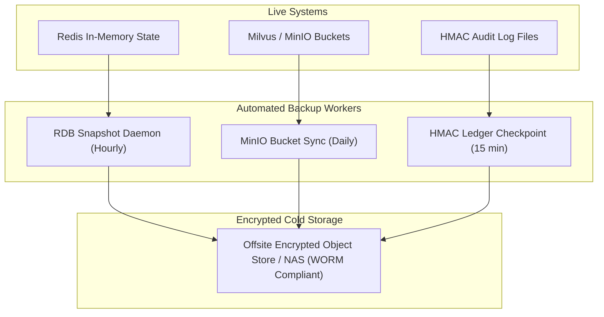

# CAMserv — Production Deployment & Infrastructure Guide

> **Document Version:** 1.0.0  
> **Status:** Production Standard  
> **Reference Compute Target:** NVIDIA GeForce RTX 3060 Laptop GPU (6GB VRAM, Compute 8.6), CUDA 13.5, Python 3.14  
> **Container Runtime:** Docker Engine 26+ / Docker Compose v2.27+ with NVIDIA Container Toolkit

---

## 1. Hardware Requirements & Sizing Matrix

CAMserv requires dedicated discrete GPU acceleration for low-latency deep learning inference. The table below outlines compute, memory, and storage dimensions across three camera density tiers.

| Specification | Small Scale (1–4 Cameras) | Medium Scale (5–8 Cameras) | Enterprise Scale (9–16 Cameras) |
| :--- | :--- | :--- | :--- |
| **Target Workload** | 4 streams @ 1080p, 15 FPS | 8 streams @ 1080p, 15 FPS | 16 streams @ 1080p, 15 FPS |
| **GPU Accelerator** | **NVIDIA RTX 3060 Laptop / Desktop (6GB VRAM)** | NVIDIA RTX 3080 / RTX 4070 (12GB VRAM) | NVIDIA RTX 4090 / A5000 (24GB VRAM) |
| **CUDA Compute Capability** | 8.6 (Ampere) | 8.6 / 8.9 (Ada Lovelace) | 8.9 / 8.6 |
| **Host CPU** | 8 Cores (Intel i7 11th Gen / AMD Ryzen 7) | 12 Cores (Intel i7 13th Gen / AMD Ryzen 9) | 16–24 Cores (AMD EPYC / Intel Xeon) |
| **Host RAM** | 16 GB DDR4/DDR5 | 32 GB DDR5 | 64–128 GB DDR5 ECC |
| **Network Interfaces** | 1x 1 Gbps Ethernet (Dedicated Camera Subnet) | 2x 1 Gbps (LACP Bonded) | 1x 10 Gbps SFP+ |
| **OS Support** | Windows 11 Pro / Ubuntu 22.04 LTS Server | Ubuntu 22.04 / 24.04 LTS Server | Ubuntu 22.04 LTS / RHEL 9 |
| **Fast NVMe Storage** | 500 GB NVMe PCIe 4.0 | 1 TB NVMe PCIe 4.0 | 2 TB NVMe PCIe 4.0 (RAID 1) |
| **Archive Storage (7-Day)** | 1 TB SATA SSD / NAS | 3 TB Surveillance HDD / NAS | 8–12 TB Enterprise Storage Array |

---

## 2. Deployment Topology Architecture

```mermaid
graph TD
    subgraph "External Ingress & Cameras"
        CAM_NET["Isolated Camera VLAN (192.168.10.0/24)<br/>RTSP Feeds"]
        CLIENT_NET["Client Workstations / Web Dashboards<br/>HTTPS / WSS"]
    end

    subgraph "Host Node / Docker Engine Network"
        NGINX["Nginx Edge Proxy<br/>(TLS 1.3 Termination, Port 443)"]
        
        subgraph "CAMserv Core Services"
            API["camserv-api<br/>FastAPI Web & WebSocket Hub"]
            WORKER["camserv-worker<br/>(GPU Accelerated: ONNX Runtime, CUDA 13.5)"]
        end
        
        subgraph "Data & State Infrastructure"
            REDIS[("Redis 7.2 (hiredis)<br/>State & Pub/Sub")]
            
            subgraph "Milvus Vector Subsystem"
                ETCD[("etcd Cluster")]
                MINIO[("MinIO Object Store")]
                MILVUS[("Milvus Standalone 2.3+")]
                
                ETCD --> MILVUS
                MINIO --> MILVUS
            end
        end
    end

    CLIENT_NET -->|HTTPS / WSS (Port 443)| NGINX
    NGINX -->|HTTP (Port 8000)| API
    CAM_NET -->|RTSP RTP| WORKER
    
    API <-->|State / Sessions| REDIS
    WORKER <-->|Events Pub/Sub| REDIS
    WORKER -->|Vectors ANN| MILVUS
    API -->|Query Metadata| MILVUS
    
    classDef edge fill:#135200,stroke:#52c41a,color:#fff;
    classDef gpu fill:#2d5a27,stroke:#73d13d,color:#fff;
    classDef db fill:#003a8c,stroke:#1890ff,color:#fff;
    
    class NGINX edge;
    class WORKER,API gpu;
    class REDIS,MILVUS,ETCD,MINIO db;
```

---

## 3. Production Docker Compose Configuration

Create `c:\Users\MPront\Documents\CAMserv\docker-compose.yml`:

```yaml
version: "3.9"

services:
  # -------------------------------------------------------------------------
  # Nginx Reverse Proxy (TLS 1.3 & Rate Limiting)
  # -------------------------------------------------------------------------
  nginx:
    image: nginx:1.25-alpine
    container_name: camserv-nginx
    restart: unless-stopped
    ports:
      - "80:80"
      - "443:443"
    volumes:
      - ./deploy/nginx/nginx.conf:/etc/nginx/nginx.conf:ro
      - ./deploy/tls:/etc/nginx/certs:ro
    depends_on:
      camserv-api:
        condition: service_healthy
    networks:
      - camserv-net

  # -------------------------------------------------------------------------
  # CAMserv FastAPI Application Server
  # -------------------------------------------------------------------------
  camserv-api:
    build:
      context: .
      dockerfile: Dockerfile
      target: runtime
    image: camserv:0.1.0
    container_name: camserv-api
    restart: unless-stopped
    environment:
      - CAMSERV_ENVIRONMENT=production
      - CAMSERV_HOST=0.0.0.0
      - CAMSERV_PORT=8000
      - CAMSERV_STORAGE__REDIS__HOST=redis
      - CAMSERV_STORAGE__MILVUS__HOST=milvus
      - CAMSERV_SECURITY__JWT__SECRET_KEY=${CAMSERV_JWT_SECRET}
    volumes:
      - camserv-data:/app/data
      - camserv-logs:/app/logs
    healthcheck:
      test: ["CMD", "curl", "-f", "http://localhost:8000/api/v1/system/health"]
      interval: 15s
      timeout: 5s
      retries: 3
    depends_on:
      - redis
      - milvus
    networks:
      - camserv-net

  # -------------------------------------------------------------------------
  # CAMserv GPU Pipeline Worker
  # -------------------------------------------------------------------------
  camserv-worker:
    image: camserv:0.1.0
    container_name: camserv-worker
    restart: unless-stopped
    command: ["python", "-m", "camserv.pipeline.engine"]
    environment:
      - CAMSERV_ENVIRONMENT=production
      - CAMSERV_INFERENCE__DEVICE=cuda
      - CAMSERV_INFERENCE__HALF_PRECISION=true
      - CAMSERV_STORAGE__REDIS__HOST=redis
      - CAMSERV_STORAGE__MILVUS__HOST=milvus
      - CAMSERV_SECURITY__JWT__SECRET_KEY=${CAMSERV_JWT_SECRET}
    deploy:
      resources:
        reservations:
          devices:
            - driver: nvidia
              count: 1
              capabilities: [gpu, video]
    volumes:
      - camserv-data:/app/data
      - camserv-logs:/app/logs
      - ./models:/app/models:ro
    depends_on:
      - redis
      - milvus
    networks:
      - camserv-net

  # -------------------------------------------------------------------------
  # Redis Cache & Message Bus
  # -------------------------------------------------------------------------
  redis:
    image: redis:7.2-alpine
    container_name: camserv-redis
    restart: unless-stopped
    command: ["redis-server", "--appendonly", "yes", "--maxmemory", "2gb", "--maxmemory-policy", "volatile-lru"]
    volumes:
      - redis-data:/data
    networks:
      - camserv-net

  # -------------------------------------------------------------------------
  # Milvus Standalone Vector Store (etcd + minio + milvus-standalone)
  # -------------------------------------------------------------------------
  etcd:
    image: quay.io/coreos/etcd:v3.5.5
    container_name: milvus-etcd
    restart: unless-stopped
    environment:
      - ETCD_AUTO_COMPACTION_MODE=revision
      - ETCD_AUTO_COMPACTION_RETENTION=1000
      - ETCD_QUOTA_BACKEND_BYTES=4294967296
      - ETCD_SNAPSHOT_COUNT=50000
    volumes:
      - etcd-data:/etcd
    command: etcd -advertise-client-urls=http://127.0.0.1:2379 -listen-client-urls http://0.0.0.0:2379 --data-dir /etcd
    networks:
      - camserv-net

  minio:
    image: minio/minio:RELEASE.2023-03-20T20-16-18Z
    container_name: milvus-minio
    restart: unless-stopped
    environment:
      MINIO_ACCESS_KEY: minioadmin
      MINIO_SECRET_KEY: minioadmin
    volumes:
      - minio-data:/minio_data
    command: minio server /minio_data
    networks:
      - camserv-net

  milvus:
    image: milvusdb/milvus:v2.3.4
    container_name: camserv-milvus
    restart: unless-stopped
    command: ["milvus", "run", "standalone"]
    environment:
      ETCD_ENDPOINTS: etcd:2379
      MINIO_ADDRESS: minio:9000
    volumes:
      - milvus-data:/var/lib/milvus
    ports:
      - "19530:19530"
    depends_on:
      - "etcd"
      - "minio"
    networks:
      - camserv-net

volumes:
  camserv-data:
  camserv-logs:
  redis-data:
  etcd-data:
  minio-data:
  milvus-data:

networks:
  camserv-net:
    driver: bridge
```

---

## 4. Multi-Stage Production Dockerfile

```dockerfile
# ===========================================================================
# Stage 1: Build & Dependency Wheel Cache
# ===========================================================================
FROM nvidia/cuda:12.4.1-runtime-ubuntu22.04 AS builder

ENV DEBIAN_FRONTEND=noninteractive \
    PYTHONUNBUFFERED=1 \
    PIP_NO_CACHE_DIR=1

RUN apt-get update && apt-get install -y --no-install-recommends \
    software-properties-common \
    build-essential \
    curl \
    git \
    ffmpeg \
    && add-apt-repository ppa:deadsnakes/ppa -y \
    && apt-get update \
    && apt-get install -y --no-install-recommends \
    python3.11 \
    python3.11-dev \
    python3.11-venv \
    && rm -rf /var/lib/apt/lists/*

RUN python3.11 -m ensurepip && pip3.11 install --upgrade pip setuptools wheel

WORKDIR /build
COPY pyproject.toml .
RUN pip3.11 wheel --no-deps -w /build/wheels -e ".[all]" || pip3.11 wheel -w /build/wheels .[all]

# ===========================================================================
# Stage 2: Minimal Distroless / Hardened Runtime Image
# ===========================================================================
FROM nvidia/cuda:12.4.1-runtime-ubuntu22.04 AS runtime

ENV DEBIAN_FRONTEND=noninteractive \
    PYTHONUNBUFFERED=1 \
    PATH="/opt/venv/bin:$PATH"

RUN apt-get update && apt-get install -y --no-install-recommends \
    software-properties-common \
    ffmpeg \
    libgl1-mesa-glx \
    libglib2.0-0 \
    curl \
    && add-apt-repository ppa:deadsnakes/ppa -y \
    && apt-get update \
    && apt-get install -y --no-install-recommends \
    python3.11 \
    python3.11-venv \
    && rm -rf /var/lib/apt/lists/*

RUN useradd -m -u 10001 camserv
WORKDIR /app

RUN python3.11 -m venv /opt/venv
COPY --from=builder /build/wheels /tmp/wheels
RUN pip install --no-cache-dir /tmp/wheels/* && rm -rf /tmp/wheels

COPY --chown=camserv:camserv src/ /app/src/
COPY --chown=camserv:camserv pyproject.toml /app/
RUN pip install --no-deps -e /app

USER camserv

EXPOSE 8000
CMD ["uvicorn", "camserv.api.app:app", "--host", "0.0.0.0", "--port", "8000", "--workers", "2"]
```

---

## 5. Nginx TLS 1.3 Reverse Proxy Configuration

Create `deploy/nginx/nginx.conf`:

```nginx
events {
    worker_connections 2048;
}

http {
    include       /etc/nginx/mime.types;
    default_type  application/octet-stream;

    # Rate Limiting Zones
    limit_req_zone $binary_remote_addr zone=api_limit:10m rate=30r/s;
    limit_conn_zone $binary_remote_addr zone=addr_limit:10m;

    upstream camserv_backend {
        server camserv-api:8000;
        keepalive 32;
    }

    server {
        listen 80;
        server_name _;
        return 301 https://$host$request_uri;
    }

    server {
        listen 443 ssl http2;
        server_name _;

        ssl_certificate /etc/nginx/certs/camserv.crt;
        ssl_certificate_key /etc/nginx/certs/camserv.key;

        ssl_protocols TLSv1.3 TLSv1.2;
        ssl_ciphers 'TLS_AES_256_GCM_SHA384:TLS_CHACHA20_POLY1305_SHA256:ECDHE-RSA-AES256-GCM-SHA384';
        ssl_prefer_server_ciphers on;
        ssl_session_cache shared:SSL:10m;
        ssl_session_timeout 1d;

        # Hardened Security Headers
        add_header X-Frame-Options "DENY" always;
        add_header X-Content-Type-Options "nosniff" always;
        add_header Strict-Transport-Security "max-age=63072000; includeSubDomains" always;

        location /api/ {
            limit_req zone=api_limit burst=20 nodelay;
            proxy_pass http://camserv_backend;
            proxy_http_version 1.1;
            proxy_set_header Connection "";
            proxy_set_header Host $host;
            proxy_set_header X-Real-IP $remote_addr;
            proxy_set_header X-Forwarded-For $proxy_add_x_forwarded_for;
            proxy_set_header X-Forwarded-Proto $scheme;
        }

        location /ws/ {
            proxy_pass http://camserv_backend;
            proxy_http_version 1.1;
            proxy_set_header Upgrade $http_upgrade;
            proxy_set_header Connection "Upgrade";
            proxy_set_header Host $host;
            proxy_read_timeout 3600s;
        }
    }
}
```

---

## 6. Environment Configuration Variables Matrix

| Environment Variable | Type | Default | Mandatory | Description |
| :--- | :---: | :---: | :---: | :--- |
| `CAMSERV_ENVIRONMENT` | str | `development` | No | Execution mode (`development`, `staging`, `production`). |
| `CAMSERV_LOG_LEVEL` | str | `INFO` | No | Logging verbosity (`DEBUG`, `INFO`, `WARNING`, `ERROR`). |
| `CAMSERV_SECURITY__JWT__SECRET_KEY` | str | — | **YES** | Cryptographic secret for JWT verification (min 32 chars). |
| `CAMSERV_INFERENCE__DEVICE` | str | `cuda` | No | Compute provider (`cuda` or `cpu`). |
| `CAMSERV_INFERENCE__HALF_PRECISION` | bool | `true` | No | FP16 inference for Tensor Core speedups. |
| `CAMSERV_STORAGE__REDIS__HOST` | str | `localhost` | No | Hostname of Redis instance. |
| `CAMSERV_STORAGE__MILVUS__HOST` | str | `localhost` | No | Hostname of Milvus vector engine. |
| `CAMSERV_PRIVACY__DATA_RETENTION_HOURS` | int | `720` | No | Metadata retention period (30 days). |
| `CAMSERV_PRIVACY__VIDEO_RETENTION_HOURS` | int | `168` | No | Video recording purge horizon (7 days). |

---

## 7. Backup, Disaster Recovery & Log Aggregation



### 7.1 Redis Persistence
Redis is configured with hybrid persistence:
- **AOF (Append Only File):** `appendfsync everysec` ensuring sub-second transaction recovery.
- **RDB Snapshots:** Captured every 60 minutes and rotated automatically off-host.

### 7.2 Zero-Downtime Rolling Upgrades
1. Run pre-flight health checks: `curl -f http://localhost:8000/api/v1/system/health`.
2. Pull new container image: `docker compose pull camserv-api camserv-worker`.
3. Perform canary launch of `camserv-api` with zero dropping of WebSocket connections.
4. Verify HMAC ledger validation utility returns zero corruption alerts.
