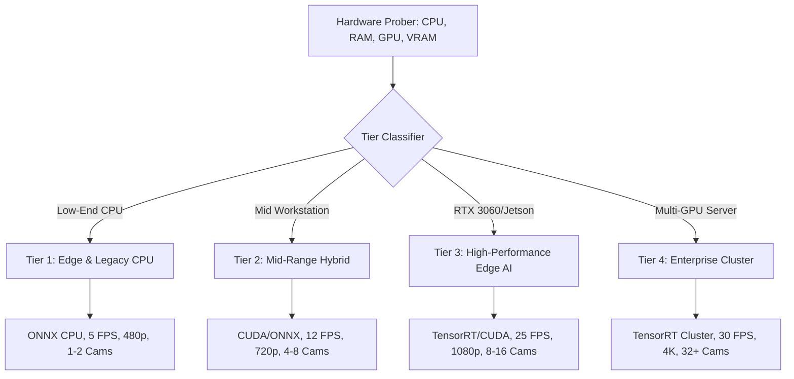

# CAMserv Universal Hardware Compatibility & Deployment Matrix

## 1. Architectural Philosophy

CAMserv is engineered with a **Universal Hardware Adaptation Architecture**. Rather than demanding high-end enterprise servers as a hard prerequisite, CAMserv dynamically inspects the host hardware upon boot and tunes its computational graph, inference backend, and ingestion pipelines to maximize throughput without crashing or dropping frames.

---

## 2. The Four Operational Tiers



### Tier 1: Low-End Edge & Legacy CPU
- **Hardware Profile:** 2–4 CPU cores, 4–8 GB RAM, Intel UHD / AMD Vega integrated graphics or older headless x86_64 nodes.
- **Inference Engine:** ONNX Runtime CPU (`ExecutionProvider = CPUExecutionProvider`). INT8 quantized models.
- **Video Pipeline:** Hardware decode fallback to software multi-threaded libavcodec. Ingestion downscaled to $640 \times 360$ or $854 \times 480$.
- **Tracking Algorithm:** ByteTrack with motion-only Kalman filtering (appearance ReID disabled to conserve compute).
- **Concurrency Target:** 1–2 simultaneous video channels at 3–5 FPS inference decimation.

### Tier 2: Mid-Range Workstation & Entry Server
- **Hardware Profile:** 6–8 CPU cores, 16 GB RAM, Entry GPU (NVIDIA GTX 1650, RTX 3050, or Intel Arc) or high-frequency AVX2/AVX-512 CPU.
- **Inference Engine:** CUDA FP16 or DirectML. Batch size = 1.
- **Video Pipeline:** NVDEC hardware decoding. Ingestion scaled to $1280 \times 720$.
- **Tracking Algorithm:** ByteTrack with lightweight feature embeddings.
- **Concurrency Target:** 4–8 simultaneous video channels at 10–15 FPS.

### Tier 3: High-Performance Edge AI Workstation
- **Hardware Profile:** 8–16 CPU cores, 16–32 GB RAM, NVIDIA RTX 3060 (6GB/12GB), RTX 4070, or Jetson AGX Orin (32GB/64GB).
- **Inference Engine:** NVIDIA TensorRT (FP16 engine optimization) with CUDA 12.x / 13.x.
- **Video Pipeline:** Full NVDEC multi-stream hardware decoding. Native 1080p resolution ($1920 \times 1080$).
- **Tracking Algorithm:** Full BoT-SORT with appearance feature embeddings and cosine distance association.
- **Concurrency Target:** 8–16 simultaneous video channels at 20–30 FPS real-time.

### Tier 4: Enterprise Multi-GPU Infrastructure
- **Hardware Profile:** 16+ CPU cores, 64+ GB RAM, NVIDIA A100, H100, L40S, or dual RTX 4090 GPUs.
- **Inference Engine:** Multi-GPU TensorRT with dynamic batching and INT8 quantization calibrated via entropy loss.
- **Video Pipeline:** Distributed NVDEC/DeepStream pipeline with zero-copy shared memory. Multi-channel 4K ingestion ($3840 \times 2160$).
- **Tracking Algorithm:** Multi-camera BoT-SORT with global cross-camera ReID clustering and Milvus IVF-FLAT vector indexing.
- **Concurrency Target:** 32+ simultaneous video channels at 30 FPS.

---

## 3. Dynamic Load Shedding & Thermal Self-Healing

CAMserv includes the `AdaptiveManager` watchdog that monitors host metrics every 500ms:

| Metric | Warning Threshold | Critical Shedding Action | Recovery Hysteresis |
| :--- | :---: | :--- | :--- |
| **CPU Utilization** | $> 80\%$ | Decimate inference frame rate by $50\%$ | 10 cycles $< 70\%$ |
| **Host RAM** | $> 85\%$ | Clear cache buffers, purge non-essential frames | 10 cycles $< 75\%$ |
| **GPU VRAM** | $> 90\%$ | Fallback to INT8 models or CPU secondary pipeline | 10 cycles $< 80\%$ |
| **Queue Fill Ratio** | $> 75\%$ | Drop non-keyframe inference requests | Immediate when queue $< 30\%$ |

---

## 4. Hardware Detection Command

To verify your system tier and compute accelerators:

```bash
python -m camserv.main detect-hw
```

Example verified output on NVIDIA RTX 3060 Laptop GPU:
```json
{
  "cpu_cores": 12,
  "ram_total_gb": 15.75,
  "gpu_available": true,
  "gpu_name": "NVIDIA GeForce RTX 3060 Laptop GPU",
  "gpu_vram_gb": 6.0,
  "cuda_version": "13.5",
  "assigned_tier": "Tier 3: High-Performance Edge AI Workstation",
  "optimal_channels": 8,
  "recommended_resolution": "1920x1080",
  "recommended_inference_fps": 25
}
```
