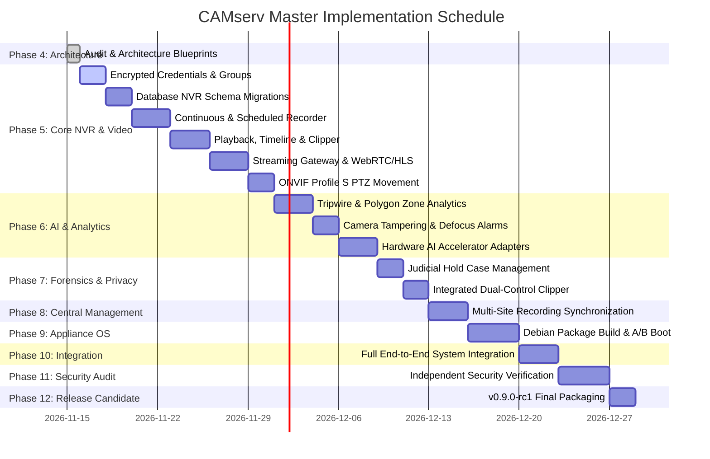

# CAMserv Master Implementation Roadmap

**Document ID:** ROADMAP-IMPL-2026-001  
**Classification:** Engineering Roadmap & Milestones  
**Version:** 1.0.0  
**Date:** November 15, 2026  

---

## 1. Development Methodology & Execution Discipline

Development proceeds strictly in sequential, controlled engineering tasks adhering to the following invariants:
1. Every task begins with inspection of existing code and explicit definition of dependencies and risks.
2. No mock is ever used to falsely claim real hardware or protocol compatibility.
3. Every new module must include exhaustive automated unit and integration tests.
4. Existing tests must remain passing (100% pass rate) with zero regressions.
5. The cryptographic audit trail (`logs/audit.jsonl`) must remain untampered.

---

## 2. Phase-by-Phase Implementation Plan

---

## 3. Work Breakdown Structure (Phases 4 to 12)

### Phase 4: Product Architecture Expansion (Current Phase)
- [x] Repository-wide read-only audit and master expansion assessment.
- [x] Authoritative architecture documents published in `docs/`.
- [x] Risk register and implementation backlog formalization.

### Phase 5: Core NVR & Video Infrastructure
- [ ] **Task 5.1:** Implement `camserv.nvr.credentials` and `camserv.nvr.groups`.
- [ ] **Task 5.2:** Extend `camserv.storage.sqlite_store` with NVR relational schema migrations.
- [ ] **Task 5.3:** Build `camserv.nvr.recording_engine` with continuous/scheduled segmentation, RAM pre-roll stitching, and crash recovery.
- [ ] **Task 5.4:** Build `camserv.nvr.playback` with multi-camera timeline navigation and clipped export.
- [ ] **Task 5.5:** Build `camserv.nvr.streaming` with WebRTC, LL-HLS, and MSE streaming gateway.
- [ ] **Task 5.6:** Build `camserv.nvr.ptz` with ONVIF Profile S PTZ controls and presets.

### Phase 6: AI and Event Intelligence
- [ ] **Task 6.1:** Build `camserv.analytics.zones` with tripwire line crossing, polygon entry/exit, and loitering timers.
- [ ] **Task 6.2:** Build `camserv.analytics.tampering` with camera obstruction, blur, and redirection alarms.
- [ ] **Task 6.3:** Build `camserv.analytics.adapters` with pluggable hardware acceleration backends.

### Phase 7: Digital Forensics & Privacy Integration
- [ ] **Task 7.1:** Integrate judicial hold locking directly with recording segment lifecycles.
- [ ] **Task 7.2:** Enhance dual-control export workflows to support clipped timeline recordings.

### Phase 8: Central Enterprise Platform
- [ ] **Task 8.1:** Add remote recording synchronization and fleet-wide camera discovery.

### Phase 9: Appliance & Edge Platform
- [ ] **Task 9.1:** Build Debian packaging scripts and appliance installation images.

### Phase 10: Product Integration & Build Preparation
- [ ] **Task 10.1:** Integrate REST endpoints and Web Console views.
- [ ] **Task 10.2:** End-to-end integration testing across synthetic camera feeds.

### Phase 11: Independent Verification & Security Closure
- [ ] **Task 11.1:** Independent security audit and vulnerability reproduction.
- [ ] **Task 11.2:** Remediation of all critical and high findings.

### Phase 12: Packaging and Release Candidate
- [ ] **Task 12.1:** Generate official CycloneDX SBOM and SHA-256 checksums.
- [ ] **Task 12.2:** Release candidate `v0.9.0-rc1` signoff.
