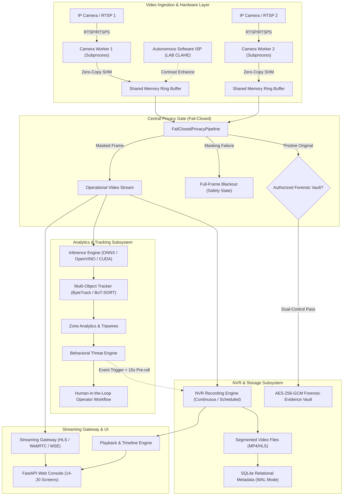

# CAMserv Master Architecture Specification

**Document ID:** ARCH-MASTER-2026-001  
**Classification:** Authoritative Technical Blueprint  
**Version:** 1.0.0  
**Date:** November 15, 2026  

---

## 1. High-Level System Architecture

CAMserv is engineered as a decoupled, asynchronous, multi-process streaming and analytics platform designed to isolate hardware drivers, stream decoders, neural networks, and storage writes into dedicated security sandboxes.

---

## 2. Subsystem Boundaries and Responsibilities

### 2.1 Video Ingestion & Worker Isolation (`camserv.acquisition`)
- **Process Isolation:** Each camera RTSP/RTSPS connection is isolated inside a dedicated worker subprocess (`CameraWorkerSupervisor`). If FFmpeg or OpenCV crashes, the parent supervisor automatically restarts the worker without impacting other streams.
- **Shared Memory IPC:** High-resolution video frames (e.g., 1080p, 4K) are placed in circular POSIX shared memory buffers (`SharedMemoryRingBuffer`), enabling zero-copy frame access across pipeline stages.
- **Autonomous Software ISP:** Streams undergo real-time image quality evaluation and dynamic LAB CLAHE low-light equalization without color distortion.

### 2.2 Mandatory Fail-Closed Privacy Gate (`camserv.inference.privacy_pipeline`)
- **Centralized Enforcement:** Positioned as an immutable gate directly between frame ingestion and all consumer subsystems.
- **Blackout Guarantee:** If privacy mask detection encounters memory pressure, timeouts, or exceptions, the frame is immediately rendered as solid black ($0,0,0$), preventing accidental exposure of raw unmasked operational video.
- **Dual-Control Vault Path:** Only cryptographically authorized forensic vault processes can bypass the operational privacy filter, requiring verified dual-operator signatures under GDPR Art. 25.

### 2.3 Modular AI & Scene Analytics (`camserv.inference`, `camserv.analytics`)
- **Multi-Backend Runtime:** Abstracted inference engine capable of executing YOLOv8/v11 models on CPU, NVIDIA CUDA/TensorRT, Intel OpenVINO, DirectML, Coral Edge TPU, and Hailo-8 accelerators.
- **Anonymous Tracking:** ByteTrack and BoT-SORT kinematic association utilizing Kalman filters, assigning transient integer track IDs.
- **Zone Analytics:** Tripwire line crossing, polygon entry/exit, loitering candidate classification, and crowd density estimation.
- **Tampering Detection:** Real-time detection of lens obstruction, camera defocus, camera redirection, and sudden optical flow blackout.

### 2.4 NVR Recording & Storage Engine (`camserv.nvr`, `camserv.storage`)
- **Continuous & Scheduled Recording:** Segmented video recording service producing standard container files (MP4/HLS) with accurate UTC timestamps.
- **Pre-Roll RAM Ring Buffer:** Maintains a 15-second circular memory buffer per camera. When an event is triggered, the pre-roll footage is stitched to the event recording, capturing root causes before the trigger.
- **Tiered Storage Management:** Automatically migrates and prunes data across volatile RAM, fast NVMe operational storage, and long-term encrypted cold archives with GDPR 48-hour continuous retention purging and judicial hold protection.

### 2.5 Digital Forensics & Cryptographic Sealing (`camserv.storage.forensics`)
- **Tamper-Evident Hash Chaining:** Every evidence chunk and audit log is linked via SHA-256 hash chains.
- **Asymmetric Digital Signatures:** Packages are signed using Ed25519 asymmetric cryptography and sealed with RFC 3161 compliant timestamping tokens.
- **Independent Offline Verifier:** Evidence ZIP packages can be audited completely offline using CLI commands (`camserv verify-evidence <package.zip>`).

### 2.6 Distributed Central Fleet Management (`camserv.central`)
- **Multi-Site Isolation:** Enforces strict server-side tenant and site isolation boundaries.
- **Replay-Protected Envelopes:** Ed25519 signed communication envelopes featuring monotonic timestamps and UUID nonces to block replay attacks.
- **WAN Data Minimization:** Transmission of raw surveillance video over wide-area networks is programmatically blocked; edge nodes exchange only structured metadata and cryptographic hashes.

---

## 3. Communication Protocols and Wire Formats

| Path | Protocol | Format / Codec | Security / Controls |
| :--- | :--- | :--- | :--- |
| **Camera Ingestion** | RTSP / RTSPS / ONVIF | H.264, H.265, MJPEG | Digest Auth, TLS, Encrypted Credential Vault |
| **Inter-Process IPC** | POSIX Shared Memory | Raw BGR24 / NV12 NumPy arrays | Process Sandboxing, Semaphore Locks |
| **Live Streaming** | LL-HLS, WebRTC, MSE | fMP4, H.264, WebRTC RTP | JWT Bearer Auth, Fail-Closed Privacy |
| **Internal Telemetry** | In-Memory / SQLite WAL | Structured JSON / Dict | WAL Transactional Isolation |
| **Central WAN Sync** | HTTPS / WSS / gRPC | Ed25519 Signed JSON Envelopes | Challenge-Response, Nonce Replay Defense |
| **Metrics** | HTTP GET `/system/metrics` | Prometheus OpenMetrics Text | Role-Based Access Control (`system:read`) |
