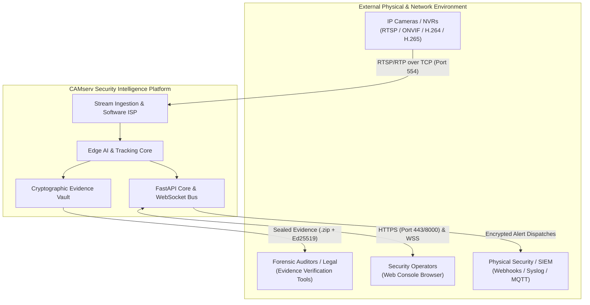
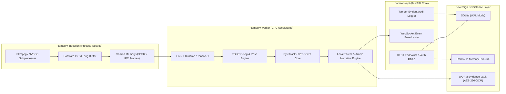
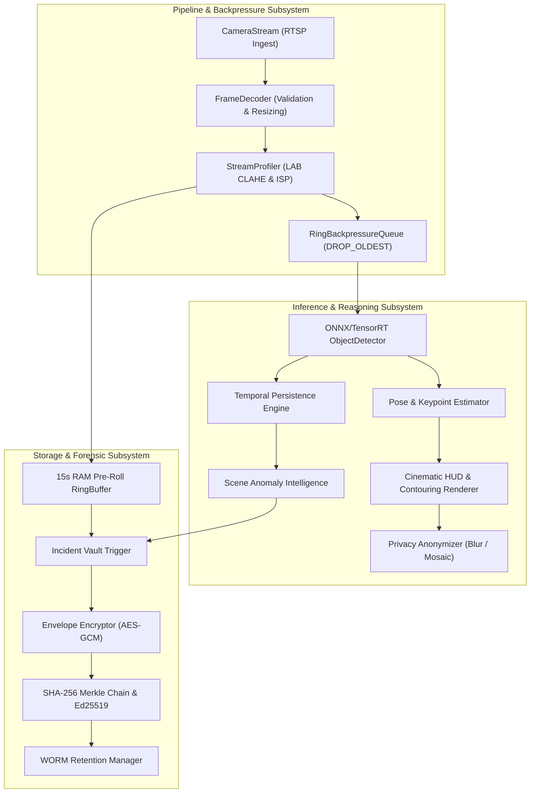
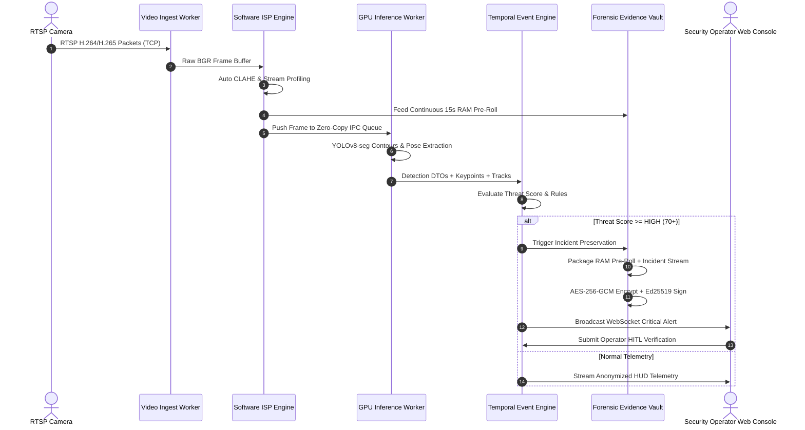
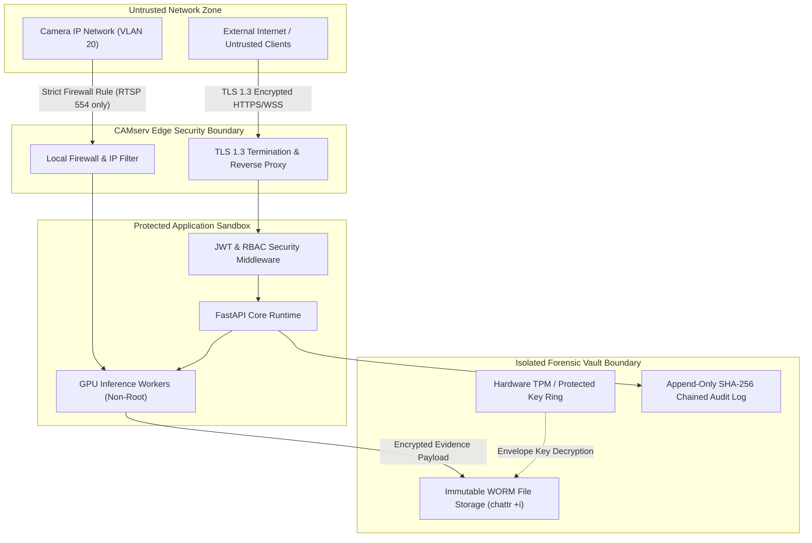
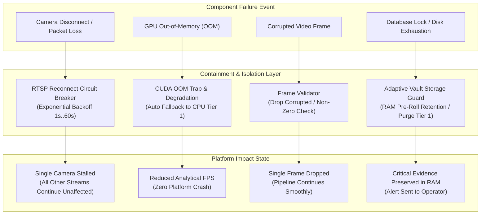
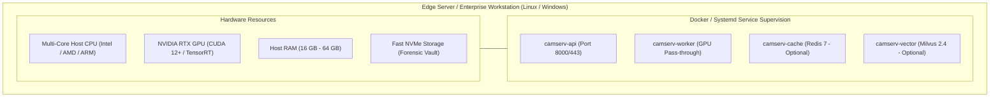

# CAMserv Master Architecture Blueprint
**Document ID:** ARCH-BLUEPRINT-2026-001  
**Author:** Chief Software Architect & Principal Systems Engineer  
**Date:** November 14, 2026  
**Status:** APPROVED FOR IMPLEMENTATION PLANNING  
**Target Version:** CAMserv Enterprise 2.5 (Multi-Process Sovereign Architecture)

---

## 1. Architectural Vision & Core Principles

CAMserv is engineered as a zero-cloud-dependent, high-assurance security intelligence platform. It enforces five non-negotiable architectural mandates:
1. **Evidence Before Assumptions:** Algorithmic inferences are explicitly marked as probabilistic predictions ($p \in [0.0, 1.0]$) and never recorded as established facts.
2. **Reliability Before Features:** Ingestion and evidence preservation are isolated from heavy analytical workers; analytics crashes cannot drop camera frames or corrupt storage.
3. **Security Before Convenience:** Zero Trust network isolation, hardware-anchored envelope encryption (AES-256-GCM), asymmetric Ed25519 forensic signing, and immutable audit logs.
4. **Privacy Before Analytics:** Fail-closed identity obfuscation, non-biometric tracking IDs, and zero facial recognition feature vectors.
5. **Universal Hardware Sovereignty:** 100% on-premise operation adapting autonomously to 4 hardware tiers without mandatory cloud API dependencies.

---

## 2. Mermaid Architectural Diagrams

### 2.1 System Context Diagram (C4 Level 1)

---

### 2.2 Container Architecture Diagram (C4 Level 2)

---

### 2.3 Component Architecture Diagram (C4 Level 3)

---

### 2.4 Data Flow Diagram (End-to-End Pipeline)

---

### 2.5 Video Processing Pipeline Diagram

```mermaid
flowchart LR
    A["RTSP Video Stream<br>(H.264/H.265)"] -->|"Demux & Transport<br>(TCP Interleaved)"| B["Hardware Decoder<br>(NVDEC / VAAPI / CPU)"]
    B -->|"Raw YUV420p Surface"| C["Format Conversion<br>(YUV -> RGB / BGR)"]
    C -->|"1080p Frame"| D["Stream Profiler & ISP<br>(LAB CLAHE Luminance Boost)"]
    D -->|"RAM Ring Buffer"| E["15s Pre-Roll Buffer<br>(Zero Disk I/O)"]
    D -->|"Letterboxed 640x640"| F["Inference Tensor<br>(FP16 / INT8 CUDA)"]
    F -->|"Neural Latents"| G["Segmentation Polygons<br>& 17-Keypoint Poses"]
    G -->|"Tracks & Contours"| H["Cinematic HUD Layer<br>(Ground Rings & Reticles)"]
    H -->|"Final Blended Feed"| I["Privacy Masking Layer<br>(Gaussian / Mosaic Redaction)"]
    I -->|"Display Surface"| J["Operator Live Console<br>(WebRTC / MJPEG WSS)"]
```

---

### 2.6 Security Trust Boundary Diagram

---

### 2.7 Failure Propagation Diagram

---

### 2.8 Deployment Architecture Diagram

---

## 3. Module Interface Contracts & Boundary Specifications

### Module Contract Registry
1. **Video Ingestion Worker (`camserv.acquisition.camera`):**
   - *Input:* RTSP URL, transport protocol (`tcp`), reconnect interval.
   - *Output:* Raw `VideoFrame` DTO with monotonic timestamp, sequence number, and decoded numpy BGR surface.
   - *Failure Boundary:* Crash of capture loop triggers local worker restart without terminating pipeline engine.
2. **Software ISP (`camserv.acquisition.isp`):**
   - *Input:* `VideoFrame` (Raw BGR).
   - *Output:* `VideoFrame` (Luminance-equalized via LAB CLAHE, profiled with contrast/sharpness metrics).
   - *Contract:* Must execute in $< 4.5\text{ ms}$ per frame on 1080p.
3. **Inference & Contouring Engine (`camserv.inference.detector` & `segmentation`):**
   - *Input:* Preprocessed frame tensor ($640 \times 640 \times 3$).
   - *Output:* List of `Detection` DTOs with polygon contour coordinates, 17 COCO keypoints, posture hint, and bounded confidence $p \in [0.0, 1.0]$.
4. **Deterministic Threat Engine (`camserv.events.threat_engine`):**
   - *Input:* List of active `Track` objects, scene telemetry, exclusion zones.
   - *Output:* `ThreatAssessment` with composite score $T \in [0, 100]$, factor breakdown ($w_1\dots w_5$), and bilingual Arabic/English situation narrative.
5. **Cryptographic Vault (`camserv.storage.adaptive_vault`):**
   - *Input:* Evidence package containing incident metadata, video chunks, and operator review logs.
   - *Output:* Sealed `.vault` archive with AES-256-GCM ciphertext, SHA-256 Merkle root, and Ed25519 asymmetric signature.
