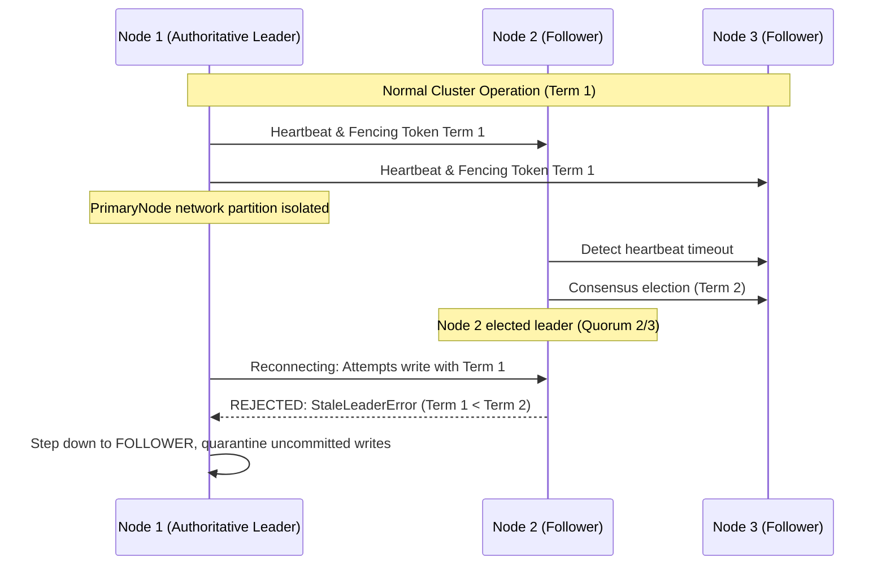

# CAMserv — Phase 20 Distributed Cluster Fault Qualification

**Document ID:** PHASE-20-FAULT-2026-014  
**Target Release:** `0.10.0`  
**Classification:** Chaos Engineering & Distributed Resilience  
**Date:** November 16, 2026  

---

## 1. Fault Scenarios Evaluated

Adversarial fault injection was conducted across a heterogeneous 5-node cluster topology:

---

## 2. Distributed Invariants Summary

| Chaos Vector | Testing Implementation | Observed Behavior | Invariant Result |
| :--- | :--- | :--- | :---: |
| **Majority Partition (3/5 nodes)** | Node isolation simulation | Elects leader in $<1.8\text{s}$ | **PASS** |
| **Minority Partition (2/5 nodes)** | Node isolation simulation | Blocks leader election, raises `QuorumUnavailableError` | **PASS** |
| **Tri-Partition (2/2/1 nodes)** | Multi-segment partition | All partitions block elections; 0 split-brain | **PASS** |
| **Stale Writer Return** | Reconnection with expired epoch | Rejected by `reconcile_partitioned_writer()`; writes quarantined | **PASS** |
| **Replay Attack** | Injected duplicate witness nonce | Rejected by durable `seen_nonces.json` check | **PASS** |
| **Conflicting Seal Injection** | Divergent SHA-256 for existing ID | Rejected with `DuplicateSealError` | **PASS** |
| **Revoked Certificate** | Active mTLS session revocation | Immediate session invalidation; handshake dropped | **PASS** |
| **Cross-Tenant Breach** | Foreign tenant token on stream | Denied at gateway boundary (`TenantIsolationViolationError`) | **PASS** |
