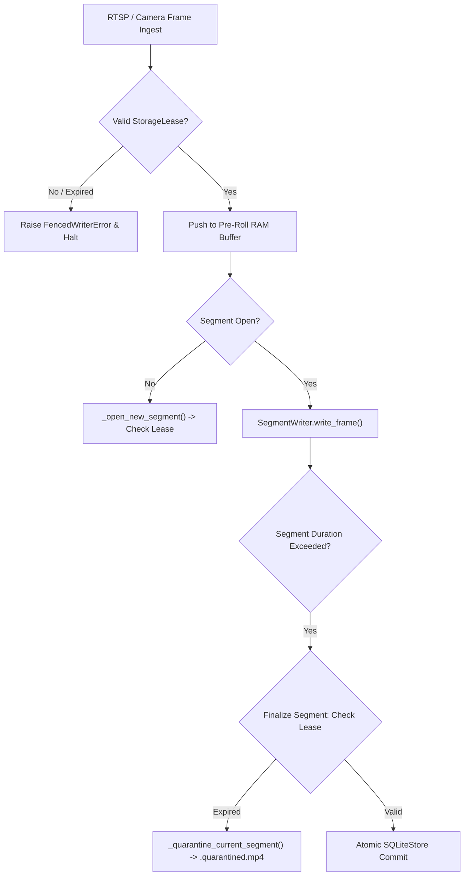

# CAMserv — Phase 20 StorageLease & Writer Fencing Audit

**Document ID:** PHASE-20-FENCE-2026-004  
**Target Release:** `0.10.0`  
**Classification:** Distributed Storage Safety & Dual-Writer Protection  
**Date:** November 16, 2026  

---

## 1. Scope of Write Path Audit

Every filesystem and database write path in the NVR subsystem was traced and evaluated against active `StorageLease` validity:

---

## 2. Comprehensive Write Path Analysis

| Write Path | Execution Method | Fencing Guard Applied | Behavior on Stale / Expired Lease |
| :--- | :--- | :--- | :--- |
| **1. Frame Ingestion** | `NVRRecordingEngine.ingest_frame()` | `enforce_storage_fencing` check against `storage_leases[cam_id]` | Raises `FencedWriterError`. Frame discarded, write aborted. |
| **2. Recording Initialization** | `NVRRecordingEngine.start_recording()` | Creates session; frame write gated at ingestion | Ingestion halted immediately if unleased. |
| **3. Segment Opening** | `NVRRecordingEngine._open_new_segment()` | Verifies lease before instantiating `SegmentWriter` | Raises `FencedWriterError`. No `.part` file created. |
| **4. Segment Finalization** | `NVRRecordingEngine._finalize_current_segment()` | Lease validity checked before database registration | Unleased segment moved to `.quarantined.mp4`. SQLiteStore commit bypassed. |
| **5. Pre-Roll Event Trigger** | `NVRRecordingEngine.trigger_event()` | Pre-roll frames written via gated `_open_new_segment` | Raises `FencedWriterError` if lease expired. |
| **6. Crash Recovery** | `NVRRecordingEngine.recover_incomplete_recordings()` | Lease checked for camera directory during scan | Unleased incomplete files quarantined to `.quarantined.mp4`, not committed. |
| **7. Quota Enforcement** | `NVRRecordingEngine.enforce_storage_quota()` | Checks judicial holds and retention rules | Judicial hold segments preserved; unlinked oldest non-held files. |

---

## 3. Storage Architecture Limitations & Real-World Boundaries

* **Local Filesystem Isolation:** CAMserv's `StorageLease` protocol provides guaranteed writer fencing for shared network storage (NFS/SMB) and local disks by coordinating through monotonic cluster epochs and lease durations.
* **Clock Skew Safety Margin:** Leases use monotonic timestamps (`time.time()`). Heartbeat timeouts are configured with a $2\times$ safety factor ($20.0\text{s}$ lease on $10.0\text{s}$ heartbeat) to absorb network jitter.
* **Decoupled Physical Storage:** For dual-controller physical SAN/NVMe-oF arrays, SCSI-3 / NVMe Reservation commands are designated as a physical pre-LTS hardware trial gate.
