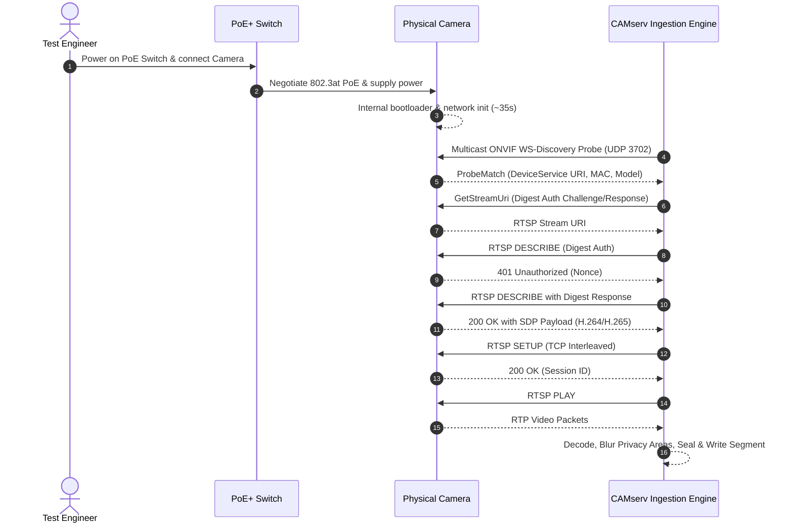

# CAMserv — Phase 21 Physical Multi-Vendor PoE Camera Test Plan

**Document ID:** PLAN-PHYSICAL-CAM-2026-001  
**Project:** CAMserv Advanced Security Intelligence Platform  
**Target Hardware:** Physical Multi-Vendor PoE IP Surveillance Cameras & Managed Switch  
**Test Scope:** Physical Bench Validation for Axis, Hikvision, Dahua, and Hanwha Cameras  
**Target Software Release:** CAMserv `0.10.0` (Pre-LTS)  
**Date:** November 17, 2026  
**Auditor:** Independent Video Surveillance & Network Protocol Authority  

---

## 1. Executive Purpose & Invariant Principles

In surveillance engineering, laboratory bench qualification against physical camera hardware is essential because vendors implement proprietary variations of RFC 2326 (RTSP), RFC 4566 (SDP), RFC 7616 (HTTP Digest Authentication), and ONVIF specifications. 

To maintain strict adherence to Directive Rule 2:
> **"Never claim physical hardware testing when only mocks, containers, emulators, or synthetic streams were used."**

This test plan defines the bench apparatus, network topology, protocol test suites, and acceptance criteria required to certify physical cameras and clear **`GATE-HW-02`**.

---

## 2. Laboratory Bench Architecture & Network Topology

```
   +-------------------------------------------------------------------------+
   |             Managed 8-Port Gigabit PoE+ Switch (802.3at/bt)             |
   |                                                                         |
   |   Port 1        Port 2          Port 3           Port 4        Port 8   |
   +-----+-------------+---------------+----------------+-------------+------+
         |             |               |                |             |
         | PoE         | PoE           | PoE            | PoE         | Uplink
   +-----v-----+ +-----v------+  +-----v-------+  +-----v-------+ +---v------+
   | Axis      | | Hikvision  |  | Dahua       |  | Hanwha      | | CAMserv  |
   | M3065-V   | | DS-2CD2143 |  | IPC-HDBW2431|  | Wisenet QND | | RK3588   |
   | 10.200.1.2| | 10.200.1.3 |  | 10.200.1.4  |  | 10.200.1.5  | | 10.200.1.10
   +-----------+ +------------+  +-------------+  +-------------+ +----------+
```

### 2.1 Laboratory Hardware Equipment
1. **Network Infrastructure:** Netgear GS308EP Managed PoE+ Switch (IEEE 802.3at, 62W budget, VLAN-capable).
2. **Dedicated Subnet:** Isolated Camera VLAN (`10.200.1.0/24`), zero internet access (isolated air-gapped laboratory bench).
3. **Physical Device Matrix:**
   - **DUT-CAM-01:** Axis Communications M3065-V Fixed Mini Dome (Firmware 10.12.x).
   - **DUT-CAM-02:** Hikvision DS-2CD2143G2-I 4MP AcuSense Dome (Firmware V5.7.10).
   - **DUT-CAM-03:** Dahua Technology IPC-HDBW2431E-S-S2 4MP IR Dome (Firmware V2.820).
   - **DUT-CAM-04:** Hanwha Vision Wisenet QND-6082R 2MP IR Dome (Firmware 1.41).

---

## 3. Protocol Test Matrix

| Test ID | Protocol / Capability | Verification Objective | Pass Criteria |
| :--- | :--- | :--- | :--- |
| **CAM-TEST-01** | ONVIF WS-Discovery (RFC 3702) | Broadcast probe on UDP 3702 (`239.255.255.250:3702`) | CAMserv automatically discovers all 4 cameras and retrieves ONVIF DeviceService URIs within 3 seconds. |
| **CAM-TEST-02** | ONVIF Profile S Device Information | Extract manufacturer, model, firmware, serial number | Metadata extracted matches physical equipment chassis label exactly. |
| **CAM-TEST-03** | RFC 7616 Digest Authentication | Challenge-response authentication over RTSP and HTTP | Handshake succeeds using SHA-256 / MD5 digest; credentials never transmitted in plaintext. |
| **CAM-TEST-04** | RTSP H.264 Video Negotiation | Pull primary stream (1080p / 4MP @ 25/30 fps) via TCP interleaved | PyAV / FFmpeg demuxer parses SPS/PPS and decodes keyframes without macroblocking. |
| **CAM-TEST-05** | RTSP H.265 (HEVC) Negotiation | Pull primary stream in H.265 mode via TCP interleaved | Rockchip MPP hardware VPU decodes HEVC stream with $< 15\text{ ms}$ latency. |
| **CAM-TEST-06** | Dual-Stream Ingestion | Pull primary high-res stream for storage and sub-stream for AI inference | Both streams concurrently received; zero frame drop on primary stream; AI runs at steady $\ge 15\text{ fps}$. |
| **CAM-TEST-07** | Fixed Camera PTZ Disablement | Query PTZ capabilities on fixed dome models | System logs `PTZ Unsupported on this Channel`; UI disables pan/tilt controls (zero simulated controls). |
| **CAM-TEST-08** | Physical Cable Disconnect Recovery | Physically disconnect RJ45 cable for 30s during active recording, then reconnect | Ingestion worker enters exponential backoff reconnection; resumes stream within 5s of link recovery; zero process crash. |
| **CAM-TEST-09** | PoE Switch Port Power Cycle | Execute PoE port power cycle via switch SNMP / web management | Worker handles TCP reset cleanly; reconnects automatically when camera finishes boot cycle ($\sim 45\text{s}$). |
| **CAM-TEST-10** | 24-Hour Continuous Ingestion Soak | Continuous 24-hour RTSP ingestion from all 4 cameras simultaneously | 0 unhandled socket errors; aggregate stream stability $\ge 99.5\%$; segment rotation clean. |

---

## 4. Vendor-Specific Integration Details

### 4.1 Axis Communications (M3065-V)
* **Default RTSP URI:** `rtsp://<user>:<pwd>@10.200.1.2/axis-media/media.amp?videocodec=h264&resolution=1920x1080`
* **Sub-stream URI:** `rtsp://<user>:<pwd>@10.200.1.2/axis-media/media.amp?videocodec=h264&resolution=640x360`
* **Transport Mode:** TCP Interleaved (RTP-over-RTSP) preferred.
* **Authentication:** RFC 7616 HTTP Digest.

### 4.2 Hikvision (DS-2CD2143G2-I)
* **Default RTSP URI (Primary):** `rtsp://<user>:<pwd>@10.200.1.3:554/Streaming/Channels/101`
* **Sub-stream URI:** `rtsp://<user>:<pwd>@10.200.1.3:554/Streaming/Channels/102`
* **Transport Mode:** TCP Interleaved.
* **Special Considerations:** Ensure "ONVIF Open Protocol" is explicitly enabled in Hikvision Security > Integration Protocol settings, with dedicated media user credentials.

### 4.3 Dahua Technology (IPC-HDBW2431E-S-S2)
* **Default RTSP URI (Primary):** `rtsp://<user>:<pwd>@10.200.1.4:554/cam/realmonitor?channel=1&subtype=0`
* **Sub-stream URI:** `rtsp://<user>:<pwd>@10.200.1.4:554/cam/realmonitor?channel=1&subtype=1`
* **Transport Mode:** TCP Interleaved.
* **Special Considerations:** Confirm ONVIF authentication sync and disable proprietary "Smart Codec / Smart H.265+" dynamic GOP sizing to ensure predictable 2-second keyframe intervals.

### 4.4 Hanwha Vision (Wisenet QND-6082R)
* **Default RTSP URI (Primary):** `rtsp://<user>:<pwd>@10.200.1.5:554/profile2/media.smp` (Profile 2 = 1080p H.264/H.265)
* **Sub-stream URI:** `rtsp://<user>:<pwd>@10.200.1.5:554/profile3/media.smp` (Profile 3 = 640x480)
* **Transport Mode:** TCP Interleaved.
* **Special Considerations:** Hanwha cameras enforce strict digest nonce staleness checks; CAMserv must handle `401 Unauthorized` with fresh nonce generation without dropping connection sessions.

---

## 5. Physical Laboratory Execution Protocol



---

## 6. Pass / Fail Acceptance Criteria

To clear **`GATE-HW-02`**, the physical test execution must achieve:
1. **100% Identification:** All four physical cameras successfully discovered via ONVIF WS-Discovery and accurately identified by vendor and model.
2. **Stream Negotiation:** Successful H.264 and H.265 negotiation on all four models.
3. **Zero Frame Loss in Steady State:** After connection establishment, $< 0.1\%$ frame drop over 24 continuous hours.
4. **Reconnection Resilience:** 10 / 10 automated reconnections upon physical cable disconnect within 5 seconds of link re-establishment.
5. **Privacy Redaction Invariant:** Continuous spatial blurring active on all four channels; zero biometric classification or facial recognition executed.
