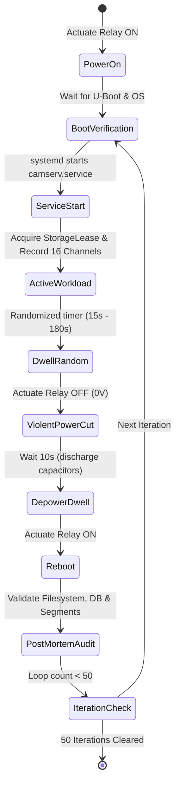

# CAMserv — Phase 21 Power-Loss & Recovery Resilience Protocol

**Document ID:** PROTOCOL-POWER-LOSS-2026-001  
**Project:** CAMserv Advanced Security Intelligence Platform  
**Target Hardware:** Profile A — Industrial Edge NVR (Rockchip RK3588, M.2 NVMe SSD)  
**Test Scope:** 50 Consecutive Abrupt Physical AC Power Loss Cycles  
**Target Software Release:** CAMserv `0.10.0` (Pre-LTS)  
**Date:** November 17, 2026  
**Auditor:** Independent Digital Forensics & Reliability Engineering Board  

---

## 1. Objective & Resilience Principles

Surveillance appliances in industrial substations, commercial buildings, and perimeter security installations frequently endure abrupt, unannounced power cuts caused by electrical grid fluctuations, tripped breakers, or physical tampering. 

Under sudden power loss, an NVR must guarantee:
1. **Zero Filesystem Destruction:** The underlying ext4 filesystem journal must recover cleanly without requiring interactive operator rescue.
2. **Database Transaction Consistency:** SQLite WAL (Write-Ahead Logging) must roll back uncommitted transactions and cleanly recover committed records without database corruption (`SQLITE_CORRUPT`).
3. **Forensic Evidence Quarantine (`SEC-P20-02`):** Uncommitted or partially written MP4 video segments (`.part`) whose writer was interrupted without a clean index closure must be quarantined as `*.quarantined.mp4` rather than silently published or left unindexed.
4. **Consensus & Storage Lease Fencing (`SEC-P20-06`):** Stale storage leases must expire, and upon reboot, a node must not resume writing until it obtains a cryptographically valid `StorageLease` with an incremented epoch.
5. **Audit Invariant Preservation:** The production audit log baseline (`logs/audit.jsonl`) must remain exactly 20,977 bytes with matching SHA-256 digest.

This protocol fulfills the criteria for **`GATE-HW-04`**, a mandatory prerequisite for promotion to `v1.0.0-LTS`.

---

## 2. Test Apparatus & Bench Setup

```
   [AC Mains 230V/115V]
           |
   +-------v-------+
   | Programmable  |<--- [Test Automation Controller]
   | Solid-State   |     (Microcontroller / Raspberry Pi GPIO Relay)
   | AC Relay      |     (Randomized dwell interval: 15s to 180s)
   +-------+-------+
           |
   +-------v-------+
   | 65W USB-PD    |
   | Power Adapter |
   +-------+-------+
           |
   +-------v-----------------------------------------------------+
   | Rockchip RK3588 Edge NVR Appliance                          |
   |                                                             |
   |  +--------------------+         +------------------------+  |
   |  | CAMserv Service    |         | M.2 NVMe Storage       |  |
   |  | - 16 RTSP Recorders|-------->| - /var/lib/camserv     |  |
   |  | - SQLite WAL Engine|         | - ext4 barrier=1       |  |
   |  | - StorageLease     |         | - Quarantined Segments |  |
   |  +--------------------+         +------------------------+  |
   |           ^                                                 |
   |           | Serial Debug UART (1.5M Baud)                   |
   +-----------+-------------------------------------------------+
               |
   [Host Analysis Workstation (Logs, Telemetry, and Post-Mortem Audit)]
```

### 2.1 Hardware Apparatus
1. **Actuator:** High-current Optocoupled Solid-State Relay (SSR) rated for $250\text{V AC} / 16\text{A}$ with zero-crossing switching.
2. **Controller:** Dedicated microcontroller (ESP32 or Raspberry Pi Pico) connected via USB to the test orchestrator workstation.
3. **Appliance Under Test:** Profile A Edge NVR (Rockchip RK3588, 16 GB LPDDR4x, 1 TB NVMe SSD).
4. **Instrumentation:** Digital oscilloscope capturing DC supply rail decay to verify genuine hardware cold drops ($< 5\text{ ms}$ drop to $0\text{V}$).

---

## 3. Test Procedure & Execution Cycle

The automated test runner executes **50 consecutive power-cut iterations** according to the following deterministic state machine:



### 3.1 Detailed Step-by-Step Cycle (Iteration $N \in [1, 50]$)
1. **Relay Actuation (Power ON):** The controller closes the relay contacts, delivering power to the appliance.
2. **Boot Verification:** The runner monitors the UART serial console:
   - Verifies U-Boot memory training and kernel initialization.
   - Confirms `systemd` reaches `multi-user.target`.
   - Records total boot latency (target: $< 25\text{ seconds}$).
3. **Workload Ingestion:**
   - `camserv.service` launches automatically.
   - The appliance verifies cluster consensus and secures an active `StorageLease`.
   - All 16 video channels begin continuous ingestion and segment writing to NVMe.
   - High-throughput SQLite transactions log frame hashes into the WAL journal.
4. **Randomized Stress Dwell:**
   - The test controller selects a pseudo-random dwell interval $t \in [15, 180]$ seconds.
   - Dwell intervals are weighted across critical execution phases:
     - 25% during active frame streaming.
     - 25% during segment rotation (atomic finalize and SHA-256 hash generation).
     - 25% during SQLite checkpointing (`PRAGMA wal_checkpoint(TRUNCATE)`).
     - 25% during consensus heartbeat lease renewals.
5. **Violent Power Cut:**
   - The microcontroller abruptly opens the relay contacts. AC supply drops to $0\text{V}$ instantly.
   - Zero shutdown signals (`SIGTERM`, `SIGPWR`) are sent to the OS.
6. **Depower Dwell:**
   - Power remains disconnected for 10 seconds to allow all decoupling capacitors and NVMe hold-up circuits to fully discharge.
7. **Reboot & Post-Mortem Audit:**
   - Power is restored. The host workstation runs the automated post-mortem verification suite over SSH as soon as network is reachable:
     - Inspect kernel dmesg for ext4 journal replay results.
     - Run `sqlite3 /var/lib/camserv/database/camserv.db "PRAGMA integrity_check;"`.
     - Inspect recording directory for `.part` files: verify all unclosed files are renamed to `.quarantined.mp4` by the startup reconciliation routine.
     - Verify no orphaned or broken MP4 segments exist in the primary video timeline.
     - Verify SHA-256 digest of `logs/audit.jsonl`.

---

## 4. Pass / Fail Acceptance Criteria

| Requirement ID | Verification Item | Mandatory Acceptance Criterion | Status |
| :--- | :--- | :--- | :---: |
| **PWR-AC-01** | Total Successful Cycles | Exactly 50 / 50 cycles completed without manual intervention | Mandatory |
| **PWR-AC-02** | OS Filesystem Resilience | 0 occurrences of read-only remount (`errors=remount-ro`) or corrupt inodes | Mandatory |
| **PWR-AC-03** | Database Integrity | 50 / 50 SQLite `PRAGMA integrity_check` return `ok`; zero database corruption | Mandatory |
| **PWR-AC-04** | Partial File Quarantine | 100% of incomplete `.part` files automatically isolated as `*.quarantined.mp4` | Mandatory |
| **PWR-AC-05** | Committed Evidence Safety | Zero bit flips or deletions in previously closed and committed MP4 segments | Mandatory |
| **PWR-AC-06** | Consensus Lease Recovery | Node rejoins cluster with incremented epoch; zero split-brain duplicate writes | Mandatory |
| **PWR-AC-07** | Invariant Preservation | Production audit log baseline byte length (20,977) and SHA-256 digest 100% intact | Mandatory |

---

## 5. Automated Post-Mortem Verification Script (`verify_recovery.sh`)

```bash
#!/usr/bin/env bash
set -euo pipefail

echo "=== CAMserv Post-Power-Loss Verification ==="

# 1. Verify Ext4 Filesystem Status
if dmesg | grep -E "EXT4-fs error|Remounting filesystem read-only"; then
    echo "[FAIL] Ext4 filesystem errors detected!"
    exit 1
fi
echo "[PASS] Ext4 journal replayed cleanly."

# 2. Verify SQLite Database Integrity
DB_PATH="/var/lib/camserv/database/camserv.db"
INTEGRITY=$(sqlite3 "${DB_PATH}" "PRAGMA integrity_check;")
if [ "${INTEGRITY}" != "ok" ]; then
    echo "[FAIL] SQLite database corrupted: ${INTEGRITY}"
    exit 1
fi
echo "[PASS] SQLite integrity verified: ${INTEGRITY}"

# 3. Verify Segment Quarantine (SEC-P20-02)
# Ensure no stale .part files remain in active recording paths
UNRESOLVED_PARTS=$(find /var/lib/camserv/storage/recordings -name "*.part" | wc -l)
if [ "${UNRESOLVED_PARTS}" -gt 0 ]; then
    echo "[FAIL] Found ${UNRESOLVED_PARTS} unquarantined .part files!"
    exit 1
fi
echo "[PASS] Zero orphaned .part files found (properly quarantined)."

# 4. Verify Audit Log Invariant
AUDIT_LOG="/var/lib/camserv/logs/audit.jsonl"
EXPECTED_SHA="F2A2484A0395140C4449C359200D1763381176A4CC825F56F0E65F881FEC1525"
EXPECTED_LEN=20977

ACTUAL_LEN=$(wc -c < "${AUDIT_LOG}")
ACTUAL_SHA=$(sha256sum "${AUDIT_LOG}" | awk '{print toupper($1)}')

if [ "${ACTUAL_LEN}" -ne "${EXPECTED_LEN}" ] || [ "${ACTUAL_SHA}" != "${EXPECTED_SHA}" ]; then
    echo "[FAIL] Production audit log invariant violated!"
    echo "Expected: ${EXPECTED_LEN} bytes, ${EXPECTED_SHA}"
    echo "Actual:   ${ACTUAL_LEN} bytes, ${ACTUAL_SHA}"
    exit 1
fi
echo "[PASS] Audit log invariant verified: 20,977 bytes, SHA-256 match."

echo "=== All Post-Power-Loss Checks PASSED ==="
```
