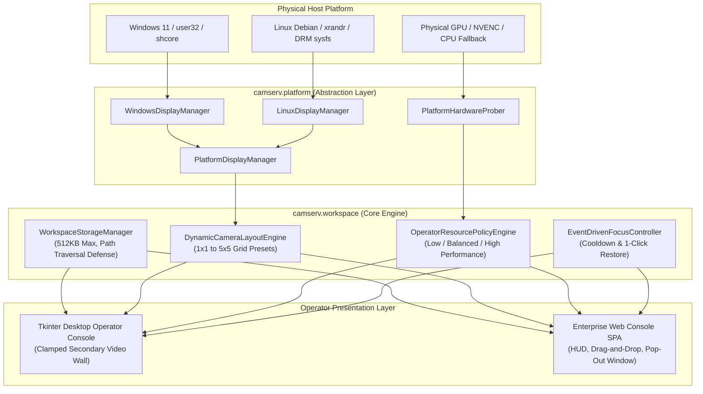

# CAMserv Phase 23 — Multi-Monitor Video Wall & Intelligent Workspace Architecture

**Platform**: CAMserv — Advanced Security Intelligence Platform  
**Target Release**: `0.10.0-rc5`  
**Phase**: 23  
**Status**: Implemented & Qualified  

---

## 1. Executive Architecture Summary

Phase 23 introduces an enterprise-grade multi-display video wall and workspace management subsystem to CAMserv. It bridges low-level cross-platform physical monitor enumeration with high-level dynamic viewport layout policies, event-driven candidate focus, and capability-aware hardware stream scaling.

The design adheres to CAMserv's foundational principles:
- **Zero Hallucination / Epistemic Truthfulness**: Monitors, GPUs, streams, and operational metrics reflect genuine hardware telemetry without fabrication or synthetic inflation.
- **Fail-Closed Security & Defense-in-Depth**: Workspace JSON persistence enforces strict path containment, rejects traversal vectors, enforces a 512KB payload ceiling, and automatically strips sensitive credential keys.
- **Ethical AI Guardrails**: Automated camera focus treats AI detections as non-consequential hypotheses requiring explicit human review and verification. Cooldown timers prevent alert fatigue and camera stealing.
- **Visual Identity Continuity**: Seamlessly preserves CAMserv's official branding assets and Phase 22 Dark Glassmorphic visual language.

---

## 2. Multi-Monitor Display Management Subsystem

### 2.1 Abstract Platform Interface (`PlatformDisplayManager`)
Located in [interfaces.py](file:///C:/Users/MPront/Documents/CAMserv/src/camserv/platform/shared/interfaces.py).
Defines abstract contracts for:
- Physical and virtual monitor enumeration (`enumerate_displays() -> list[DisplayInfo]`).
- Primary display discovery (`get_primary_display() -> DisplayInfo`).
- Identifier lookup (`get_display_by_id(display_id) -> DisplayInfo | None`).
- Window geometry bounds clamping (`validate_window_geometry(x, y, w, h) -> tuple[int, int, int, int]`).
- Display change subscription and notification dispatch.

### 2.2 Windows 11 Native Adapter (`WindowsDisplayManager`)
Located in [display.py](file:///C:/Users/MPront/Documents/CAMserv/src/camserv/platform/windows/display.py).
- Interfaces with Win32 `user32.dll` via `ctypes` (`EnumDisplayMonitors`, `GetMonitorInfoW`, `GetSystemMetrics`).
- Queries per-monitor DPI scaling factors via `shcore.dll` (`GetDpiForMonitor` with `MDT_EFFECTIVE_DPI`).
- Differentiates total monitor rectangle (`rcMonitor`) from usable desktop workspace (`rcWork`, accounting for Windows taskbars and docked appbars).
- Clamps popup window geometries to ensure no secondary video wall or modal dialog can spawn outside visible monitor boundaries.

### 2.3 Linux Debian Native Adapter (`LinuxDisplayManager`)
Located in [display.py](file:///C:/Users/MPront/Documents/CAMserv/src/camserv/platform/linux/display.py).
- Primary discovery parses standard `xrandr --query` connected screen geometry records.
- Secondary discovery inspects `/sys/class/drm/card*-*/status` sysfs connectors.
- Headless CI / server fallback synthesizes a virtual 1920x1080 display geometry, allowing automated test pipelines to execute without physical X11/Wayland screens.

---

## 3. Dynamic Camera Layout Engine

Located in [engine.py](file:///C:/Users/MPront/Documents/CAMserv/src/camserv/workspace/engine.py).

### 3.1 Presets and Capacities
The layout engine supports deterministic grid calculations across six standardized presets:
1. `1x1` (`SINGLE`): Focused single viewport (100% canvas).
2. `1x2` (`SPLIT`): Side-by-side dual viewport (50% canvas each).
3. `2x2` (`GRID_2X2`): Standard quad surveillance matrix (4 cameras).
4. `3x3` (`GRID_3X3`): Standard enterprise matrix (9 cameras).
5. `4x4` (`GRID_4X4`): High-density operations matrix (16 cameras).
6. `5x5` (`GRID_5X5`): Ultra-density video wall matrix (25 cameras).
7. `custom`: Configurable aspect ratios (up to 36 viewports).

### 3.2 Viewport Management & Interactivity
- **Tile Swapping & Reordering**: Enables drag-and-drop viewport reordering while preserving camera identifiers, stream qualities, and telemetry metadata.
- **Tile Maximization & Restoration**: Operators can maximize any individual camera tile with a single click or keyboard shortcut (`M`), expanding it across the full viewport area while retaining underlying layout state.
- **Epistemic Truthfulness Evaluation**: Every tile evaluates stream truthfulness against active cluster leases and optical hardware probe results (`verified_live`, `simulated`, `unverified_degraded`, `evacuated_offline`).

---

## 4. Secure Persistent Workspace Storage

Located in [storage.py](file:///C:/Users/MPront/Documents/CAMserv/src/camserv/workspace/storage.py).

### 4.1 Schema Specification & Migration
- Modern Phase 23 schema version: `2.0`.
- Automatic migration engine ingests legacy `v1.0` flat configuration payloads (`layout="grid_4"`, `cameras=[...]`) and maps them cleanly into `DisplayLayout` hierarchy.

### 4.2 Security Defenses
- **Path Traversal Protection**: Enforces strict regular expression validation on all workspace identifiers (`^[a-zA-Z0-9_-]{1,64}$`). Rejects path traversal sequences (`..`, `/`, `\`), preventing arbitrary filesystem reads or overwrites.
- **Payload Ceiling**: Rejects any JSON payload exceeding 512 KB (`MAX_WORKSPACE_FILE_BYTES`).
- **Prohibited Credential Sanitization**: Untrusted import payloads are recursively scanned and stripped of sensitive credential keys (`password`, `secret`, `private_key`, `api_token`, `auth_token`, `master_key`).

---

## 5. Capability-Aware Resource Management Policy Engine

Located in [resource_policy.py](file:///C:/Users/MPront/Documents/CAMserv/src/camserv/workspace/resource_policy.py).

### 5.1 Dynamic Hardware Probing
Dynamically discovers host capabilities:
- CPU logical core count and system RAM.
- GPU vendor, model, and VRAM.
- True hardware acceleration verification: Requires verified driver and $\ge 512$ MB dedicated VRAM before reporting GPU decoding. CPU fallback is explicitly stated.

### 5.2 Resource Profiles
| Parameter | Low Resource | Balanced | High Performance | Custom |
| :--- | :--- | :--- | :--- | :--- |
| **Max Concurrent Decodes** | 4 Feeds | 9 Feeds | 25 Feeds | Operator Configured |
| **Target FPS Cap** | 10 FPS | 20 FPS | 25 FPS | Configurable |
| **Preferred Stream** | Sub-stream | Dynamic Mix | Main stream | Configurable |
| **Background Pause** | Enabled (5s cycle) | Disabled | Disabled | Configurable |
| **Glassmorphism Blur** | Disabled | Enabled | Enabled | Configurable |

---

## 6. Event-Driven Camera Focus & Human-in-the-Loop Workflow

Located in [event_focus.py](file:///C:/Users/MPront/Documents/CAMserv/src/camserv/workspace/event_focus.py).

- **Non-Consequential Hypothesis Tagging**: AI model predictions are strictly labeled as candidate hypotheses (`candidate_hypothesis`), preventing automated actions without human sign-off.
- **Anti-Stealing Cooldown Window**: Implements an 8.0-second cooldown timer. During an active inspection, lower- or equal-priority alerts cannot steal operator focus.
- **1-Click Layout Restoration**: One click restores the previous viewport arrangement, layout preset, and maximized states.
