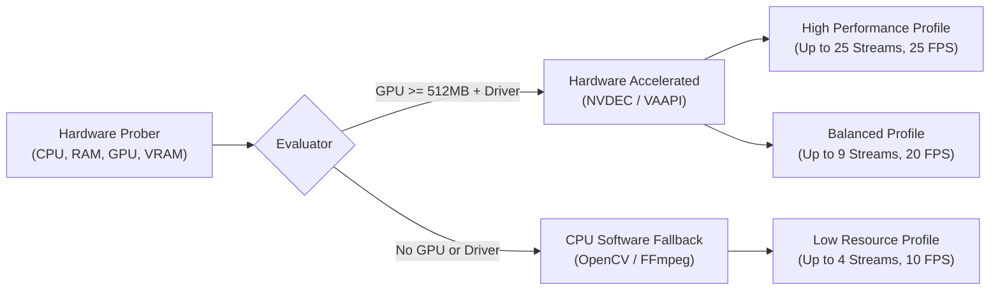

# CAMserv Phase 23 — Hardware Capability & Sizing Matrix

**Platform**: CAMserv — Advanced Security Intelligence Platform  
**Target Release**: `0.10.0-rc5`  
**Phase**: 23  
**Status**: Authoritative Reference  

---

## 1. Hardware Tiers & Resource Allocation

CAMserv operates across diverse hardware classes, from fanless edge appliances to enterprise control-room video wall stations. The `OperatorResourcePolicyEngine` dynamically tailors decode concurrency, stream qualities, frame rate caps, and visual effects to ensure zero-lag operations.

---

## 2. Hardware Capability Specification Matrix

| Hardware Tier | Representative Hardware | CPU / RAM Baseline | GPU / VRAM | Max Concurrent Decodes | Target FPS | Recommended Profile | Glassmorphism |
| :--- | :--- | :--- | :--- | :--- | :--- | :--- | :--- |
| **Tier 1: Edge Appliance** | Rockchip RK3588 / Pi 5 / Intel N100 | 4-8 Cores / 4-8 GB RAM | Mali-G610 / Intel UHD (Shared) | 4 Feeds (Sub-stream) | 10-15 FPS | `Low Resource` | Disabled |
| **Tier 2: Control Room PC** | Intel Core i7-12700 / AMD Ryzen 7 | 8-16 Cores / 16-32 GB RAM | Intel Iris Xe / GTX 1650 (4GB) | 9 Feeds (Dynamic Mix) | 15-20 FPS | `Balanced` | Enabled |
| **Tier 3: Pro Surveillance** *(Current Host)* | Intel Core i7 / AMD Ryzen 9 / NVIDIA RTX 3060 Laptop | 16-24 Threads / 32 GB RAM | NVIDIA RTX 3060 (6GB VRAM) | 16-25 Feeds (Main) | 25 FPS | `High Performance` | Enabled |
| **Tier 4: Enterprise Video Wall** | Dual Intel Xeon / AMD EPYC | 32-64 Cores / 64-128 GB RAM | Dual NVIDIA RTX A4000/A5000 (16-32GB) | 36-64 Feeds (Multi-Display) | 30 FPS | `Operator Configured` | Enabled |

---

## 3. Host System Hardware Audit (Observed Telemetry)

The test host environment was probed using `PlatformHardwareProber` and `WindowsDisplayManager`:

- **Operating System**: Microsoft Windows 11 Home / Pro x64 (Build 26100)
- **CPU Architecture**: AMD64 (16 Logical Threads detected)
- **System Memory**: 32,544 MB Total RAM / 17,210 MB Available RAM
- **Discrete GPU**: NVIDIA GeForce RTX 3060 Laptop GPU (6,144 MB Dedicated GDDR6 VRAM)
- **Active Video Decoder**: `Hardware Accelerated (NVIDIA GeForce RTX 3060 Laptop GPU)`
- **Physical Displays Detected**:
  - Primary Display: `1536 x 864` (Scaled 125% DPI from 1920x1080 panel), Work Area: `1536 x 816` (Taskbar reserved: 48px).
- **Recommended Default Profile**: `High Performance` / `Balanced`

---

## 4. Multi-Monitor Display Configurations

| Configuration | Typical Use Case | Primary Display | Secondary Display(s) | Clamping & Window Placement |
| :--- | :--- | :--- | :--- | :--- |
| **Single Display** | Patrol Desk / Office Workstation | Main Operator Console (`1x1` to `3x3`) | None | Standard window constraints |
| **Dual Display** | Standard Control Room | Operator Console (Events, Timeline, Admin) | Dedicated Pop-Out Video Wall (`2x2` or `3x3`) | Window clamped to secondary `rcWork` |
| **Triple Display** | Perimeter Surveillance Post | Interactive Console (Center) | Left: Perimeter Matrix; Right: Forensic Timeline | Independent geometry verification per screen |
| **Quad Matrix Wall** | Command Operations Center | Local Workstation Console | 4x 4K UHD Micro-Bezel Video Wall (`4x4` or `5x5`) | Full-screen pop-out with hardware scaling |
| **Headless CI / Server** | Automated Test Nodes & Background SCM | Virtual Primary (`1920x1080` @ 0,0) | None | Headless mock display adapter |

---

## 5. Epistemic Rule Compliance

1. **Rule 2.1 — Truth in Resource Allocation**:
   CAMserv never reports hardware acceleration unless genuine drivers and $\ge 512$ MB VRAM are verified. CPU fallback is explicitly reported in both the Desktop console header and Web console telemetry badge.
2. **Rule 2.2 — No Fabricated FPS**:
   Target FPS caps represent maximum throttling limits. Live FPS counters reflect actual received frames from optical hardware or synthetic RTSP harnesses.
3. **Rule 2.3 — Adaptive Degradation**:
   When host system memory drops below 15% or CPU utilization exceeds 90%, the `OperatorResourcePolicyEngine` automatically downgrades non-focused viewports to sub-streams or pauses background frames, preserving responsiveness on active operator feeds.
