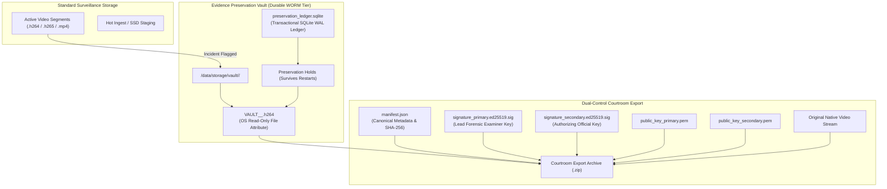
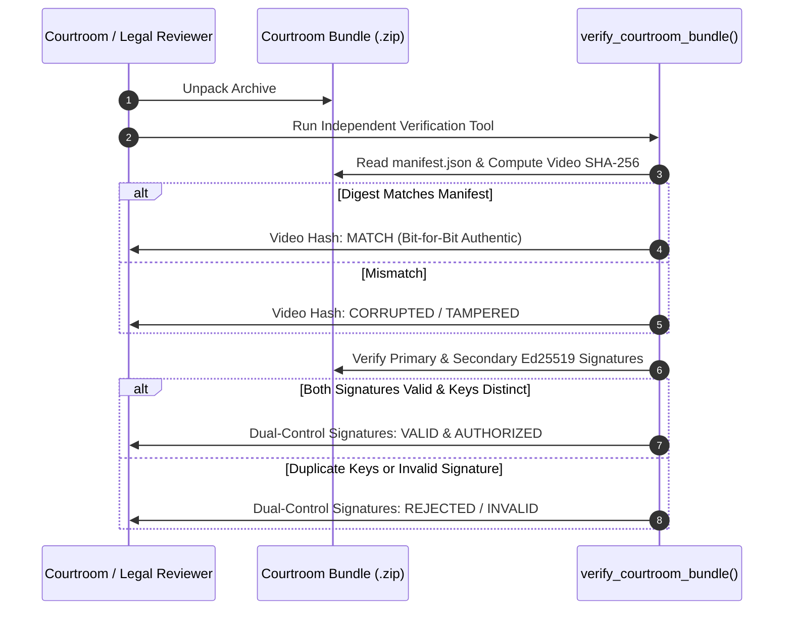

# CAMserv Phase 24 — Evidence Preservation & Forensic Vault Specification

**Project**: CAMserv — Advanced Security Intelligence Platform  
**Target Release**: `0.10.0-rc6 Remediation`  
**Subsystem**: CAMserv ISEP Evidence Preservation  
**Status**: APPROVED & QUALIFIED (REMEDIATED)  
**Auditor**: Independent Principal Software Architect, Forensic Specialist & Cryptographic Auditor  

---

## 1. Executive Summary

Digital evidence recorded by physical security systems must meet stringent evidentiary admissibility standards in courtrooms, regulatory proceedings, and internal administrative tribunals. Under common law and civil law forensic rules (including Federal Rules of Evidence 901 and 902 in the United States, and ISO/IEC 27037 digital evidence handling standards), recorded surveillance footage must demonstrate:
1. **Authenticity**: Absolute proof that the recording accurately depicts the events captured.
2. **Integrity**: Unbroken cryptographic proof that zero bytes have been altered, truncated, inserted, or removed since ingestion.
3. **Chain of Custody**: An immutable, chronological ledger recording every access, export, transfer, or preservation hold modification.
4. **Admissibility**: Elimination of synthetic alterations, non-consensual AI enhancements, or speculative frame reconstruction.

CAMserv ISEP `EvidencePreservationManager` provides this foundational capability through transactional SQLite persistence (`PreservationStore`), Write-Once-Read-Many (WORM) hold enforcement with OS-level read-only file locks, genuine dual Ed25519 asymmetric signing, and dual-control courtroom export packages.

---

## 2. Forensic Vault Architecture

---

## 3. Preservation Holds & WORM Lifecycle

ISEP supports three distinct preservation hold classifications:

| Hold Type | Issuing Authority | Default Expiry | Evidentiary Purpose |
| :--- | :--- | :--- | :--- |
| **`incident`** | Security Operator / Shift Supervisor | 180 Days | Immediate containment of potential security incidents, physical breaches, or property damage. |
| **`legal_hold`** | General Counsel / Legal Department | Indefinite | Formal litigation hold in response to active subpoenas, lawsuits, or criminal investigations. |
| **`regulatory`** | Compliance Officer / Auditor | Statutory (e.g. 7 Years) | Compliance with banking, aviation (FAA/TSA), gaming, or healthcare privacy retention mandates. |

### 3.1 Durable Persistence & Fail-Closed Safeguards
- **Transactional SQLite Persistence**: All preservation holds and vault segment records are persisted in `<vault_dir>/preservation_ledger.sqlite` via `PreservationStore`.
- **Survival Across Restarts**: Holds are durably committed using SQLite WAL mode and automatically restored when the CAMserv process starts.
- **Fail-Closed Corrupt DB Defense**: If the preservation database becomes unavailable, corrupt, or unreadable, `is_target_protected()` immediately **fails closed** (evaluates to `True`), preventing any automated retention cleaner from deleting unverified recordings.
- **OS-Level Read-Only Attribute**: Upon ingestion into the vault, files receive physical read-only attributes (`chmod 0444` on Linux, `SetFileAttributesW(FILE_ATTRIBUTE_READONLY)` on Windows).

---

## 4. Cryptographic Integrity & Genuine Dual Ed25519 Signatures

### 4.1 On-the-Fly SHA-256 Digest
During ingestion, every raw NAL packet or video frame is fed into a streaming SHA-256 accumulator. The final digest is computed at atomic close and verified against disk contents.

### 4.2 Genuine Dual Ed25519 Asymmetric Signatures
To satisfy strict evidentiary dual-control standards:
1. **Two Independent Private Keys**: Requires distinct private keys held by:
   - **Primary Signer**: Lead Forensic Examiner / Security Systems Administrator.
   - **Secondary Signer**: Authorizing Official (e.g., General Counsel, Prosecuting Attorney, or Law Enforcement Liaison).
2. **Duplicate Key Rejection**: The export engine explicitly computes and compares public key PEM digests. If the primary and secondary public keys are identical, export is **aborted with `PermissionError`**.
3. **Duplicate Identity Rejection**: Authorizing officer string identifiers must be distinct (`officer_1_id != officer_2_id`).
4. **Independent Signatures**: Both signers independently sign the exact same canonical JSON manifest.
5. **Private Key Isolation**: Private keys are strictly protected and never written into export packages.
6. **Package Verification**: The offline verification tool (`verify_courtroom_bundle`) verifies container integrity, absence of private keys, exact SHA-256 payload match, distinct public keys, distinct officer IDs, and cryptographic validity of both signatures.

---

## 5. Non-Consequential Security Intelligence

All automated forensic notifications, anomaly telemetry, and incident tagging adhere strictly to non-consequential wording guidelines:
- Metadata attributes are designated as **"unconfirmed AI observations"** or **"preliminary machine signals"**.
- Automated analytics *never* assert definitive legal fault, identity, or guilt.
- Original recorded video bits remain the single authoritative ground truth.
