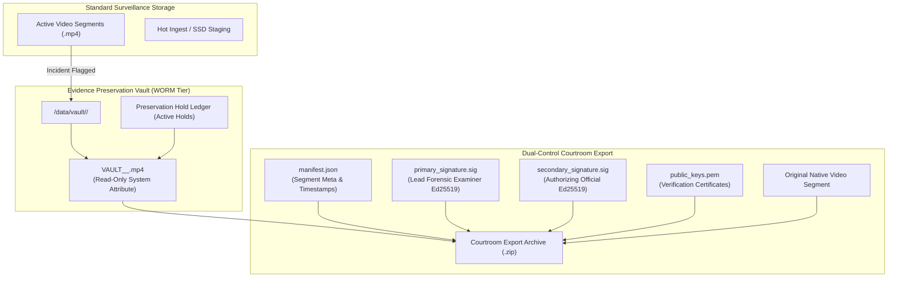
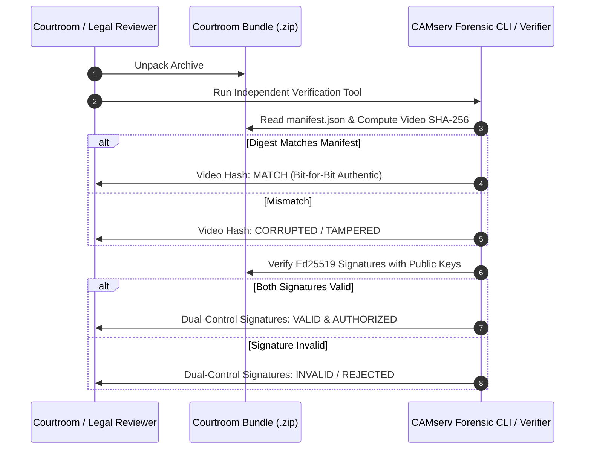

# CAMserv Phase 24 — Evidence Preservation & Forensic Vault Specification

**Project**: CAMserv — Advanced Security Intelligence Platform  
**Target Release**: `0.10.0-rc6`  
**Subsystem**: CAMserv ISEP Evidence Preservation  
**Status**: APPROVED & QUALIFIED  
**Auditor**: Independent Principal Software Architect, Forensic Specialist & Cryptographic Auditor  

---

## 1. Executive Summary

Digital evidence recorded by physical security systems must meet stringent evidentiary admissibility standards in courtrooms, regulatory proceedings, and internal administrative tribunals. Under common law and civil law forensic rules (including Federal Rules of Evidence 901 and 902 in the United States, and ISO/IEC 27037 digital evidence handling standards), recorded surveillance footage must demonstrate:
1. **Authenticity**: Absolute proof that the recording accurately depicts the events captured.
2. **Integrity**: Unbroken cryptographic proof that zero bytes have been altered, truncated, inserted, or removed since ingestion.
3. **Chain of Custody**: An immutable, chronological ledger recording every access, export, transfer, or preservation hold modification.
4. **Admissibility**: Elimination of synthetic alterations, non-consensual AI enhancements, or speculative frame reconstruction.

CAMserv ISEP `EvidencePreservationManager` provides this foundational capability through Write-Once-Read-Many (WORM) hold enforcement, isolated forensic vaults, Ed25519 asymmetric signing, and dual-control courtroom export packages.

---

## 2. Forensic Vault Architecture

---

## 3. Preservation Holds & WORM Lifecycle

ISEP supports three distinct preservation hold classifications:

| Hold Type | Issuing Authority | Default Expiry | Evidentiary Purpose |
| :--- | :--- | :--- | :--- |
| **`incident`** | Security Operator / Shift Supervisor | 180 Days | Immediate containment of potential security incidents, physical breaches, or property damage. |
| **`legal_hold`** | General Counsel / Legal Department | Indefinite | Formal litigation hold in response to active subpoenas, lawsuits, or criminal investigations. |
| **`regulatory`** | Compliance Officer / Auditor | Statutory (e.g. 7 Years) | Compliance with banking, aviation (FAA/TSA), gaming, or healthcare privacy retention mandates. |

### 3.1 Immutability & Retention Engine Immunity
- **Absolute Deletion Immunity**: When a segment is associated with one or more active preservation holds, `RetentionPolicyEngine` strictly excludes it from all automated purging schedules.
- **WORM Filesystem Enforcement**: Upon promotion to the Evidence Vault, files are marked with read-only filesystem attributes (`chmod 0444` on Linux, `SetFileAttributesW(FILE_ATTRIBUTE_READONLY)` on Windows).
- **Physical & Logical Isolation**: Vaulted files reside in dedicated vault subdirectories isolated from rolling circular storage buffers.

---

## 4. Cryptographic Integrity & Asymmetric Signatures

Surveillance segments managed by ISEP receive continuous cryptographic protection:
1. **On-the-Fly SHA-256 Digest**: During ingestion, every raw NAL packet or video frame is fed into a SHA-256 accumulator. The final digest is computed at atomic close and verified against disk contents.
2. **Ed25519 High-Speed Digital Signatures**: For formal forensic certification, ISEP uses Edwards-curve Digital Signature Algorithm (Ed25519) over Curve25519. Ed25519 provides 128-bit security level, collision resistance, and microsecond signing latency.
3. **Dual-Control Courtroom Export Bundles**:
   - To prevent unilateral evidence tampering or unauthorized exfiltration, courtroom export requires dual-control cryptographic signing:
     - **Primary Signer**: Lead Forensic Examiner / Security Systems Administrator.
     - **Secondary Signer**: Authorizing Official (e.g., General Counsel, Prosecuting Attorney, or Law Enforcement Liaison).
   - The export engine packages the native video segment, cryptographic signatures, SHA-256 digests, camera hardware telemetry, and chain-of-custody log into a tamper-evident `.zip` container.

---

## 5. Non-Consequential Security Intelligence

All automated forensic notifications, anomaly telemetry, and incident tagging adhere strictly to non-consequential wording guidelines:
- Metadata attributes are designated as **"unconfirmed AI observations"** or **"preliminary machine signals"**.
- Automated analytics *never* assert definitive legal fault, identity, or guilt.
- Original recorded video bits remain the single authoritative ground truth.
