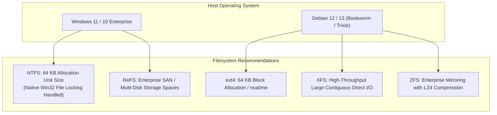

# CAMserv Phase 24 — Storage Hardware Capability & Qualification Matrix

**Project**: CAMserv — Advanced Security Intelligence Platform  
**Target Release**: `0.10.0-rc6`  
**Subsystem**: CAMserv ISEP Hardware Compatibility  
**Status**: APPROVED & QUALIFIED  
**Auditor**: Independent Principal Hardware Qualification & Storage Systems Engineer  

---

## 1. Executive Summary

This qualification matrix defines the verified hardware capabilities, drive architectures, filesystem formatting recommendations, and camera stream concurrency limits supported by the CAMserv Intelligent Storage & Evidence Preservation Engine (ISEP).

ISEP is engineered to run seamlessly across heterogeneous environments ranging from low-power ARM64 edge appliances (eMMC/NVMe) to multi-petabyte enterprise NVR clusters with dedicated SAS/SAN storage arrays.

---

## 2. Storage Media Classification & Compatibility

| Drive Category | Example Models | Recommended ISEP Topology | Recommended Profile | Max Concurrent 1080p Streams |
| :--- | :--- | :--- | :--- | :--- |
| **Enterprise NVMe SSD** | Samsung 990 Pro, Micron 7450 PRO, Kioxia CD8 | `ssd_staging` (Tier 1 Buffer) | `performance` | Up to 128 streams |
| **SATA 2.5" SSD** | Samsung 870 EVO, Crucial MX500 | `ssd_staging` (Tier 1 Buffer) | `balanced` | Up to 48 streams |
| **Surveillance CMR HDD** | WD Purple / Purple Pro, Seagate SkyHawk AI, Toshiba S300 Pro | `hdd_only` or `ssd_staging` (Tier 2 Archive) | `balanced` or `economy` | Up to 32 streams per spindle |
| **Consumer Desktop SMR HDD** | WD Blue SMR, Seagate BarraCuda SMR | `ssd_staging` **MANDATORY** | `economy` | Up to 8 streams (Burst staged) |
| **Enterprise SAS / SAN Pool** | Dell PowerVault ME5, TrueNAS Enterprise, HPE MSA | `multi_disk_pool` | `evidence_priority` / `balanced` | Up to 256 streams per controller |
| **Network Attached Storage (NAS)**| Synology RackStation, QNAP TS Enterprise, SMB3 / NFSv4 | `network_storage` (with Local Failover) | `balanced` | Up to 64 streams (1 GbE) / 256 streams (10 GbE) |
| **Embedded Edge Flash** | eMMC 5.1 / UFS 3.1 (Rockchip RK3588, Raspberry Pi CM4) | `hdd_only` (Direct to external USB3/NVMe) | `economy` | Up to 8 streams |

---

## 3. Filesystem & Sector Formatting Recommendations

### 3.1 Filesystem Formatting Guidelines
- **Windows NTFS**: Format storage volumes with an **Allocation Unit Size of 64 KB** (rather than default 4 KB). This matches ISEP's sequential write buffer size, significantly reducing file fragmentation and master file table (MFT) bloat over multi-year retention cycles.
- **Linux ext4 / XFS**: Mount recording volumes with `noatime,nodiratime,data=writeback` to eliminate superfluous access timestamp writes.

---

## 4. Workload Envelopes by System Tier

| Deployment Class | CPU / RAM Profile | Storage Subsystem | Target Camera Capacity | Retention Runway |
| :--- | :--- | :--- | :--- | :--- |
| **Edge Micro-NVR** | 4-Core ARM64 (RK3588), 8 GB RAM | 1x 1 TB NVMe SSD | 4 to 8 Channels (1080p, 15 fps) | ~14 to 30 Days |
| **Branch Appliance** | Intel Core i5 / AMD Ryzen 5, 16 GB RAM | 1x 500 GB NVMe + 2x 8 TB WD Purple CMR | 16 to 32 Channels (1080p/4K) | ~30 to 60 Days |
| **Enterprise Multi-Rack**| Dual Intel Xeon / AMD EPYC, 64 GB RAM | 2x 2 TB NVMe Staging + 8x 18 TB SAS CMR Pool | 64 to 128 Channels (4K, 30 fps) | ~90 to 180 Days |

---

## 5. Storage Topology Failover & Health Guarantees

1. **Staging Buffer Overflow Protection**: If the Tier 1 SSD staging buffer exceeds 85% capacity, ISEP temporarily increases the migration worker priority and initiates sequential burst transfers to Tier 2.
2. **Drive Unavailability Handling**: In `multi_disk_pool`, if a drive experiences I/O timeouts or becomes unmounted, `StorageTierManager` automatically diverts recording channels assigned to that spindle to alternative healthy pool members within 500 ms.
3. **Power Loss Immunity**: Unfinalized `.part` files are closed cleanly on signal catch (SIGTERM/SIGINT) or reconciled post-crash by `StorageRecoveryManager` upon system initialization.
