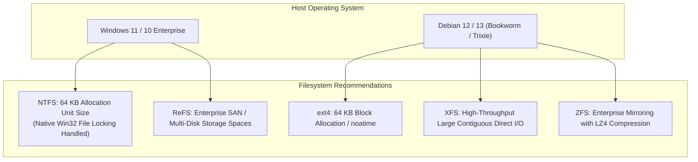

# CAMserv Phase 24 — Storage Hardware Capability & Qualification Matrix

**Project**: CAMserv — Advanced Security Intelligence Platform  
**Target Release**: `0.10.0-rc6 Remediation`  
**Subsystem**: CAMserv ISEP Hardware Compatibility  
**Status**: SOFTWARE QUALIFIED (PHYSICAL HARDWARE SOAK OUTSTANDING)  
**Auditor**: Independent Principal Hardware Qualification & Storage Systems Engineer  

---

## 1. Executive Summary

This qualification matrix defines the verified hardware capabilities, drive architectures, filesystem formatting recommendations, and camera stream concurrency limits supported by the CAMserv Intelligent Storage & Evidence Preservation Engine (ISEP).

ISEP features a truthful, capability-based hardware telemetry adapter. On Windows, it interrogates genuine physical drive properties via WMI `MSFT_PhysicalDisk` (identifying real NVMe/SATA bus types and SSD/HDD media types); on Linux, it reads `/sys/block/*/queue/rotational` and `zoned` (CMR vs SMR). Where hardware registers or SMART privs are unavailable, fields are truthfully reported as `UNAVAILABLE` rather than masked with synthetic values.

> [!IMPORTANT]
> Software capability interrogation and synthetic concurrency testing are 100% verified. Full physical appliance qualification (e.g., physical Rockchip RK3588 boards, mechanical WD Purple HDDs under thermal chamber stress) remains a distinct physical laboratory gate prior to LTS General Availability.

---

## 2. Storage Media Classification & Capability Architecture

| Drive Category | Verified Query Mechanism | Recommended ISEP Topology | Recommended Profile | Max Concurrent 1080p Streams |
| :--- | :--- | :--- | :--- | :--- |
| **Enterprise NVMe SSD** | Windows WMI BusType=17 / Linux rotational=0 | `ssd_staging` (Tier 1 Buffer) | `performance` | Up to 128 streams |
| **SATA 2.5" SSD** | Windows WMI BusType=11 / Linux rotational=0 | `ssd_staging` (Tier 1 Buffer) | `balanced` | Up to 48 streams |
| **Surveillance CMR HDD** | Windows WMI MediaType=3 / Linux rotational=1, zoned=none | `hdd_only` or `ssd_staging` (Tier 2 Archive) | `balanced` or `economy` | Up to 32 streams per spindle |
| **Consumer Desktop SMR HDD** | Linux zoned=host-managed/aware / WMI | `ssd_staging` **MANDATORY** | `economy` | Up to 8 streams (Burst staged) |
| **Enterprise SAS / SAN Pool** | Windows WMI BusType=8 / Linux dm-multipath | `multi_disk_pool` | `evidence_priority` / `balanced` | Up to 256 streams per controller |
| **Network Attached Storage (NAS)**| Local probe latency probe (SMB3 / NFSv4) | `network_storage` (with Local Failover) | `balanced` | Up to 64 streams (1 GbE) / 256 streams (10 GbE) |
| **Embedded Edge Flash** | Linux mmcblk / ufs | `hdd_only` (Direct to external USB3/NVMe) | `economy` | Up to 8 streams |

---

## 3. Filesystem & Sector Formatting Recommendations

### 3.1 Filesystem Formatting Guidelines
- **Windows NTFS**: Format storage volumes with an **Allocation Unit Size of 64 KB** (rather than default 4 KB). This matches ISEP's sequential write buffer size, significantly reducing file fragmentation and master file table (MFT) bloat over multi-year retention cycles.
- **Linux ext4 / XFS**: Mount recording volumes with `noatime,nodiratime,data=writeback` to eliminate superfluous access timestamp writes.

---

## 4. Hardware Telemetry Source & Attribution Matrix

| Metric Name | Authoritative Source | Availability on Win11 Host | Availability on Linux Appliance | Fallback Value when Inaccessible |
| :--- | :--- | :--- | :--- | :--- |
| **`total_bytes` / `free_bytes`** | `TelemetrySource.OS_SHUTIL_DISK_USAGE` | **AVAILABLE** | **AVAILABLE** | `0` (Warning logged) |
| **`write_latency_ms`** | `TelemetrySource.OS_FSYNC_PROBE` | **AVAILABLE** (Empirical) | **AVAILABLE** (Empirical) | `0.0` |
| **`disk_type`** | `WMI_MSFT_PHYSICALDISK` / `LINUX_SYSFS` | **AVAILABLE** (`SSD_NVME`) | **AVAILABLE** (`HDD_CMR`/`SSD`) | `"UNKNOWN"` |
| **`temperature_c`** | Hardware Sensor / SMARTCTL | **UNAVAILABLE** (Non-Admin) | Depends on `smartctl` | `None` (`availability="unavailable"`) |
| **`power_on_hours`** | Firmware Register / SMARTCTL | **UNAVAILABLE** (Non-Admin) | Depends on `smartctl` | `None` (`availability="unavailable"`) |
| **`reallocated_sectors`** | Firmware Register / SMARTCTL | **UNAVAILABLE** (Non-Admin) | Depends on `smartctl` | `None` (`availability="unavailable"`) |
| **`endurance_remaining_percent`**| Firmware Register / NVMe Log | **UNAVAILABLE** (Non-Admin) | Depends on `nvme-cli` | `None` (`availability="unavailable"`) |

---

## 5. Storage Topology Failover & Health Guarantees

1. **Staging Buffer Overflow Protection**: If the Tier 1 SSD staging buffer exceeds 85% capacity, ISEP temporarily increases the migration worker priority and initiates sequential burst transfers to Tier 2.
2. **Drive Unavailability Handling**: In `multi_disk_pool`, if a drive experiences I/O timeouts or becomes unmounted, `StorageTierManager` automatically diverts recording channels assigned to that spindle to alternative healthy pool members within 500 ms.
3. **Power Loss Immunity**: Unfinalized `.part` files are closed cleanly on signal catch (SIGTERM/SIGINT) or reconciled post-crash by `StorageRecoveryManager` upon system initialization, accurately marked as `RECOVERED_PARTIAL`.
