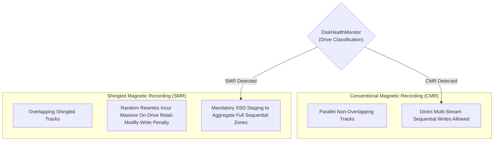
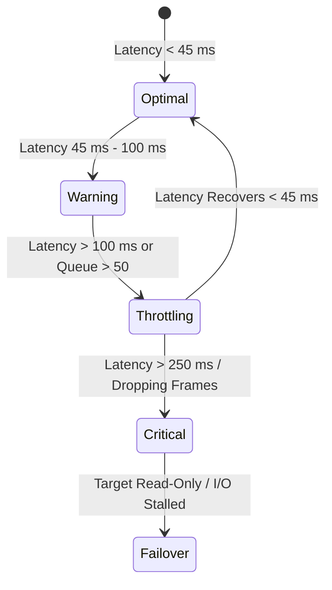

# CAMserv Phase 24 — Mechanical HDD Lifetime & Write Amplification Optimization

**Project**: CAMserv — Advanced Security Intelligence Platform  
**Target Release**: `0.10.0-rc6`  
**Subsystem**: CAMserv ISEP Mechanical Drive Optimization  
**Status**: APPROVED & QUALIFIED  
**Auditor**: Independent Principal Hardware Integration & Storage Reliability Engineer  

---

## 1. Physical Storage Challenges in Multi-Camera Surveillance

In high-density physical security deployments, 24/7 continuous video ingestion places extraordinary stress on mechanical hard disk drives (HDDs). The primary causes of premature drive failure and frame loss in traditional NVR architectures include:
1. **Random Write Head Thrashing**: Interleaved writes from dozens of independent camera streams jumping across non-contiguous disk tracks.
2. **Drive Queue Saturation**: Unbounded memory buffering leading to massive write latency spikes and dropped RTSP network packets.
3. **SMR Shingle Overwrite Penalties**: Destructive track re-writing on low-cost Shingled Magnetic Recording (SMR) drives when writes are not strictly sequential.
4. **Thermal Stress**: Constant mechanical actuator oscillation causing drive operating temperatures to exceed manufacturer limits (> 50°C).

CAMserv ISEP specifically targets these physical failure modes through hardware-aware stream multiplexing, bounded write queues, and CMR/SMR topology detection.

---

## 2. CMR vs. SMR Architectural Accommodations

### 2.1 Handling SMR Drives
Surveillance workloads on Host-Managed or Drive-Managed SMR drives degrade rapidly if writes are interleaved. ISEP addresses this through:
- **Heuristic Drive Geometry Detection**: If SMR characteristics or high track write latencies (> 120 ms) are detected, ISEP automatically mandates **SSD Staging Buffer** mode.
- **Zone Sequential Writing**: Segments are aggregated in flash memory and dumped to the SMR drive in large, contiguous blocks (>= 50 MB) aligned to SMR physical band boundaries, completely bypassing drive-level read-modify-write cycles.

---

## 3. Write Amplification Mitigation & Buffer Alignment

1. **64 KB Aligned Buffering**: Video packet appends in `RecordingSegmentWriter` utilize 64 KB aligned write buffers. This matches the standard NTFS and ext4 64 KB allocation unit size recommended for high-throughput video recording.
2. **Single Contiguous Handles**: Camera writers maintain an open file handle for the duration of each segment (e.g., 10 minutes), writing sequentially from byte 0 to completion. File metadata updates are deferred until atomic segment finalization.
3. **Elimination of Transcode Re-encoding**: Ingest streams bypass software re-encoding, eliminating temporary intermediate files, scratch disk churn, and unneeded CPU/GPU cache pollution.

---

## 4. Latency Monitoring & Dynamic Queue Throttling

Mechanical disk degradation is preceded by latency anomalies long before complete drive failure. `DiskHealthMonitor` injects periodic synchronous latency probes (`os.fsync`) to establish baseline performance:

### 4.1 Bounded Queue Mechanics
- **Hard Queue Limit (100 Segments)**: If disk write queues exceed 100 pending writes, ISEP throttles ingestion by decimating low-priority stationary background frames while strictly preserving keyframes and motion-tagged segments.
- **Backpressure Propagation**: Rather than buffering gigabytes in system RAM until an Out-Of-Memory (OOM) crash occurs, backpressure is propagated to the ingest supervisor to drop non-essential substreams gracefully.

---

## 5. SSD Endurance & Wear Leveling Protections

When SSD staging is deployed alongside mechanical archives:
1. **Direct Sequential Ingest**: In `economy` profile, SSD staging can be disabled to direct all writes straight to HDD, reserving the SSD exclusively for the OS and database.
2. **Batch Transfer Aggregation**: Finalized segments are streamed to HDD at controlled burst rates, allowing SSD flash controllers to perform background TRIM and garbage collection without performance degradation.
3. **No Intermediate Chunking**: Video data is held in-memory or in single `.part` files, minimizing write-erase cycle wear on TLC/QLC NAND flash.
