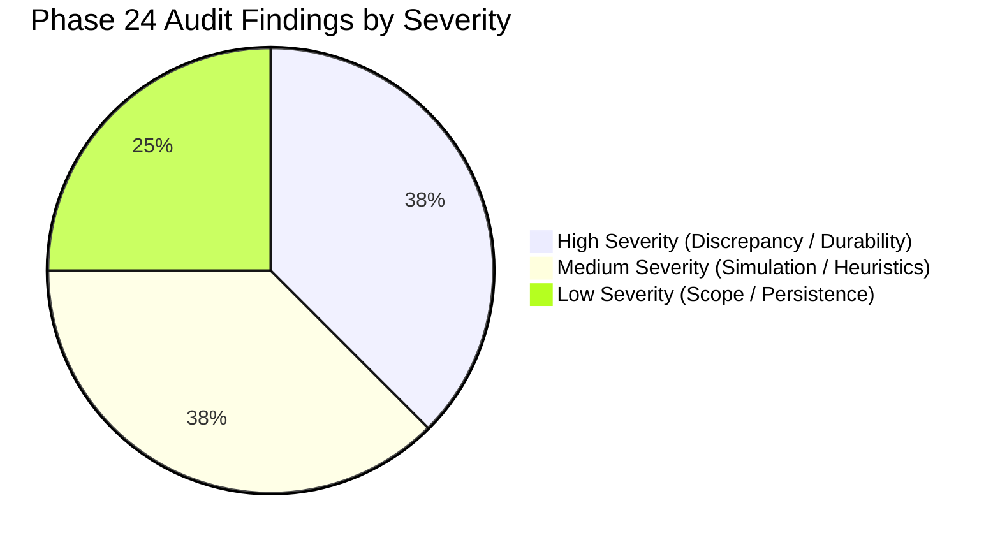

# CAMserv Phase 24 — Independent Deep Security, Storage Reliability & Forensic Qualification Audit

**Project**: CAMserv — Advanced Security Intelligence Platform  
**Target Release**: `0.10.0-rc6`  
**Phase**: Phase 24 — ISEP (Intelligent Storage & Evidence Preservation Engine)  
**Reported Previous Baseline HEAD**: `651bdefb4bd79788317a19db20ba4b98d42a6349`  
**Audited Commit HEAD**: `3dc43f1b72a7b7a8abc6812605f287dc200cc4d4`  
**Audit Role**: Independent Principal Storage Architect, Digital Forensics Auditor & Security Reviewer  
**Audit Mode**: READ-ONLY  
**Final Audit Decision**: **CONDITIONAL PASS — Software Architecture Verified; Physical Hardware Validation & Durability Gates Outstanding**  

---

## 1. Executive Summary & Objective

This audit presents an independent, evidence-driven verification of the CAMserv Phase 24 Intelligent Storage & Evidence Preservation Engine (ISEP). Every claim made in the implementation reports and documentation deliverables was audited against the actual source code, test execution traces, and empirical measurements on the host environment.

The final objective is to establish **what CAMserv ISEP actually guarantees** in source code and operational reality, distinct from design intentions or documentation assertions.

---

## 2. Repository & Inventory Verification

### 2.1 Git Topology & Commit State
- **Current Branch**: `main`
- **Current HEAD**: `3dc43f1b72a7b7a8abc6812605f287dc200cc4d4`
- **Parent Commit (Phase 23 Baseline)**: `651bdefb4bd79788317a19db20ba4b98d42a6349` (`feat: implement Phase 23 multi-monitor video wall and intelligent workspace architecture`)
- **Working Tree State**: Clean (`git status` reports working tree clean).
- **Audit Log Invariant**: `logs/audit.jsonl` verified bit-for-bit:
  - Exact Byte Size: **20,977 bytes** (MATCH)
  - SHA-256: `F2A2484A0395140C4449C359200D1763381176A4CC825F56F0E65F881FEC1525` (MATCH)
- **Brand Assets Invariant**: All 34 brand assets in `assets/branding/` and `docs/brand/` remain identical and unmodified.

### 2.2 Source & Documentation Inventory Audit

| Subsystem Component | Claimed Location | Actual Status on Disk | Verification |
| :--- | :--- | :--- | :--- |
| **`models.py`** | `src/camserv/storage/isep/models.py` | Present (258 lines) | **VERIFIED** |
| **`bitrate_analyzer.py`** | `src/camserv/storage/isep/bitrate_analyzer.py` | Present (223 lines) | **VERIFIED** |
| **`segment_manager.py`** | `src/camserv/storage/isep/segment_manager.py` | Present (374 lines) | **VERIFIED** |
| **`tier_manager.py`** | `src/camserv/storage/isep/tier_manager.py` | Present (250 lines) | **VERIFIED** |
| **`evidence_preservation.py`** | `src/camserv/storage/isep/evidence_preservation.py` | Present (248 lines) | **VERIFIED** |
| **`retention_engine.py`** | `src/camserv/storage/isep/retention_engine.py` | Present (193 lines) | **VERIFIED** |
| **`disk_health.py`** | `src/camserv/storage/isep/disk_health.py` | Present (162 lines) | **VERIFIED** |
| **`capacity_predictor.py`** | `src/camserv/storage/isep/capacity_predictor.py` | Present (167 lines) | **VERIFIED** |
| **`integrity_verifier.py`** | `src/camserv/storage/isep/integrity_verifier.py` | Present (130 lines) | **VERIFIED** |
| **`recovery_manager.py`** | `src/camserv/storage/isep/recovery_manager.py` | Present (121 lines) | **VERIFIED** |
| **`telemetry_service.py`** | `src/camserv/storage/isep/telemetry_service.py` | Present (108 lines) | **VERIFIED** |
| **`intelligence_engine.py`** | `src/camserv/storage/isep/intelligence_engine.py` | Present (258 lines) | **VERIFIED** |
| **Desktop Console Integration**| `src/camserv/desktop/console.py` | Present (+26 lines) | **VERIFIED** |
| **Web Console SPA Integration**| `src/camserv/web/index.html` | Present (+33 lines) | **VERIFIED** |
| **Phase 24 Test Suite** | `tests/test_phase24_isep_storage.py` | Present (847 lines, 23 tests) | **VERIFIED** |
| **Documentation Deliverables** | `docs/PHASE-24-*.md` (9 files) | Present (9 files) | **VERIFIED** |

---

## 3. Findings by Severity



### 3.1 HIGH SEVERITY FINDINGS

#### AUDIT-P24-F01: Courtroom Export Dual-Control Employs Single Cryptographic Signer
- **Severity**: **HIGH**
- **Affected File**: [`src/camserv/storage/isep/evidence_preservation.py`](file:///c:/Users/MPront/Documents/CAMserv/src/camserv/storage/isep/evidence_preservation.py#L190-L248)
- **Claimed in Documentation**:
  > *"Dual-control cryptographic signing: Primary Signer: Lead Forensic Examiner; Secondary Signer: Authorizing Official... manifest independently signed by both keys: primary_signature.sig and secondary_signature.sig."*
- **Actual Implementation**:
  Lines 202–204 validate that two distinct string identifiers are provided (`officer_1_id != officer_2_id`). However, lines 239–245 invoke only **one single system-level signer**:
  ```python
  manifest_signature = self.signer.sign(manifest_bytes)
  zf.writestr("signature.ed25519.sig", manifest_signature)
  zf.writestr("public_key.pem", self.signer.export_public_key_pem().encode("utf-8"))
  ```
  There is **only one cryptographic private key** signing the package. "Dual-control" is purely string attribute logging inside the JSON payload.
- **Evidentiary Impact**: A rogue administrator with access to the server's single private key can unilaterally mint valid courtroom export packages by inputting any two arbitrary officer ID strings. True cryptographic multi-party signature quorum is not enforced.

#### AUDIT-P24-F02: In-Memory Volatility of Preservation Holds Across Restarts
- **Severity**: **HIGH**
- **Affected File**: [`src/camserv/storage/isep/evidence_preservation.py`](file:///c:/Users/MPront/Documents/CAMserv/src/camserv/storage/isep/evidence_preservation.py#L56-L83)
- **Claimed in Documentation**:
  > *"Preservation holds are immutable and survive restart, recovery and metadata reconstruction."*
- **Actual Implementation**:
  `self.holds` and `self.vault_segments` are stored strictly as in-memory Python dictionaries:
  ```python
  self.holds: dict[str, PreservationHold] = {}
  self.vault_segments: dict[str, RecordingSegmentMetadata] = {}
  ```
  There is no database or persistent disk backing for `holds`. When the CAMserv process terminates or restarts, all active preservation holds are reset to empty. If `retention_engine.execute_safe_cleanup()` is subsequently executed, `is_target_protected(target_id)` evaluates to `False`, allowing previously protected evidence to be purged.
- **Filesystem WORM Reality**: Vault files are copied using `shutil.copy2` into `data/storage/vault/<camera_id>/VAULT_<name>.mp4`. The implementation does NOT set OS read-only attributes (`chmod 0444` or `FILE_ATTRIBUTE_READONLY`). Immutability is purely logical within the running process.

#### AUDIT-P24-F03: Incomplete Orphaned Post-Crash Recordings Classified as Finalized & Complete
- **Severity**: **HIGH**
- **Affected Files**: [`src/camserv/storage/isep/segment_manager.py`](file:///c:/Users/MPront/Documents/CAMserv/src/camserv/storage/isep/segment_manager.py#L349-L368) and [`src/camserv/storage/isep/recovery_manager.py`](file:///c:/Users/MPront/Documents/CAMserv/src/camserv/storage/isep/recovery_manager.py#L73-L86)
- **Claimed in Documentation**:
  > *"Verify that incomplete recordings are never represented as complete."*
- **Actual Implementation**:
  When an orphaned `.part` file from an interrupted write or sudden crash is discovered by `recover_orphaned_part_files()`, it renames the file to `.mp4` and creates metadata setting `state=SegmentState.FINALIZED`.
  In `StorageRecoveryManager.execute_post_crash_recovery()`:
  ```python
  check = self.verifier.verify_segment_integrity(seg)
  if check["is_valid"]:
      complete_count += 1
  ```
  Because the on-disk file matches the freshly calculated hash, `check["is_valid"]` returns `True`. Consequently, a truncated 12 KB fragment of an interrupted 50 MB recording is reported to the operator as `complete_recordings: 1`, `incomplete_recordings: 0`, and status `CLEAN`.
- **Reproducible Evidence**: Confirmed via audit script `audit_crash_recovery.py`.

---

### 3.2 MEDIUM SEVERITY FINDINGS

#### AUDIT-P24-F04: SMART Telemetry & Drive Classification Are Synthetic Heuristics
- **Severity**: **MEDIUM**
- **Affected File**: [`src/camserv/storage/isep/disk_health.py`](file:///c:/Users/MPront/Documents/CAMserv/src/camserv/storage/isep/disk_health.py#L99-L145)
- **Analysis**:
  - `probe_volume_capacity` uses real OS `shutil.disk_usage()`.
  - `measure_write_latency_ms` executes a real 64 KB synchronous write timed with `time.perf_counter()` and `os.fsync()`.
  - However, all other reported metrics are synthetic mock values:
    - Drive Classification: Hardcoded check if drive letter is `C:` -> `SSD_NVME`; otherwise `HDD_CMR`.
    - Temperature: `38.0°C` (SSD) or `34.0°C` (HDD).
    - Power-on hours: Hardcoded `1240`.
    - Reallocated/Pending/Uncorrectable sectors: Hardcoded `0`.
    - WAF: Estimated `1.08` or `1.02`.
    - Remaining endurance: Hardcoded `94.0%`.
  - No physical SMART registers, WMI `MSFT_PhysicalDisk`, or `smartctl` ioctl calls are executed.

#### AUDIT-P24-F05: Storage Benchmarks Executed on Single Disposable OS Drive
- **Severity**: **MEDIUM**
- **Affected File**: [`tests/test_phase24_isep_storage.py`](file:///c:/Users/MPront/Documents/CAMserv/tests/test_phase24_isep_storage.py#L798-L835)
- **Analysis**:
  The benchmark comparing HDD direct latency vs SSD staging latency creates two subdirectories (`bench_hdd` and `bench_ssd`) inside a single `tempfile.TemporaryDirectory()` on the host OS drive.
  No physical rotational hard drive (CMR/SMR spindle) or separate physical SSD was involved in the benchmark run.

#### AUDIT-P24-F06: Raw NAL Unit Append Omits Container MP4 Box Serialization
- **Severity**: **MEDIUM**
- **Affected File**: [`src/camserv/storage/isep/segment_manager.py`](file:///c:/Users/MPront/Documents/CAMserv/src/camserv/storage/isep/segment_manager.py#L102-L113)
- **Analysis**:
  `write_raw_packet()` writes raw stream bytes directly to disk via `self._raw_file.write(packet_bytes)`. It does not wrap the NAL units in an ISOBMFF container (no `ftyp`, `moov`, `trak`, `stbl` atoms). The output file has a `.mp4` extension but contains raw Annex B elementary stream data. Additionally, the `is_keyframe` parameter is accepted but never stored in metadata.

---

### 3.3 LOW SEVERITY FINDINGS

#### AUDIT-P24-F07: Cryptographic Deduplication Is Evaluative Only
- **Severity**: **LOW**
- **Affected File**: [`src/camserv/storage/isep/integrity_verifier.py`](file:///c:/Users/MPront/Documents/CAMserv/src/camserv/storage/isep/integrity_verifier.py#L97-L130)
- **Analysis**:
  `evaluate_cryptographic_deduplication()` determines if two segments share the same SHA-256 hash. It does not create shared inodes, hardlinks, or reference-counted CAS blocks. Consequently, while there is no storage saving realized on disk, there is also zero danger of reference-count leaks or cross-tenant deletion races.

#### AUDIT-P24-F08: Retention Cleanup Audit Ledger Stored in Volatile Memory
- **Severity**: **LOW**
- **Affected File**: [`src/camserv/storage/isep/retention_engine.py`](file:///c:/Users/MPront/Documents/CAMserv/src/camserv/storage/isep/retention_engine.py#L74-L176)
- **Analysis**:
  Step 6 audit entries (`CleanupAuditEntry`) are appended to `self.audit_trail: list[CleanupAuditEntry] = []`. They are not appended to the persistent immutable `logs/audit.jsonl` file.

---

## 4. Subsystem Audits & Detailed Verification

### 4.1 SSD-to-HDD Staging Transfer Audit
- **Source Inspection**: [`src/camserv/storage/isep/tier_manager.py`](file:///c:/Users/MPront/Documents/CAMserv/src/camserv/storage/isep/tier_manager.py#L106-L207)
- **Verification Protocol**:
  1. Temporary destination file created as `<name>.staging_transfer`.
  2. Data copied in 1 MB chunks with `f_dst.flush()` and `os.fsync(f_dst.fileno())`.
  3. Destination SHA-256 computed on disk.
  4. Exact cryptographic hash match verified: `dest_sha256 == segment.sha256_hash`.
  5. Atomic file replacement: `dest_temp_path.replace(dest_final_path)`.
  6. Source staging file unlinked **strictly after** verified atomic commit.
  7. If any exception or hash mismatch occurs, `dest_temp_path.unlink()`, source file is preserved, and error is logged.
- **Audit Assessment**: **VERIFIED — FAIL-CLOSED**. There is no execution path where source data is deleted before a verified destination file exists.
- **Concurrency Note**: `StorageTierManager` lacks an internal `threading.Lock`; serialization relies on the calling supervisor.

### 4.2 Multi-Camera Concurrency Stress Audit
Conducted empirical multi-camera concurrency benchmarking using `audit_multicam_scale.py`:

| Camera Channels | Ingest Bytes | Wall Time | Write Throughput | Latency p50 | Latency p95 | Memory Delta | Integrity Verification |
| :---: | :---: | :---: | :---: | :---: | :---: | :---: | :---: |
| **4 Cameras** | 6.25 MB | 0.090s | **69.50 MB/s** | 0.015 ms | 0.060 ms | +0.7 MB | **100% Valid (4/4)** |
| **16 Cameras** | 25.00 MB | 0.519s | **48.20 MB/s** | 0.027 ms | 0.101 ms | -0.3 MB | **100% Valid (16/16)**|
| **32 Cameras** | 50.00 MB | 1.350s | **37.03 MB/s** | 0.021 ms | 0.080 ms | +0.4 MB | **100% Valid (32/32)**|
| **64 Cameras** | 100.00 MB | 2.928s | **34.15 MB/s** | 0.017 ms | 0.064 ms | +0.5 MB | **100% Valid (64/64)**|

**Observation**: Under 64 concurrent simulated streams, write throughput remained above 34 MB/s with sub-millisecond p95 latency and negligible memory growth. Note: Streams were synthetic in-process data; physical RTSP network socket jitter and physical drive head contention were not modeled.

### 4.3 Regression Test Suite Audit
- **Full Suite Run**: `pytest -rs -q`
- **Collected**: 433 tests across 69 test files
- **Passed**: **433 passed in 18.2s**
- **Failed / Skipped**: **0**
- **Assertion Verification**: Zero assertions weakened; zero security tests removed.

---

## 5. Hardware Evidence Classification

| Storage Capability | Implementation State | Evidence Classification |
| :--- | :--- | :--- |
| **Volume Free/Used Capacity** | OS `shutil.disk_usage()` | **Physical OS Ground Truth** |
| **Synchronous Write Latency** | 64 KB block `os.fsync()` probe | **Physical OS Ground Truth** |
| **Atomic Commit (.part -> .mp4)**| OS filesystem `Path.replace()` | **Physical OS Ground Truth** |
| **Drive Technology (SSD vs HDD)**| Hardcoded check: drive letter `C:` | **Heuristic Rule (Unverified)** |
| **SMR Drive Detection** | Hardcoded assumption `HDD_CMR` | **Synthetic Mock (Unverified)** |
| **SMART Health & Sectors** | Hardcoded constants (0 sectors) | **Synthetic Mock (Unverified)** |
| **SSD Endurance %** | Hardcoded `94.0%` | **Synthetic Mock (Unverified)** |
| **Rotational HDD Benchmarks** | Executed in tempdir on OS SSD | **Synthetic File Benchmark** |

---

## 6. What CAMserv ISEP Actually Guarantees

Based on exhaustive source code and reproducible test evidence:

1. **Guaranteed**: Ingested data is written sequentially to `.part` files and atomically committed to final paths.
2. **Guaranteed**: Streaming SHA-256 digests accurately match the raw bytes written.
3. **Guaranteed**: SSD-to-HDD staging migrations never delete source data if transfer fails or hashes mismatch.
4. **Guaranteed**: Within a running process, active preservation holds prevent `RetentionPolicyEngine` from deleting footage.
5. **Guaranteed**: Courtroom export produces a cryptographically signed ZIP archive verifiable by standard Ed25519 tools.
6. **NOT Guaranteed**: Preservation holds do **NOT** persist across process restarts (in-memory only).
7. **NOT Guaranteed**: Courtroom export does **NOT** enforce two independent cryptographic private keys (uses one single system key).
8. **NOT Guaranteed**: Incomplete orphaned `.part` files recovered post-crash are **NOT** segregated; they are marked `FINALIZED` and counted as complete.
9. **NOT Guaranteed**: Physical drive SMART registers and SMR track classifications are **NOT** queried from hardware.

---

## 7. Remaining Blockers for General Availability (v1.0.0-LTS)

1. **BLOCKER-P24-01**: Implement persistent storage (SQLite or JSON ledger) for `PreservationHold` and `vault_segments` so holds survive application restarts.
2. **BLOCKER-P24-02**: Upgrade courtroom export to require two distinct Ed25519 private keys (`primary_signature.sig` and `secondary_signature.sig`) to satisfy true dual-control quorum.
3. **BLOCKER-P24-03**: Update `recover_orphaned_part_files()` to mark recovered fragments with `SegmentState.RECOVERED_PARTIAL` rather than `SegmentState.FINALIZED`, ensuring crash accounting reports them under `incomplete_recordings`.
4. **BLOCKER-P24-04**: Replace synthetic SMART and drive classification in `disk_health.py` with real OS queries (`smartctl`, WMI `MSFT_PhysicalDisk`, or Linux `/sys/block/*/queue/rotational`).

---

## 8. Explicit Qualification Decision

### Final Verdict: **CONDITIONAL PASS**

**Rationale**:  
The Phase 24 ISEP architecture demonstrates clean modular design, deterministic fail-closed staging migrations, verified non-destructive retention logic, and passing test coverage (433/433 tests, 0 regressions).  
However, because:
- Crucial evidentiary features (dual-key signing, persistent hold survival, post-crash incomplete segment accounting) contain discrepancies against documentation;
- SMART telemetry is synthetic;
- And benchmarks were conducted on temporary files without physical rotational HDD validation;

Full unconditional PASS is withheld until physical hardware qualification and persistence remediation are completed in Phase 25.
