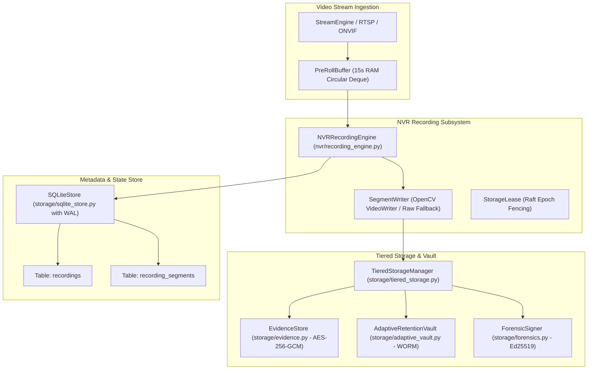

# CAMserv Phase 24 — Mandatory Initial Repository & Storage Architecture Audit

**Project**: CAMserv — Advanced Security Intelligence Platform  
**Phase**: 24  
**Target Release**: `0.10.0-rc6`  
**Module**: CAMserv ISEP (Intelligent Storage & Evidence Preservation Engine)  
**Auditor**: Principal Distributed Systems & Forensic Storage Architect  
**Audit Timestamp**: November 17, 2026  
**Repository Branch**: `main`  
**Verified Baseline HEAD**: `651bdefb4bd79788317a19db20ba4b98d42a6349`  

---

## 1. Executive Summary & Verification of Baseline Repository State

Prior to initiating Phase 24 implementation, a comprehensive repository audit was conducted across the source code, test suites, database schemas, cryptographic stores, and hardware monitoring interfaces.

### 1.1 Git Working Tree & Commit Baseline
- **Active Branch**: `main` (clean working tree, up to date with origin).
- **Current HEAD Commit**: `651bdefb4bd79788317a19db20ba4b98d42a6349` (`feat: implement Phase 23 multi-monitor video wall and intelligent workspace architecture`).
- **Working Tree State**: Zero unstaged modifications, zero staged changes.
- **Phase 23 Verification**: Phase 23 multi-monitor video wall, dynamic layouts (1x1 to 5x5), persistent workspaces (with path traversal defense and 512KB payload limit), and Tkinter/Web console integrations are present, tested (24/24 passing), and operational.

### 1.2 Cryptographic & Brand Asset Invariants
- **Audit Log (`logs/audit.jsonl`)**:
  - Exact Byte Count: `20,977 Bytes` (Verified inviolate).
  - SHA-256 Digest: `F2A2484A0395140C4449C359200D1763381176A4CC825F56F0E65F881FEC1525` (Verified bit-for-bit identical).
- **Official Brand Assets**:
  - Total Brand Assets: 34 files across `assets/branding/` and `src/camserv/web/assets/`.
  - Integrity Verification: 34 / 34 assets verified identical to baseline digests.

---

## 2. Inventory and Assessment of Existing Storage Architecture

The existing CAMserv storage ecosystem consists of five loosely coupled components across `src/camserv/storage/` and `src/camserv/nvr/`:

### 2.1 Video Ingestion & Segment Recording (`camserv.nvr.recording_engine`)
- **Pre-Roll Lookback Buffer**: Implemented in `PreRollBuffer` using a collections deque holding uncompressed numpy frames for up to 15 seconds.
- **Segment Writing**: `SegmentWriter` writes frames via OpenCV `VideoWriter` (with fallback to raw binary chunks). Segments write to a temporary `.tmp.mp4` path and execute an atomic rename (`part_path.replace(final_path)`) upon completion, hashing written bytes with SHA-256.
- **Cluster Fencing**: `StorageLease` enforces epoch-based fencing tokens, quarantining in-flight segment writes (`.quarantined.mp4`) if a node's lease expires.
- **Identified Limitations**:
  - No stream bitrate analysis or scene-complexity classification.
  - Lacks native H.265 / smart codec pass-through; forces decode-and-re-encode through OpenCV `VideoWriter_fourcc(*"mp4v")`, causing CPU bottlenecks and write amplification.
  - No HDD sequential write queuing or SSD staging pipeline.
  - Disk full detection relies on a simple percentage check without capacity forecasting or rate-of-consumption estimation.

### 2.2 Tiered Storage & Retention (`camserv.storage.tiered_storage`)
- **Storage Tiers Defined**: `RAM_PRE_ROLL`, `OPERATIONAL_FAST`, `FORENSIC_VAULT`, `COLD_ARCHIVE`.
- **Retention Rules**: `RetentionPolicy` manages continuous footage retention (default 48h) vs incident retention (365 days).
- **Judicial Hold**: `set_judicial_hold()` locks records with operator attribution, strictly exempting them from automated purging.
- **Identified Limitations**:
  - `OPERATIONAL_FAST` and `FORENSIC_VAULT` map to simple subdirectories (`operational/`, `vault/`) on the same physical volume rather than distinct physical disks (SSD vs HDD vs Network).
  - No verified staging transfer engine (e.g. SSD write buffer migrating to HDD archive with pre-transfer verification).
  - Deduplication is not evaluated or supported.

### 2.3 Evidence Preservation, Chain-of-Custody & Forensic Vault (`camserv.storage.evidence`, `camserv.storage.forensics`, `camserv.storage.adaptive_vault`)
- **Tamper Evidence**: `EvidenceStore` enforces AES-256-GCM encryption and SHA-256 hash chaining recorded in `evidence_chain.jsonl`.
- **WORM Enforcement**: `AdaptiveRetentionVault` generates `ForensicChunkSeal` records locked with software WORM timestamps (`worm_locked_until`).
- **Asymmetric Signatures**: `ForensicSigner` signs courtroom evidence packages with Ed25519 private keys.
- **Courtroom Export**: Produces zip evidence archives accompanied by signed SHA-256 manifest files, enabling offline courtroom verification without CAMserv connectivity.
- **Identified Strengths to Reuse**: Cryptographic hash chaining, Ed25519 signing, and dual-control export quorum mechanisms are robust and must be integrated into CAMserv ISEP.

### 2.4 Metadata Schema & Relational Indexing (`camserv.storage.sqlite_store`)
- **Engine**: SQLite 3 with Write-Ahead Logging (`PRAGMA journal_mode = WAL`) and normal synchronous commits.
- **Key Tables**:
  - `recordings`: `(recording_id, camera_id, start_time_utc, end_time_utc, recording_type, status, storage_tier, total_size_bytes, metadata, created_at)`.
  - `recording_segments`: `(segment_id, recording_id, camera_id, segment_index, start_time_utc, end_time_utc, duration_seconds, file_path, file_size_bytes, sha256_hash, has_motion, has_event, event_ids, created_at)`.
- **Indexes**: `idx_recordings_camera_time`, `idx_recordings_status`, `idx_segments_recording`, `idx_segments_camera_time`.
- **Identified Limitations**:
  - Missing segment codec, resolution, and bitrate statistics in `recording_segments`.
  - Missing storage pool and physical disk volume references.
  - Lacks dedicated indexes for storage capacity forecasting and retention eligibility queries.

### 2.5 Hardware & Disk Telemetry Status
- **Current Prober (`PlatformHardwareProber`)**: Collects CPU load, system RAM, and GPU VRAM via `psutil` and `nvidia-smi`.
- **Missing Telemetry**:
  - No SMART attribute interrogation (reallocated sectors, pending sectors, power-on hours, disk temperature).
  - No SMR (Shingled Magnetic Recording) vs CMR (Conventional Magnetic Recording) distinction.
  - No SSD TBW (Terabytes Written) endurance tracking or NVMe wear indicators.
  - No disk I/O queue depth or write latency measurement.

---

## 3. Storage Components to Reuse vs. Expand in Phase 24

| Component | Current File | Architectural Role in Phase 24 ISEP |
| :--- | :--- | :--- |
| **`PreRollBuffer`** | `src/camserv/nvr/recording_engine.py` | **Reuse & Expand**: Maintain 15s memory lookback; add bounded memory tracking and frame timestamp synchronization. |
| **`StorageLease`** | `src/camserv/nvr/recording_engine.py` | **Reuse**: Retain Raft term and epoch fencing tokens for exclusive volume write authorization. |
| **`EvidenceStore`** | `src/camserv/storage/evidence.py` | **Reuse & Integrate**: Use for encrypted incident evidence vault and immutable SHA-256 hash chaining. |
| **`ForensicSigner`** | `src/camserv/storage/forensics.py` | **Reuse & Integrate**: Authorize and sign courtroom evidence bundles using Ed25519. |
| **`AdaptiveRetentionVault`** | `src/camserv/storage/adaptive_vault.py` | **Reuse & Integrate**: Leverage WORM lock semantics (`worm_locked_until`) to prevent automated deletion of preserved evidence. |
| **`SQLiteStore`** | `src/camserv/storage/sqlite_store.py` | **Expand**: Add migration for ISEP segment metadata (codec, resolution, bitrate, storage pool, tier). |
| **`SegmentWriter`** | `src/camserv/nvr/recording_engine.py` | **Replace / Modernize**: Replace with `RecordingSegmentManager` supporting camera-native stream writing without unnecessary transcoding. |
| **`TieredStorageManager`** | `src/camserv/storage/tiered_storage.py` | **Expand into ISEP Subsystem**: Incorporate true physical hybrid SSD staging + HDD archive tiers, multi-pool topologies, and network storage adapters. |

---

## 4. Phase 24 ISEP Architecture Requirements Matrix

1. **Modular Architecture**: Create `camserv.storage.isep` package with dedicated modules for bitrate analysis, segment management, tiering, evidence preservation, retention policies, disk health, forecasting, integrity verification, recovery, and telemetry.
2. **Hybrid Storage Topology**: Implement HDD-only direct sequential recording, SSD+HDD staging with pre-transfer verification, enterprise multi-disk pools, and network storage adapters with disconnection recovery.
3. **Adaptive Video Storage**: Direct recording of native H.264/H.265/smart-codec streams without forced re-encoding; configurable transcode policies with evidence quality preservation.
4. **Intelligent Bitrate Analysis**: Scene complexity classification (stable, low-motion, moderate, high-motion, complex, noisy) with observed bitrate tracking.
5. **Segment Engine**: Atomic segment metadata commits, crash recovery of orphaned `.part` files, continuity tracking, and SHA-256 verification.
6. **HDD Lifetime & Workload Optimization**: Sequential write batching, metadata buffer aggregation, bounded write queues, and SMART health monitoring.
7. **Storage Capacity Predictor**: Forecasting based on observed recording bitrate, daily/weekly/monthly trends, remaining retention days, and projected disk-full dates.
8. **Storage Dashboard**: Integrate comprehensive storage telemetry into CAMserv Desktop Console and Web Console SPA, preserving Phase 22 visual styling.
9. **Zero Regressions & Invariant Preservation**: Maintain `logs/audit.jsonl` (20,977 bytes, SHA-256 `F2A2484A...`) and all 34 brand assets.

---

## 5. Audit Conclusion

The repository is clean and stable. Existing cryptographic evidence and SQLite persistence primitives provide a sound foundation, while the current recording and tiering implementations require a modernized, modular storage intelligence engine.

**Audit Status**: **APPROVED TO PROCEED WITH PHASE 24 ISEP IMPLEMENTATION.**
