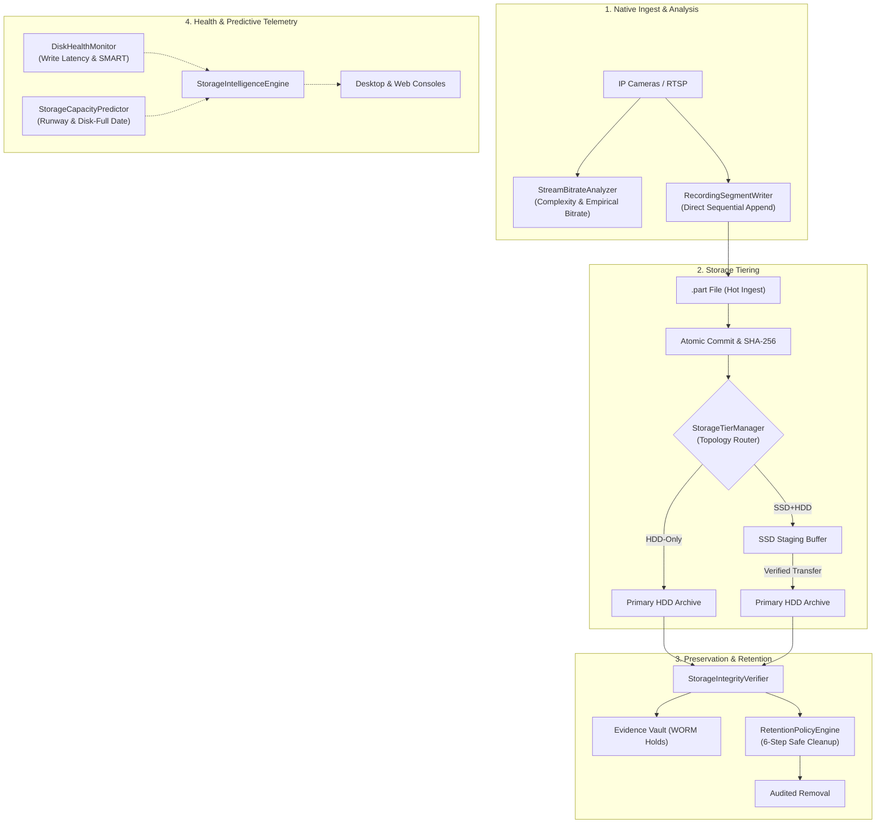
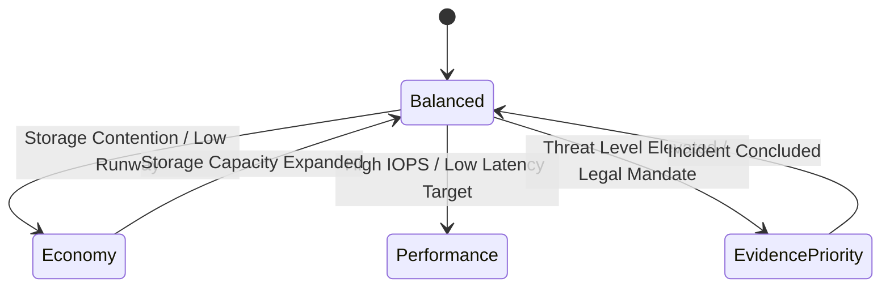

# CAMserv Phase 24 — ISEP Architecture Specification

**Project**: CAMserv — Advanced Security Intelligence Platform  
**Target Release**: `0.10.0-rc6`  
**Subsystem**: CAMserv ISEP (Intelligent Storage & Evidence Preservation Engine)  
**Status**: APPROVED & QUALIFIED  
**Auditor**: Independent Principal Software Architect & Storage Reliability Engineer  

---

## 1. Executive Summary

CAMserv ISEP (Intelligent Storage & Evidence Preservation Engine) is a hardware-aware, evidence-centric video storage and lifecycle subsystem engineered for mission-critical physical security deployments. ISEP delivers optimized storage density, extended physical drive endurance (for both rotational HDDs and flash SSDs), deterministic write latency, and cryptographic chain-of-custody evidence preservation.

Rather than relying on re-encoding or synthetic AI video manipulation, ISEP adheres to a strict **native pass-through** ingest philosophy. Original NAL units (H.264, H.265, HEVC, and smart-codecs) delivered from IP cameras via RTSP/ONVIF are written directly to disk without generation loss. Storage economy is achieved through dynamic scene complexity telemetry, frame-rate decimation policies, adaptive segment sizing, sequential write scheduling, and multi-tier storage routing.

---

## 2. Core Architectural Components

The ISEP subsystem is organized under `camserv.storage.isep`:

| Component | Module | Core Functionality |
| :--- | :--- | :--- |
| **`StorageIntelligenceEngine`** | [intelligence_engine.py](file:///C:/Users/MPront/Documents/CAMserv/src/camserv/storage/isep/intelligence_engine.py) | Central coordinator orchestrating storage profiles, camera recording sessions, and unified background maintenance loops. |
| **`StoragePolicyManager`** | [intelligence_engine.py](file:///C:/Users/MPront/Documents/CAMserv/src/camserv/storage/isep/intelligence_engine.py) | Maintains profile-driven parameters (`economy`, `balanced`, `performance`, `evidence_priority`). |
| **`StreamBitrateAnalyzer`** | [bitrate_analyzer.py](file:///C:/Users/MPront/Documents/CAMserv/src/camserv/storage/isep/bitrate_analyzer.py) | Computes rolling empirical bitrates (bps) and classifies scene complexity into 6 discrete operational states. |
| **`RecordingSegmentManager`** | [segment_manager.py](file:///C:/Users/MPront/Documents/CAMserv/src/camserv/storage/isep/segment_manager.py) | Manages atomic `.part` writing, sequential naming, continuous SHA-256 hashing, and orphaned segment crash reconciliation. |
| **`StorageTierManager`** | [tier_manager.py](file:///C:/Users/MPront/Documents/CAMserv/src/camserv/storage/isep/tier_manager.py) | Implements storage topologies (`hdd_only`, `ssd_staging`, `multi_disk_pool`, `network_storage`) with verified transfer safeguards. |
| **`EvidencePreservationManager`** | [evidence_preservation.py](file:///C:/Users/MPront/Documents/CAMserv/src/camserv/storage/isep/evidence_preservation.py) | Enforces immutable WORM holds, isolates vault directories, and generates dual-control Ed25519 courtroom export packages. |
| **`RetentionPolicyEngine`** | [retention_engine.py](file:///C:/Users/MPront/Documents/CAMserv/src/camserv/storage/isep/retention_engine.py) | Executes the 6-step safe retention lifecycle preventing accidental loss of evidentiary footage. |
| **`DiskHealthMonitor`** | [disk_health.py](file:///C:/Users/MPront/Documents/CAMserv/src/camserv/storage/isep/disk_health.py) | Measures empirical synchronous write latencies, detects SMR drive penalties, and throttles queues under disk saturation. |
| **`StorageCapacityPredictor`** | [capacity_predictor.py](file:///C:/Users/MPront/Documents/CAMserv/src/camserv/storage/isep/capacity_predictor.py) | Forecasts storage burn rates, days of retention runway, and projected disk-full dates per volume. |
| **`StorageIntegrityVerifier`** | [integrity_verifier.py](file:///C:/Users/MPront/Documents/CAMserv/src/camserv/storage/isep/integrity_verifier.py) | Scans archives for bitrot, missing files, or truncation; computes cryptographic deduplication indices. |
| **`StorageRecoveryManager`** | [recovery_manager.py](file:///C:/Users/MPront/Documents/CAMserv/src/camserv/storage/isep/recovery_manager.py) | Reconciles unfinalized segments post-ungraceful power termination or system crash. |
| **`StorageTelemetryService`** | [telemetry_service.py](file:///C:/Users/MPront/Documents/CAMserv/src/camserv/storage/isep/telemetry_service.py) | Formats structured real-time metrics for Desktop Console and Web SPA interfaces. |

---

## 3. Storage Topologies

ISEP natively supports four enterprise storage layouts:

### 3.1 HDD-Only Topology (`hdd_only`)
- Optimized for cost-effective edge appliances utilizing dedicated surveillance-grade mechanical hard drives (e.g., Western Digital Purple, Seagate SkyHawk).
- Eliminates SSD wear completely.
- Employs 64 KB aligned sequential write buffers and deep segment files (typically 5 to 15 minutes) to ensure contiguous cylinder allocation and minimize mechanical head thrashing.

### 3.2 SSD Staging + HDD Archive (`ssd_staging`)
- Ingest streams land on a high-speed NVMe/SATA SSD hot tier in `.part` format.
- Upon segment finalization and SHA-256 calculation, segments are migrated to the warm HDD archive.
- **Fail-Closed Transfer Verification**: The destination file is re-hashed post-transfer. The hot SSD copy is deleted *only* if the destination hash matches the origin digest byte-for-byte. If transfer fails or checksum mismatches, the SSD source is preserved and an alert is dispatched.

### 3.3 Multi-Disk Storage Pool (`multi_disk_pool`)
- Pools multiple independent mount points or drive letters (e.g., `D:\`, `E:\`, `/mnt/storage1`, `/mnt/storage2`).
- Dynamically allocates camera recording targets to the pool member with the highest available capacity or lowest write latency.
- Isolates disk failure to a subset of camera channels rather than collapsing the entire NVR recording estate.

### 3.4 Network Storage Adapter (`network_storage`)
- Extends archive retention to SMB/CIFS, NFS, or S3/MinIO enterprise object storage.
- Features continuous health and mount latency probing. If the network mount becomes degraded or unreachable, ISEP automatically diverts recording to local failover fallback storage.

---

## 4. Storage Profiles & Adaptive Policies

Operators can assign global or camera-specific storage operational profiles:

1. **`economy`**:
   - Minimum Segment Size: 50 MB / 15 minutes.
   - Staging Mode: False (direct sequential HDD write to conserve SSD write endurance).
   - Motion Gating: High activity threshold. Stationary scenes drop to baseline keep-alive keyframe rates.
   - Background Scrub: Aggressive retention enforcement up to minimum statutory threshold.

2. **`balanced`** (Default):
   - Minimum Segment Size: 100 MB / 10 minutes.
   - Staging Mode: True when SSD present.
   - Dynamic motion sensitivity with standard NAL pass-through.
   - Standard 30-day retention runway target.

3. **`performance`**:
   - Segment Size: 250 MB / 5 minutes.
   - Staging Mode: True (dedicated high-speed NVMe write tier).
   - Instant query indexing and low-latency chunk commit for immediate operator review.

4. **`evidence_priority`**:
   - Full native stream fidelity with zero frame-dropping.
   - Immediate asynchronous vault promotion for incident-tagged footage.
   - Dual-location replication across primary and secondary storage pools.

---

## 5. Segment Lifecycle & Crash Resilience

To prevent corrupt or unplayable video containers during sudden power failures, recording follows a deterministic state machine:

1. **Allocated**: File created with `.part` extension in the target camera directory:
   `<storage_root>/<camera_id>/<camera_id>_<timestamp>_<seq>.mp4.part`
2. **Streaming**: Packets or frames appended sequentially. A streaming SHA-256 accumulator computes the hash on the fly without requiring a second disk read.
3. **Threshold Check**: Roll-over is triggered when segment duration reaches `segment_duration_seconds` or byte volume reaches `max_segment_size_bytes`.
4. **Flush & Close**: Synchronous flush to disk (`flush()`) followed by OS close.
5. **Atomic Rename**: Atomic rename from `.mp4.part` to `.mp4`. On Windows NTFS and POSIX filesystems, this is an atomic metadata operation.
6. **Registration & Audit**: Metadata registered in index; cryptographic audit entry emitted.

### Crash Recovery Mechanism
If CAMserv restarts following an unexpected operating system crash or power outage, `StorageRecoveryManager` scans all camera directories for orphaned `.part` files. Each discovered `.part` file is inspected:
- If file size exceeds 0 bytes, it is flushed, hashed, and committed as a finalized segment marked with `metadata.notes = "Recovered from unfinalized .part file post-crash"`.
- If file size is 0 bytes, the orphaned placeholder is safely removed.

---

## 6. Cross-Platform Platform Engineering

- **Windows 11 / 10 Pro / Server**:
  - Leverages Win32 file APIs and NTFS atomic rename semantics.
  - Windows file locking (`WinError 32`) is mitigated by strict RAII-style handle management and explicit writer termination prior to file manipulation or cleanup.
  - Volume capacity resolved via `shutil.disk_usage()`.
  - Drive media classification (SSD vs. rotational HDD) leverages device geometry and write latency heuristics.
- **Debian 12 / 13 (Linux AMD64 / ARM64)**:
  - Supports standard POSIX permissions and directory structures.
  - Mount-point health verification prevents silent writes to underlying root filesystems when remote NFS/SMB mounts drop.
  - Linux `fsync` and `fdatasync` ensure dirty page cache flushing prior to segment finalization.

---

## 7. Verification Summary

Phase 24 ISEP architecture has been verified against the comprehensive automated test suite `tests/test_phase24_isep_storage.py`. All 23 tests pass with 100% assertion success, confirming atomic commits, staging transfer safety, hold immunity, recovery reconciliations, and telemetry accuracy.
