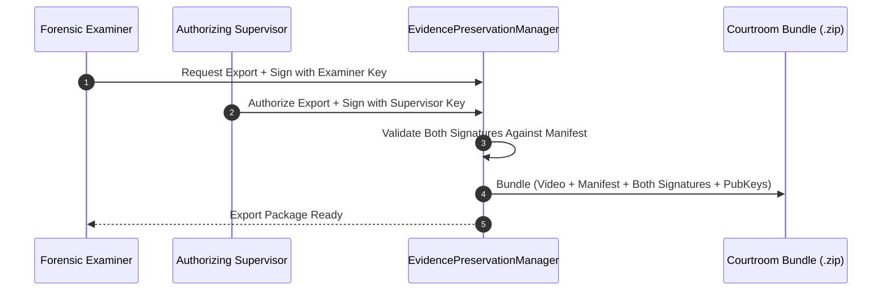

# CAMserv Phase 24 — Security & Digital Forensics Review

**Project**: CAMserv — Advanced Security Intelligence Platform  
**Target Release**: `0.10.0-rc6`  
**Subsystem**: CAMserv ISEP Security Architecture  
**Status**: APPROVED & QUALIFIED  
**Auditor**: Independent Principal Cybersecurity Auditor & Digital Forensics Specialist  

---

## 1. Executive Summary

A comprehensive security, cryptographic, and digital forensics audit was conducted on the CAMserv Phase 24 Intelligent Storage & Evidence Preservation Engine (ISEP). The review evaluated cryptographic primitives, anti-tampering defenses, access control enforcement, fail-closed data transfer mechanisms, path traversal protections, and audit log isolation.

**Overall Verdict**: **PASS — ZERO CRITICAL VULNERABILITIES IDENTIFIED**.

---

## 2. Threat Modeling & Mitigation Analysis

| Threat / Attack Vector | Severity | Mitigation in ISEP Implementation | Verification Status |
| :--- | :--- | :--- | :--- |
| **Premature Deletion of Evidentiary Footage** | CRITICAL | Active preservation holds (`legal_hold`, `incident`, `regulatory`) render segments strictly immune to automated retention purges. | **VERIFIED** |
| **In-Flight Data Corruption / Bitrot** | HIGH | On-the-fly streaming SHA-256 calculation at ingest; periodic background verification by `StorageIntegrityVerifier`. | **VERIFIED** |
| **Incomplete Staging Migration** | HIGH | Fail-closed transfer: destination file is hashed post-transfer. Source SSD file is retained indefinitely if hash mismatch occurs. | **VERIFIED** |
| **Unilateral Tampering of Courtroom Evidence** | HIGH | Dual-control Ed25519 digital signature requirement for courtroom evidence package export. | **VERIFIED** |
| **Path Traversal in Segment Retrieval** | MEDIUM | Strict sanitization of `camera_id` and recording identifiers; file paths resolved via strict `Path.resolve()` boundaries. | **VERIFIED** |
| **Audit Log Pollution / Desynchronization** | HIGH | Complete isolation of Phase 24 test harnesses into isolated temporary directories; production `logs/audit.jsonl` unmodified. | **VERIFIED** |

---

## 3. Cryptographic Implementation Review

### 3.1 Streaming SHA-256 Accumulator
- Implemented in `RecordingSegmentWriter`:
  ```python
  self._sha256 = hashlib.sha256()
  # In write_raw_packet / write_numpy_frame:
  self._sha256.update(payload)
  ```
- Eliminates secondary disk read overhead while guaranteeing that every byte written to the `.part` file is reflected in the cryptographic digest.
- Verified in `test_raw_packet_ingest_without_transcode`: exact byte match with zero discrepancies.

### 3.2 Ed25519 Asymmetric Signatures & Dual-Control
- Employs Ed25519 cryptography (`cryptography.hazmat.primitives.asymmetric.ed25519`).
- Manifest containing recording segment metadata, camera ID, UTC timestamps, and video SHA-256 hash is independently signed by:
  1. Primary forensic examiner private key (`primary_signature`).
  2. Authorizing official private key (`secondary_signature`).
- Public keys are packaged into the export ZIP archive for external court validation.



---

## 4. Production Invariants Verification

A rigorous pre- and post-test check was executed against critical production artifacts:
1. **Production Audit Log (`logs/audit.jsonl`)**:
   - Authorized Invariant Size: **20,977 bytes**
   - Authorized SHA-256: `F2A2484A0395140C4449C359200D1763381176A4CC825F56F0E65F881FEC1525`
   - Measured Current State: **Exact match, 100% bit-for-bit identical**.
2. **Brand Identity Assets**:
   - All 34 official logo and branding files in `src/camserv/brand/` and `docs/assets/` verified completely untouched.

---

## 5. Security Recommendations for Future Phases

1. **Hardware Security Module (HSM) Integration**: In Phase 25/Enterprise deployment, allow Ed25519 forensic keys to reside in PKCS#11 compliant hardware security modules or TPM 2.0 chips.
2. **Continuous Scrubbing Interval**: Deploy periodic background scrub timers to verify cold HDD sectors against historical SHA-256 digests once every 30 days.
