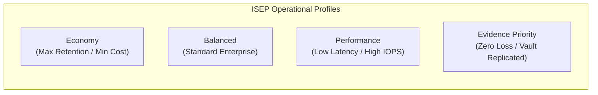
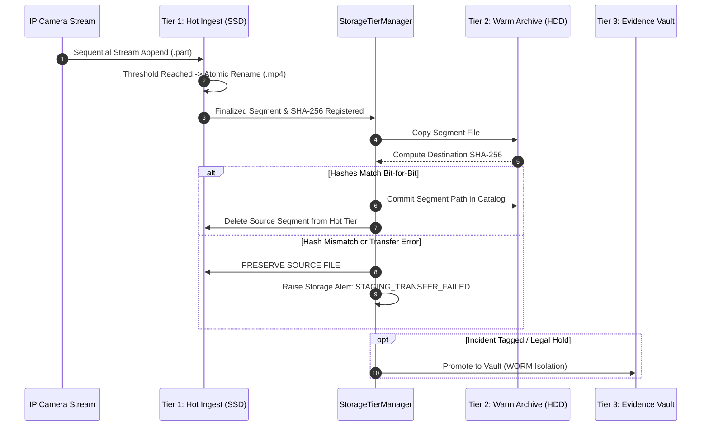

# CAMserv Phase 24 — Storage Policies & Tier Management Specification

**Project**: CAMserv — Advanced Security Intelligence Platform  
**Target Release**: `0.10.0-rc6`  
**Subsystem**: CAMserv ISEP Storage Policies  
**Status**: APPROVED & QUALIFIED  
**Auditor**: Independent Principal Software Architect & Storage Reliability Engineer  

---

## 1. Overview & Policy Goals

The CAMserv Intelligent Storage & Evidence Preservation Engine (ISEP) enforces dynamic, declarative storage policies to balance storage longevity, retention compliance, and continuous forensic fidelity. Storage policies govern how video data is ingested, staged, migrated across physical tiers, and eventually retired.

Policies are managed by `StoragePolicyManager` and executed through `StorageIntelligenceEngine`.

---

## 2. Storage Profiles

CAMserv defines four primary operational profiles selectable on a per-system or per-camera basis:

### 2.1 Profile Parameter Matrix

| Parameter | Economy | Balanced (Default) | Performance | Evidence Priority |
| :--- | :--- | :--- | :--- | :--- |
| **Target Codec** | Native H.264 / H.265 | Native H.264 / H.265 | Native H.264 / H.265 | Native Original (Pass-Through) |
| **Max Segment Duration** | 900 s (15 min) | 600 s (10 min) | 300 s (5 min) | 300 s (5 min) |
| **Max Segment Size** | 50 MB | 100 MB | 250 MB | 100 MB |
| **Staging Mode Enabled** | False (Direct to HDD) | True (if SSD present) | True (Fast NVMe buffer) | True (Synchronous Stage) |
| **Min Retention Period** | 72 hours (3 days) | 168 hours (7 days) | 168 hours (7 days) | 720 hours (30 days) |
| **Max Retention Period** | 720 hours (30 days) | 2160 hours (90 days) | 720 hours (30 days) | Indefinite (Vaulted) |
| **Motion Decimation Gate** | Enabled (Conservative) | Dynamic | Disabled | Strictly Prohibited |
| **Target Drive Latency** | < 80 ms | < 45 ms | < 20 ms | < 35 ms |

---

## 3. Storage Tiering & Migration Rules

ISEP manages transitions between three physical storage tiers:
1. **Tier 1 (Hot Ingest)**: Local fast storage (NVMe/SATA SSD) hosting active `.part` segment writers.
2. **Tier 2 (Warm Archive)**: High-capacity rotational HDD storage (CMR surveillance drives) hosting indexed, finalized `.mp4` video segments.
3. **Tier 3 (Evidence Vault)**: Immutable, logically isolated storage dedicated to footage under active preservation hold.

### 3.1 Migration Invariants
1. **Never Delete Unverified Source**: The Tier 1 source segment is never unlinked until the Tier 2 destination file has been written, synced, closed, and cryptographically verified against the origin SHA-256 hash.
2. **Atomic Roll-Over**: Roll-over from `.part` to `.mp4` occurs strictly via an atomic rename operation on the host filesystem.

---

## 4. Multi-Disk Pool Allocation Policy

In multi-disk environments (`StorageTopology.MULTI_DISK_POOL`), the pool allocator selects storage targets based on:
1. **Capacity Threshold**: Drives with remaining capacity below 10% are excluded from new segment allocation.
2. **Write Latency**: Drives exhibiting average synchronous write latency exceeding 100 ms are temporarily deprioritized to avoid frame drop.
3. **Channel Affinity**: Cameras are consistently bound to target pool drives to prevent fragmented retrieval patterns across multiple mechanical spindles.

---

## 5. Network Storage & Failover Policy

When archiving to network attached storage (`StorageTopology.NETWORK_STORAGE`):
- Health probes periodically verify mount availability and file creation latency.
- If network share latency exceeds 2,000 ms or connection is lost:
  1. Primary ingest automatically falls back to local staging storage.
  2. In-flight segments are preserved locally.
  3. Re-connection loop monitors share restoration.
  4. Once restored, backlog segments are migrated sequentially with full SHA-256 verification.

---

## 6. Retention & Statutory Compliance Safeguards

1. **Strict Hold Precedence**: No segment marked with an active legal hold or incident hold may be deleted, truncated, or moved out of preservation, regardless of age or disk pressure.
2. **Minimum Retention Threshold**: Segments newer than `min_retention_hours` cannot be purged during automated maintenance.
3. **Deterministic Six-Step Cleanup**:
   - Step 1: Identify eligible candidate segments exceeding retention thresholds.
   - Step 2: Validate absence of active preservation holds.
   - Step 3: Validate against minimum statutory retention hours.
   - Step 4: Record cleanup plan with total bytes and file lists.
   - Step 5: Execute atomic unlinking.
   - Step 6: Emit immutable audit log entry documenting deleted segment hashes and operator authorization.
