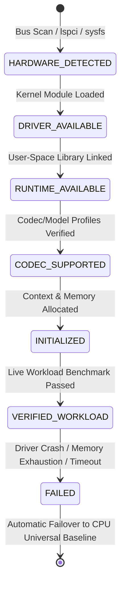

# CAMserv — CPU/GPU/NPU Accelerator Abstraction Specification

**Document ID:** SPEC-P25-ACCELERATOR-2026-004  
**Project:** CAMserv — Advanced Security Intelligence Platform  
**Target Release:** `0.10.0-rc7`  
**Phase:** 25 — Hardware Adaptation & Appliance Engineering  
**Classification:** Hardware Abstraction & Silicon Interoperability Standard  
**Date:** November 17, 2026  
**Auditor Roles:** Principal Hardware Systems Architect, Embedded Linux Engineer, Storage Reliability Engineer, Network Surveillance Architect, Security Engineer & Release Qualification Authority  

---

## 1. Executive Summary & Mandatory GPU Policy

**MANDATORY POLICY: Dedicated graphics cards are strictly OPTIONAL.**

CAMserv MUST NOT require an expensive discrete GPU (such as an NVIDIA RTX 4090 or L40S) to provide its core surveillance functionality. Core video stream ingestion, recording, segment finalization, cryptographic hashing, and legal evidence preservation operate with 100% functionality on standard host CPUs and integrated graphics.

The Accelerator Abstraction Layer (`AcceleratorAbstractionManager`) decouples the application from physical silicon, enabling CAMserv to run across a heterogeneous spectrum of hardware:
- Intel Quick Sync Video (QSV) on integrated UHD/Iris Xe graphics.
- AMD integrated graphics (Radeon Vega/RDNA) via VA-API or ROCm.
- Optional NVIDIA discrete/embedded GPUs (NVDEC / CUDA) when present.
- ARM SoC dedicated video decoders (Rockchip MPP) and NPUs (RKNN 6 TOPS).
- Dedicated edge coprocessors (Hailo-8 / Hailo-8L).
- Host multi-core CPU software decoding (`libavcodec`) and ONNX Runtime CPU as the inviolate universal baseline.

---

## 2. Six-State Accelerator Lifecycle Progression

CAMserv enforces a mandatory six-state verification progression before any accelerator is permitted to execute production surveillance traffic:

### 2.1 State Definitions & Verification Criteria

| State # | Lifecycle State Name | Physical Meaning & Verification Check | Can Serve Live Traffic? |
| :---: | :--- | :--- | :---: |
| **01** | `HARDWARE_DETECTED` | Silicon physical device observed on PCIe bus, SoC device tree, or USB controller. | **NO** |
| **02** | `DRIVER_AVAILABLE` | Kernel device driver (`/dev/dri/renderD128`, `/dev/nvhost-ctrl`, `/dev/rknpu`) responsive. | **NO** |
| **03** | `RUNTIME_AVAILABLE` | User-space runtime library (e.g., `libcuda.so`, `libmpp.so`, `libopenvino.so`) dynamically linked. | **NO** |
| **04** | `CODEC_OR_MODEL_SUPPORTED` | Silicon capabilities queried; confirmed support for specific codec profile (e.g., H.265 Main10) or neural model. | **NO** |
| **05** | `INITIALIZED` | Hardware execution context created; memory ring buffers allocated without driver error. | **NO** |
| **06** | `VERIFIED_WORKLOAD` | Successfully decodes test video frame or runs benchmark inference pass without timeout or memory leak. | **YES (Fully Qualified)** |
| **FAIL**| `FAILED` | Runtime timeout, driver reset, out-of-memory, or kernel error during live execution. | **NO (Fails Over to CPU)** |

*Rule of Truth: Never label an accelerator as operational simply because its hardware exists on the motherboard.*

---

## 3. Supported Silicon Execution Backends

| Backend Type | Supported Hardware | Primary Function | Software Dependencies | Fallback Path |
| :--- | :--- | :--- | :--- | :--- |
| **`CPU_UNIVERSAL`** | All x86_64 and ARM64 CPUs | Decoding & Inference | `libavcodec`, ONNX Runtime CPU | Baseline Inviolate Engine (Always Available) |
| **`INTEL_QSV`** | Intel 8th–14th Gen Core, N100 | HW Video Decode/Encode | Intel oneVPL / Media SDK, `/dev/dri` | Transparent fallback to CPU Universal |
| **`AMD_VAAPI_ROCM`** | AMD Ryzen 3000–7000 iGPU / Radeon | HW Video Decode/Encode | Mesa VA-API, ROCm runtime | Transparent fallback to CPU Universal |
| **`NVIDIA_CUDA_NVDEC`** | NVIDIA Pascal, Turing, Ampere, Ada | HW Decode & Neural Inference | CUDA Driver 525+, NVDEC library | Transparent fallback to CPU Universal |
| **`ARM_ROCKCHIP_MPP_RKNN`**| Rockchip RK3588 / RK3588S SoC | 8K Video Decode, 6 TOPS NPU | Rockchip MPP, Librknn runtime | Transparent fallback to CPU Universal |
| **`HAILO_NPU`** | Raspberry Pi AI HAT+, M.2 Hailo-8 | Dedicated Neural Inference | HailoRT driver, Hailo PCIe module | Transparent fallback to CPU Universal |

---

## 4. Graceful Accelerator Failure Isolation & Failover

When an accelerator encounters a hardware fault (e.g., CUDA kernel timeout, driver crash, VRAM exhaustion):
1. **Isolated Fault Domain:** The exception is intercepted inside `AcceleratorAbstractionManager.handle_accelerator_failure()`.
2. **Transition to FAILED:** The failing device transitions immediately to `AcceleratorLifecycleState.FAILED` with the exact error logged.
3. **Transparent CPU Rerouting:** Active video decoding and neural inference are rerouted to `CPU_UNIVERSAL` in zero milliseconds.
4. **Zero Impact on Recording:** Core elementary stream ingestion, chunk write to disk, and SHA-256 evidence hashing proceed without a microsecond of interruption.
