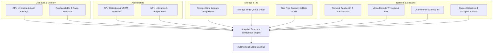
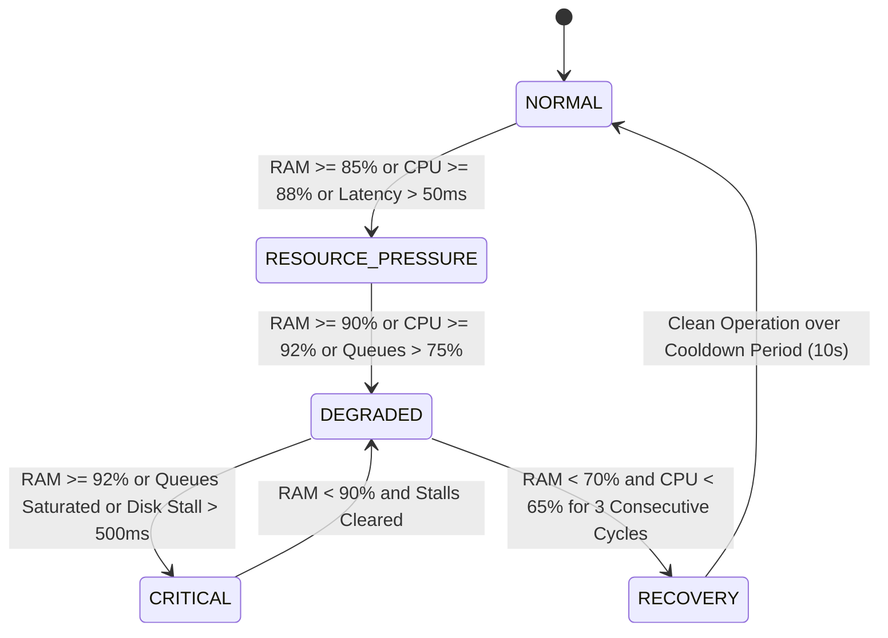

# CAMserv — Adaptive Resource Intelligence Engine Architecture

**Document ID:** ARCH-P25-RESOURCE-INTELLIGENCE-2026-002  
**Project:** CAMserv — Advanced Security Intelligence Platform  
**Target Release:** `0.10.0-rc7`  
**Phase:** 25 — Hardware Adaptation & Appliance Engineering  
**Classification:** Autonomous Systems & Dynamic Load Regulation Architecture  
**Date:** November 17, 2026  
**Auditor Roles:** Principal Hardware Systems Architect, Embedded Linux Engineer, Storage Reliability Engineer, Network Surveillance Architect, Security Engineer & Release Qualification Authority  

---

## 1. Executive Summary & Design Mission

The Adaptive Resource Intelligence Engine (`AdaptiveResourceManager`) serves as the central autonomous governor of CAMserv. Its objective is to prevent catastrophic failure modes: out-of-memory crashes, disk write starvation, thermal runaway, and interface freezes.

Unlike traditional software that crashes or drops video frames uncontrollably when overloaded, CAMserv continuously monitors host resources and regulates its workload through five formal operating states and a progressive 7-stage degradation hierarchy.

**Core Invariant:** Video recording and cryptographic evidence preservation have absolute priority over optional analytical AI workloads. Under extreme pressure, AI is shed progressively to ensure 100% of incoming camera elementary streams are safely committed to disk.

---

## 2. Multi-Resource Evaluation Telemetry

The engine samples eleven multi-dimensional metrics via `CompositeResourceTelemetry`:



---

## 3. Five-Stage Operational State Machine

CAMserv operates across five formal states:



### 3.1 State Definitions & Transition Matrix

| Operating State | Entry Condition | Autonomous System Response | Recording Status | AI Processing Status |
| :--- | :--- | :--- | :---: | :---: |
| **`NORMAL`** | RAM $< 85\%$, CPU $< 88\%$, disk latency $< 25\text{ms}$ | Standard baseline parameters; nominal fan speed; all configured analytics active. | **100% Active (30 FPS)** | **100% Active (15 FPS)** |
| **`RESOURCE_PRESSURE`** | RAM $\ge 85\%$ or CPU $\ge 88\%$ or latency $> 50\text{ms}$ | Advisory logged; background reporting and database VACUUM deferred; preview refresh rate throttled. | **100% Active (30 FPS)** | **Active (Downscaled to 10 FPS)** |
| **`DEGRADED`** | RAM $\ge 90\%$ or CPU $\ge 92\%$ or queue depth $> 75\%$ | AI inference downsampled; resolution reduced to 480x480; concurrent inference workers limited. | **100% Active (25–30 FPS)** | **Throttled (5 FPS, Substreams Only)** |
| **`RECOVERY`** | RAM $< 70\%$ and CPU $< 65\%$ for 3 cycles | Transient cooling stage; gradual workload restoration (+2 FPS per step) to prevent resource spikes. | **100% Active (30 FPS)** | **Gradual Stepwise Restoration** |
| **`CRITICAL`** | RAM $\ge 92\%$ or disk stall $> 500\text{ms}$ | Emergency load shed; neural inference suspended; noncritical queues cleared; raw encrypted vault recording strictly preserved. | **100% Protected (15–30 FPS Raw)** | **HALTED / SUSPENDED (0 FPS)** |

---

## 4. Progressive Seven-Stage Workload Shedding Policy

When resource pressure escalates, CAMserv applies progressive, deterministic load shedding:

```
[Level 1: Defer Background Indexing]
       │
       ▼
[Level 2: Downsample AI Sampling Frequency (15 -> 10 FPS)]
       │
       ▼
[Level 3: Limit Concurrent Inference Tasks (Reduce Workers)]
       │
       ▼
[Level 4: Prioritize Critical Recording & Evidence Holds]
       │
       ▼
[Level 5: Defer Nonessential Analytics & Thumbnail Generation]
       │
       ▼
[Level 6: Engage Bounded Backpressure on Substream Queues]
       │
       ▼
[Level 7: Emergency Shed: Suspend AI Inference, Preserve Raw Video Vault]
```

### 4.1 Anti-Flapping Hysteresis & Cooldown Rules
- **Cooldown Interval:** Minimum 10.0 seconds (`cooldown_period_sec`) between state changes to prevent oscillating between NORMAL and DEGRADED during bursty traffic.
- **Recovery Hold Cycles:** The engine mandates three consecutive clean metric evaluations before leaving DEGRADED/CRITICAL states.
- **Gradual Workload Restoration:** Restores inference frequency in incremental steps (+2 FPS per cooldown period) to prevent immediate resource re-saturation.
