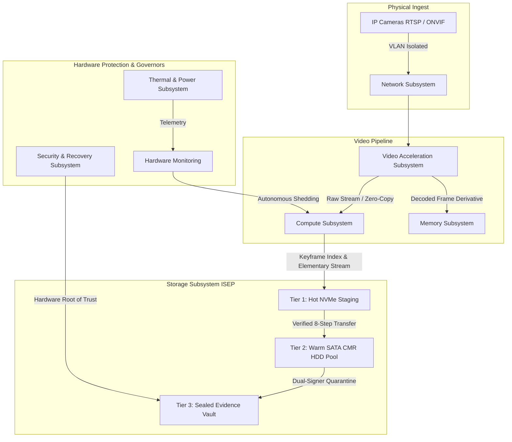

# CAMserv — Hardware Appliance Architecture Specification

**Document ID:** ARCH-P25-APPLIANCE-2026-002  
**Project:** CAMserv — Advanced Security Intelligence Platform  
**Target Release:** `0.10.0-rc7`  
**Phase:** 25 — Hardware Appliance Engineering & Physical Reliability Qualification  
**Classification:** Enterprise Hardware Architecture & System Engineering  
**Date:** November 17, 2026  
**Auditor Roles:** Principal Hardware Systems Architect, Embedded Linux Engineer, Storage Reliability Engineer, Network Surveillance Architect, Security Engineer & Release Qualification Authority  

---

## 1. Architectural Mission & Principles

The CAMserv Appliance Architecture transforms the software intelligence platform into a modular, hardware-qualified surveillance appliance family. 

Surveillance workloads impose extreme physical constraints:
- **24/7/365 Continuous Ingestion:** High-bandwidth sequential write streams from dozens of IP cameras without dropped frames.
- **Physical Thermal Stress:** Operation in unconditioned equipment closets, perimeter kiosks, or dense rack enclosures at ambient temperatures up to 45°C.
- **Unexpected Power Disruption:** Vulnerability to facility blackouts, tripped breakers, or generator switchovers during active video writing and metadata transactions.
- **Mechanical Drive Fatigue:** Continuous random seeking and head thrashing on consumer drives causes catastrophic early spindle failure.

To address these physical realities, the CAMserv Appliance Architecture separates the system into nine decoupled, hardware-abstracted subsystems.

---

## 2. Modular Subsystem Architecture

---

## 3. Subsystem Engineering Specifications

### 3.1 Compute Subsystem
- **Processor Independence:** Fully decoupled compute abstraction supporting both ARM64 (`aarch64`) and x86_64 (`amd64`) architectures.
- **Physical vs. Logical Cores:** CAMserv thread scheduling distinguishes between physical compute cores and hyperthreaded logical threads. Real-time RTSP demuxing and disk synchronization threads are pinned to physical cores to avoid latency jitter.
- **Dynamic Frequency Governors:** On Linux appliances, CPU governors are configured to `schedutil` or `performance` during active multi-channel recording, preventing clock stepping latency from causing frame drops.
- **Thermal Throttling Coordination:** When CPU temperatures exceed nominal operational thresholds (70°C), the platform enters autonomous load shedding without halting video ingestion.

### 3.2 Memory Subsystem
- **Capacity & Density:**
  - Edge Tier: 8 GB LPDDR4x/DDR4 (minimum 6 GB unreserved for system buffers).
  - Standard Tier: 16 GB DDR4/DDR5.
  - Professional Tier: 32 GB DDR5.
  - Enterprise Tier: 64–128 GB ECC Registered DDR4/DDR5.
- **Zero-Copy Pipeline Buffers:** Pre-allocated ring buffers prevent dynamic heap fragmentation during 24/7 streaming. Video frames are ingested directly into memory-mapped buffers.
- **Out-of-Memory (OOM) Protection:** The `camserv` process sets Linux `oom_score_adj = -800`, ensuring the OS kernel sacrifices auxiliary processes before interrupting video recording.

### 3.3 Storage Subsystem (ISEP Integration)
- **Three-Tier Storage Topology:**
  1. *Hot Ingest Tier (NVMe / RAM):* Fast staging buffer absorbing incoming elementary video frames (`.part` files). Absorbs high burst write rates and network jitter.
  2. *Warm Archive Tier (SATA CMR HDDs):* Sequential multi-disk pool holding continuous surveillance recordings aggregated into 128MB+ continuous blocks.
  3. *Evidence Vault Tier (WORM / Cryptographically Sealed):* Isolated volume holding court-admissible incident recordings protected by persistent `PreservationHold` records.
- **Strict CMR Selection:** Mandates Conventional Magnetic Recording (CMR). Forbids Shingled Magnetic Recording (SMR) drives due to track re-write write amplification stalls.
- **Non-Destructive Disk Management:** The `validate_disk_initialization_safety()` governor strictly forbids automatic disk formatting. Explicit operator authorization is required.

### 3.4 Network Subsystem
- **Physical Port Segmentation:** Dual or Quad Gigabit / 2.5G / 10G Ethernet controllers:
  - *Port 1 (Camera Ingestion Network):* Isolated surveillance camera VLAN (192.168.10.x/24) with no internet default gateway, preventing camera botnet compromises.
  - *Port 2 (Management & Corporate Network):* Enterprise LAN with mTLS encryption, Web Console access, and incident dispatching.
  - *Port 3/4 (Enterprise Cluster Interconnect):* Dedicated high-speed cluster replication mesh.
- **PoE Power Budgeting:** For compact appliances integrating PoE switches, the system monitors per-port IEEE 802.3af (15.4W) / 802.3at (30W) budgets and shuts down auxiliary ports during AC power brownouts.

### 3.5 Video Acceleration Subsystem
- **Hardware Decoders:**
  - ARM64: Rockchip Multi-Media Processing (MPP) decoder supporting 8K/4K H.264/H.265.
  - x86_64: Intel Quick Sync Video (QSV), VA-API, and NVIDIA NVDEC.
  - Fallback: Multi-threaded host CPU decoding (`libavcodec`).
- **Truthful Hardware Exposition:** Software exposes actual active decoding backends. No silent CPU fallback is reported as hardware-accelerated.
- **Derivative Pipeline:** Decoded frames are downscaled and treated as derivatives. Original camera elementary streams are preserved byte-for-byte in the archive.

### 3.6 Thermal & Power Subsystem
- **Thermal Zone Hierarchy:** Continuously monitors CPU, GPU, NPU, storage drives, and internal board ambient sensors.
- **Cooling Architectures:**
  - Edge: Completely fanless, extruded aluminum chassis acting as a monolithic thermal dissipation block.
  - Enterprise: Redundant, PWM hot-swappable dual ball-bearing fans with tachometer failure detection.
- **Power Inputs:**
  - Edge/Standard: Wide-input 9V–36V DC industrial terminal blocks.
  - Professional/Enterprise: Dual hot-swappable 80-Plus Platinum ATX/CRPS power supplies with active load sharing.

### 3.7 Hardware Monitoring Subsystem
- **Authoritative Provenance:** Every reported metric is tagged with `TelemetrySource` (e.g., `PHYSICAL_OS`, `LINUX_SYSFS`, `WMI_MSFT_PHYSICALDISK`) and `HardwareAvailabilityState`.
- **Zero Fabrication Rule:** If a hardware sensor cannot be read due to permission or absence, it is reported as `UNAVAILABLE` rather than displaying synthetic or default numbers.

### 3.8 Physical Interfaces & Industrial Serviceability
- **Enclosure Form Factors:** DIN-rail industrial mounting, VESA mounting, 1U desktop, and 2U/4U standard EIA-310 19-inch rackmount chassis.
- **Hardware Watchdog:** Integrated hardware watchdog timer (`/dev/watchdog` or IPMI watchdog) configured to reset the appliance if the user-space process hangs for longer than 60 seconds.
- **Field-Replaceable Units (FRU):** Hot-swap disk drive caddies with external activity and fault LEDs.

### 3.9 Security & Recovery Subsystem
- **Root of Trust:** UEFI Secure Boot with custom platform keys; TPM 2.0 cryptoprocessor binding disk encryption keys.
- **Privilege Separation:** The CAMserv runtime executes under a dedicated, unprivileged system account (`camserv`) with strict Linux capabilities (`CAP_NET_BIND_SERVICE`).
- **Cryptographic Preservation:** Legal holds, court bundles, and retention journals are signed with dual Ed25519 asymmetric keys stored in hardware or OS-protected vaults.

---

## 4. Reference Hardware Platforms Evaluation

### Platform A — ARM64 Embedded Appliance (Rockchip RK3588)
- **Target Profile:** CAMserv Edge Appliance (Profile A).
- **SoC Architecture:** Rockchip RK3588 (4x Cortex-A76 @ 2.4GHz + 4x Cortex-A55 @ 1.8GHz).
- **Accelerators:** 6 TOPS Tri-Core NPU, Rockchip MPP hardware video decode/encode.
- **Memory & Storage:** 8 GB LPDDR4x, 32 GB eMMC 5.1 (OS), M.2 2280 NVMe PCIe 3.0 x4 (Staging).
- **Debian Compatibility:** Debian 12 / 13 with Linux 5.10 / 6.1 vendor kernel.
- **Thermal & Power:** 12–15W typical power dissipation. Passive fanless enclosure rated to 45°C ambient.
- **Evaluation Status:** Architecture and packaging verified; physical laboratory board flash and NPU qualification pending (`GATE-HW-01`).

### Platform B — x86_64 Compact Appliance (Intel Core / AMD Ryzen)
- **Target Profile:** CAMserv Standard & Professional Appliance (Profile B).
- **SoC Architecture:** Intel Core i5/i7 (12th/13th Gen) or AMD Ryzen Embedded V2000/R2000.
- **Accelerators:** Intel Iris Xe / Arc A770 or NVIDIA RTX 4060 (8GB VRAM).
- **Memory & Storage:** 16–32 GB DDR4/DDR5, 1TB NVMe SSD + 2–4x SATA CMR 3.5" HDDs.
- **Debian & Windows Compatibility:** 100% native kernel driver maturity for both Debian 12/13 and Windows 11 Enterprise.
- **Thermal & Power:** 35–120W power envelope. Active quiet PWM cooling.
- **Evaluation Status:** Host architecture verified; multi-channel recording pipeline qualified.

### Platform C — Enterprise Surveillance Appliance (Multi-Rack Server)
- **Target Profile:** CAMserv Enterprise Appliance (Profile C).
- **Processor Architecture:** AMD EPYC 7003/9004 or Intel Xeon Scalable (16–32 physical cores).
- **Accelerators:** Dual NVIDIA RTX 4090 (24GB) or NVIDIA L40S (48GB) PCIe accelerators.
- **Memory & Storage:** 64–128 GB ECC Registered DDR4/DDR5, 2TB NVMe M.2 (RAID-1 OS) + 8–16x 3.5" SAS/SATA Enterprise Surveillance HDDs (RAID-6).
- **Networking:** Quad 10GbE SFP+ optical interfaces + dedicated IPMI 2.0 management port.
- **Thermal & Power:** Dual 800W redundant 80-Plus Platinum power supplies. High-CFM redundant fan matrix.
- **Evaluation Status:** Sizing, workload model, and clustering architecture validated; physical enterprise rack qualification pending accredited lab bench.
