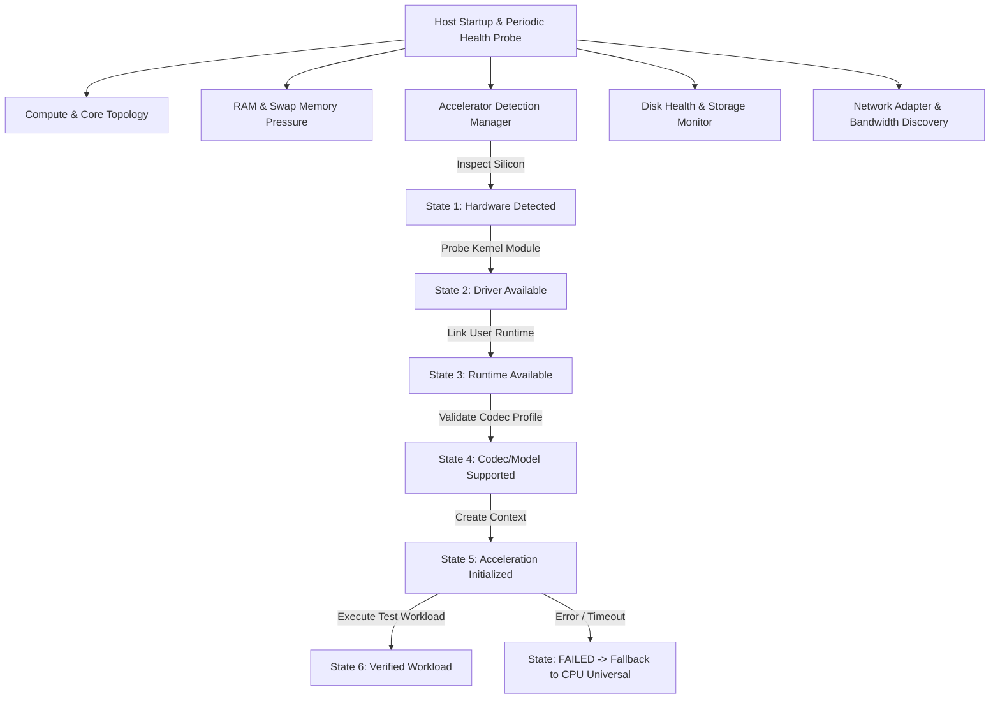

# CAMserv — Hardware Capability Detection Specification

**Document ID:** SPEC-P25-CAPABILITY-DETECTION-2026-001  
**Project:** CAMserv — Advanced Security Intelligence Platform  
**Target Release:** `0.10.0-rc7`  
**Phase:** 25 — Hardware Adaptation & Appliance Engineering  
**Classification:** Hardware Abstraction & Truthful Telemetry Standard  
**Date:** November 17, 2026  
**Auditor Roles:** Principal Hardware Systems Architect, Embedded Linux Engineer, Storage Reliability Engineer, Network Surveillance Architect, Security Engineer & Release Qualification Authority  

---

## 1. Executive Summary & Design Principle

The core engineering principle of CAMserv is: **Hardware-Adaptive, Resource-Aware, Failure-Resilient Architecture.**

CAMserv strictly avoids hardcoding expectations around specific expensive CPUs, discrete graphics cards, or proprietary appliances. Instead, the platform truthfully interrogates the host machine at runtime, identifies genuine physical capabilities, and distinguishes between six discrete capability states:
1. **Hardware Detected:** Silicon physical existence observed on bus/PCIe/SoC.
2. **Driver Available:** Operating system kernel driver loaded and responsive.
3. **Runtime Available:** User-space execution libraries (e.g., CUDA, oneVPL, OpenVINO, RKNN) linked and initialized.
4. **Codec / Model Supported:** The specific requested media codec (H.264/H.265) or neural network architecture is supported by the silicon.
5. **Acceleration Initialized:** Memory buffers allocated and hardware execution context established.
6. **Acceleration Verified through Workload:** Actively confirmed operational by successfully running a live test workload.

**Zero Fabrication Invariant:** If any sensor or accelerator is absent or fails verification, it is explicitly reported as `UNAVAILABLE` or `FAILED`. The platform never simulates operational status or returns hardcoded mock temperatures.

---

## 2. Hardware Detection Subsystem Architecture

---

## 3. Sensor Discovery & Attribution Register

Every telemetry metric collected across Linux and Windows hosts carries explicit provenance, confidence, and availability metadata:

| Telemetry Metric | Underlying Physical Source | Linux Provider | Windows Provider | Fallback Behavior on Absence |
| :--- | :--- | :--- | :--- | :--- |
| **CPU Architecture & Cores** | Host Processor CPUID | `/proc/cpuinfo`, `os.cpu_count()` | Win32 API, `os.cpu_count()` | Universal Native Fallback |
| **Physical Memory (RAM)** | OS Memory Subsystem | `/proc/meminfo`, `sysinfo()` | `GlobalMemoryStatusEx` via Win32 | Safe default tier bounding |
| **Thermal Telemetry** | Silicon Junction Diodes | `/sys/class/thermal/thermal_zone*` | WMI `MSAcpi_ThermalZoneTemperature` | Report `None` with `UNAVAILABLE` |
| **GPU / VPU Discovery** | Graphics Bus & Drivers | `/dev/dri/renderD*`, `nvidia-smi` | Win32 DirectX, `nvidia-smi.exe` | Mark GPU `UNAVAILABLE`; zero crashes |
| **NPU Discovery** | Dedicated Neural Silicon | `/dev/rknpu` (Rockchip), Hailo PCI | Not present / NPU stub | Fall back to Host CPU ONNX Runtime |
| **Storage Capacity & Type** | Block Devices & NVMe Subsystem | `/sys/block/*/queue/rotational` | WMI `MSFT_PhysicalDisk` | Distinguish CMR/SMR/NVMe/Unknown |
| **Storage Latency & Queue** | Filesystem Sync Latency | Direct synchronous 64KB `os.fsync` | Direct synchronous 64KB `os.fsync` | Monitor latency percentiles ($p_{50}, p_{95}, p_{99}$) |

---

## 4. Hardware Lifecycle State Flags

In accordance with Section 11 of the Phase 25 Directive, the `ApplianceCapabilityProfile` exposes five explicit boolean lifecycle flags:
- `hardware_detected` (`bool`): Set to `True` when silicon device is physically observed on the system bus.
- `hardware_available` (`bool`): Set to `True` when kernel drivers and device nodes are accessible with appropriate permissions.
- `hardware_initialized` (`bool`): Set to `True` when execution contexts and memory ring buffers are successfully allocated.
- `hardware_actively_used` (`bool`): Set to `True` when live camera frames or neural inference requests are actively executing on the device.
- `hardware_physically_verified` (`bool`): Strictly set to `False` on developer workstations and synthetic testbeds. Set to `True` **only** upon completion of accredited physical laboratory test protocols (`GATE-HW-01` through `GATE-HW-04`).
