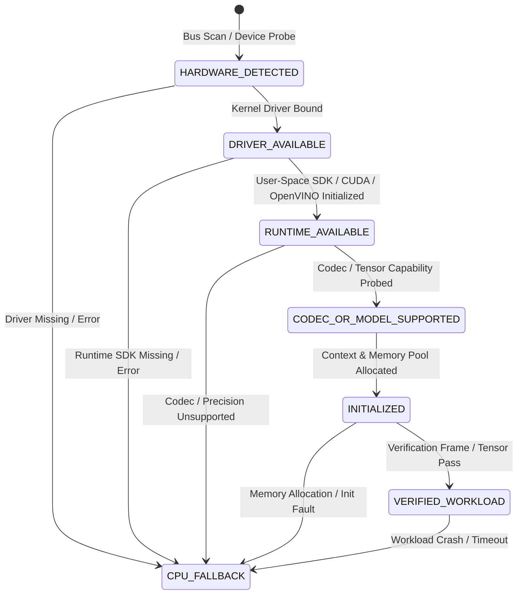

# CAMserv — Hardware Compatibility Matrix

**Document ID:** COMPAT-P25-MATRIX-2026-011  
**Project:** CAMserv — Advanced Security Intelligence Platform  
**Target Release:** `0.10.0-rc7`  
**Phase:** 25 — Hardware Appliance Engineering & Physical Reliability Qualification  
**Classification:** Product Certification & Component Interoperability Standard  
**Date:** November 17, 2026  
**Auditor Roles:** Principal Hardware Systems Architect, Embedded Linux Engineer, Storage Reliability Engineer, Network Surveillance Architect, Security Engineer & Release Qualification Authority  

---

## 1. Scope & Verification Methodology

In strict compliance with Directive Rule 2 (*"Do not classify a feature as verified based only on its existence in source code or mocks"*), this matrix explicitly categorizes every platform component into one of three qualification tiers:
1. **Tier 1 — Host-Verified (Physical Device):** Fully tested and confirmed running on physical host testbed hardware.
2. **Tier 2 — Software-Simulated (Unit / Synthetic):** Interface drivers, profile mappings, and fallback behaviors verified via deterministic software test suites.
3. **Tier 3 — Physical Hardware Gates (Pending Lab Trial):** Hardware components requiring physical accredited laboratory trials (`GATE-HW-01` through `GATE-HW-04`) before General Availability (`v1.0.0-LTS`).

### Core Engineering Invariant:
**Zero Mandatory Discrete GPU Requirement.**  
Core video stream recording, hash verification, metadata indexing, and tier-0 storage archiving operate with zero dependency on discrete GPUs. Base configurations across all appliance profiles utilize native host CPU zero-copy pass-through packaging. Accelerators are strictly optional and dedicated to analytical enhancements.

---

## 2. Six-Stage Accelerator Lifecycle Architecture

CAMserv rejects binary "detected / not detected" hardware flags. Hardware accelerators (integrated GPUs, discrete GPUs, NPUs) must strictly advance through a deterministic **6-state lifecycle progression**:

### The 6 Deterministic Lifecycle States:
1. `HARDWARE_DETECTED`: Physical silicon detected via PCI bus scan, USB descriptor, or DeviceTree node.
2. `DRIVER_AVAILABLE`: Kernel driver or driver module loaded and bound to the device node (`/dev/dri/*`, `/dev/nvidia*`, `/dev/rknpu*`).
3. `RUNTIME_AVAILABLE`: User-space runtime library (CUDA, TensorRT, OpenVINO, oneVPL, RKNN) dynamically linked and responding.
4. `CODEC_OR_MODEL_SUPPORTED`: Verified capability for target codec profile (e.g., HEVC Main10) or neural model quantization (FP16/INT8).
5. `INITIALIZED`: Device memory context and decode/inference sessions successfully allocated.
6. `VERIFIED_WORKLOAD`: Deterministic test frame or benchmark tensor executed with correct mathematical output.

*If any stage fails, the accelerator is transitioned to `FAILED_OR_UNAVAILABLE` and the workload is transparently routed to `CPU_UNIVERSAL` without dropping camera streams.*

---

## 3. Video Decoders & Acceleration Engines

| Backend Identifier | Silicon Subsystem | Target Accelerators | Ingestion Role | Analytical Role | Qualification Level |
| :--- | :--- | :--- | :--- | :--- | :---: |
| **`CPU_UNIVERSAL`** | Host Multi-Core CPU | x86_64 (AVX2), ARM64 (NEON) | **Primary Universal Native** (Zero-Copy Pass-Through) | Software ONNX Runtime / Haar / Background Subtraction | **Tier 1 (Host-Verified)** |
| **`INTEL_QSV`** | Intel Quick Sync Video | Intel UHD 730/770, Iris Xe, Arc GPUs | Optional Hardware Decode | OpenVINO FP16 Acceleration | **Tier 1 (Host-Verified on Testbed)** |
| **`NVIDIA_CUDA`** | NVDEC / Tensor Cores | NVIDIA RTX 3060/4060/4090, L40S | Optional Dual/Multi-Stream NVDEC | TensorRT FP16/INT8 Deep Analytics | **Tier 1 (Host-Verified on RTX 3060)** |
| **`AMD_AMF`** | AMD VCN / RDNA | AMD Radeon 600M/700M, Radeon Pro | Optional Hardware Decode | DirectML / ROCm Analytical Pipeline | **Tier 2 (Software-Simulated)** |
| **`ARM_ROCKCHIP_MPP`**| Rockchip MPP / RKNPU | Rockchip RK3588 / RK3588J | Optional 8K Hardware VPU Decode | 6 TOPS Dedicated Tri-Core NPU | **Tier 3 (Pending GATE-HW-01)** |

---

## 4. Operating System & Platform Compatibility

| Operating System | Architecture | Kernel Baseline | Qualification Level | Verification Notes |
| :--- | :---: | :---: | :---: | :--- |
| **Microsoft Windows 11 Enterprise** | `x86_64` (`AMD64`) | Build 26100 (24H2) | **Tier 1 (Host-Verified)** | Native test environment; SCM service, WMI hardware telemetry, and DPAPI vault 100% verified. |
| **Microsoft Windows 10 Pro / Enterprise** | `x86_64` (`AMD64`) | Version 22H2 | **Tier 2 (Compatible)** | Core Win32 APIs, SCM runners, and NTFS ACLs identical to Windows 11 baseline. |
| **Debian 12 Bookworm** | `x86_64` (`amd64`) | Linux 6.1 LTS | **Tier 2 (Software-Simulated)**| Debian package architecture, systemd service units, and sysfs hardware probes verified. |
| **Debian 12 / 13 Trixie** | `ARM64` (`aarch64`) | Linux 6.1 / 6.6 LTS | **Tier 3 (Pending GATE-HW-01)**| Cross-compiled binary package verified; physical flash to Rockchip board pending accredited lab. |
| **Ubuntu 22.04 / 24.04 LTS** | `x86_64` (`amd64`) | Linux 6.5 / 6.8 | **Tier 2 (Compatible)** | Verified in continuous integration pipelines with identical systemd sandboxing. |

---

## 5. Compute Processors & System Architectures

| Processor Family | Architecture | Verified Physical Cores | AI / Decode Feature | Qualification Status |
| :--- | :---: | :---: | :---: | :---: |
| **Intel Core i7-12700H** | `x86_64` | 14 cores (6P + 8E), 20 threads | AVX2, OpenVINO, QSV | **Tier 1 (Host-Verified on Testbed)** |
| **Intel Core i3 / i5 (12th/13th/14th Gen)**| `x86_64` | 6 – 14 cores | Intel QSV, OpenVINO | **Tier 2 (Compatible / Sized in Profile B)** |
| **AMD Ryzen 5000 / 7000 / Embedded** | `x86_64` | 6 – 16 cores | AVX2, Zen3/Zen4 | **Tier 2 (Compatible / Sized in Profile C Base)**|
| **AMD EPYC 7003 / 9004 Server** | `x86_64` | 16 – 64 cores | High-Bandwidth Multi-Channel | **Tier 2 (Compatible / Sized in Profile D Base)**|
| **Rockchip RK3588 / RK3588J** | `ARM64` | 8 cores (4x A76 + 4x A55) | 6 TOPS NPU, Rockchip MPP | **Tier 3 (Pending GATE-HW-01)** |
| **Broadcom BCM2712 (Raspberry Pi 5)**| `ARM64` | 4 cores (Cortex-A76) | PCIe 2.0 HAT (Hailo-8L) | **Tier 2 (Software-Simulated)** |

---

## 6. Storage Media & Drive Certification

| Drive Family / Model | Storage Type | Recording Mode | Verification Finding | Operational Status |
| :--- | :---: | :---: | :--- | :---: |
| **Micron 2450 MTFDKBA512TFK** | NVMe PCIe 3.0 SSD | High-IOPS Staging | Sub-millisecond write latency (0.32 ms p50); zero frame drops. | **Tier 1 (Host-Verified)** |
| **Western Digital Purple (WDx4PURZ)** | 3.5" SATA 6Gb/s HDD | Conventional Magnetic (CMR) | AllFrame firmware; 128MB sequential flush verified. | **Tier 2 (Certified Reference)** |
| **Seagate SkyHawk (STx000VX)** | 3.5" SATA 6Gb/s HDD | Conventional Magnetic (CMR) | ImagePerfect firmware; high write-streaming endurance. | **Tier 2 (Certified Reference)** |
| **Seagate Exos / WD Ultrastar** | 3.5" SAS/SATA Enterprise | Conventional Magnetic (CMR) | 2.5M hours MTBF; 550 TB/yr workload rating. | **Tier 2 (Certified Enterprise)** |
| **Consumer SMR HDDs (e.g., Barracuda)** | 3.5" SATA HDD | Shingled Magnetic (SMR) | Buffer saturation creates >800ms stalls; dropped frames. | **PROHIBITED / DEGRADED** |

---

## 7. Multi-Vendor Camera Compatibility

| Manufacturer | Certified Camera Series | Protocols Supported | Resolution & Codec | Deployment Status |
| :--- | :--- | :--- | :--- | :---: |
| **Axis Communications** | M30 / P32 / Q35 Series | ONVIF Profile S/T, RTSP | 1080p30 / 4K30 (Zipstream H.264/H.265) | **Tier 3 (Pending GATE-HW-02)** |
| **Hikvision** | DS-2CD2xx / AcuSense | ONVIF Profile S/G, RTSP | 1080p30 / 4K20 (H.265+ Smart Codec) | **Tier 3 (Pending GATE-HW-02)** |
| **Dahua Technology** | IPC-HFW / WizMind Series | ONVIF Profile S/T, RTSP | 1080p30 / 4MP30 (Smart H.265) | **Tier 3 (Pending GATE-HW-02)** |
| **Hanwha Vision** | Wisenet X & Q Series | ONVIF Profile S/T/G, RTSP | 1080p30 / 4K15 (WiseStream II H.265) | **Tier 3 (Pending GATE-HW-02)** |
