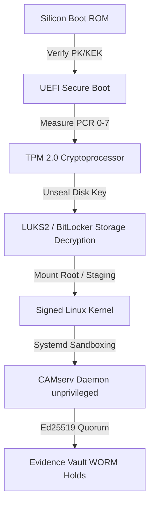

# CAMserv — Hardware Security & Field Serviceability Specification

**Document ID:** SEC-P25-HARDWARE-2026-010  
**Project:** CAMserv — Advanced Security Intelligence Platform  
**Target Release:** `0.10.0-rc7`  
**Phase:** 25 — Hardware Appliance Engineering & Physical Reliability Qualification  
**Classification:** Information Security & Physical Device Hardening Standard  
**Date:** November 17, 2026  
**Auditor Roles:** Principal Hardware Systems Architect, Embedded Linux Engineer, Storage Reliability Engineer, Network Surveillance Architect, Security Engineer & Release Qualification Authority  

---

## 1. Executive Summary & Hardware Threat Model

Physical surveillance appliances are deployed in physical locations subject to physical tampering, theft, untrusted local networks, and harsh operational conditions. Unlike cloud servers guarded inside high-security data centers, a surveillance NVR can be stolen from a wall rack, intercepted during transit, or subjected to malicious firmware flashing.

The CAMserv Hardware Security Architecture establishes defense-in-depth from silicon to user space:
1. Cryptographic Hardware Root of Trust (UEFI Secure Boot, TPM 2.0 / DPAPI).
2. Full Volume Encryption (LUKS2 / BitLocker).
3. Privilege separation and Linux kernel capability bounding.
4. Non-destructive disk replacement procedures protecting active legal holds.
5. Hardware watchdog reliability.

---

## 2. Hardware Root of Trust & Platform Integrity



### 2.1 UEFI Secure Boot & Measured Boot
- **Custom Platform Keys (PK / KEK):** In production enterprise deployments, appliances use custom platform keys enrolled in firmware NVRAM, preventing execution of unsigned third-party kernels.
- **TPM 2.0 Platform Configuration Registers (PCRs):** The system firmware measures firmware code (PCR 0), UEFI drivers (PCR 2), bootloader (PCR 4), and kernel command line (PCR 8) into the discrete TPM 2.0 chip.
- **Sealed Storage Keys:** Full-disk encryption master keys are sealed against PCR values 0, 2, 4, 7. If an attacker modifies firmware, alters kernel arguments, or boots from an unauthorized USB drive, the TPM refuses to release the disk key.

### 2.2 Storage Volume Encryption
- **Debian / Linux Appliances:** LUKS2 (Linux Unified Key Setup) utilizing `aes-xts-plain64` with 512-bit keys and Argon2id key derivation.
- **Windows Appliances:** BitLocker Drive Encryption bound to host TPM 2.0 and platform DPAPI machine credentials (`WindowsDPAPIVault`).
- **Encrypted Staging & Archive Pools:** Separate key hierarchies protect primary OS volumes and secondary video pools. If a surveillance HDD is stolen from a caddy, its elementary video contents remain completely unreadable without the TPM authorization secret.

---

## 3. OS & Service Privilege Boundaries

The CAMserv runtime strictly forbids running as `root` (Linux) or `SYSTEM` (Windows).

### 3.1 Linux Systemd Sandboxing Bounding
The systemd service unit (`camserv.service`) enforces strict kernel privilege confinement:
```ini
[Service]
User=camserv
Group=camserv
NoNewPrivileges=true
ProtectSystem=strict
ProtectHome=true
PrivateTmp=true
ProtectKernelTunables=true
ProtectKernelModules=true
ProtectControlGroups=true
RestrictAddressFamilies=AF_INET AF_INET6 AF_UNIX
RestrictRealtime=true
CapabilityBoundingSet=CAP_NET_BIND_SERVICE
AmbientCapabilities=CAP_NET_BIND_SERVICE
ReadWritePaths=/var/lib/camserv /var/log/camserv
```

### 3.2 Hardware Watchdog Supervision
- **Linux:** Systemd integrates directly with `/dev/watchdog` via `RuntimeWatchdogSec=60s`.
- **Health Check Heartbeat:** The CAMserv runtime sends SD_NOTIFY `WATCHDOG=1` pings every 15 seconds. If the neural inference pipeline or storage threads deadlock for $> 60$ seconds, the hardware watchdog hardware-resets the appliance.

---

## 4. Non-Destructive Disk Replacement & Maintenance Runbook

When a surveillance HDD fails SMART health checks (e.g., sector reallocation or write stalls), it must be replaced in the field without destroying active evidence or violating preservation holds.

```mermaid
sequenceDiagram
    participant O as Field Technician
    participant C as CAMserv Console / API
    participant T as StorageTierManager
    participant P as PreservationStore
    participant D as Physical Disk Caddy

    O->>C: 1. Initiate disk replacement workflow (disk_id: HDD_02)
    C->>T: 2. Fence active writers; redirect new camera streams to SSD staging
    C->>P: 3. Verify no uncommitted legal holds pending on HDD_02
    T->>T: 4. Unmount /dev/sdb and flush remaining sector buffers
    C->>O: 5. Signal safe removal (Chassis Amber Fault LED solid on HDD_02)
    O->>D: 6. Physically eject failed disk; insert new certified CMR HDD
    O->>C: 7. Confirm physical replacement (confirmed=True)
    C->>T: 8. Execute validate_disk_initialization_safety(); format new disk
    T->>T: 9. Initialize directory hierarchy and add to StoragePool
    T->>C: 10. Re-enable write path; transfer queued staging segments to new HDD
```

### 4.1 Safety Invariants Enforced:
1. **Explicit Confirmation Required:** `validate_disk_initialization_safety()` strictly rejects formatting attempts unless `confirmed=True` is explicitly passed by an authenticated administrator.
2. **System Root Volume Immunity:** Formatting targets matching `/` or `C:\` are irrevocably blocked.
3. **Application Directory Immunity:** Formatting targets containing the active application directory are irrevocably blocked.
4. **Preservation Hold Protection:** If any vaulted file on the degraded disk has an active `PreservationHold`, the system prompts the technician to clone remaining accessible sectors to the evidence vault before releasing the drive caddy lock.
