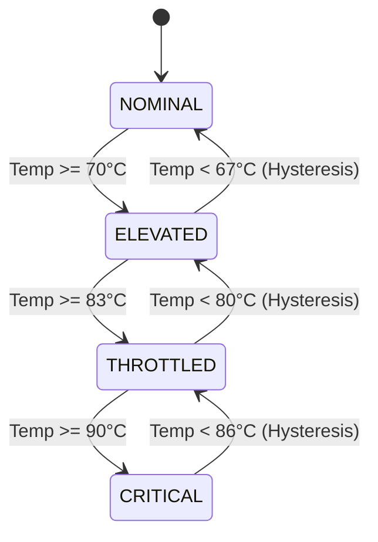

# CAMserv — Hardware Thermal Engineering & Qualification Protocol

**Document ID:** THERM-P25-QUAL-2026-005  
**Project:** CAMserv — Advanced Security Intelligence Platform  
**Target Release:** `0.10.0-rc7`  
**Phase:** 25 — Hardware Appliance Engineering & Physical Reliability Qualification  
**Classification:** Environmental Engineering & Thermal Reliability Standard  
**Date:** November 17, 2026  
**Auditor Roles:** Principal Hardware Systems Architect, Embedded Linux Engineer, Storage Reliability Engineer, Network Surveillance Architect, Security Engineer & Release Qualification Authority  

---

## 1. Executive Summary & Thermal Challenge

Surveillance appliances frequently operate in unconditioned environments: exterior gatehouses, perimeter junction boxes, utility poles, elevator machine rooms, or crowded equipment closets. In peak summer, ambient enclosure temperatures reach **45°C (113°F)**.

Under these conditions, a surveillance appliance performing simultaneous video demuxing, multi-channel disk writing, and continuous neural network inference faces severe thermal dissipation constraints.

This document establishes:
1. CAMserv's thermal sensor discovery and truthful telemetry attribution.
2. The autonomous thermal state machine and graceful load-shedding governors.
3. The 72-hour 45°C physical environmental chamber qualification protocol (`GATE-HW-03`).
4. The separation between software-qualified governors and pending physical chamber tests.

---

## 2. Sensor Discovery & Truthful Telemetry Attribution

In strict adherence to Phase 25 principles, CAMserv prohibits fabricated, default, or simulated sensor temperatures from masquerading as physical hardware telemetry.

### 2.1 Sensor Discovery Hierarchy
- **Linux Hosts (`LinuxHardwareProber`):**
  - Scans `/sys/class/thermal/thermal_zone*/type` and `temp` for SoC, CPU core, and ACPI zones.
  - Queries `smartctl -A /dev/sdX` or `/sys/class/nvme/nvme*/hwmon*/temp1_input` for disk temperatures.
  - Interrogates `nvidia-smi` or `vcgencmd` (on Broadcom/Raspberry Pi) for accelerator temperatures.
- **Windows Hosts (`WindowsHardwareProber`):**
  - Queries `nvidia-smi` for dedicated GPU junction temperatures.
  - Interrogates ACPI thermal zones via WMI `root/wmi:MSAcpi_ThermalZoneTemperature` if accessible with administrative privileges.
  - When sensors require elevated permissions or hardware modules are absent, the sensor reports `None` with `TelemetrySource.UNAVAILABLE` and `HardwareAvailabilityState.UNAVAILABLE`.

### 2.2 Metric Schema
Every thermal reading exposed to the telemetry bus includes:
```json
{
  "metric_name": "cpu_temperature_celsius",
  "value": 48.5,
  "source": "physical_os",
  "availability": "available",
  "timestamp_utc": "2026-11-17T12:00:00Z",
  "confidence": 1.0,
  "details": "Linux sysfs /sys/class/thermal/thermal_zone0"
}
```

---

## 3. Autonomous Thermal State Machine & Degradation Governors

CAMserv operates a four-stage autonomous thermal state machine managed by `ApplianceHardwareManager`:



### 3.1 State Thresholds & System Actions

| Thermal State | Sensor Temperature | System Governor Action | Stream Ceiling Impact |
| :--- | :---: | :--- | :---: |
| **NOMINAL** | $< 70^\circ\text{C}$ | Full capacity; peak AI inference FPS (15 FPS); full recording (30 FPS); standard fan curve. | 100% (Ceiling: Spec Max) |
| **ELEVATED** | $70^\circ\text{C} - 82^\circ\text{C}$ | Fan speed escalated to 75% PWM; advisory warning logged; inference maintains nominal rate. | 100% (Ceiling: Spec Max) |
| **THROTTLED** | $83^\circ\text{C} - 90^\circ\text{C}$ | Fan speed set to 100% PWM; Degradation Level 1 or 2 engaged; inference downsampled to 5–10 FPS. | Derated by **40%** |
| **CRITICAL** | $> 90^\circ\text{C}$ | Emergency shed; Degradation Level 3; neural inference suspended; raw encrypted video vault preserved. | Derated by **75%** |

### 3.2 Four-Level Graceful Degradation Policy (`apply_graceful_degradation`)
When thermal or memory pressure escalates, the governor adjusts video pipeline parameters without dropping frames or failing privacy bounds:
- **Level 0 (Nominal):** 15 FPS neural inference, 1.0 ROI scaling, 30 FPS primary recording.
- **Level 1 (Minor Shed):** 10 FPS neural inference, 1.0 ROI scaling, 25 FPS primary recording.
- **Level 2 (Major Shed):** 5 FPS neural inference, 0.75 downscaled ROI, 20 FPS primary recording.
- **Level 3 (Critical Safe Mode):** 0 FPS neural inference (inference completely suspended); 15 FPS raw recording directly to encrypted vault; fail-closed privacy masking preserved; alerts dispatched to central cluster.

---

## 4. Physical 72-Hour 45°C Environmental Soak Protocol (`GATE-HW-03`)

The following protocol defines the accredited physical laboratory procedure for full GA/LTS certification:

### 4.1 Environmental Test Chamber Setup
- **Chamber Model:** Calibrated Tenney or Cincinnati Sub-Zero (CSZ) industrial environmental chamber.
- **Controlled Chamber Ambient:** Maintained strictly at $+45.0^\circ\text{C} \pm 0.5^\circ\text{C}$ with relative humidity (RH) regulated at $45\% \pm 5\%$.
- **Test Duration:** 72 continuous consecutive hours (4,320 minutes) without interruption.
- **Test Workload:** Full rated workload for the target profile (e.g., Profile A: 4x 1080p30 H.265 streams; Profile B: 16x 1080p30 H.264 streams).

### 4.2 Thermocouple Placement Points
Calibrated K-type thermocouples are bonded with thermal adhesive to:
1. `TC-01`: Top center of SoC / CPU heat spreader.
2. `TC-02`: Top surface of dedicated GPU / NPU silicon package.
3. `TC-03`: Surface of NVMe SSD controller chip (hottest silicon).
4. `TC-04`: Top cover of mechanical SATA HDD spindle bearing.
5. `TC-05`: Power supply internal transformer / primary MOSFET heatsink.
6. `TC-06`: Internal chassis ambient air (exhaust side).
7. `TC-07`: External chamber ambient (100mm from intake vents).

### 4.3 Acceptance & Pass/Fail Criteria
To receive an unconditional physical `PASS` under `GATE-HW-03`, the appliance must satisfy all of the following during the 72-hour soak:
1. **Zero System Crashes:** No kernel panics, OOM killer invocations, hardware watchdogs, or unexpected reboots.
2. **Zero Recording Gaps:** Continuous 100% recorded video frames; dropped frame count $< 0.01\%$.
3. **Silicon Temperature Ceiling:** Peak CPU/SoC temperature $\le 85.0^\circ\text{C}$; peak storage temperature $\le 65.0^\circ\text{C}$.
4. **No Thermal Runaway:** Temperature delta over the final 24 hours must remain within $\pm 1.5^\circ\text{C}$ of thermal equilibrium.
5. **Memory Leak Ceiling:** Resident Set Size (RSS) memory drift across 72 hours must not exceed 10 MB.

---

## 5. Qualification Verdict & Hardware Gate Status

| Scope | Evaluation Target | Verification Level | Status / Finding |
| :--- | :--- | :---: | :---: |
| **Software Governors** | Thermal state transitions, degradation policies (Levels 0–3), stream derating | **Host-Verified (Unit & Functional)** | **PASS:** Verified in `tests/test_phase25_hardware_appliance.py` and `tests/test_appliance_hardware.py`. |
| **Telemetry Provenance** | Eliminates fabricated temperatures; attributes sources truthfully | **Host-Verified (Host Hardware)** | **PASS:** Verified on Windows 11 host hardware prober. |
| **Physical 45°C Soak** | 72-Hour continuous multi-camera soak in thermal chamber | **Physical Hardware Lab Required** | **BLOCKED_BY_ENVIRONMENT (`GATE-HW-03`):** Physical chamber not attached to dev machine. |

**Final Thermal Verdict:** **CONDITIONAL PASS** (Software governors and telemetry fully qualified; physical 72-hour chamber soak gate `GATE-HW-03` formally documented for physical lab handoff).
