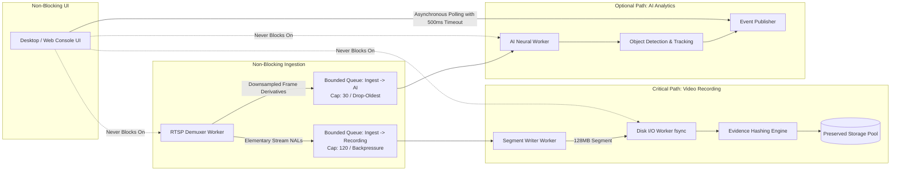

# CAMserv — Zero-Freeze Architecture & Pipeline Stability Specification

**Document ID:** ARCH-P25-ZERO-FREEZE-2026-005  
**Project:** CAMserv — Advanced Security Intelligence Platform  
**Target Release:** `0.10.0-rc7`  
**Phase:** 25 — Hardware Adaptation & Appliance Engineering  
**Classification:** Reliability Engineering & Concurrency Protection Standard  
**Date:** November 17, 2026  
**Auditor Roles:** Principal Hardware Systems Architect, Embedded Linux Engineer, Storage Reliability Engineer, Network Surveillance Architect, Security Engineer & Release Qualification Authority  

---

## 1. Executive Summary & Zero-Freeze Mandate

Security operations centers and automated surveillance platforms cannot tolerate graphical user interface freezes, dropped recording frames, or thread deadlocks. A 3-second UI freeze while an operator searches video footage or a camera reconnects can obscure critical perimeter breaches.

**Zero-Freeze Mandate:** The CAMserv graphical user interface, live monitoring views, and core video recording loops must **NEVER** wait synchronously for:
1. Camera network connections or RTSP stream negotiation.
2. Neural network AI inference passes or model loading.
3. Disk I/O, sector synchronization (`fsync`), or storage tier transfers.
4. Long-running SQLite WAL database queries or integrity checks.
5. Hardware sensor discovery, WMI queries, or sysfs probes.
6. Outbound webhook or push notifications.

All long-running, blocking, or non-deterministic operations must execute asynchronously in decoupled worker pools with hard timeouts and bounded ring buffers.

---

## 2. Decoupled Pipeline & Queue Architecture

---

## 3. Bounded Queue Capacity & Overflow Policies (`BoundedPipelineQueue`)

Uncontrolled in-memory queues cause catastrophic Out-of-Memory (OOM) kernel terminations. When a disk stalls or an AI accelerator throttles, memory backlogs must be deterministically bounded:

| Queue Identification | Producer Subsystem | Consumer Subsystem | Bounded Capacity | Configured Overflow Policy | Rationale |
| :--- | :--- | :--- | :---: | :--- | :--- |
| **`ingest_to_recording`** | RTSP Demuxer | Segment Writer | **120 frames** (4 sec buffer) | `APPLY_BACKPRESSURE` (with timeout) | Recording is critical; apply backpressure to network socket rather than dropping evidentiary frames. |
| **`ingest_to_ai`** | RTSP Demuxer | AI Inference Worker | **30 frames** (1 sec buffer) | `DROP_OLDEST` | AI analytics are optional derivatives; drop stale preview frames to process latest live frame. |
| **`recording_to_storage`**| Segment Writer | Tier Transfer Manager | **64 segments** (8 GB buffer) | `APPLY_BACKPRESSURE` | Prevents filling memory with uncommitted video segments during HDD queue spikes. |
| **`event_to_ui`** | Analytics Engine | Operator Console / WS | **256 events** | `DROP_OLDEST` | Evicts oldest acknowledged notifications to protect UI rendering loops. |

---

## 4. Worker Crash Supervision & Failure Isolation (`WorkerCrashSupervisor`)

Optional subsystems (such as third-party neural plugins or hardware accelerator drivers) must be isolated from the core recording engine:

### 4.1 Crash Isolation Boundary
- If an AI inference worker throws an unhandled CUDA error, segmentation fault, or out-of-memory exception:
  1. The exception is caught within the worker thread boundary.
  2. `WorkerCrashSupervisor.record_crash()` logs the incident and computes a safe retry delay.
  3. **Core video recording continues completely uninterrupted.**
  4. The UI displays an advisory warning: *"AI Acceleration Offline — Recording Protected."*

### 4.2 Exponential Backoff with Randomized Jitter
To prevent cascading restart storms (where a failing model repeatedly crashes the CPU on loop):
$$t_{\text{retry}} = \min(60.0, t_{\text{base}} \times 2^{\max(0, n - 1)}) \times (1 \pm \text{jitter})$$
- Where $n$ is the sequential crash count and $\text{jitter} \in [-0.25, +0.25]$.
- If a worker crashes more than 5 consecutive times, it is **fenced** (`is_fenced=True`) to permanently halt restart loops until manual operator intervention or hardware reset.

### 4.3 Mitigation of Camera Reconnect Storms
When an industrial PoE switch reboots, 16 to 64 IP cameras attempt to reconnect simultaneously. CAMserv handles reconnects asynchronously using non-blocking socket pools and randomized jitter delays, ensuring network threads and file descriptors are never exhausted.
