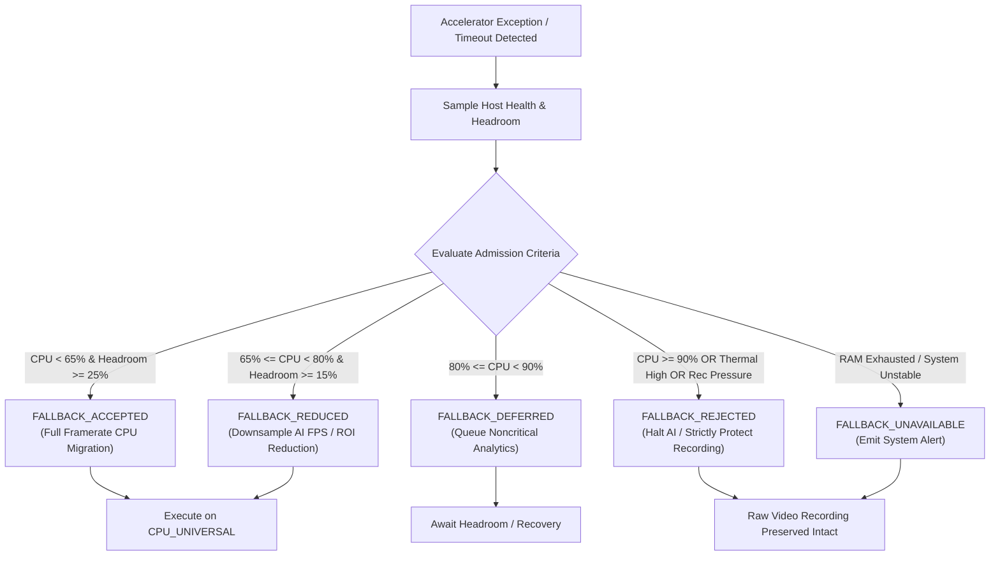

# CAMserv — Phase 25.1 CPU Fallback Admission Controller & Controlled Degradation

**Document ID:** SPEC-P25.1-CPU-ADMISSION-2026-003  
**Project:** CAMserv — Advanced Security Intelligence Platform  
**Target Release:** `0.10.0-rc7`  
**Phase:** 25.1 — Reliability Correction & Engineering Hardening  
**Date:** November 17, 2026  
**Auditor Roles:** Principal Systems Architect, Video Pipeline Reliability Engineer & Release Qualification Authority  
**Classification:** Core Runtime Safety Standard  

---

## 1. Executive Summary & Problem Definition

In Phase 25, the accelerator abstraction layer implemented transparent failover to `CPU_UNIVERSAL` when an accelerator failed or encountered an unrecoverable exception. 

### The Latent Failure Mode:
On multi-camera surveillance appliances (e.g. 8 to 32 streams), the host CPU is already utilized for network packet handling, RTSP demuxing, cryptographic hashing, and filesystem caching. If an accelerator hosting multiple decoding pipelines and deep neural models crashes, dumping all workloads blindly onto the host CPU instantly drives utilization to 100%.

Under 100% CPU saturation:
1. Video ingest threads miss network read deadlines, inducing TCP window collapse or UDP packet loss.
2. Kernel I/O flushes stall, causing write queue overflows and memory exhaustion.
3. The platform enters an unrecoverable freeze, defeating CAMserv's primary mission: **uninterrupted continuous recording**.

---

## 2. The CPU Fallback Admission Controller Architecture

---

## 3. Admission Decision States

| Decision | CPU Utilization Window | Thermal Status | Recording Pipeline Health | Task Action |
| :--- | :---: | :---: | :---: | :--- |
| **`FALLBACK_ACCEPTED`** | $< 65.0\%$ | Nominal ($< 75^\circ\text{C}$) | Healthy, Zero Drops | Task admitted to CPU at full requested framerate ($30\text{ FPS}$). |
| **`FALLBACK_REDUCED`** | $65.0\% - 80.0\%$ | Moderate ($75^\circ - 80^\circ\text{C}$) | Healthy | Task admitted at reduced framerate (e.g. $5\text{ FPS}$) or downscaled ROI. |
| **`FALLBACK_DEFERRED`** | $80.0\% - 90.0\%$ | Elevated ($80^\circ - 85^\circ\text{C}$) | Active Warning | Task enqueued in deferred ring; re-evaluated every $5.0\text{ s}$. |
| **`FALLBACK_REJECTED`** | $\ge 90.0\%$ | Throttled ($\ge 85^\circ\text{C}$) | Queue Pressure | Analytical task completely rejected; zero CPU impact on raw recording. |
| **`FALLBACK_UNAVAILABLE`**| Any | Critical | Memory Exhaustion | Host incapable of hosting task; diagnostic log emitted. |

---

## 4. Workload Admission Evaluation Matrix

Before any task is migrated to CPU, the admission controller computes the **Projected Host Load**:

$$P_{\text{projected}} = \text{CPU}_{\text{avg\_5s}} + \sum \Delta \text{CPU}_{\text{admitted}} + \Delta \text{CPU}_{\text{new\_task}}$$

Where:
- $\text{CPU}_{\text{avg\_5s}}$ is the 5-second moving average host CPU load.
- $\Delta \text{CPU}_{\text{admitted}}$ is the measured CPU consumption of tasks previously admitted to CPU.
- $\Delta \text{CPU}_{\text{new\_task}}$ is the estimated CPU cost (e.g., $3.5\%$ for 1080p30 H.264 pass-through; $12.0\%$ for 1080p15 CPU decode; $25.0\%$ for ONNX CPU object detection).

### Rejection Guardrail:
If $P_{\text{projected}} > 85.0\%$, the task is disqualified from `FALLBACK_ACCEPTED` and downscaled to `FALLBACK_REDUCED` or `FALLBACK_REJECTED`.

---

## 5. Gradual Phased Accelerator Recovery Protocol

When an accelerator recovers (e.g., GPU driver reset completes or external accelerator re-initializes), the controller executes a **Staged Gradual Migration** rather than an instantaneous mass migration:

1. **Phase 1: Verification Workload**
   The accelerator must pass a deterministic synthetic workload (1 sample frame decode or 1 tensor forward pass) via `AcceleratorLifecycleState.VERIFIED_WORKLOAD`.
2. **Phase 2: Single-Stream Canary Migration**
   A single lowest-priority stream is migrated to the accelerator. Telemetry is monitored for 3.0 seconds to confirm stability and thermals.
3. **Phase 3: Progressive Step-Wise Handoff**
   Remaining eligible tasks are migrated in batches of 2 streams every 2.0 seconds.
4. **Phase 4: Headroom Release on Host CPU**
   As tasks move off CPU, the admission controller updates available CPU headroom, gradually promoting previously deferred or reduced tasks back to full resolution.
