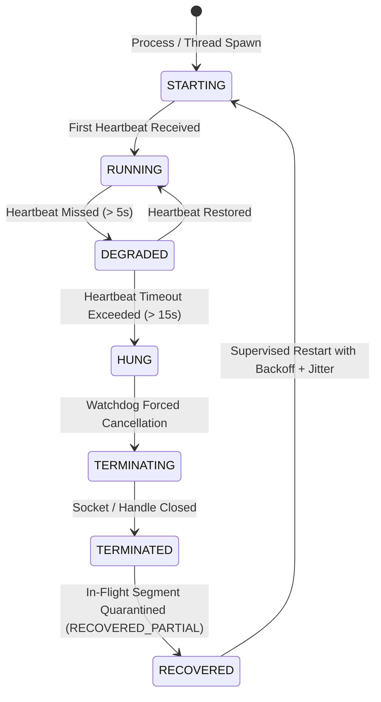

# CAMserv — Phase 25.1 Non-Blocking I/O, Enforceable Cancellation & Worker Isolation

**Document ID:** SPEC-P25.1-IO-ISOLATION-2026-005  
**Project:** CAMserv — Advanced Security Intelligence Platform  
**Target Release:** `0.10.0-rc7`  
**Phase:** 25.1 — Reliability Correction & Engineering Hardening  
**Date:** November 17, 2026  
**Auditor Roles:** Principal Systems Architect, Reliability Engineer & Operating Systems Specialist  
**Classification:** Core System Reliability & Concurrency Standard  

---

## 1. Executive Summary & Problem Analysis

In multi-threaded surveillance architectures, thread-level timeouts (`completed.wait(timeout_sec)`) provide only an illusion of non-blocking safety if the underlying task is trapped in a native system call or driver library:
- **Native Blocked Calls:** A C/C++ library (e.g., OpenCV `cv::VideoCapture::read()`, FFmpeg `avformat_open_input()`, or a kernel storage `fsync()`) blocking on an unresponsive network socket or failing disk cannot be interrupted by Python's `threading` module.
- **Resource Leaks:** Abandoned threads continue to hold open socket descriptors, file locks, and GPU context buffers.
- **Duplicate Worker Collisions:** When a worker is assumed dead and restarted, if the previous worker was merely stalled, two workers now compete for the same camera channel or disk segment, causing corrupted recordings and race conditions.

---

## 2. Worker Lifecycle & Hung State Machine

CAMserv Phase 25.1 introduces explicit worker lifecycle progression:

### Worker Lifecycle States:
1. `STARTING`: Initializing memory buffers, network sockets, or video codecs.
2. `RUNNING`: Actively streaming or processing frames with continuous heartbeats ($\le 2.0\text{ s}$).
3. `DEGRADED`: Missed 2 consecutive heartbeats; processing queue warning raised.
4. `HUNG`: Unresponsive beyond the watchdog deadline ($\ge 10.0\text{ s}$). Flagged for isolation.
5. `TERMINATING`: Enforcing cancellation, closing OS file descriptors, and revoking channel lease.
6. `TERMINATED`: Process or thread concluded; resources reclaimed.
7. `RECOVERED`: In-flight `.part` segments finalized as `RECOVERED_PARTIAL` with SHA-256 hash.

---

## 3. Enforceable Isolation Principles

### 3.1 Channel Lease & Anti-Duplicate Fencing
To prevent duplicate recording workers from writing to the same storage segment after a restart:
- Every active recording worker must hold an atomic **Channel Lease Token**.
- If a worker hangs, the supervisor revokes its lease before attempting a restart.
- The storage writer refuses any write command from an expired lease token.

### 3.2 Safe Segment Recovery Protocol
When a recording worker crashes or is terminated by the watchdog:
1. In-flight `.part` files are never discarded or deleted.
2. The segment manager reads existing written bytes, computes the SHA-256 digest, and renames the file to `*.recovered_partial.mp4`.
3. An audit record is logged in the `RecordingContinuityLedger` with reason `WORKER_WATCHDOG_TERMINATION`.
4. The replacement worker starts writing to a fresh segment identifier, maintaining absolute evidence provenance.
