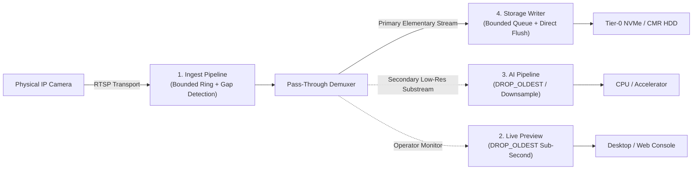

# CAMserv — Phase 25.1 Video Pipeline Backpressure & Evidence Integrity Architecture

**Document ID:** SPEC-P25.1-PIPELINE-SAFETY-2026-004  
**Project:** CAMserv — Advanced Security Intelligence Platform  
**Target Release:** `0.10.0-rc7`  
**Phase:** 25.1 — Reliability Correction & Engineering Hardening  
**Date:** November 17, 2026  
**Auditor Roles:** Principal Video Pipeline Engineer, Storage Reliability Engineer & Forensics Auditor  
**Classification:** Core Evidence Preservation & Data Integrity Standard  

---

## 1. Executive Summary & The Problem of Ingestion Backpressure

In Phase 25, the storage architecture applied `QueueOverflowPolicy.APPLY_BACKPRESSURE` uniformly across queues to prevent memory accumulation.

### The Network Transmission Reality:
Unlike local inter-process pipes, **RTSP surveillance cameras do not respond to application-level backpressure by pausing transmission**. A physical IP camera continuously pushes H.264/H.265 Network Abstraction Layer (NAL) units over RTP/RTSP.
- If the host application blocks the network ingest thread via unconditional backpressure, the operating system kernel's TCP receive window fills up.
- For TCP streams: The camera's internal buffer overflows, causing camera firmware crashes or TCP socket reset (`RST`).
- For UDP streams: The kernel silently drops datagrams, causing corrupted macroblocks and un-indexed keyframe loss.
- In both cases, the evidence is corrupted without an auditable record of where the gap occurred.

---

## 2. Pipeline-Specific Queue & Buffer Policies

CAMserv Phase 25.1 establishes strictly distinct queue architectures across the four discrete processing pipelines:

### 2.1 The Four Discrete Queue Policies:

| Pipeline | Queue Policy | Overflow Action | Evidence Impact | Observability |
| :--- | :--- | :--- | :--- | :--- |
| **1. Recording Ingest** | Bounded Ring Buffer + Bounded Wait ($500\text{ms}$) | If storage stalls, record explicit `DISCONTINUITY_GAP`; unblock socket | Gaps explicitly logged; socket remains alive | Frame sequence and timestamp continuity logged in `RecordingContinuityLedger` |
| **2. Live Preview** | Bounded Queue ($30\text{ frames}$) | `DROP_OLDEST` | None (Preview only; primary recording untouched) | Preview drop counter tracked separately from recording drops |
| **3. AI Analytics** | Bounded Queue ($15\text{ frames}$) | `DROP_OLDEST` + Dynamic Downsampling | None (Analytics only; raw recording untouched) | Skipped analysis reason logged (`AI_LOAD_SHED`) |
| **4. Storage Writer** | Bounded Queue ($120\text{ chunks}$) | Bounded Backpressure ($5.0\text{s}$) + Disk-Full Fencing | Strict: Never report success if unwritten | Storage write latency, slow disk alerts, disk full alarms |

---

## 3. Recording Continuity Ledger & Discontinuity Metadata

Every continuous surveillance recording must produce verifiable continuity telemetry. The `RecordingContinuityLedger` records:

1. **Camera & Stream Identification:** Camera UUID, Stream URI, and active Segment ID.
2. **Start and End Timestamps:** Nanosecond-resolution UTC timestamps derived from RTP presentation timestamps ($PTS$).
3. **Frame Accounting:**
   - Expected frames (calculated from reported FPS and elapsed segment duration).
   - Observed frames actually received and committed to storage.
4. **Discontinuity Events:** Every detected gap creates a structured audit record:
   - `gap_start_utc`: Exact timestamp of last contiguous frame.
   - `gap_end_utc`: Exact timestamp of next received frame.
   - `gap_duration_sec`: Elapsed gap time.
   - `lost_frames_estimated`: Estimated missing frames based on expected cadence.
   - `reason`: `NETWORK_TIMEOUT`, `SLOW_DISK_OVERFLOW`, `CAMERA_DISCONNECT`, `RECONNECT_BURST`.
5. **Storage Flush Latency & Integrity:** Verification that write operations reached durable non-volatile media before finalization.

---

## 4. Disk-Full & Storage Failure Protocol

When a storage target reaches capacity or encounters unrecoverable hardware errors:

1. **Immediate High-Priority Alarm:** System emits `STORAGE_CAPACITY_EXHAUSTED` or `STORAGE_IO_FAULT`.
2. **Preserve Finalized Segments:** Existing committed recordings and SQLite WAL indexes are immediately set read-only.
3. **Respect Legal Holds:** Automated FIFO retention pruning is strictly prohibited from deleting any segment referenced by a `PreservationHold`.
4. **Safe In-Flight Finalization:** Active `.part` files are closed, hashed, and tagged as `RECOVERED_PARTIAL` rather than corrupted garbage.
5. **Zero Silent Dropping:** Recording for that channel is marked as `UNAVAILABLE_DISK_FULL` with an exact UTC downtime timestamp until healthy storage is mounted.
