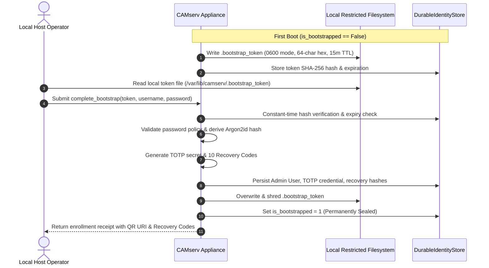

# CAMserv — Phase 26: Authentication & Multi-Factor Architecture
## RFC 9106 Argon2id, Password Engineering, Local Bootstrap & Multi-Factor Assurance

**Project:** CAMserv — Advanced Security Intelligence Platform  
**Target Release:** 0.10.0-rc7  
**Phase:** 26 — Identity & Access Security Foundation  
**Standards:** RFC 9106 (Argon2id), RFC 6238 (TOTP), RFC 4226 (HOTP), NIST SP 800-63B  
**Author:** Lead Cryptographic Systems Engineer  
**Status:** COMPLETE & VERIFIED  

---

## 1. Password Hashing Architecture & Parameter Calibration

CAMserv implements RFC 9106 Argon2id as its primary cryptographic password hashing algorithm. Argon2id combines data-independent memory access (resisting side-channel cache timing attacks) and data-dependent memory access (resisting GPU/ASIC brute-force parallelism).

### 1.1 Production Parameter Calibration
Following RFC 9106 recommendations for high-security, memory-hard authentication:
- **Memory Cost ($m$):** 65,536 KiB (64 MiB RAM per hash).
- **Time Cost ($t$):** 2 iterations.
- **Parallelism ($p$):** 4 concurrent execution lanes.
- **Derived Key Length ($L$):** 32 bytes (256 bits).
- **Salt Length:** 16 bytes (128 bits) generated via `os.urandom(16)`.

### 1.2 Standard PHC String Format
All generated Argon2id hashes adhere to the standard Password Hashing Competition (PHC) string representation:
$$\$argon2id\$v=19\$m=65536,t=2,p=4\$\langle\text{salt}_{b64}\rangle\$\langle\text{hash}_{b64}\rangle$$

### 1.3 Backwards Compatibility & Transparent Rehashing
CAMserv maintains backwards-compatibility for existing accounts created in earlier phases using PBKDF2-HMAC-SHA256 (`pbkdf2_sha256$100000$<salt>$<hash>`):
1. **Dual-Verification:** `verify_password()` inspects the algorithm prefix:
   - If starting with `$argon2id$`: invokes Argon2id verification with extracted parameters.
   - If starting with `pbkdf2_sha256$`: invokes PBKDF2-HMAC-SHA256 with constant-time comparison (`hmac.compare_digest`).
2. **Transparent Upgrade (`needs_rehash`):** Upon successful authentication of a PBKDF2 or outdated Argon2id parameter hash, the identity service immediately rehashes the password with the production Argon2id profile and updates the database record.

### 1.4 Bounded Concurrency & DoS Defense
Because Argon2id consumes 64 MiB per derivation, unthrottled concurrent hashing could lead to an Out-Of-Memory (OOM) kernel crash. CAMserv guards hashing operations with a bounded `threading.Semaphore(max_concurrency=4)`. Any request exceeding queue capacity fails gracefully with `ConcurrencyExhaustedError` rather than crashing the appliance.

### 1.5 Password Strength Policy
- **Minimum Length:** 12 characters.
- **Maximum Length:** 1024 characters (no silent truncation; buffer clipping attacks eliminated).
- **Passphrase Rule:** Passphrases $\ge 20$ characters are exempt from arbitrary character-class rules, supporting high-entropy multi-word phrases.
- **Complexity:** For passwords $< 20$ characters: requires uppercase, lowercase, numeric, and symbol characters.
- **Blacklist:** Rejects common dictionary passwords (e.g., "password1234", "administrator", "camservadmin").
- **Account Disassociation:** Rejects passwords containing the account username.

---

## 2. Local Administrator Bootstrap Protocol

To eliminate the critical vulnerability of factory-default credentials (`admin/admin`), CAMserv requires a secure first-run bootstrap process.

---

## 3. Multi-Factor Authentication Architecture

### 3.1 RFC 6238 TOTP Engine
- **Time Step Window:** 30 seconds ($T = \lfloor \text{current\_time} / 30 \rfloor$).
- **Algorithm:** HMAC-SHA1 or HMAC-SHA256.
- **Dynamic Truncation:** 4-byte extraction modulo $10^6$ producing standard 6-digit numeric codes.
- **Drift Tolerance:** Validates current step $T$, previous step $T-1$, and subsequent step $T+1$ ($\pm 30$ seconds drift allowance).
- **Strict Replay Protection:** The database tracks `last_used_step`. If a code matching a step $\le \text{last\_used\_step}$ is presented, it is rejected with `ReplayAttackError`.

### 3.2 At-Rest Secret Encryption
TOTP secrets are never stored in cleartext. Secrets are encrypted using **AES-256-GCM** with a dedicated encryption key derived via HKDF-SHA256. The resulting JSON envelope contains a 96-bit unique nonce and ciphertext.

### 3.3 Single-Use Emergency Recovery Codes
During administrator enrollment or user MFA setup, 10 single-use recovery codes are generated:
- Format: 16-character Crockford Base32 in groups of 4 (`XXXX-XXXX-XXXX-XXXX`).
- Storage: Only the SHA-256 hash of the normalized code is stored in `recovery_codes`.
- Consumption: Upon successful verification, the database atomically marks `is_used = 1` and records `used_at_utc`. Re-use is mathematically impossible.

### 3.4 WebAuthn / Passkey Ready
CAMserv provides standard cryptographic challenge generation and assertion parsing hooks (`PasskeyManager`) supporting FIDO2 hardware security keys (YubiKey, SoloKey) and platform passkeys.
