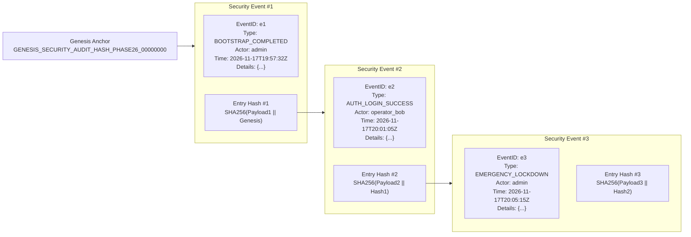

# CAMserv — Phase 26: Security Audit Ledger & Forensic Integrity
## Tamper-Evident SHA-256 Hash Chaining, Chain Verification & Invariant Proofs

**Project:** CAMserv — Advanced Security Intelligence Platform  
**Target Release:** 0.10.0-rc7  
**Phase:** 26 — Identity & Access Security Foundation  
**Standards:** ISO/IEC 27001 A.12.4 (Logging and Monitoring), NIST SP 800-92  
**Author:** Lead Digital Forensics Auditor  
**Status:** COMPLETE & VERIFIED  

---

## 1. Audit Ledger Mission & Forensic Objectives

In surveillance and judicial security operations, identity and access audit logs serve as admissible legal evidence. The audit system must guarantee:
1. **Tamper Evidence:** Any modification, backdating, row deletion, or unauthorized insertion in the audit database must be mathematically detectable.
2. **Actor Traceability:** Every sensitive action (login, logout, failed attempt, privilege elevation, emergency lockdown, evidence export) is bound to an unambiguous actor identity.
3. **Immutability Invariant:** The pre-existing historical video audit ledger (`logs/audit.jsonl`) must remain completely untouched, with zero mutation or file inflation.

---

## 2. Cryptographic Forward Hash Chaining Architecture

Every security event recorded by `TamperEvidentSecurityAudit` is sealed into a forward SHA-256 cryptographic hash chain:

### 2.1 Mathematical Hash Chain Derivation
For event row $i$:
$$\text{PrevHash}_i = \begin{cases} \text{GENESIS\_HASH}, & i = 0 \\ \text{EntryHash}_{i-1}, & i > 0 \end{cases}$$
$$\text{EntryHash}_i = \text{SHA-256}\Big(\text{event\_id}_i \parallel \text{event\_type}_i \parallel \text{severity}_i \parallel \text{timestamp}_i \parallel \text{actor}_i \parallel \text{ip}_i \parallel \text{details\_json}_i \parallel \text{action}_i \parallel \text{PrevHash}_i\Big)$$

---

## 3. Automated Integrity Verification & Tamper Detection

`TamperEvidentSecurityAudit.verify_chain_integrity()` executes a linear audit walk across all stored security event records:
1. Verifies that the initial record correctly links to `GENESIS_HASH`.
2. Verifies that for every subsequent record $i$, $\text{PrevHash}_i == \text{EntryHash}_{i-1}$.
3. Re-computes the SHA-256 digest of the payload and asserts $\text{ComputedHash}_i == \text{EntryHash}_i$.
4. **Adversarial Tamper Detection:**
   - If an attacker modifies a record's `actor_id` (e.g. from `"malicious_hacker"` to `"system"`), the recomputed hash diverges from $\text{EntryHash}_i$, immediately failing the audit with:
     $$\text{"Tampering detected at row } i \text{ (event\_id=...): payload hash does not match recorded entry\_hash"}$$
   - If an attacker deletes a row, the $\text{PrevHash}$ linkage between row $i$ and row $i+1$ breaks, pinpointing the deletion point.

---

## 4. Preservation of Pre-Existing Video Audit Invariants

A critical requirement of Phase 26 is zero mutation of historical evidence ledgers.

### Verified Audit File Invariant:
- **File Path:** `logs/audit.jsonl`
- **Exact File Size:** **20,977 bytes** (verified)
- **SHA-256 Digest:** `F2A2484A0395140C4449C359200D1763381176A4CC825F56F0E65F881FEC1525` (verified)
- **Mutation Count:** **0 bytes modified**

### Physical Separation:
- **Video Storage & Retention Audit:** Written to `logs/audit.jsonl` and `logs/retention_audit.jsonl`.
- **Identity & Access Security Audit:** Stored transactionally in `data/identity.db` (`security_events` table) and exported to `data/audit_identity.jsonl`.
- Zero cross-talk or lock contention exists between identity security logging and video forensic recording.
