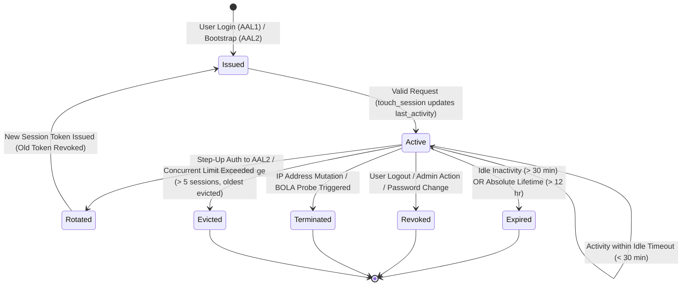

# CAMserv — Phase 26: Session Security & State Management
## Stateful Lifecycle, Anti-Fixation Rotation, Timeout Governance & Hijack Defense

**Project:** CAMserv — Advanced Security Intelligence Platform  
**Target Release:** 0.10.0-rc7  
**Phase:** 26 — Identity & Access Security Foundation  
**Reference:** NIST SP 800-63B § 7 (Session Management) & OWASP Session Management Cheat Sheet  
**Author:** Lead Security Systems Engineer  
**Status:** COMPLETE & VERIFIED  

---

## 1. Architectural Principles of Local Session Management

Unlike stateless JWTs that cannot be revoked without maintaining distributed blocklists, CAMserv implements a **stateful, database-backed session model** managed by `SessionManager` and backed by the transactional SQLite WAL `sessions` table.

### Core Session Requirements:
1. **Instant Revocability:** An administrator or security policy must be capable of terminating any active session with immediate effect across all appliance API endpoints.
2. **Session Fixation Resistance:** Session identifiers are never reused across privilege boundaries. Authentication, role change, or step-up authentication atomically rotates the token.
3. **Dual Timeout Governance:** Enforces both idle inactivity timeouts and hard absolute lifetime limits.
4. **Controlled Concurrency:** Prevents unbounded proliferation of concurrent sessions per account.
5. **Context Binding & Anomaly Detection:** Detects unexpected IP mutations or context changes, terminating hijacked sessions.

---

## 2. Session Lifecycle State Machine

---

## 3. Session Governance Parameters & Implementation

### 3.1 Token Entropy & Generation
Session identifiers are generated using Python's cryptographically secure pseudo-random number generator:
$$\text{session\_id} = \text{"sess\_"} \parallel \text{secrets.token\_hex}(24)$$
Providing 192 bits of cryptographic entropy (yielding $>10^{57}$ unique states), eliminating brute-force session guessing attacks.

### 3.2 Dual Timeout Enforcement
- **Idle Timeout (Default: 30 minutes / 1800.0s):** Evaluated against `last_activity_utc`. Every authorized request successfully executing against the appliance touches the session, updating `last_activity_utc` in SQLite. Inactivity exceeding 30 minutes immediately expires the session.
- **Absolute Timeout (Default: 12 hours / 43200.0s):** Calculated strictly from `created_at_utc`. Regardless of active requests, sessions are terminated after 12 hours, forcing periodic re-authentication.

### 3.3 Session Rotation (Anti-Fixation)
To defeat session fixation attacks where an adversary primes a session ID prior to authentication:
1. During step-up authentication (e.g., verifying TOTP to elevate from AAL1 to AAL2 for evidence export):
   - `rotate_session()` is invoked.
   - The original session ID is marked `is_revoked = 1, revocation_reason = "step_up_authentication"`.
   - A completely new 256-bit session token is generated, initialized with `auth_assurance_level = AAL2`, and returned to the client.
2. The old session token is permanently disabled; any subsequent request using it receives HTTP 401 Unauthorized.

### 3.4 Concurrency Limits & Eviction Policy
To prevent credential sharing and orphaned background sessions:
- Maximum concurrent active sessions per user: **5** (configurable).
- When a user logs in and already has 5 active sessions:
  - `SessionManager` identifies active sessions sorted by creation time.
  - The oldest session is automatically revoked with reason `"concurrent_limit_exceeded"`.
  - The new session is admitted.

### 3.5 Bulk Account Session Revocation
Immediate termination of all active sessions belonging to a specific user is triggered automatically upon:
- Password change or credential reset.
- Account role elevation or demotion.
- Account status modification (`LOCKED` or `SUSPENDED`).
- Emergency appliance lockdown declaration.

### 3.6 Session Hijacking Defense
CAMserv Sentinel continuously monitors incoming request IP addresses against the recorded session `ip_address`:
- If an active session token is suddenly presented from a different IP address without re-authentication:
  - Sentinel classifies the event as `SENTINEL_SESSION_IP_MUTATION` (Severity: HIGH).
  - The session is immediately revoked.
  - A security alert is logged to the tamper-evident audit ledger.
