# CAMserv — Phase 26: Threat Model & Security Posture
## Local-First Surveillance Appliance Threat Analysis & Mitigation Register

**Project:** CAMserv — Advanced Security Intelligence Platform  
**Target Release:** 0.10.0-rc7  
**Phase:** 26 — Identity & Access Security Foundation  
**Framework:** STRIDE Threat Classification + NIST SP 800-63B Guidelines  
**Status:** COMPLETE & VERIFIED  

---

## 1. Threat Modeling Scope & Trust Boundaries

The CAMserv surveillance appliance operates in localized network environments (corporate intranets, secure facility LANs, edge appliances, or standalone NVR stations). The threat model evaluates threats arising from:
1. Malicious local network actors attempting unauthorized access.
2. Insider threats (operators or viewers attempting to access unassigned cameras or export restricted evidence).
3. Adversaries attempting physical or network brute-force attacks against appliance authentication.
4. Supply-chain or factory-default exposure (default password exploitation).
5. Resource exhaustion denial-of-service targeting cryptographic operations.

```mermaid
flowchart LR
    subgraph UntrustedZone["Untrusted Network / Client Surface"]
        Attacker["Network Adversary / Insider"]
    end

    subgraph TrustBoundary["CAMserv Appliance Perimeter Boundary"]
        RateLimiter["Sentinel Ingress Rate Limiter & Progressive Delay"]
        AuthService["Argon2id Verifier & Bounded Worker Queue"]
        SessionFencing["Stateful Session Fencing & Timeout Monitor"]
        PolicyGate["Zero-Trust Object Authorization Gate"]
    end

    subgraph ProtectedZone["Isolated Protected Assets"]
        VaultDB[(Encrypted Credentials & WAL Store)]
        AuditLog[(Cryptographic Hash Chained Audit Log)]
        VideoEngine[(Continuous RTSP Ingestion & Storage)]
    end

    Attacker -->|1. Brute Force / DoS Attempt| RateLimiter
    RateLimiter -->|2. Throttled Request| AuthService
    AuthService -->|3. Stateful Token| SessionFencing
    SessionFencing -->|4. Scoped Request| PolicyGate
    PolicyGate -->|5. Authorized Read/Write| ProtectedZone
    PolicyGate -.->|Blocked IDOR Attempt| RateLimiter
```

---

## 2. STRIDE Threat Assessment Matrix

| Threat ID | Threat Description | STRIDE Category | Pre-Phase 26 Risk | Implemented Mitigation Subsystem | Residual Risk | Verified Test Case |
| :--- | :--- | :--- | :--- | :--- | :--- | :--- |
| **THREAT-01** | **Default Credential Exploitation:** Appliance ships with factory `admin/admin` or predictable default account credentials. | Spoofing | **CRITICAL** | `LocalAdministratorBootstrap`: Zero factory credentials. Generates one-time 256-bit token in local `data/.bootstrap_token` (file mode 0600, 15m TTL). | **NEGLIGIBLE** | `test_bootstrap_initialization_and_completion` |
| **THREAT-02** | **Credential Stuffing & Online Brute Force:** Automated bot attempts thousands of passwords against exposed local login endpoints. | Spoofing | **HIGH** | `CAMservSentinelIdentity`: Progressive exponential delay ($0.5 \times 2^N$ s), account lockout after 5 failures, global IP block after 20 failures. | **LOW** | `test_progressive_delay_and_account_lockout` |
| **THREAT-03** | **Argon2id Memory Exhaustion DoS:** Adversary sends concurrent authentication requests to saturate RAM via Argon2id memory costs. | Denial of Service | **HIGH** | `Argon2idPasswordHasher`: Threading semaphore bounded to 4 concurrent hash operations. Rejects burst overload with `ConcurrencyExhaustedError`. | **LOW** | `test_bounded_concurrency_semaphore` |
| **THREAT-04** | **Broken Object Level Authorization (BOLA/IDOR):** Viewer assigned to Camera 1 attempts to access Camera 2 (vault/secure area) by altering `camera_id` in API requests. | Elevation of Privilege | **CRITICAL** | `ZeroTrustPolicyEngine`: Deny-by-default object-level evaluation against `allowed_camera_ids` and `ResourceScope`. Intercepted by Sentinel horizontal scan detector. | **NEGLIGIBLE** | `test_deny_by_default_and_camera_scoping` |
| **THREAT-05** | **Session Hijacking & Token Replay:** Stolen session token reused from a different IP or reused after logout. | Spoofing | **HIGH** | `SessionManager`: 256-bit entropy tokens, stateful database tracking, immediate revocation, idle/absolute timeouts, and client IP mutation detection. | **LOW** | `test_session_ip_mutation_anomaly`, `test_session_lifecycle_and_rotation` |
| **THREAT-06** | **Session Fixation:** Attacker tricks victim into authenticating using a pre-established session ID. | Spoofing | **MEDIUM** | `SessionManager`: Mandatory session rotation on login, role change, and AAL2 step-up. Atomically revokes previous session. | **NEGLIGIBLE** | `test_session_lifecycle_and_rotation` |
| **THREAT-07** | **MFA TOTP Code Replay:** Attacker intercepts valid 6-digit TOTP code and replays it within the active 30-second window. | Spoofing | **HIGH** | `TOTPManager`: Strict replay protection tracking `last_used_step` in durable database. Reusing identical step code is rejected. | **NEGLIGIBLE** | `test_totp_verification_and_replay_protection` |
| **THREAT-08** | **Camera Credential Leakage in Logs / API:** Camera RTSP URL with embedded passwords leaked in diagnostic logs, client responses, or API payloads. | Information Disclosure | **HIGH** | `CameraCredentialProtection`: Automated `redact_url` with URL parser handling `@` in passwords, deep dictionary sanitizer, AES-256-GCM vault at rest. | **NEGLIGIBLE** | `test_rtsp_url_redaction_with_special_characters`, `test_deep_data_redaction` |
| **THREAT-09** | **Audit Log Tampering / Repudiation:** Disgruntled operator or attacker deletes or alters security event entries in SQLite to cover tracks. | Tampering / Repudiation | **CRITICAL** | `TamperEvidentSecurityAudit`: Cryptographic forward hash chaining with SHA-256 rooted in genesis hash. Built-in verifier pinpoints exact altered row. | **NEGLIGIBLE** | `test_audit_hash_chain_and_tampering_detection` |
| **THREAT-10** | **Recording Pipeline Denial-of-Service:** Security database lock, corruption, or flood of auth failures halts video recording. | Denial of Service | **CRITICAL** | Architectural Isolation: Identity services run in separate context from RTSP ingestion and recording continuity. Ingestion fails closed for auth without blocking video. | **NEGLIGIBLE** | `test_identity_subsystem_failure_isolation`, `test_emergency_lockdown_preserves_recording_pipeline` |

---

## 3. Threat Mitigation Summary & NIST SP 800-63B Alignment

| NIST SP 800-63B Requirement | CAMserv Implementation | Alignment Status |
| :--- | :--- | :--- |
| **Password Length & Entropy** | Minimum 12 characters, up to 1024 characters without truncation, passphrase exemption for $\ge 20$ chars. | **COMPLIANT** |
| **Password Storage** | RFC 9106 Argon2id ($m=65536, t=2, p=4, 32$ bytes). Salt 128-bit CSPRNG. | **COMPLIANT** |
| **Rate Limiting & Lockout** | Progressive exponential delay, 5-failure account lockout, 20-failure IP blocking. | **COMPLIANT** |
| **Multi-Factor Authentication (AAL2)** | RFC 6238 TOTP with encrypted secret storage, drift tolerance $\pm 1$ step, replay rejection, single-use recovery codes. | **COMPLIANT** |
| **Session Binding & Expiry** | 256-bit CSPRNG token, 30m idle timeout, 12h absolute timeout, anti-fixation rotation, concurrent session cap. | **COMPLIANT** |
| **Cryptographic Agility & Rehash** | Automatic detection and transparent rehashing of legacy PBKDF2 hashes upon successful authentication. | **COMPLIANT** |
