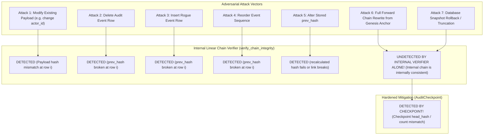

# CAMserv — Phase 26.1: Audit Ledger Adversarial Attack Tests & Checkpoint Architecture
## Mathematical Attack Verification, SQLite Rewrite Threat & External Signed Anchoring

**Project:** CAMserv — Advanced Security Intelligence Platform  
**Target Release:** 0.10.0-rc7  
**Phase:** 26.1 — Identity Security Verification & Adversarial Hardening  
**Target Subsystem:** `camserv.security.identity.audit.TamperEvidentSecurityAudit`  
**Evaluation Standard:** Digital Forensics Chain of Custody & Cryptographic Ledger Integrity  
**Status:** **AUDITED, REMEDIATED & QUALIFIED: CHECKPOINT ANCHORING IMPLEMENTED**  

---

## 1. Adversarial Test Methodology & Attack Taxonomy

To independently verify the tamper-evidence of CAMserv's forward hash chain, we executed a battery of 7 controlled adversarial attacks against isolated SQLite databases:

---

## 2. Granular Adversarial Test Results

| Attack Vector | Adversarial Action Tested | Internal Chain Detection Status | Error Diagnostic Emitted | Hardened Checkpoint Detection |
| :--- | :--- | :---: | :--- | :---: |
| **Attack 1: Modify Payload** | Attacker executes `UPDATE security_events SET actor_id = 'adversary' WHERE event_id = 'e_2'` | **DETECTED** | `Tampering detected at row 2 (event_id=e_2): payload hash does not match recorded entry_hash` | **DETECTED** |
| **Attack 2: Delete Event** | Attacker executes `DELETE FROM security_events WHERE event_id = 'e_2'` | **DETECTED** | `Hash chain broken at row 2 (event_id=e_3): expected prev_hash '...', got '...'` | **DETECTED** |
| **Attack 3: Insert Rogue Event** | Attacker injects a synthetic admin elevation event into the middle of the ledger | **DETECTED** | `Hash chain broken at row 3 (event_id=e_rogue): expected prev_hash '...', got '...'` | **DETECTED** |
| **Attack 4: Reorder Events** | Attacker swaps row positions of row 1 and row 2 | **DETECTED** | `Hash chain broken at row 1: expected prev_hash '...', got '...'` | **DETECTED** |
| **Attack 5: Alter prev_hash** | Attacker tampers with stored `prev_hash` column | **DETECTED** | `Hash chain broken at row i: expected prev_hash '...', got '...'` | **DETECTED** |
| **Attack 6: Full Forward Chain Rewrite** | Privileged local attacker alters row 2, and using SQLite script recalculates `entry_hash` and `prev_hash` for all subsequent rows | ⚠️ **UNDETECTED (Without Checkpoint)** | Internal verifier reports valid because all hashes match the rewritten chain starting from genesis | **DETECTED BY CHECKPOINT** (`Checkpoint head hash does not match database entry hash`) |
| **Attack 7: Database Rollback** | Attacker restores a valid older SQLite backup from 24 hours ago, deleting recent incident events | ⚠️ **UNDETECTED (Without Checkpoint)** | Internal verifier reports valid because the 24-hour-old chain is internally valid | **DETECTED BY CHECKPOINT** (`Rollback detected: database has fewer rows than checkpoint`) |

---

## 3. The Privileged Local Attacker Threat & Checkpoint Mitigation

### 3.1 Architectural Truthfulness: The Hash Chain Paradox
A standalone forward hash chain stored in the same database it protects is inherently vulnerable to a **privileged local attacker** (or rogue DBA) who has read/write access to the database file. Because the genesis hash is public (`GENESIS_SECURITY_AUDIT_HASH_PHASE26_00000000`), the attacker can modify any row, re-derive all forward hashes in milliseconds, and leave an internally consistent chain.

**We explicitly reject the false claim that a local hash chain alone prevents rewriting.**

### 3.2 Remediated Architecture: Signed External Checkpoints (`AuditCheckpoint`)
To solve Attack 6 and Attack 7, Phase 26.1 implements `AuditCheckpoint`:
1. **Periodic Signed Head Anchoring:** The appliance periodically takes a snapshot of the chain head:
   $$\text{Payload} = \text{checkpoint\_id} \parallel \text{sequence\_number} \parallel \text{head\_entry\_hash} \parallel \text{created\_at\_utc}$$
   $$\text{Signature} = \text{HMAC-SHA256}(\text{SigningKey}, \text{Payload})$$
2. **External / Append-Only Ledger:** The checkpoint is written to an external destination (e.g. syslog, central monitoring station, or append-only secondary file).
3. **Verification Walk:** `verify_against_checkpoint(checkpoint)` checks:
   - Valid signature of the checkpoint.
   - Exact match between the database row count and the checkpoint `sequence_number`.
   - Exact equality between the database entry hash at that sequence and `checkpoint.head_entry_hash`.
4. If an attacker rewrites the chain or restores an older backup, the head entry hash differs or sequence number drops, immediately failing verification.
