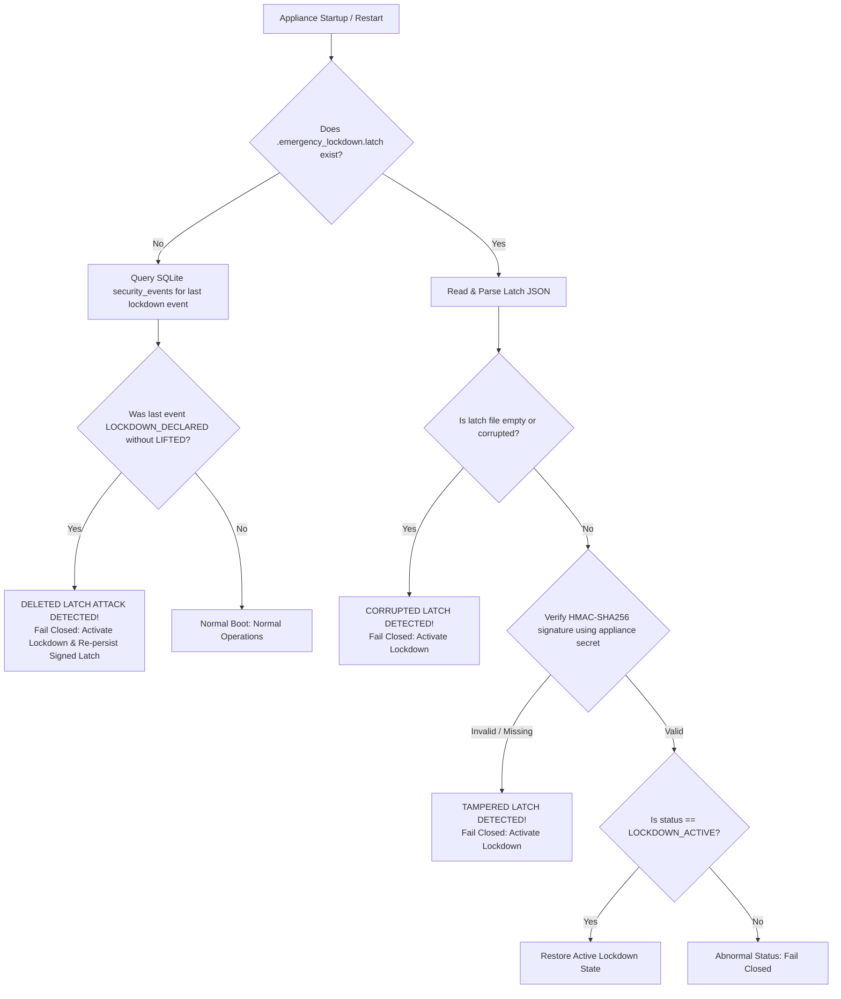

# CAMserv — Phase 26.3: Emergency Lockdown Subsystem & Durable Latch Assurance

**Project:** CAMserv — Advanced Security Intelligence Platform  
**Target Release:** 0.10.0-rc7  
**Subsystem:** Emergency Lockdown Subsystem (`src/camserv/security/identity/emergency.py`)  
**Document:** `docs/PHASE-26.3-EMERGENCY-LATCH-ASSURANCE.md`  
**Classification:** Incident Response, Fail-Safe Architecture & Latch Cryptographic Verification  

---

## 1. Executive Summary & Incident Response Architecture

The CAMserv Emergency Lockdown Subsystem (`EmergencyLockdownManager`) provides an immediate, appliance-wide security isolation barrier when physical or logical intrusion is detected. It enforces an absolute dual-priority invariant:
1. **Total Threat Containment:** Immediate revocation of active client sessions, rejection of non-admin logins, suspension of evidence exports, and blocking of camera PTZ/configuration commands.
2. **Absolute Recording Preservation:** Real-time video ingestion, RTSP streaming pipelines, frame bounding, storage tier preservation, and evidence SHA-256 hashing continue without a microsecond of interruption or a single dropped frame.

---

## 2. Latch Cryptographic Architecture & Tamper Resistance

To prevent attackers from bypassing lockdown across system reboots or crashes, CAMserv utilizes a durable recovery latch file (`data/.emergency_lockdown.latch`).

### Phase 26.3 Cryptographic Enhancements
In Phase 26.3, the latch mechanism was upgraded with HMAC integrity signatures and cross-subsystem event reconciliation:



### 1. Cryptographic HMAC-SHA256 Latch Integrity
The latch file stores:
```json
{
  "status": "LOCKDOWN_ACTIVE",
  "initiated_by": "sec_admin",
  "reason": "Host perimeter breach",
  "declared_at_utc": "2026-11-17T21:40:00Z",
  "latch_signature": "a9f3b14...e6"
}
```
The signature is computed over `status:initiated_by:reason:declared_at_utc` using the internal appliance key. If an adversary attempts to alter `"status": "LOCKDOWN_ACTIVE"` to `"LOCKDOWN_INACTIVE"` or substitute parameters, signature validation fails and the subsystem fails closed into lockdown.

### 2. Defeating Deleted-Latch Attacks via Database Reconciliation
If an adversary deletes `.emergency_lockdown.latch` and forces an appliance reboot, `_restore_latch_state()` cross-checks the SQLite security audit log:
```sql
SELECT event_type, details FROM security_events 
WHERE event_type IN ('EMERGENCY_LOCKDOWN_DECLARED', 'EMERGENCY_LOCKDOWN_LIFTED') 
ORDER BY rowid DESC LIMIT 1
```
If the latest security event is `EMERGENCY_LOCKDOWN_DECLARED`, the system recognizes that lockdown was active prior to reboot and that the latch was illegally removed. It immediately enters fail-closed lockdown, re-generates the signed latch, and emits a critical security audit event.

### 3. Strict Administrator Authorization on `lift_lockdown()`
Terminating lockdown requires step-up administrative authorization:
- `authorizing_admin` cannot be forged or bypassed with unauthenticated calls.
- Unprivileged users (operators, viewers, anonymous callers) are rejected with `PermissionError`.
- Every lift operation generates an immutable `EMERGENCY_LOCKDOWN_LIFTED` audit event.

---

## 3. Preservation of Recording Pipeline Invariants

Under active lockdown, `can_perform_action()` strictly segregates operations:

| Category | Action | Lockdown Permission | Rationale |
| :--- | :--- | :---: | :--- |
| **Pipeline** | `recording:ingest` | **ALLOWED** | Uninterrupted camera stream capture |
| **Pipeline** | `recording:write` | **ALLOWED** | Continuous segment storage |
| **Pipeline** | `recording:continuity` | **ALLOWED** | Gap and frame loss tracking |
| **Pipeline** | `evidence:hash` | **ALLOWED** | Tamper-evident SHA-256 evidence sealing |
| **Pipeline** | `storage:preserve` | **ALLOWED** | Storage tiering and disk space management |
| **Audit** | `audit:log` | **ALLOWED** | Security event ledger immutability |
| **Client** | `camera:view` | **BLOCKED** | Prevent unauthorized reconnaissance |
| **Client** | `camera:ptz` | **BLOCKED** | Prevent tampering with camera positioning |
| **Client** | `evidence:export` | **BLOCKED** | Prevent exfiltration of video evidence |
| **Client** | `recording:playback` | **BLOCKED** | Suspend client video access |
| **Client** | `camera:configure` | **BLOCKED** | Prevent perimeter reconfiguration |

---

## 4. Adversarial Verification Test Suite

Tested in `tests/test_phase26_3_adversarial.py`:
1. `test_lockdown_hmac_signature_tampering_fails_closed`: PASS
2. `test_lockdown_deleted_latch_reconciled_from_db`: PASS
3. `test_lockdown_empty_latch_fails_closed`: PASS
4. `test_lockdown_unauthorized_lift_rejected`: PASS
5. `test_lockdown_active_client_session_blocked_from_surveillance`: PASS
6. `test_lockdown_continuous_recording_isolation_maintained`: PASS
