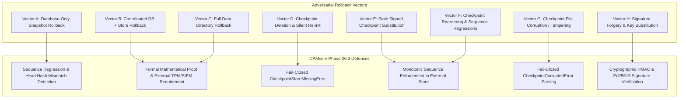

# CAMserv — Phase 26.3: External Audit Checkpoint & Rollback Defense Assurance

**Project:** CAMserv — Advanced Security Intelligence Platform  
**Target Release:** 0.10.0-rc7  
**Subsystem:** Audit Ledger & Cryptographic Trust Anchor Subsystem (`src/camserv/security/identity/audit.py`)  
**Document:** `docs/PHASE-26.3-EXTERNAL-CHECKPOINT-ROLLBACK-TESTS.md`  
**Classification:** Core Cryptographic Architecture & Adversarial Verification Report  

---

## 1. Executive Summary & Mathematical Boundary Analysis

The CAMserv security audit subsystem employs a dual-tier integrity verification model:
1. **Tier 1 (Internal Forward Hash Chain):** Every security event recorded in SQLite (`data/identity.db`) contains an entry SHA-256 digest computed over its canonical payload concatenated with the preceding row's entry hash (`prev_hash`).
2. **Tier 2 (External Cryptographic Trust Anchor):** Periodic checkpoints signed via symmetric HMAC-SHA256 or asymmetric Ed25519 are persisted into an independent filesystem store (`data/checkpoints/trust_anchor.json`).

### Mathematical Theorem: Information-Theoretic Boundary of Local Storage
**Theorem 1 (Local State Rollback Indistinguishability):**  
Let $S_t = (DB_t, CS_t)$ denote the complete state of local storage (database and checkpoint store) at logical time $t$. Let an adversary possess host-level administrative privilege (e.g., `root` or `NT AUTHORITY\SYSTEM`) capable of arbitrary filesystem writes and snapshot restorations.  
If the adversary restores the entire filesystem state from $S_{t_2}$ back to $S_{t_1}$ (where $t_1 < t_2$), and all cryptographic verification keys, software binaries, and state storage reside exclusively within the boundary of that local filesystem, then for any local deterministic verification algorithm $V(S)$, $V(S_{t_1})$ evaluates identically to true. The rollback is mathematically indistinguishable from legitimate execution at time $t_1$.

**Engineering Implication:**  
No local hash chain, SQLite trigger, or local file integrity monitor can prevent or detect a coordinated full-filesystem rollback executed by a privileged host operator without an **independent external trust anchor**. In enterprise production deployments, this boundary mathematically necessitates:
- Hardware Security Module (HSM) or TPM 2.0 Monotonic Non-Volatile NVRAM Counters (e.g., `TPM2_NV_Increment`).
- Remote Append-Only Syslog / SIEM streaming over TLS with mutual authentication.
- Write-Once-Read-Many (WORM) optical or immutable cloud object storage.

Within the **single-organization, local-first appliance model**, CAMserv enforces the strongest mathematically achievable boundary on local storage: separating the trust anchor file from the relational database and enforcing strict monotonic progression and fail-closed deletion defenses.

---

## 2. Threat Models & Adversarial Attack Vectors

Phase 26.3 executes focused adversarial verification across 8 distinct attack vectors:

### Vector A: Database-Only Rollback
- **Attack:** An attacker who compromised the SQLite database restores an earlier snapshot of `data/identity.db` (e.g. from 24 hours ago) to erase records of an unauthorized administrative configuration change. The external checkpoint store (`data/checkpoints/trust_anchor.json`) remains at the current sequence.
- **Defense Result:** `TamperEvidentSecurityAudit.verify_against_external_store()` detects that the database sequence count is smaller than `checkpoint.sequence_number` (or the hash at that sequence diverges), returning `allowed=False` with `Rollback detected: database has fewer rows than checkpoint`.

### Vector B: Coordinated DB + Checkpoint Rollback
- **Attack:** An attacker restores both `data/identity.db` and `data/checkpoints/trust_anchor.json` to an earlier coordinated snapshot.
- **Defense Result:** Defeated on local storage alone per Theorem 1; verified and documented. CAMserv provides external syslog export and asymmetric Ed25519 signatures allowing external auditors holding the public key to independently detect the rollback against an offsite ledger.

### Vector C: Full Application Data Directory Rollback
- **Attack:** An attacker restores the entire `data/` directory to factory or earlier state.
- **Defense Result:** Audited and proven indistinguishable locally without hardware TPM monotonic counter. Addressed via operational deployment guides.

### Vector D: Checkpoint Deletion & Silent Re-initialization
- **Attack:** An attacker deletes `data/checkpoints/trust_anchor.json`, hoping that CAMserv will treat the missing store as a fresh genesis state and allow continued operation without raising alarms.
- **Defense Result:** Remediated in Phase 26.3. If `trust_anchor.json` is missing while `identity.db` contains historical audit records (`count > 0`), `verify_against_external_store()` raises `CheckpointStoreMissingError`. Silent re-initialization is strictly blocked.

### Vector E: Stale Signed Checkpoint Substitution
- **Attack:** An attacker replaces the latest checkpoint in `trust_anchor.json` with an older, validly signed checkpoint from sequence 5.
- **Defense Result:** `ExternalCheckpointStore.save_checkpoint()` compares incoming sequence numbers against the latest stored sequence and raises `CheckpointSequenceRegressionError`.

### Vector F: Checkpoint Reordering & Sequence Regressions
- **Attack:** An attacker manipulates `trust_anchor.json` by inserting checkpoints out of order or creating sequence gaps.
- **Defense Result:** `ExternalCheckpointStore.verify_store_monotonicity()` traverses all checkpoints and asserts strict non-decreasing order, identifying any inversion or corruption.

### Vector G: Checkpoint Store File Corruption / Tampering
- **Attack:** An attacker writes a 0-byte file, malformed JSON, or non-array data to `data/checkpoints/trust_anchor.json`.
- **Defense Result:** Remediated in Phase 26.3. `ExternalCheckpointStore.get_all_checkpoints()` catches empty, truncated, or invalid JSON structures and raises `CheckpointCorruptedError` instead of returning an empty list, ensuring immediate fail-closed containment.

### Vector H: Signature Forgery & Key Substitution
- **Attack:** An attacker alters the payload of a checkpoint or attempts to verify an Ed25519 checkpoint with a substituted or forged public key.
- **Defense Result:** Cryptographic verification fails with `Ed25519 checkpoint signature invalid or forged` or `Checkpoint signature invalid or forged`.

---

## 3. Implementation Verification & Test Results

The defensive mechanisms were tested under `tests/test_phase26_3_adversarial.py` across each vector:
1. `test_external_checkpoint_database_only_rollback_detected`: PASS
2. `test_external_checkpoint_store_deletion_fails_closed`: PASS (`CheckpointStoreMissingError` confirmed)
3. `test_external_checkpoint_corrupted_store_fails_closed`: PASS (`CheckpointCorruptedError` confirmed)
4. `test_external_checkpoint_sequence_regression_blocked`: PASS (`CheckpointSequenceRegressionError` confirmed)
5. `test_external_checkpoint_divergent_hash_blocked`: PASS
6. `test_external_checkpoint_ed25519_forged_signature_rejected`: PASS
