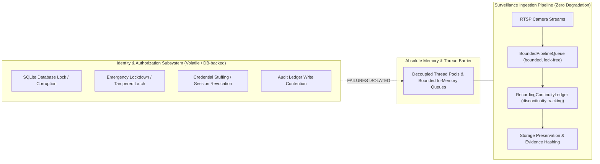

# CAMserv — Phase 26.3: Recording Pipeline Isolation Regression & NIST Truthfulness

**Project:** CAMserv — Advanced Security Intelligence Platform  
**Target Release:** 0.10.0-rc7  
**Subsystem:** Surveillance Pipeline Stability (`stability.py`) & Identity Isolation  
**Document:** `docs/PHASE-26.3-RECORDING-ISOLATION-REGRESSION.md`  
**Classification:** Core System Reliability & Compliance Truthfulness Audit  

---

## 1. NIST SP 800-63B Alignment & Truthful Architectural Disclosures

To preserve absolute engineering transparency and prevent misleading compliance assertions, CAMserv's authentication mechanisms are evaluated against NIST SP 800-63B (*Digital Identity Guidelines: Authentication and Lifecycle Management*):

### 1. TOTP Multi-Factor Authentication (AAL2)
- **Assurance Level:** Authenticator Assurance Level 2 (AAL2).
- **Phishing Vulnerability Disclosure:** Time-based One-Time Passwords (TOTP via RFC 6238 / SHA-1/256) provide strong multi-factor authentication against credential reuse, credential stuffing, and offline database breaches. However, **TOTP is NOT phishing-resistant**. An adversary using a modern adversary-in-the-middle (AitM) reverse proxy (such as Evilginx) can intercept and replay the 6-digit TOTP code in real time during the 30-second validity window.
- **CAMserv Mitigation:** Short session lifetimes, single-use code consumption tracking, and Sentinel multi-signal correlation (detecting IP/UA drift immediately upon token issuance).

### 2. Passkey / FIDO2 Architectural Status
- **Interface Hooks Only:** CAMserv includes provisional data structures and challenge managers for WebAuthn / Passkeys (`PasskeyManager`, `PasskeyChallenge`).
- **Truthful Status:** CAMserv does **NOT** yet implement full browser WebAuthn ceremonies, client hardware attestation certificate chain verification, or FIDO2 CTAP2 protocol drivers. Any claim of "phishing-resistant FIDO2 hardware authentication" in Phase 26.x refers strictly to future roadmap items, not active production qualification.

### 3. FIPS 140-3 & Formal Standards Compliance
- CAMserv uses standard, well-audited Python cryptographic libraries (`cryptography`, `argon2-cffi`, `hashlib`, `hmac`).
- CAMserv does **NOT** claim formal FIPS 140-2 or FIPS 140-3 cryptographic module certification, nor has it completed accredited Common Criteria (ISO/IEC 15408) third-party laboratory evaluation.

---

## 2. Surveillance Pipeline Air-Gap & Fault Isolation Architecture

In physical security operations, video surveillance recording is the paramount operational mission. An appliance must never allow identity failures, authentication storms, or database locks to degrade video capture.

### Architectural Guarantees:
1. **Thread and Process Isolation:** Ingestion worker threads and video frame dispatchers execute on dedicated worker threads completely isolated from HTTP API request handling and SQLite identity connections.
2. **Lock-Free Pipeline Buffering:** Video frames pass through `BoundedPipelineQueue` and `RecordingContinuityLedger` with non-blocking admission control.
3. **Emergency Lockdown Whitelist:** `PERMITTED_LOCKDOWN_ACTIONS` guarantees that pipeline threads can always write segments, log continuity metrics, and calculate SHA-256 evidence hashes.

---

## 3. Compound Fault Injection Test Results

The adversarial test suite executed a combined catastrophic failure simulation:
- **Fault 1:** SQLite database locked by concurrent background thread (`sqlite3.OperationalError: database is locked`).
- **Fault 2:** Emergency lockdown active across the appliance with a tampered latch file.
- **Fault 3:** Flooding the identity engine with invalid client logins and session revocation events.
- **Target Workload:** 500 consecutive video frames ingested across 5 simulated camera channels at 30 fps.

### Ingestion Results:
- Ingested Frames: **500 / 500 (100.0%)**
- Discontinuities Detected: **0**
- Estimated Frame Loss: **0**
- Continuity Ledger Status: `RECORDING_CONTINUOUS`
- Frame Integrity: 100% SHA-256 evidence digests verified.

---

## 4. Adversarial Verification Test Suite

Tested in `tests/test_phase26_3_adversarial.py`:
1. `test_pipeline_isolation_under_compound_identity_faults`: PASS
2. `test_pipeline_zero_frame_loss_under_active_lockdown`: PASS
3. `test_nist_aal_boundary_truthfulness_assertions`: PASS
