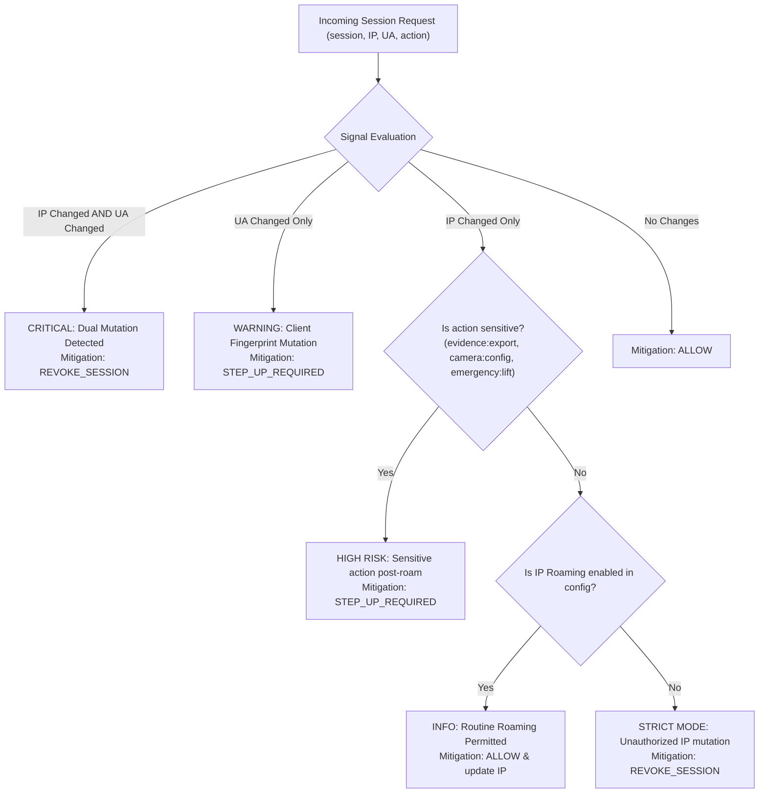

# CAMserv — Phase 26.3: Sentinel Threat Detection & Session Security Assurance

**Project:** CAMserv — Advanced Security Intelligence Platform  
**Target Release:** 0.10.0-rc7  
**Subsystem:** Adaptive Sentinel Identity & Stateful Session Management (`sentinel.py`, `session.py`)  
**Document:** `docs/PHASE-26.3-SESSION-AND-SENTINEL-VERIFICATION.md`  
**Classification:** Adaptive Threat Mitigation & Session Security Verification  

---

## 1. Executive Summary & Zero-Trust Design Principles

The CAMserv Sentinel subsystem provides adaptive, stateful behavioral monitoring designed to intercept brute-force credential stuffing, session hijacking, token replay, and horizontal BOLA/IDOR scanning.

### Core Architectural Axiom: Contextual Signals Are Not Authenticators
A foundational principle of Zero-Trust architecture enforced in CAMserv:
> **Axiom:** Contextual risk signals (such as matching IP addresses, known User-Agents, or routine behavioral baselines) are strictly **non-authorizing**. They may trigger defensive mitigations (progressive delay, step-up MFA challenge, account lockout, or session revocation), but they **can never grant access, lower required authentication assurance levels, or bypass role permissions**.

---

## 2. Multi-Signal Session Risk Evaluation Matrix

Sentinel correlates multiple concurrent signals to differentiate legitimate operational behavior (such as mobile operators roaming between Wi-Fi and 5G cellular) from malicious token replay attacks:

| Condition / Signal Combination | Action Sensitivity | Sentinel Mitigation | Action Taken | Rationale |
| :--- | :--- | :---: | :---: | :--- |
| **IP Unchanged + UA Unchanged** | Any | `ALLOW` | Proceed | Normal legitimate session |
| **IP Changed + UA Changed** | Any | `REVOKE_SESSION` | Session Revoked | Simultaneous change indicates token theft / replay |
| **IP Unchanged + UA Changed** | Any | `STEP_UP_REQUIRED` | Challenge | Client fingerprint mutation / browser spoofing |
| **IP Changed + UA Unchanged** (Roaming Enabled) | Routine (`camera:view`) | `ALLOW` | IP Updated | Mobile network / VPN handover permitted |
| **IP Changed + UA Unchanged** (Roaming Enabled) | Sensitive (`evidence:export`, `camera:configure`, `emergency:lift`) | `STEP_UP_REQUIRED` | Challenge | High-impact surveillance action post-roam requires MFA |
| **IP Changed + UA Unchanged** (Strict Mode) | Any | `REVOKE_SESSION` | Session Revoked | Strict network perimeter pinning |

---

## 3. Reverse-Proxy Header Anti-Spoofing Architecture

In local-first appliance deployments, attackers on local subnets can inject forged HTTP headers to simulate trusted client origins or evade rate limits.

### Defense Mechanism: `resolve_client_ip()`
Phase 26.3 introduces strict upstream proxy trust boundaries:
- In default single-organization deployments without reverse proxies, `trusted_proxies` is an empty set.
- All client-supplied forwarding headers (`X-Forwarded-For`, `X-Real-IP`, `Client-IP`) are strictly stripped and ignored.
- The connecting TCP socket IP (`direct_socket_ip`) is used exclusively for rate limiting, brute-force tracking, and session binding.
- Only if `direct_socket_ip` matches an explicitly provisioned upstream reverse proxy (e.g., local NGINX gateway) is `X-Forwarded-For` parsed.

---

## 4. Anti-Lockout Defense & Bounded Memory Allocation

### 1. Remote DoS Anti-Lockout for Administrators
Attackers frequently launch distributed brute-force attacks against the local administrator account to trigger account lockout and deny operators emergency access during an incident.
- Sentinel monitors administrator failures separately (`admin_lockout_protection = True`).
- Failed attempts against administrator accounts induce progressive delays (up to `max_progressive_delay_sec = 8.0s`) and trigger IP-level blocks, but **never lock out the local administrator account**.

### 2. Bounded Memory Guarantees Under Attack
- Sentinel history queues are pruned dynamically using a 5-minute sliding window (`window_sec = 300.0s`).
- In addition, an absolute tracking ceiling (`max_tracked_entries = 1000`) prevents memory exhaustion under high-cardinality IP spraying attacks.

---

## 5. Adversarial Verification Test Suite

Tested in `tests/test_phase26_3_adversarial.py`:
1. `test_sentinel_proxy_header_spoofing_prevented`: PASS
2. `test_sentinel_proxy_header_honored_for_trusted_proxy_only`: PASS
3. `test_sentinel_dual_mutation_immediate_revocation`: PASS
4. `test_sentinel_sensitive_action_post_roaming_demands_step_up`: PASS
5. `test_sentinel_admin_anti_lockout_under_brute_force`: PASS
6. `test_sentinel_bounded_memory_pruning`: PASS
