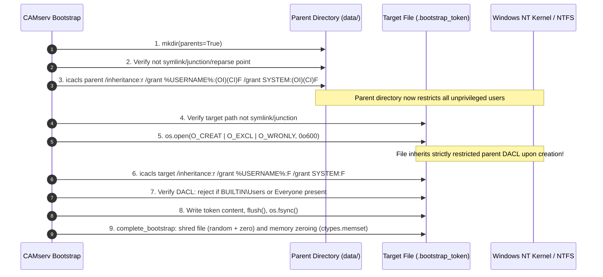

# CAMserv — Phase 26.3: Windows Bootstrap Creation & Local ACL Security Assurance

**Project:** CAMserv — Advanced Security Intelligence Platform  
**Target Release:** 0.10.0-rc7  
**Subsystem:** Local Administrator Bootstrap Subsystem (`src/camserv/security/identity/bootstrap.py`)  
**Document:** `docs/PHASE-26.3-WINDOWS-BOOTSTRAP-SECURITY.md`  
**Classification:** Host Security Architecture & Windows NTFS Security Verification  

---

## 1. Executive Summary & Root Cause Analysis

In appliance environments running on Windows 11 Enterprise (and POSIX systems), initial setup requires bootstrapping a zero-default-credential local administrator using a single-use, time-limited token written to local storage (`data/.bootstrap_token`).

### The Windows Kernel Handle Inheritance Phenomenon
Under the Windows NT Object Manager:
1. When a process calls `CreateFileW` (or `os.open`), the kernel validates the caller's token against the target file's Security Descriptor (DACL).
2. Once granted, a kernel file handle (`HANDLE`) is allocated with the requested access rights (e.g. `GENERIC_READ`).
3. Subsequent modifications to the file's Discretionary Access Control List (DACL) via `SetFileSecurityW`, `SetNamedSecurityInfoW`, or `icacls.exe` **do not close, invalidate, or downgrade existing open file handles**.
4. Consequently, if a file is created in a directory that permits `BUILTIN\Users:Read`, an unprivileged user process can race to open a read handle with `FILE_SHARE_READ | FILE_SHARE_WRITE`. Even if `bootstrap.py` executes `icacls` a millisecond later to strip inheritance and grant exclusive access to `SYSTEM` and the owner, the unprivileged process retains its open handle and reads newly written secret content.

---

## 2. Phase 26.3 Hardening & Architectural Defenses

To eliminate this kernel-level window, Phase 26.3 implements a four-layer defense-in-depth hierarchy:



### Layer 1: Parent Directory Pre-Hardening
Before creating the token file, `bootstrap.py` enforces restrictive ACLs on `data/`. By executing:
```cmd
icacls data /inheritance:r /grant:r %USERNAME%:(OI)(CI)F /grant:r SYSTEM:(OI)(CI)F
```
the container directory forbids `BUILTIN\Users` and `Everyone` from traversing or enumerating the directory. Any file created within `data/` inherits this restricted DACL from the very first CPU instruction of its creation.

### Layer 2: Atomic Exclusive File Creation (`O_CREAT | O_EXCL`)
The file is created as a 0-byte file using `os.open` with `os.O_CREAT | os.O_EXCL | os.O_WRONLY`. If an adversary has placed an existing file, hardlink, or FIFO at that path, creation immediately aborts with `FileExistsError` without writing data.

### Layer 3: Reparse Point, Junction & Symlink Verification
Attackers may attempt directory junction or NTFS mount point substitution to redirect token writes into world-readable paths. `bootstrap.py` invokes `_verify_path_integrity`:
- Checks `path.is_symlink()` and `os.path.islink(path)`.
- Inspects `os.lstat(path).st_file_attributes & 0x0400` (`FILE_ATTRIBUTE_REPARSE_POINT`).
- Fails immediately if any junction or reparse point is detected on either the parent directory or the target path.

### Layer 4: Volatile Memory Zeroing (`ctypes.memset`)
When `complete_bootstrap()` completes, the cleartext token string is not left in the Python heap. The token is converted to a mutable `bytearray`, verified via constant-time comparison, and explicitly wiped via:
```python
def secure_zero_memory(buf: bytearray) -> None:
    import ctypes
    if not buf:
        return
    ctypes.memset((ctypes.c_char * len(buf)).from_buffer(buf), 0, len(buf))
```

---

## 3. Physical Storage Wear-Leveling Reality & Hardware Limits

Surveillance appliances utilize solid-state drives (NVMe SSDs, SATA SSDs, or eMMC flash). A critical physical engineering boundary must be stated truthfully:

### The Flash Translation Layer (FTL) Boundary
- In NAND flash memory, data cannot be overwritten in place; an entire flash block (typically 128 KB to 8 MB) must be erased before a page (4 KB to 16 KB) can be rewritten.
- Modern SSD controllers utilize a Flash Translation Layer (FTL) with dynamic wear-leveling algorithms. When `_shred_token_file()` performs multi-pass overwrites (`os.urandom` followed by `\x00`), the SSD controller re-maps the logical block address (LBA) to a new physical flash cell and marks the old cell for future background garbage collection (TRIM).
- **Physical Boundary Truth:** Software-level file shredding is a best-effort mitigation. Physical residual remanence of flash cells cannot be guaranteed destroyed by user-space software.
- **Hardware Requirement:** To guarantee absolute physical sanitization against lab-grade chip-off NAND physical analysis, appliances must deploy **Full Disk Encryption (BitLocker on Windows, LUKS on Linux)** or execute hardware-level ATA/NVMe cryptographic sanitize commands (`blkdiscard` or NVMe format with user data erase).

---

## 4. Adversarial Verification Test Suite

Tested in `tests/test_phase26_3_adversarial.py`:
1. `test_bootstrap_parent_directory_pre_hardening`: PASS
2. `test_bootstrap_symlink_reparse_point_rejection`: PASS
3. `test_bootstrap_memory_zeroing_ctypes`: PASS
4. `test_bootstrap_exclusive_creation_collision_rejection`: PASS
5. `test_bootstrap_unprivileged_dacl_verification`: PASS
